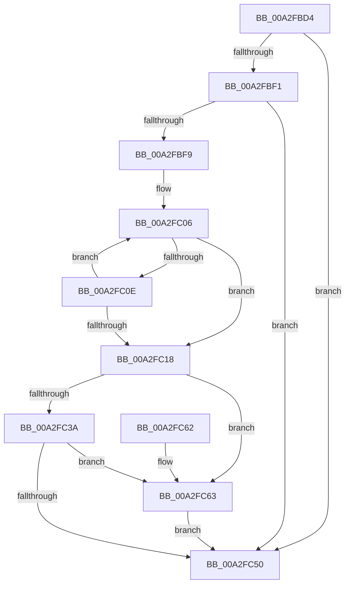

# EtwpAppStateChangeSummaryShouldLogCommandLine

- RVA: `0x00A2FBD4`–`0x00A2FC67` (길이 `147` bytes)
- VA: `0x0000000140A2FBD4`
- 실행 섹션: `PAGE`
- PDB 이름 있음: `예`; PDB Function 태그: `예`
- unwind 정보 RVA: `0x00088864`
- 디코드: `46`개 명령, `147/147` bytes 표시
- 미해석 바이트: `0` (있으면 어셈블리에 `.byte`로 보존)

> 이 문서는 커널 이미지의 기계어와 PDB 기호를 분석해 생성했습니다. 4번과 5번은 함수 원형과 자료형을 바이너리 사용 방식에서 추정한 C 해석이며 원본 소스 복구 결과는 아닙니다.

## 1. Dependencies

- 직접 호출 지점: **2**; 고유 호출 대상: **1**
- 직접 호출자로 확인된 함수: **2**
- RIP 상대 이미지 참조: **2**

### Outgoing calls
- `0x00A2FC31` → [wcsnicmp](../../text/50/wcsnicmp_function_005001C0.md) (function, `0x005001C0`)
- `0x00A2FC47` → [wcsnicmp](../../text/50/wcsnicmp_function_005001C0.md) (function, `0x005001C0`)

### Direct callers
- [EtwTraceProcess](../8A/EtwTraceProcess_function_008A4004.md) at `0x008A410A`
- [EtwTraceAppStateChange](../8A/EtwTraceAppStateChange_function_008A452C.md) at `0x008A470C`

### Static image references
- `0x00A2FC21` → RVA `0x00B075D0` (` ?? ::NNGAKEGL::`string'`; read)
- `0x00A2FC3D` → RVA `0x00B075B0` (` ?? ::NNGAKEGL::`string'`; read)

## 2. Other-region calls and transfers

- 다른 실행 섹션으로 향하는 call: **2**
  - `0x00A2FC31` → [wcsnicmp](../../text/50/wcsnicmp_function_005001C0.md) (`PAGE` → `.text`)
  - `0x00A2FC47` → [wcsnicmp](../../text/50/wcsnicmp_function_005001C0.md) (`PAGE` → `.text`)
- 별도 외부 분기/꼬리 이동을 확인하지 못했습니다.

## 3. Assembly (complete function range)

```asm
00A2FBD4  48 89 5C 24 08                  mov qword ptr [rsp + 8], rbx
00A2FBD9  48 89 74 24 10                  mov qword ptr [rsp + 0x10], rsi
00A2FBDE  57                              push rdi
00A2FBDF  48 83 EC 20                     sub rsp, 0x20
00A2FBE3  48 8B 81 50 03 00 00            mov rax, qword ptr [rcx + 0x350]
00A2FBEA  33 DB                           xor ebx, ebx
00A2FBEC  48 85 C0                        test rax, rax
00A2FBEF  74 5F                           je 0x140a2fc50
00A2FBF1  0F B7 08                        movzx ecx, word ptr [rax]
00A2FBF4  66 85 C9                        test cx, cx
00A2FBF7  74 57                           je 0x140a2fc50
00A2FBF9  48 8B 50 08                     mov rdx, qword ptr [rax + 8]
00A2FBFD  8B F9                           mov edi, ecx
00A2FBFF  48 D1 EF                        shr rdi, 1
00A2FC02  48 8D 04 7A                     lea rax, [rdx + rdi*2]
00A2FC06  48 8B F0                        mov rsi, rax
00A2FC09  48 3B C2                        cmp rax, rdx
00A2FC0C  74 0A                           je 0x140a2fc18
00A2FC0E  48 83 E8 02                     sub rax, 2
00A2FC12  66 83 38 5C                     cmp word ptr [rax], 0x5c
00A2FC16  75 EE                           jne 0x140a2fc06
00A2FC18  48 8B C6                        mov rax, rsi
00A2FC1B  48 8B CE                        mov rcx, rsi
00A2FC1E  48 2B C2                        sub rax, rdx
00A2FC21  48 8D 15 A8 79 0D 00            lea rdx, [rip + 0xd79a8]
00A2FC28  48 D1 F8                        sar rax, 1
00A2FC2B  48 2B F8                        sub rdi, rax
00A2FC2E  4C 8B C7                        mov r8, rdi
00A2FC31  E8 8A 05 AD FF                  call 0x1405001c0
00A2FC36  85 C0                           test eax, eax
00A2FC38  74 29                           je 0x140a2fc63
00A2FC3A  4C 8B C7                        mov r8, rdi
00A2FC3D  48 8D 15 6C 79 0D 00            lea rdx, [rip + 0xd796c]
00A2FC44  48 8B CE                        mov rcx, rsi
00A2FC47  E8 74 05 AD FF                  call 0x1405001c0
00A2FC4C  85 C0                           test eax, eax
00A2FC4E  74 13                           je 0x140a2fc63
00A2FC50  48 8B 74 24 38                  mov rsi, qword ptr [rsp + 0x38]
00A2FC55  8A C3                           mov al, bl
00A2FC57  48 8B 5C 24 30                  mov rbx, qword ptr [rsp + 0x30]
00A2FC5C  48 83 C4 20                     add rsp, 0x20
00A2FC60  5F                              pop rdi
00A2FC61  C3                              ret
00A2FC62  CC                              int3
00A2FC63  B3 01                           mov bl, 1
00A2FC65  EB E9                           jmp 0x140a2fc50
```

## 4. C-style interpretation (structured pseudocode)

```c
__int64 __fastcall EtwpAppStateChangeSummaryShouldLogCommandLine(__int64 a1)
{
    __int64 result;
    __int64 v_rbx;
    __int64 v_rdi;
    __int64 v_rsp;
    unsigned __int64 v_stack_p10;
    unsigned __int64 v_stack_p8;

    v_stack_p8 = v_rbx;
    v_stack_p10 = v_rsi;
    v_rsp = (v_rsp) - (32);
    v_rbx = 0;
    if (*(unsigned __int64 *)(a1 + 848) == 0) goto loc_00A2FC50;
    if ((unsigned __int16)(*(unsigned __int16 *)(*(unsigned __int64 *)(a1 + 848))) == 0) goto loc_00A2FC50;
    v_rdi = ((unsigned int)((unsigned int)(*(unsigned __int16 *)(*(unsigned __int64 *)(a1 + 848))))) >> (1);
loc_00A2FC06:
    if ((*(unsigned __int64 *)(*(unsigned __int64 *)(a1 + 848) + 8) + v_rdi * 2) == (*(unsigned __int64 *)(*(unsigned __int64 *)(a1 + 848) + 8))) goto loc_00A2FC18;
    result = (*(unsigned __int64 *)(*(unsigned __int64 *)(a1 + 848) + 8) + v_rdi * 2) - (2);
    if ((*(unsigned __int16 *)(result)) != 92) goto loc_00A2FC06;
loc_00A2FC18:
    result = (*(unsigned __int64 *)(*(unsigned __int64 *)(a1 + 848) + 8) + v_rdi * 2) - (*(unsigned __int64 *)(*(unsigned __int64 *)(a1 + 848) + 8));
    result = (result) >> (1);
    v_rdi = (v_rdi) - (result);
    result = wcsnicmp(*(unsigned __int64 *)(*(unsigned __int64 *)(a1 + 848) + 8) + v_rdi * 2, v_rip + 883112, v_rdi, a4);
    if ((unsigned int)(result) == 0) goto loc_00A2FC63;
    result = wcsnicmp(*(unsigned __int64 *)(*(unsigned __int64 *)(a1 + 848) + 8) + v_rdi * 2, v_rip + 883052, v_rdi, a4);
    if ((unsigned int)(result) == 0) goto loc_00A2FC63;
loc_00A2FC50:
    v_rsp = (v_rsp) + (32);
    return 0;
loc_00A2FC63:
    goto loc_00A2FC50;
}
```

## 5. (Beta) C Style

```c
int64_t EtwpAppStateChangeSummaryShouldLogCommandLine(void *Arg1)
{
    uint8_t *arg1 = (uint8_t *)Arg1;

    int64_t result;
    int64_t local_rbx;
    int64_t local_rdi;
    int64_t local_rsp;
    uint64_t v_stack_p10;
    uint64_t v_stack_p8;

    v_stack_p8 = local_rbx;
    v_stack_p10 = local_rsi;
    local_rsp = (local_rsp) - (32);
    local_rbx = 0;
    if (*(uint64_t *)(arg1 + 0x350) == 0) goto loc_00A2FC50;
    if ((uint16_t)(*(uint16_t *)(*(uint64_t *)(arg1 + 0x350))) == 0) goto loc_00A2FC50;
    local_rdi = ((uint32_t)((uint32_t)(*(uint16_t *)(*(uint64_t *)(arg1 + 0x350))))) >> (1);
loc_00A2FC06:
    if ((*(uint64_t *)(*(uint64_t *)(arg1 + 0x350) + 0x8) + local_rdi * 2) == (*(uint64_t *)(*(uint64_t *)(arg1 + 0x350) + 0x8))) goto loc_00A2FC18;
    result = (*(uint64_t *)(*(uint64_t *)(arg1 + 0x350) + 0x8) + local_rdi * 2) - (2);
    if ((*(uint16_t *)(result)) != 92) goto loc_00A2FC06;
loc_00A2FC18:
    result = (*(uint64_t *)(*(uint64_t *)(arg1 + 0x350) + 0x8) + local_rdi * 2) - (*(uint64_t *)(*(uint64_t *)(arg1 + 0x350) + 0x8));
    result = (result) >> (1);
    local_rdi = (local_rdi) - (result);
    result = wcsnicmp(*(uint64_t *)(*(uint64_t *)(arg1 + 0x350) + 0x8) + local_rdi * 2, v_rip + 883112, local_rdi, a4);
    if ((uint32_t)(result) == 0) goto loc_00A2FC63;
    result = wcsnicmp(*(uint64_t *)(*(uint64_t *)(arg1 + 0x350) + 0x8) + local_rdi * 2, v_rip + 883052, local_rdi, a4);
    if ((uint32_t)(result) == 0) goto loc_00A2FC63;
loc_00A2FC50:
    local_rsp = (local_rsp) + (32);
    return 0;
loc_00A2FC63:
    goto loc_00A2FC50;
}
```

### 관측된 메모리 오프셋

구조체 형식이 확인되지 않은 접근은 인자 기준의 오프셋으로만 기록했습니다.

| 기준 인자 | 오프셋 표현 | 폭 (bit) | 접근 |
|---|---:|---:|---|
| `Arg1` | `+ 0x350` | `64` | `R` |

## 6. Execution-region graph

[열기: 2D/3D 그래프와 함수 탐색 컨트롤 패널](../../../control-panel.html?section=page&rva=0x00A2FBD4&view=graph)

- 2D 그래프는 위에서 아래로 흐르고, 3D 그래프는 빈 공간을 드래그해 회전합니다. Shift+드래그는 이동, 휠은 확대·축소, 함수 노드 선택은 대상 보고서 이동입니다.

### Static fallback


