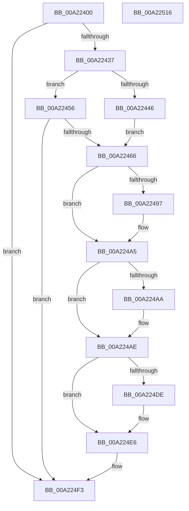

# EtwpCoverageSamplerUnloadImage

- RVA: `0x00A22400`–`0x00A22517` (길이 `279` bytes)
- VA: `0x0000000140A22400`
- 실행 섹션: `PAGE`
- PDB 이름 있음: `예`; PDB Function 태그: `아니요`
- unwind 정보 RVA: `0x00060300`
- 디코드: `71`개 명령, `279/279` bytes 표시
- 미해석 바이트: `0` (있으면 어셈블리에 `.byte`로 보존)

> 이 문서는 커널 이미지의 기계어와 PDB 기호를 분석해 생성했습니다. 4번과 5번은 함수 원형과 자료형을 바이너리 사용 방식에서 추정한 C 해석이며 원본 소스 복구 결과는 아닙니다.

## 1. Dependencies

- 직접 호출 지점: **8**; 고유 호출 대상: **8**
- 직접 호출자로 확인된 함수: **1**
- RIP 상대 이미지 참조: **1**

### Outgoing calls
- `0x00A2242A` → [EtwpCovSampAcquireSamplerRundown](../8D/EtwpCovSampAcquireSamplerRundown_function_008D7F7C.md) (function, `0x008D7F7C`)
- `0x00A22487` → [KeAbPreAcquire](../../text/21/KeAbPreAcquire_function_00210230.md) (function, `0x00210230`)
- `0x00A224A0` → [ExfAcquirePushLockExclusiveEx](../../text/20/ExfAcquirePushLockExclusiveEx_function_0020FC90.md) (function, `0x0020FC90`)
- `0x00A224C4` → [EtwpCovSampProcessRemoveModule](../8D/EtwpCovSampProcessRemoveModule_function_008D6B78.md) (function, `0x008D6B78`)
- `0x00A224E1` → [ExfTryToWakePushLock](../../text/26/ExfTryToWakePushLock_function_00265DD0.md) (function, `0x00265DD0`)
- `0x00A224E9` → [KeAbPostRelease](../../text/2E/KeAbPostRelease_function_002E1600.md) (function, `0x002E1600`)
- `0x00A224EE` → [KeLeaveCriticalRegion](../../text/25/KeLeaveCriticalRegion_function_0025D8B0.md) (function, `0x0025D8B0`)
- `0x00A224F8` → [EtwpCovSampReleaseSamplerRundown](../8D/EtwpCovSampReleaseSamplerRundown_function_008D7850.md) (function, `0x008D7850`)

### Direct callers
- [PerfLogImageUnload](PerfLogImageUnload_function_00A2216C.md) at `0x00A221D6`

### Static image references
- `0x00A22446` → RVA `0x00EFF1D8` (`.data`; read)

## 2. Other-region calls and transfers

- 다른 실행 섹션으로 향하는 call: **5**
  - `0x00A22487` → [KeAbPreAcquire](../../text/21/KeAbPreAcquire_function_00210230.md) (`PAGE` → `.text`)
  - `0x00A224A0` → [ExfAcquirePushLockExclusiveEx](../../text/20/ExfAcquirePushLockExclusiveEx_function_0020FC90.md) (`PAGE` → `.text`)
  - `0x00A224E1` → [ExfTryToWakePushLock](../../text/26/ExfTryToWakePushLock_function_00265DD0.md) (`PAGE` → `.text`)
  - `0x00A224E9` → [KeAbPostRelease](../../text/2E/KeAbPostRelease_function_002E1600.md) (`PAGE` → `.text`)
  - `0x00A224EE` → [KeLeaveCriticalRegion](../../text/25/KeLeaveCriticalRegion_function_0025D8B0.md) (`PAGE` → `.text`)
- 별도 외부 분기/꼬리 이동을 확인하지 못했습니다.

## 3. Assembly (complete function range)

```asm
00A22400  48 8B C4                        mov rax, rsp
00A22403  48 89 58 08                     mov qword ptr [rax + 8], rbx
00A22407  48 89 68 10                     mov qword ptr [rax + 0x10], rbp
00A2240B  48 89 70 18                     mov qword ptr [rax + 0x18], rsi
00A2240F  57                              push rdi
00A22410  41 56                           push r14
00A22412  41 57                           push r15
00A22414  48 83 EC 20                     sub rsp, 0x20
00A22418  48 83 60 20 00                  and qword ptr [rax + 0x20], 0
00A2241D  48 8B F1                        mov rsi, rcx
00A22420  48 8D 48 20                     lea rcx, [rax + 0x20]
00A22424  4D 8B F8                        mov r15, r8
00A22427  4C 8B F2                        mov r14, rdx
00A2242A  E8 4D 5B EB FF                  call 0x1408d7f7c
00A2242F  85 C0                           test eax, eax
00A22431  0F 88 BC 00 00 00               js 0x140a224f3
00A22437  48 B8 00 00 00 00 00 80 FF FF   movabs rax, 0xffff800000000000
00A22441  4C 3B F0                        cmp r14, rax
00A22444  72 10                           jb 0x140a22456
00A22446  48 8B 35 8B CD 4D 00            mov rsi, qword ptr [rip + 0x4dcd8b]
00A2244D  48 81 C6 F0 04 00 00            add rsi, 0x4f0
00A22454  EB 10                           jmp 0x140a22466
00A22456  48 8B B6 70 07 00 00            mov rsi, qword ptr [rsi + 0x770]
00A2245D  48 85 F6                        test rsi, rsi
00A22460  0F 84 8D 00 00 00               je 0x140a224f3
00A22466  65 48 8B 04 25 88 01 00 00      mov rax, qword ptr gs:[0x188]
00A2246F  48 8D 7E 08                     lea rdi, [rsi + 8]
00A22473  48 83 CB FF                     or rbx, 0xffffffffffffffff
00A22477  45 33 C0                        xor r8d, r8d
00A2247A  33 D2                           xor edx, edx
00A2247C  48 8B CF                        mov rcx, rdi
00A2247F  66 01 98 E4 01 00 00            add word ptr [rax + 0x1e4], bx
00A22486  90                              nop
00A22487  E8 A4 DD 7E FF                  call 0x140210230
00A2248C  F0 48 0F BA 2F 00               lock bts qword ptr [rdi], 0
00A22492  48 8B E8                        mov rbp, rax
00A22495  73 0E                           jae 0x140a224a5
00A22497  4C 8B C7                        mov r8, rdi
00A2249A  48 8B D0                        mov rdx, rax
00A2249D  48 8B CF                        mov rcx, rdi
00A224A0  E8 EB D7 7E FF                  call 0x14020fc90
00A224A5  48 85 ED                        test rbp, rbp
00A224A8  74 04                           je 0x140a224ae
00A224AA  C6 45 0A 01                     mov byte ptr [rbp + 0xa], 1
00A224AE  65 48 8B 04 25 88 01 00 00      mov rax, qword ptr gs:[0x188]
00A224B7  4D 8B C7                        mov r8, r15
00A224BA  49 8B D6                        mov rdx, r14
00A224BD  48 89 46 10                     mov qword ptr [rsi + 0x10], rax
00A224C1  48 8B CE                        mov rcx, rsi
00A224C4  E8 AF 46 EB FF                  call 0x1408d6b78
00A224C9  48 C7 46 10 00 00 00 00         mov qword ptr [rsi + 0x10], 0
00A224D1  F0 48 0F C1 1F                  lock xadd qword ptr [rdi], rbx
00A224D6  80 E3 06                        and bl, 6
00A224D9  80 FB 02                        cmp bl, 2
00A224DC  75 08                           jne 0x140a224e6
00A224DE  48 8B CF                        mov rcx, rdi
00A224E1  E8 EA 38 84 FF                  call 0x140265dd0
00A224E6  48 8B CF                        mov rcx, rdi
00A224E9  E8 12 F1 8B FF                  call 0x1402e1600
00A224EE  E8 BD B3 83 FF                  call 0x14025d8b0
00A224F3  48 8B 4C 24 58                  mov rcx, qword ptr [rsp + 0x58]
00A224F8  E8 53 53 EB FF                  call 0x1408d7850
00A224FD  48 8B 5C 24 40                  mov rbx, qword ptr [rsp + 0x40]
00A22502  48 8B 6C 24 48                  mov rbp, qword ptr [rsp + 0x48]
00A22507  48 8B 74 24 50                  mov rsi, qword ptr [rsp + 0x50]
00A2250C  48 83 C4 20                     add rsp, 0x20
00A22510  41 5F                           pop r15
00A22512  41 5E                           pop r14
00A22514  5F                              pop rdi
00A22515  C3                              ret
00A22516  CC                              int3
```

## 4. C-style interpretation (structured pseudocode)

```c
__int64 __fastcall EtwpCoverageSamplerUnloadImage(__int64 a1, __int64 a2, __int64 a3)
{
    __int64 result;
    __int64 v_rbx;
    __int64 v_rsi;
    __int64 v_rsp;
    unsigned __int64 v_stack_p10;
    unsigned __int64 v_stack_p18;
    unsigned __int64 v_stack_p20;
    unsigned __int64 v_stack_p8;

    *(unsigned __int64 *)(v_rsp + 8) = v_rbx;
    *(unsigned __int64 *)(v_rsp + 16) = v_rbp;
    *(unsigned __int64 *)(v_rsp + 24) = v_rsi;
    v_rsp = (v_rsp) - (32);
    result = EtwpCovSampAcquireSamplerRundown(v_rsp + 32, a2, a3, a4);
    if (sign_flag) goto loc_00A224F3;
    if (a2 < result) goto loc_00A22456;
    v_rsi = (*(unsigned __int64 *)(v_rip + 5098891)) + (0x4F0ULL);
    goto loc_00A22466;
loc_00A22456:
    if (*(unsigned __int64 *)(v_rsi + 1904) == 0) goto loc_00A224F3;
loc_00A22466:
    v_rbx = (v_rbx) | (-1);
    a3 = 0;
    a2 = 0;
    result = KeAbPreAcquire(*(unsigned __int64 *)(v_rsi + 1904) + 8, a2, a3, a4);
    if (!(condition_is_above_or_equal)) {
        a3 = *(unsigned __int64 *)(v_rsi + 1904) + 8;
        a2 = result;
        a1 = *(unsigned __int64 *)(v_rsi + 1904) + 8;
        result = ExfAcquirePushLockExclusiveEx(a1, a2, a3, a4);
    }
    if (result != 0) {
        *(unsigned __int8 *)(result + 10) = 1;
    }
    *(unsigned __int64 *)(*(unsigned __int64 *)(v_rsi + 1904) + 16) = *(unsigned __int64 *)(gs_base + (0 + 392));
    result = EtwpCovSampProcessRemoveModule(*(unsigned __int64 *)(v_rsi + 1904), a2, a3, a4);
    *(unsigned __int64 *)(*(unsigned __int64 *)(v_rsi + 1904) + 16) = 0;
    v_rbx = (unsigned __int8)((v_rbx) & (6));
    if (((unsigned __int8)(v_rbx)) == 2) {
        a1 = *(unsigned __int64 *)(v_rsi + 1904) + 8;
        result = ExfTryToWakePushLock(a1, a2, a3, a4);
    }
    result = KeAbPostRelease(*(unsigned __int64 *)(v_rsi + 1904) + 8, a2, a3, a4);
    result = KeLeaveCriticalRegion(*(unsigned __int64 *)(v_rsi + 1904) + 8, a2, a3, a4);
loc_00A224F3:
    result = EtwpCovSampReleaseSamplerRundown(v_stack_p20, a2, a3, a4);
    v_rsp = (v_rsp) + (32);
    return result;
}
```

## 5. (Beta) C Style

```c
int64_t EtwpCoverageSamplerUnloadImage(void *Arg1, int64_t Arg2, int64_t Arg3)
{
    uint8_t *arg1 = (uint8_t *)Arg1;

    int64_t result;
    int64_t local_rbx;
    int64_t local_rsi;
    int64_t local_rsp;
    uint64_t v_stack_p10;
    uint64_t v_stack_p18;
    uint64_t v_stack_p20;
    uint64_t v_stack_p8;

    *(uint64_t *)(local_rsp + 0x8) = local_rbx;
    *(uint64_t *)(local_rsp + 0x10) = local_rbp;
    *(uint64_t *)(local_rsp + 0x18) = local_rsi;
    local_rsp = (local_rsp) - (32);
    result = EtwpCovSampAcquireSamplerRundown(local_rsp + 32, Arg2, Arg3, a4);
    if (sign_flag) goto loc_00A224F3;
    if (Arg2 < result) goto loc_00A22456;
    local_rsi = (*(uint64_t *)(v_rip + 0x4DCD8B)) + (0x4F0ULL);
    goto loc_00A22466;
loc_00A22456:
    if (*(uint64_t *)(local_rsi + 0x770) == 0) goto loc_00A224F3;
loc_00A22466:
    local_rbx = (local_rbx) | (-1);
    Arg3 = 0;
    Arg2 = 0;
    result = KeAbPreAcquire(*(uint64_t *)(local_rsi + 0x770) + 8, Arg2, Arg3, a4);
    if (!(condition_is_above_or_equal)) {
        Arg3 = *(uint64_t *)(local_rsi + 0x770) + 8;
        Arg2 = result;
        Arg1 = *(uint64_t *)(local_rsi + 0x770) + 8;
        result = ExfAcquirePushLockExclusiveEx(Arg1, Arg2, Arg3, a4);
    }
    if (result != 0) {
        *(uint8_t *)(result + 0xA) = 1;
    }
    *(uint64_t *)(*(uint64_t *)(local_rsi + 0x770) + 0x10) = *(uint64_t *)(gs_base + (0 + 0x188));
    result = EtwpCovSampProcessRemoveModule(*(uint64_t *)(local_rsi + 0x770), Arg2, Arg3, a4);
    *(uint64_t *)(*(uint64_t *)(local_rsi + 0x770) + 0x10) = 0;
    local_rbx = (uint8_t)((local_rbx) & (6));
    if (((uint8_t)(local_rbx)) == 2) {
        Arg1 = *(uint64_t *)(local_rsi + 0x770) + 8;
        result = ExfTryToWakePushLock(Arg1, Arg2, Arg3, a4);
    }
    result = KeAbPostRelease(*(uint64_t *)(local_rsi + 0x770) + 8, Arg2, Arg3, a4);
    result = KeLeaveCriticalRegion(*(uint64_t *)(local_rsi + 0x770) + 8, Arg2, Arg3, a4);
loc_00A224F3:
    result = EtwpCovSampReleaseSamplerRundown(v_stack_p20, Arg2, Arg3, a4);
    local_rsp = (local_rsp) + (32);
    return result;
}
```

### 관측된 메모리 오프셋

구조체 형식이 확인되지 않은 접근은 인자 기준의 오프셋으로만 기록했습니다.

| 기준 인자 | 오프셋 표현 | 폭 (bit) | 접근 |
|---|---:|---:|---|
| `Arg1` | `+ 0x770` | `64` | `R` |

## 6. Execution-region graph

[열기: 2D/3D 그래프와 함수 탐색 컨트롤 패널](../../../control-panel.html?section=page&rva=0x00A22400&view=graph)

- 2D 그래프는 위에서 아래로 흐르고, 3D 그래프는 빈 공간을 드래그해 회전합니다. Shift+드래그는 이동, 휠은 확대·축소, 함수 노드 선택은 대상 보고서 이동입니다.

### Static fallback


