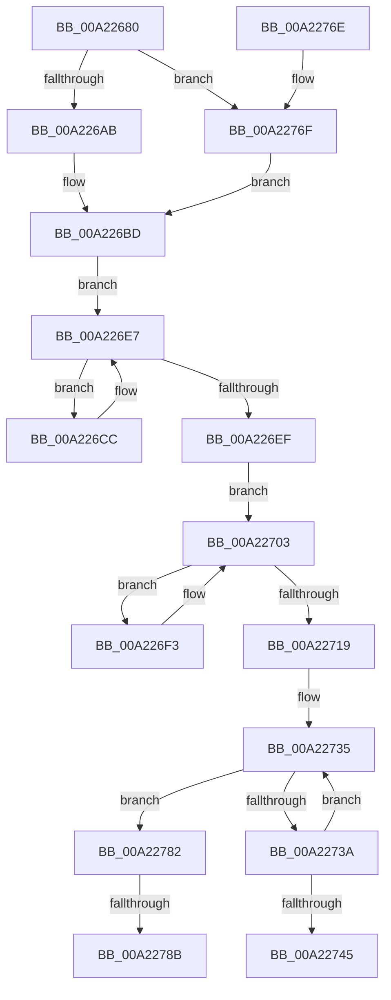

# EtwpDisableTraceProviders

- RVA: `0x00A22680`–`0x00A22798` (길이 `280` bytes)
- VA: `0x0000000140A22680`
- 실행 섹션: `PAGE`
- PDB 이름 있음: `예`; PDB Function 태그: `예`
- unwind 정보 RVA: `0x000AB5B0`
- 디코드: `76`개 명령, `280/280` bytes 표시
- 미해석 바이트: `0` (있으면 어셈블리에 `.byte`로 보존)

> 이 문서는 커널 이미지의 기계어와 PDB 기호를 분석해 생성했습니다. 4번과 5번은 함수 원형과 자료형을 바이너리 사용 방식에서 추정한 C 해석이며 원본 소스 복구 결과는 아닙니다.

## 1. Dependencies

- 직접 호출 지점: **8**; 고유 호출 대상: **5**
- 직접 호출자로 확인된 함수: **1**
- RIP 상대 이미지 참조: **3**

### Outgoing calls
- `0x00A226C2` → [EtwpGetNextGuidEntry](../8C/EtwpGetNextGuidEntry_function_008C3170.md) (function, `0x008C3170`)
- `0x00A226D4` → [EtwpClearSessionAndUnreferenceEntry](../8C/EtwpClearSessionAndUnreferenceEntry_function_008C1438.md) (function, `0x008C1438`)
- `0x00A226E2` → [EtwpGetNextGuidEntry](../8C/EtwpGetNextGuidEntry_function_008C3170.md) (function, `0x008C3170`)
- `0x00A226FB` → [EtwpClearSessionAndUnreferenceEntry](../8C/EtwpClearSessionAndUnreferenceEntry_function_008C1438.md) (function, `0x008C1438`)
- `0x00A2270C` → [EtwpGetNextGuidEntry](../8C/EtwpGetNextGuidEntry_function_008C3170.md) (function, `0x008C3170`)
- `0x00A2272D` → [KeWaitForSingleObject](../../text/20/KeWaitForSingleObject_function_0020E6B0.md) (function, `0x0020E6B0`)
- `0x00A2274E` → [KeReleaseMutex](../../text/39/KeReleaseMutex_function_00396810.md) (function, `0x00396810`)
- `0x00A2278D` → [EtwpDisablePerProcessTracing](../7B/EtwpDisablePerProcessTracing_function_007B8D60.md) (function, `0x007B8D60`)

### Direct callers
- [EtwpStopLoggerInstance](../9B/EtwpStopLoggerInstance_function_009BEB94.md) at `0x009BED85`

### Static image references
- `0x00A22699` → RVA `0x00FC6AA8` (`ALMOSTRO`; read)
- `0x00A22724` → RVA `0x00EFF220` (`.data`; read)
- `0x00A2276F` → RVA `0x00FC5008` (`ALMOSTRO`; read)

## 2. Other-region calls and transfers

- 다른 실행 섹션으로 향하는 call: **2**
  - `0x00A2272D` → [KeWaitForSingleObject](../../text/20/KeWaitForSingleObject_function_0020E6B0.md) (`PAGE` → `.text`)
  - `0x00A2274E` → [KeReleaseMutex](../../text/39/KeReleaseMutex_function_00396810.md) (`PAGE` → `.text`)
- call이 아닌 외부 분기/꼬리 이동: **2**
  - `0x00A22785` → [sub_00B37A78](../B3/Unknown_function_00B37A78.md) (`tail-transfer`)
  - `0x00A22793` → [sub_00B37A78](../B3/Unknown_function_00B37A78.md) (`tail-transfer`)

## 3. Assembly (complete function range)

```asm
00A22680  48 8B C4                        mov rax, rsp
00A22683  48 89 58 08                     mov qword ptr [rax + 8], rbx
00A22687  48 89 68 10                     mov qword ptr [rax + 0x10], rbp
00A2268B  48 89 70 18                     mov qword ptr [rax + 0x18], rsi
00A2268F  48 89 78 20                     mov qword ptr [rax + 0x20], rdi
00A22693  41 56                           push r14
00A22695  48 83 EC 30                     sub rsp, 0x30
00A22699  48 3B 0D 08 44 5A 00            cmp rcx, qword ptr [rip + 0x5a4408]
00A226A0  8B EA                           mov ebp, edx
00A226A2  48 8B F9                        mov rdi, rcx
00A226A5  0F 84 C4 00 00 00               je 0x140a2276f
00A226AB  48 8B 41 08                     mov rax, qword ptr [rcx + 8]
00A226AF  48 8B 98 08 05 00 00            mov rbx, qword ptr [rax + 0x508]
00A226B6  48 81 C3 26 02 00 00            add rbx, 0x226
00A226BD  45 33 C0                        xor r8d, r8d
00A226C0  33 D2                           xor edx, edx
00A226C2  E8 A9 0A EA FF                  call 0x1408c3170
00A226C7  45 33 F6                        xor r14d, r14d
00A226CA  EB 1B                           jmp 0x140a226e7
00A226CC  45 33 C0                        xor r8d, r8d
00A226CF  48 8B D6                        mov rdx, rsi
00A226D2  8B CD                           mov ecx, ebp
00A226D4  E8 5F ED E9 FF                  call 0x1408c1438
00A226D9  45 33 C0                        xor r8d, r8d
00A226DC  48 8B D6                        mov rdx, rsi
00A226DF  48 8B CF                        mov rcx, rdi
00A226E2  E8 89 0A EA FF                  call 0x1408c3170
00A226E7  48 8B F0                        mov rsi, rax
00A226EA  48 85 C0                        test rax, rax
00A226ED  75 DD                           jne 0x140a226cc
00A226EF  33 D2                           xor edx, edx
00A226F1  EB 10                           jmp 0x140a22703
00A226F3  41 B0 02                        mov r8b, 2
00A226F6  48 8B D6                        mov rdx, rsi
00A226F9  8B CD                           mov ecx, ebp
00A226FB  E8 38 ED E9 FF                  call 0x1408c1438
00A22700  48 8B D6                        mov rdx, rsi
00A22703  41 B8 02 00 00 00               mov r8d, 2
00A22709  48 8B CF                        mov rcx, rdi
00A2270C  E8 5F 0A EA FF                  call 0x1408c3170
00A22711  48 8B F0                        mov rsi, rax
00A22714  48 85 C0                        test rax, rax
00A22717  75 DA                           jne 0x140a226f3
00A22719  45 33 C9                        xor r9d, r9d
00A2271C  4C 89 74 24 20                  mov qword ptr [rsp + 0x20], r14
00A22721  45 33 C0                        xor r8d, r8d
00A22724  48 8D 0D F5 CA 4D 00            lea rcx, [rip + 0x4dcaf5]
00A2272B  33 D2                           xor edx, edx
00A2272D  E8 7E BF 7E FF                  call 0x14020e6b0
00A22732  41 8B FE                        mov edi, r14d
00A22735  40 38 2B                        cmp byte ptr [rbx], bpl
00A22738  74 48                           je 0x140a22782
00A2273A  FF C7                           inc edi
00A2273C  48 83 C3 02                     add rbx, 2
00A22740  83 FF 09                        cmp edi, 9
00A22743  72 F0                           jb 0x140a22735
00A22745  33 D2                           xor edx, edx
00A22747  48 8D 0D D2 CA 4D 00            lea rcx, [rip + 0x4dcad2]
00A2274E  E8 BD 40 97 FF                  call 0x140396810
00A22753  48 8B 5C 24 40                  mov rbx, qword ptr [rsp + 0x40]
00A22758  48 8B 6C 24 48                  mov rbp, qword ptr [rsp + 0x48]
00A2275D  48 8B 74 24 50                  mov rsi, qword ptr [rsp + 0x50]
00A22762  48 8B 7C 24 58                  mov rdi, qword ptr [rsp + 0x58]
00A22767  48 83 C4 30                     add rsp, 0x30
00A2276B  41 5E                           pop r14
00A2276D  C3                              ret
00A2276E  CC                              int3
00A2276F  48 8B 1D 92 28 5A 00            mov rbx, qword ptr [rip + 0x5a2892]
00A22776  48 81 C3 80 03 00 00            add rbx, 0x380
00A2277D  E9 3B FF FF FF                  jmp 0x140a226bd
00A22782  83 FF 01                        cmp edi, 1
00A22785  0F 87 ED 52 11 00               ja 0x140b37a78
00A2278B  8B CF                           mov ecx, edi
00A2278D  E8 CE 65 D9 FF                  call 0x1407b8d60
00A22792  90                              nop
00A22793  E9 E0 52 11 00                  jmp 0x140b37a78
```

## 4. C-style interpretation (structured pseudocode)

```c
__int64 __fastcall EtwpDisableTraceProviders(__int64 a1, int a2, int a3, int a4)
{
    __int64 result;
    __int64 v_r14;
    __int64 v_rbx;
    __int64 v_rdi;
    __int64 v_rsp;
    unsigned __int64 v_stack_m18;
    unsigned __int64 v_stack_p10;
    unsigned __int64 v_stack_p18;
    unsigned __int64 v_stack_p20;
    unsigned __int64 v_stack_p8;

    *(unsigned __int64 *)(v_rsp + 8) = v_rbx;
    *(unsigned __int64 *)(v_rsp + 16) = v_rbp;
    *(unsigned __int64 *)(v_rsp + 24) = v_rsi;
    *(unsigned __int64 *)(v_rsp + 32) = v_rdi;
    v_rsp = (v_rsp) - (48);
    if (a1 == (*(unsigned __int64 *)(v_rip + 5915656))) goto loc_00A2276F;
    v_rbx = (*(unsigned __int64 *)(*(unsigned __int64 *)(a1 + 8) + 1288)) + (550);
loc_00A226BD:
    a3 = 0;
    a2 = 0;
    result = EtwpGetNextGuidEntry(a1, a2, a3, a4);
    v_r14 = 0;
    goto loc_00A226E7;
loc_00A226CC:
    a3 = 0;
    result = EtwpClearSessionAndUnreferenceEntry((unsigned int)((unsigned int)((unsigned int)(a2))), v_rsi, a3, a4);
    a3 = 0;
    result = EtwpGetNextGuidEntry(a1, v_rsi, a3, a4);
loc_00A226E7:
    if (result != 0) goto loc_00A226CC;
    a2 = 0;
    goto loc_00A22703;
loc_00A226F3:
    result = EtwpClearSessionAndUnreferenceEntry((unsigned int)((unsigned int)((unsigned int)(a2))), result, 2, a4);
loc_00A22703:
    result = EtwpGetNextGuidEntry(a1, result, 2, a4);
    if (result != 0) goto loc_00A226F3;
    a4 = 0;
    v_stack_m18 = 0;
    a3 = 0;
    a2 = 0;
    result = KeWaitForSingleObject(v_rip + 5098229, a2, a3, a4);
loc_00A22735:
    if ((*(unsigned __int8 *)(v_rbx)) == ((unsigned __int8)((unsigned int)(a2)))) goto loc_00A22782;
    v_rdi = (unsigned int)((0) + 1);
    v_rbx = (v_rbx) + (2);
    if (((unsigned int)(v_rdi)) < 9) goto loc_00A22735;
    a2 = 0;
    result = KeReleaseMutex(v_rip + 5098194, a2, a3, a4);
    v_rsp = (v_rsp) + (48);
    return result;
loc_00A2276F:
    v_rbx = (*(unsigned __int64 *)(v_rip + 5908626)) + (896);
    goto loc_00A226BD;
loc_00A22782:
    result = EtwpDisablePerProcessTracing((unsigned int)((unsigned int)(v_stack_p20)), a2, a3, a4);
}
```

## 5. (Beta) C Style

```c
int64_t EtwpDisableTraceProviders(int64_t Arg1, int32_t Arg2, int32_t Arg3, int32_t Arg4)
{
    int64_t result;
    int64_t local_r14;
    int64_t local_rbx;
    int64_t local_rdi;
    int64_t local_rsp;
    uint64_t v_stack_m18;
    uint64_t v_stack_p10;
    uint64_t v_stack_p18;
    uint64_t v_stack_p20;
    uint64_t v_stack_p8;

    *(uint64_t *)(local_rsp + 0x8) = local_rbx;
    *(uint64_t *)(local_rsp + 0x10) = local_rbp;
    *(uint64_t *)(local_rsp + 0x18) = local_rsi;
    *(uint64_t *)(local_rsp + 0x20) = local_rdi;
    local_rsp = (local_rsp) - (48);
    if (Arg1 == (*(uint64_t *)(v_rip + 0x5A4408))) goto loc_00A2276F;
    local_rbx = (*(uint64_t *)(*(uint64_t *)(Arg1 + 0x8) + 0x508)) + (550);
loc_00A226BD:
    Arg3 = 0;
    Arg2 = 0;
    result = EtwpGetNextGuidEntry(Arg1, Arg2, Arg3, Arg4);
    local_r14 = 0;
    goto loc_00A226E7;
loc_00A226CC:
    Arg3 = 0;
    result = EtwpClearSessionAndUnreferenceEntry((uint32_t)((uint32_t)((uint32_t)(Arg2))), local_rsi, Arg3, Arg4);
    Arg3 = 0;
    result = EtwpGetNextGuidEntry(Arg1, local_rsi, Arg3, Arg4);
loc_00A226E7:
    if (result != 0) goto loc_00A226CC;
    Arg2 = 0;
    goto loc_00A22703;
loc_00A226F3:
    result = EtwpClearSessionAndUnreferenceEntry((uint32_t)((uint32_t)((uint32_t)(Arg2))), result, 2, Arg4);
loc_00A22703:
    result = EtwpGetNextGuidEntry(Arg1, result, 2, Arg4);
    if (result != 0) goto loc_00A226F3;
    Arg4 = 0;
    v_stack_m18 = 0;
    Arg3 = 0;
    Arg2 = 0;
    result = KeWaitForSingleObject(v_rip + 5098229, Arg2, Arg3, Arg4);
loc_00A22735:
    if ((*(uint8_t *)(local_rbx)) == ((uint8_t)((uint32_t)(Arg2)))) goto loc_00A22782;
    local_rdi = (uint32_t)((0) + 1);
    local_rbx = (local_rbx) + (2);
    if (((uint32_t)(local_rdi)) < 9) goto loc_00A22735;
    Arg2 = 0;
    result = KeReleaseMutex(v_rip + 5098194, Arg2, Arg3, Arg4);
    local_rsp = (local_rsp) + (48);
    return result;
loc_00A2276F:
    local_rbx = (*(uint64_t *)(v_rip + 0x5A2892)) + (896);
    goto loc_00A226BD;
loc_00A22782:
    result = EtwpDisablePerProcessTracing((uint32_t)((uint32_t)(v_stack_p20)), Arg2, Arg3, Arg4);
}
```

## 6. Execution-region graph

[열기: 2D/3D 그래프와 함수 탐색 컨트롤 패널](../../../control-panel.html?section=page&rva=0x00A22680&view=graph)

- 2D 그래프는 위에서 아래로 흐르고, 3D 그래프는 빈 공간을 드래그해 회전합니다. Shift+드래그는 이동, 휠은 확대·축소, 함수 노드 선택은 대상 보고서 이동입니다.

### Static fallback


