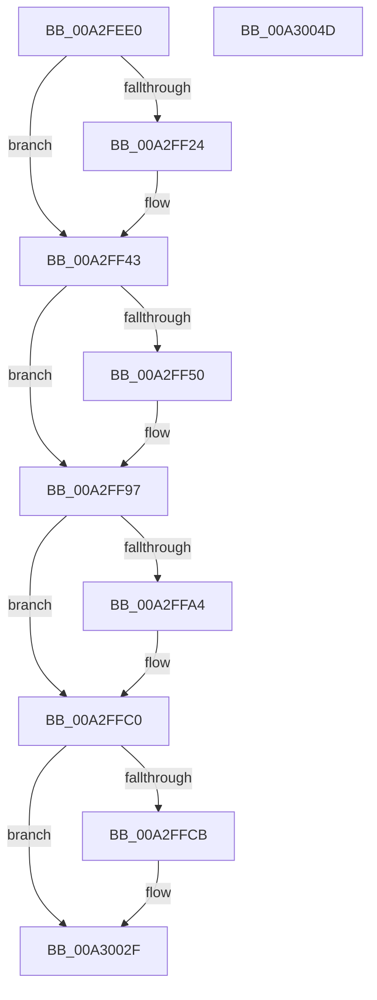

# EtwpTiParseContextRecord

- RVA: `0x00A2FEE0`–`0x00A3004E` (길이 `366` bytes)
- VA: `0x0000000140A2FEE0`
- 실행 섹션: `PAGE`
- PDB 이름 있음: `예`; PDB Function 태그: `아니요`
- unwind 정보 RVA: `0x0005E6B4`
- 디코드: `91`개 명령, `366/366` bytes 표시
- 미해석 바이트: `0` (있으면 어셈블리에 `.byte`로 보존)

> 이 문서는 커널 이미지의 기계어와 PDB 기호를 분석해 생성했습니다. 4번과 5번은 함수 원형과 자료형을 바이너리 사용 방식에서 추정한 C 해석이며 원본 소스 복구 결과는 아닙니다.

## 1. Dependencies

- 직접 호출 지점: **1**; 고유 호출 대상: **1**
- 직접 호출자로 확인된 함수: **1**
- RIP 상대 이미지 참조: **0**

### Outgoing calls
- `0x00A2FF0E` → [memset](../../text/6C/memset_function_006C6C40.md) (function, `0x006C6C40`)

### Direct callers
- [EtwTiLogSetContextThread](EtwTiLogSetContextThread_function_00A2FC70.md) at `0x00A2FE6B`

### Static image references
- 디코드된 RIP-relative 메모리 참조가 없습니다.

## 2. Other-region calls and transfers

- 다른 실행 섹션으로 향하는 call: **1**
  - `0x00A2FF0E` → [memset](../../text/6C/memset_function_006C6C40.md) (`PAGE` → `.text`)
- 별도 외부 분기/꼬리 이동을 확인하지 못했습니다.

## 3. Assembly (complete function range)

```asm
00A2FEE0  48 8B C4                        mov rax, rsp
00A2FEE3  48 89 58 08                     mov qword ptr [rax + 8], rbx
00A2FEE7  48 89 68 10                     mov qword ptr [rax + 0x10], rbp
00A2FEEB  48 89 70 18                     mov qword ptr [rax + 0x18], rsi
00A2FEEF  48 89 78 20                     mov qword ptr [rax + 0x20], rdi
00A2FEF3  41 56                           push r14
00A2FEF5  48 83 EC 20                     sub rsp, 0x20
00A2FEF9  45 33 F6                        xor r14d, r14d
00A2FEFC  49 8B F8                        mov rdi, r8
00A2FEFF  8B EA                           mov ebp, edx
00A2FF01  48 8B D9                        mov rbx, rcx
00A2FF04  33 D2                           xor edx, edx
00A2FF06  41 0F B7 F6                     movzx esi, r14w
00A2FF0A  45 8D 46 60                     lea r8d, [r14 + 0x60]
00A2FF0E  E8 2D 6D C9 FF                  call 0x1406c6c40
00A2FF13  B9 01 00 01 00                  mov ecx, 0x10001
00A2FF18  41 8D 56 01                     lea edx, [r14 + 1]
00A2FF1C  8B C5                           mov eax, ebp
00A2FF1E  23 C1                           and eax, ecx
00A2FF20  3B C1                           cmp eax, ecx
00A2FF22  75 1F                           jne 0x140a2ff43
00A2FF24  8B 87 B8 00 00 00               mov eax, dword ptr [rdi + 0xb8]
00A2FF2A  8B F2                           mov esi, edx
00A2FF2C  48 89 03                        mov qword ptr [rbx], rax
00A2FF2F  8B 87 C4 00 00 00               mov eax, dword ptr [rdi + 0xc4]
00A2FF35  48 89 43 08                     mov qword ptr [rbx + 8], rax
00A2FF39  8B 87 B4 00 00 00               mov eax, dword ptr [rdi + 0xb4]
00A2FF3F  48 89 43 18                     mov qword ptr [rbx + 0x18], rax
00A2FF43  B9 02 00 01 00                  mov ecx, 0x10002
00A2FF48  8B C5                           mov eax, ebp
00A2FF4A  23 C1                           and eax, ecx
00A2FF4C  3B C1                           cmp eax, ecx
00A2FF4E  75 47                           jne 0x140a2ff97
00A2FF50  8B 87 B0 00 00 00               mov eax, dword ptr [rdi + 0xb0]
00A2FF56  0F 57 C0                        xorps xmm0, xmm0
00A2FF59  48 89 43 20                     mov qword ptr [rbx + 0x20], rax
00A2FF5D  66 83 CE 02                     or si, 2
00A2FF61  8B 87 AC 00 00 00               mov eax, dword ptr [rdi + 0xac]
00A2FF67  48 89 43 28                     mov qword ptr [rbx + 0x28], rax
00A2FF6B  8B 87 A8 00 00 00               mov eax, dword ptr [rdi + 0xa8]
00A2FF71  48 89 43 30                     mov qword ptr [rbx + 0x30], rax
00A2FF75  8B 87 A4 00 00 00               mov eax, dword ptr [rdi + 0xa4]
00A2FF7B  48 89 43 38                     mov qword ptr [rbx + 0x38], rax
00A2FF7F  8B 87 A0 00 00 00               mov eax, dword ptr [rdi + 0xa0]
00A2FF85  48 89 43 40                     mov qword ptr [rbx + 0x40], rax
00A2FF89  8B 87 9C 00 00 00               mov eax, dword ptr [rdi + 0x9c]
00A2FF8F  48 89 43 48                     mov qword ptr [rbx + 0x48], rax
00A2FF93  0F 11 43 50                     movups xmmword ptr [rbx + 0x50], xmm0
00A2FF97  B9 01 00 10 00                  mov ecx, 0x100001
00A2FF9C  8B C5                           mov eax, ebp
00A2FF9E  23 C1                           and eax, ecx
00A2FFA0  3B C1                           cmp eax, ecx
00A2FFA2  75 1C                           jne 0x140a2ffc0
00A2FFA4  48 8B 87 F8 00 00 00            mov rax, qword ptr [rdi + 0xf8]
00A2FFAB  66 0B F2                        or si, dx
00A2FFAE  48 89 03                        mov qword ptr [rbx], rax
00A2FFB1  48 8B 87 98 00 00 00            mov rax, qword ptr [rdi + 0x98]
00A2FFB8  48 89 43 08                     mov qword ptr [rbx + 8], rax
00A2FFBC  4C 89 73 10                     mov qword ptr [rbx + 0x10], r14
00A2FFC0  B8 02 00 10 00                  mov eax, 0x100002
00A2FFC5  23 E8                           and ebp, eax
00A2FFC7  3B E8                           cmp ebp, eax
00A2FFC9  75 64                           jne 0x140a3002f
00A2FFCB  48 8B 87 A0 00 00 00            mov rax, qword ptr [rdi + 0xa0]
00A2FFD2  66 83 CE 02                     or si, 2
00A2FFD6  48 89 43 18                     mov qword ptr [rbx + 0x18], rax
00A2FFDA  48 8B 47 78                     mov rax, qword ptr [rdi + 0x78]
00A2FFDE  48 89 43 20                     mov qword ptr [rbx + 0x20], rax
00A2FFE2  48 8B 87 80 00 00 00            mov rax, qword ptr [rdi + 0x80]
00A2FFE9  48 89 43 28                     mov qword ptr [rbx + 0x28], rax
00A2FFED  48 8B 8F 88 00 00 00            mov rcx, qword ptr [rdi + 0x88]
00A2FFF4  48 89 4B 30                     mov qword ptr [rbx + 0x30], rcx
00A2FFF8  48 8B 8F 90 00 00 00            mov rcx, qword ptr [rdi + 0x90]
00A2FFFF  48 89 4B 38                     mov qword ptr [rbx + 0x38], rcx
00A30003  48 8B 8F A8 00 00 00            mov rcx, qword ptr [rdi + 0xa8]
00A3000A  48 89 4B 40                     mov qword ptr [rbx + 0x40], rcx
00A3000E  48 8B 8F B0 00 00 00            mov rcx, qword ptr [rdi + 0xb0]
00A30015  48 89 4B 48                     mov qword ptr [rbx + 0x48], rcx
00A30019  48 8B 8F B8 00 00 00            mov rcx, qword ptr [rdi + 0xb8]
00A30020  48 89 4B 50                     mov qword ptr [rbx + 0x50], rcx
00A30024  48 8B 8F C0 00 00 00            mov rcx, qword ptr [rdi + 0xc0]
00A3002B  48 89 4B 58                     mov qword ptr [rbx + 0x58], rcx
00A3002F  48 8B 5C 24 30                  mov rbx, qword ptr [rsp + 0x30]
00A30034  0F B7 C6                        movzx eax, si
00A30037  48 8B 74 24 40                  mov rsi, qword ptr [rsp + 0x40]
00A3003C  48 8B 6C 24 38                  mov rbp, qword ptr [rsp + 0x38]
00A30041  48 8B 7C 24 48                  mov rdi, qword ptr [rsp + 0x48]
00A30046  48 83 C4 20                     add rsp, 0x20
00A3004A  41 5E                           pop r14
00A3004C  C3                              ret
00A3004D  CC                              int3
```

## 4. C-style interpretation (structured pseudocode)

```c
__int64 __fastcall EtwpTiParseContextRecord(__int64 a1, int a2, __int64 a3)
{
    __int64 result;
    __int64 v_r14;
    __int64 v_rbp;
    __int64 v_rsi;
    __int64 v_rsp;
    unsigned __int64 v_stack_p10;
    unsigned __int64 v_stack_p18;
    unsigned __int64 v_stack_p20;
    unsigned __int64 v_stack_p8;

    *(unsigned __int64 *)(v_rsp + 8) = v_rbx;
    *(unsigned __int64 *)(v_rsp + 16) = v_rbp;
    *(unsigned __int64 *)(v_rsp + 24) = v_rsi;
    *(unsigned __int64 *)(v_rsp + 32) = v_rdi;
    v_rsp = (v_rsp) - (32);
    v_r14 = 0;
    a2 = 0;
    result = memset(a1, a2, v_r14 + 96, a4);
    result = (unsigned int)(((unsigned int)((unsigned int)((unsigned int)(a2)))) & ((unsigned int)((unsigned int)(0x10001ULL))));
    v_rsi = 0;
    if (((unsigned int)(result)) == ((unsigned int)((unsigned int)(0x10001ULL)))) {
        result = *(unsigned int *)(a3 + 184);
        v_rsi = (unsigned int)(v_r14 + 1);
        *(unsigned __int64 *)(a1) = result;
        result = *(unsigned int *)(a3 + 196);
        *(unsigned __int64 *)(a1 + 8) = result;
        result = *(unsigned int *)(a3 + 180);
        *(unsigned __int64 *)(a1 + 24) = result;
    }
    result = (unsigned int)(((unsigned int)((unsigned int)((unsigned int)(a2)))) & ((unsigned int)((unsigned int)(0x10002ULL))));
    if (((unsigned int)(result)) == ((unsigned int)((unsigned int)(0x10002ULL)))) {
        result = *(unsigned int *)(a3 + 176);
        *(unsigned __int64 *)(a1 + 32) = result;
        v_rsi = (unsigned __int16)((v_rsi) | (2));
        result = *(unsigned int *)(a3 + 172);
        *(unsigned __int64 *)(a1 + 40) = result;
        result = *(unsigned int *)(a3 + 168);
        *(unsigned __int64 *)(a1 + 48) = result;
        result = *(unsigned int *)(a3 + 164);
        *(unsigned __int64 *)(a1 + 56) = result;
        result = *(unsigned int *)(a3 + 160);
        *(unsigned __int64 *)(a1 + 64) = result;
        result = *(unsigned int *)(a3 + 156);
        *(unsigned __int64 *)(a1 + 72) = result;
        *(unsigned __int64 *)(a1 + 80) = v_xmm0;
    }
    result = (unsigned int)(((unsigned int)((unsigned int)((unsigned int)(a2)))) & ((unsigned int)((unsigned int)(0x100001ULL))));
    if (((unsigned int)(result)) == ((unsigned int)((unsigned int)(0x100001ULL)))) {
        result = *(unsigned __int64 *)(a3 + 248);
        v_rsi = (unsigned __int16)((v_rsi) | ((unsigned __int16)(v_r14 + 1)));
        *(unsigned __int64 *)(a1) = result;
        result = *(unsigned __int64 *)(a3 + 152);
        *(unsigned __int64 *)(a1 + 8) = result;
        *(unsigned __int64 *)(a1 + 16) = 0;
    }
    v_rbp = (unsigned int)(((unsigned int)(a2)) & ((unsigned int)((unsigned int)(0x100002ULL))));
    result = (unsigned int)(0x100002ULL);
    if (((unsigned int)(v_rbp)) == ((unsigned int)((unsigned int)(0x100002ULL)))) {
        result = *(unsigned __int64 *)(a3 + 160);
        v_rsi = (unsigned __int16)((v_rsi) | (2));
        *(unsigned __int64 *)(a1 + 24) = result;
        result = *(unsigned __int64 *)(a3 + 120);
        *(unsigned __int64 *)(a1 + 32) = result;
        result = *(unsigned __int64 *)(a3 + 128);
        *(unsigned __int64 *)(a1 + 40) = result;
        a1 = *(unsigned __int64 *)(a3 + 136);
        *(unsigned __int64 *)(a1 + 48) = a1;
        a1 = *(unsigned __int64 *)(a3 + 144);
        *(unsigned __int64 *)(a1 + 56) = a1;
        a1 = *(unsigned __int64 *)(a3 + 168);
        *(unsigned __int64 *)(a1 + 64) = a1;
        a1 = *(unsigned __int64 *)(a3 + 176);
        *(unsigned __int64 *)(a1 + 72) = a1;
        a1 = *(unsigned __int64 *)(a3 + 184);
        *(unsigned __int64 *)(a1 + 80) = a1;
        a1 = *(unsigned __int64 *)(a3 + 192);
        *(unsigned __int64 *)(a1 + 88) = a1;
    }
    v_rsp = (v_rsp) + (32);
    return (unsigned __int16)(v_rsi);
}
```

## 5. (Beta) C Style

```c
int64_t EtwpTiParseContextRecord(void *Arg1, int32_t Arg2, void *Arg3)
{
    uint8_t *arg1 = (uint8_t *)Arg1;
    uint8_t *arg3 = (uint8_t *)Arg3;

    int64_t result;
    int64_t local_r14;
    int64_t local_rbp;
    int64_t local_rsi;
    int64_t local_rsp;
    uint64_t v_stack_p10;
    uint64_t v_stack_p18;
    uint64_t v_stack_p20;
    uint64_t v_stack_p8;

    *(uint64_t *)(local_rsp + 0x8) = local_rbx;
    *(uint64_t *)(local_rsp + 0x10) = local_rbp;
    *(uint64_t *)(local_rsp + 0x18) = local_rsi;
    *(uint64_t *)(local_rsp + 0x20) = local_rdi;
    local_rsp = (local_rsp) - (32);
    local_r14 = 0;
    Arg2 = 0;
    result = memset(Arg1, Arg2, local_r14 + 96, a4);
    result = (uint32_t)(((uint32_t)((uint32_t)((uint32_t)(Arg2)))) & ((uint32_t)((uint32_t)(0x10001ULL))));
    local_rsi = 0;
    if (((uint32_t)(result)) == ((uint32_t)((uint32_t)(0x10001ULL)))) {
        result = *(uint32_t *)(arg3 + 0xB8);
        local_rsi = (uint32_t)(local_r14 + 1);
        *(uint64_t *)(arg1) = result;
        result = *(uint32_t *)(arg3 + 0xC4);
        *(uint64_t *)(arg1 + 0x8) = result;
        result = *(uint32_t *)(arg3 + 0xB4);
        *(uint64_t *)(arg1 + 0x18) = result;
    }
    result = (uint32_t)(((uint32_t)((uint32_t)((uint32_t)(Arg2)))) & ((uint32_t)((uint32_t)(0x10002ULL))));
    if (((uint32_t)(result)) == ((uint32_t)((uint32_t)(0x10002ULL)))) {
        result = *(uint32_t *)(arg3 + 0xB0);
        *(uint64_t *)(arg1 + 0x20) = result;
        local_rsi = (uint16_t)((local_rsi) | (2));
        result = *(uint32_t *)(arg3 + 0xAC);
        *(uint64_t *)(arg1 + 0x28) = result;
        result = *(uint32_t *)(arg3 + 0xA8);
        *(uint64_t *)(arg1 + 0x30) = result;
        result = *(uint32_t *)(arg3 + 0xA4);
        *(uint64_t *)(arg1 + 0x38) = result;
        result = *(uint32_t *)(arg3 + 0xA0);
        *(uint64_t *)(arg1 + 0x40) = result;
        result = *(uint32_t *)(arg3 + 0x9C);
        *(uint64_t *)(arg1 + 0x48) = result;
        *(uint64_t *)(arg1 + 0x50) = v_xmm0;
    }
    result = (uint32_t)(((uint32_t)((uint32_t)((uint32_t)(Arg2)))) & ((uint32_t)((uint32_t)(0x100001ULL))));
    if (((uint32_t)(result)) == ((uint32_t)((uint32_t)(0x100001ULL)))) {
        result = *(uint64_t *)(arg3 + 0xF8);
        local_rsi = (uint16_t)((local_rsi) | ((uint16_t)(local_r14 + 1)));
        *(uint64_t *)(arg1) = result;
        result = *(uint64_t *)(arg3 + 0x98);
        *(uint64_t *)(arg1 + 0x8) = result;
        *(uint64_t *)(arg1 + 0x10) = 0;
    }
    local_rbp = (uint32_t)(((uint32_t)(Arg2)) & ((uint32_t)((uint32_t)(0x100002ULL))));
    result = (uint32_t)(0x100002ULL);
    if (((uint32_t)(local_rbp)) == ((uint32_t)((uint32_t)(0x100002ULL)))) {
        result = *(uint64_t *)(arg3 + 0xA0);
        local_rsi = (uint16_t)((local_rsi) | (2));
        *(uint64_t *)(arg1 + 0x18) = result;
        result = *(uint64_t *)(arg3 + 0x78);
        *(uint64_t *)(arg1 + 0x20) = result;
        result = *(uint64_t *)(arg3 + 0x80);
        *(uint64_t *)(arg1 + 0x28) = result;
        Arg1 = *(uint64_t *)(arg3 + 0x88);
        *(void **)(arg1 + 0x30) = Arg1;
        Arg1 = *(uint64_t *)(arg3 + 0x90);
        *(void **)(arg1 + 0x38) = Arg1;
        Arg1 = *(uint64_t *)(arg3 + 0xA8);
        *(void **)(arg1 + 0x40) = Arg1;
        Arg1 = *(uint64_t *)(arg3 + 0xB0);
        *(void **)(arg1 + 0x48) = Arg1;
        Arg1 = *(uint64_t *)(arg3 + 0xB8);
        *(void **)(arg1 + 0x50) = Arg1;
        Arg1 = *(uint64_t *)(arg3 + 0xC0);
        *(void **)(arg1 + 0x58) = Arg1;
    }
    local_rsp = (local_rsp) + (32);
    return (uint16_t)(local_rsi);
}
```

### 관측된 메모리 오프셋

구조체 형식이 확인되지 않은 접근은 인자 기준의 오프셋으로만 기록했습니다.

| 기준 인자 | 오프셋 표현 | 폭 (bit) | 접근 |
|---|---:|---:|---|
| `Arg1` | `+ 0x0` | `64` | `W` |
| `Arg1` | `+ 0x8` | `64` | `W` |
| `Arg1` | `+ 0x10` | `64` | `W` |
| `Arg1` | `+ 0x18` | `64` | `W` |
| `Arg1` | `+ 0x20` | `64` | `W` |
| `Arg1` | `+ 0x28` | `64` | `W` |
| `Arg1` | `+ 0x30` | `64` | `W` |
| `Arg1` | `+ 0x38` | `64` | `W` |
| `Arg1` | `+ 0x40` | `64` | `W` |
| `Arg1` | `+ 0x48` | `64` | `W` |
| `Arg1` | `+ 0x50` | `64` | `W` |
| `Arg1` | `+ 0x50` | `128` | `R` |
| `Arg1` | `+ 0x58` | `64` | `W` |
| `Arg3` | `+ 0x78` | `64` | `R` |
| `Arg3` | `+ 0x80` | `64` | `R` |
| `Arg3` | `+ 0x88` | `64` | `R` |
| `Arg3` | `+ 0x90` | `64` | `R` |
| `Arg3` | `+ 0x98` | `64` | `R` |
| `Arg3` | `+ 0x9C` | `32` | `R` |
| `Arg3` | `+ 0xA0` | `32` | `R` |
| `Arg3` | `+ 0xA0` | `64` | `R` |
| `Arg3` | `+ 0xA4` | `32` | `R` |
| `Arg3` | `+ 0xA8` | `32` | `R` |
| `Arg3` | `+ 0xA8` | `64` | `R` |
| `Arg3` | `+ 0xAC` | `32` | `R` |
| `Arg3` | `+ 0xB0` | `32` | `R` |
| `Arg3` | `+ 0xB0` | `64` | `R` |
| `Arg3` | `+ 0xB4` | `32` | `R` |
| `Arg3` | `+ 0xB8` | `32` | `R` |
| `Arg3` | `+ 0xB8` | `64` | `R` |
| `Arg3` | `+ 0xC0` | `64` | `R` |
| `Arg3` | `+ 0xC4` | `32` | `R` |

추가 오프셋 1개는 표에서 생략했습니다.

## 6. Execution-region graph

[열기: 2D/3D 그래프와 함수 탐색 컨트롤 패널](../../../control-panel.html?section=page&rva=0x00A2FEE0&view=graph)

- 2D 그래프는 위에서 아래로 흐르고, 3D 그래프는 빈 공간을 드래그해 회전합니다. Shift+드래그는 이동, 휠은 확대·축소, 함수 노드 선택은 대상 보고서 이동입니다.

### Static fallback


