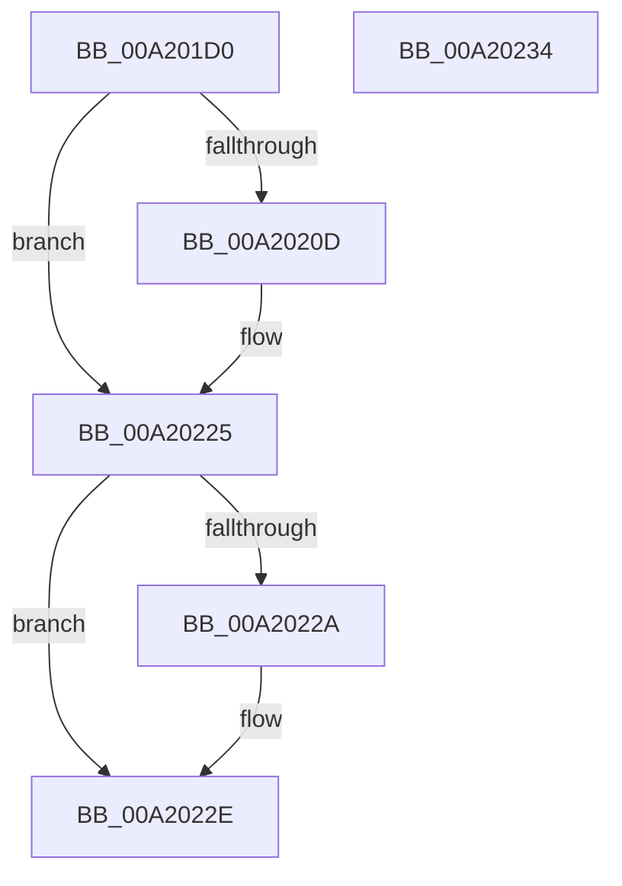

# ExAcquireTimeRefreshLockShared

- RVA: `0x00A201D0`–`0x00A20235` (길이 `101` bytes)
- VA: `0x0000000140A201D0`
- 실행 섹션: `PAGE`
- PDB 이름 있음: `예`; PDB Function 태그: `아니요`
- unwind 정보 RVA: `0x0005CF00`
- 디코드: `26`개 명령, `101/101` bytes 표시
- 미해석 바이트: `0` (있으면 어셈블리에 `.byte`로 보존)

> 이 문서는 커널 이미지의 기계어와 PDB 기호를 분석해 생성했습니다. 4번과 5번은 함수 원형과 자료형을 바이너리 사용 방식에서 추정한 C 해석이며 원본 소스 복구 결과는 아닙니다.

## 1. Dependencies

- 직접 호출 지점: **2**; 고유 호출 대상: **2**
- 직접 호출자로 확인된 함수: **4**
- RIP 상대 이미지 참조: **1**

### Outgoing calls
- `0x00A201F3` → [KeAbPreAcquire](../../text/21/KeAbPreAcquire_function_00210230.md) (function, `0x00210230`)
- `0x00A20220` → [ExfAcquirePushLockSharedEx](../../text/21/ExfAcquirePushLockSharedEx_function_0021044C.md) (function, `0x0021044C`)

### Direct callers
- [ExTraceTimerResolution](../../text/4B/ExTraceTimerResolution_function_004B348C.md) at `0x004B34A4`
- [ExpSetTimeZoneInformation](../7C/ExpSetTimeZoneInformation_function_007C5240.md) at `0x007C5402`
- [PopPolicyTimeChange](PopPolicyTimeChange_function_00A20180.md) at `0x00A20184`
- [ExpQuerySystemInformation](../A5/ExpQuerySystemInformation_function_00A57858.md) at `0x00A5842D`
- [ExpQuerySystemInformation](../A5/ExpQuerySystemInformation_function_00A57858.md) at `0x00A585B8`
- [ExpQuerySystemInformation](../A5/ExpQuerySystemInformation_function_00A57858.md) at `0x00A5934C`

### Static image references
- `0x00A201DF` → RVA `0x00EFEFC8` (`.data`; read)

## 2. Other-region calls and transfers

- 다른 실행 섹션으로 향하는 call: **2**
  - `0x00A201F3` → [KeAbPreAcquire](../../text/21/KeAbPreAcquire_function_00210230.md) (`PAGE` → `.text`)
  - `0x00A20220` → [ExfAcquirePushLockSharedEx](../../text/21/ExfAcquirePushLockSharedEx_function_0021044C.md) (`PAGE` → `.text`)
- 별도 외부 분기/꼬리 이동을 확인하지 못했습니다.

## 3. Assembly (complete function range)

```asm
00A201D0  40 53                           push rbx
00A201D2  48 83 EC 20                     sub rsp, 0x20
00A201D6  65 48 8B 04 25 88 01 00 00      mov rax, qword ptr gs:[0x188]
00A201DF  48 8D 0D E2 ED 4D 00            lea rcx, [rip + 0x4dede2]
00A201E6  45 33 C0                        xor r8d, r8d
00A201E9  33 D2                           xor edx, edx
00A201EB  66 FF 88 E4 01 00 00            dec word ptr [rax + 0x1e4]
00A201F2  90                              nop
00A201F3  E8 38 00 7F FF                  call 0x140210230
00A201F8  48 8B D8                        mov rbx, rax
00A201FB  BA 11 00 00 00                  mov edx, 0x11
00A20200  33 C0                           xor eax, eax
00A20202  F0 48 0F B1 15 BD ED 4D 00      lock cmpxchg qword ptr [rip + 0x4dedbd], rdx
00A2020B  74 18                           je 0x140a20225
00A2020D  4C 8D 0D B4 ED 4D 00            lea r9, [rip + 0x4dedb4]
00A20214  4C 8B C3                        mov r8, rbx
00A20217  33 D2                           xor edx, edx
00A20219  48 8D 0D A8 ED 4D 00            lea rcx, [rip + 0x4deda8]
00A20220  E8 27 02 7F FF                  call 0x14021044c
00A20225  48 85 DB                        test rbx, rbx
00A20228  74 04                           je 0x140a2022e
00A2022A  C6 43 0A 01                     mov byte ptr [rbx + 0xa], 1
00A2022E  48 83 C4 20                     add rsp, 0x20
00A20232  5B                              pop rbx
00A20233  C3                              ret
00A20234  CC                              int3
```

## 4. C-style interpretation (structured pseudocode)

```c
__int64 __fastcall ExAcquireTimeRefreshLockShared(__int64 a1, int a2, int a3)
{
    __int64 result;
    __int64 v_rsp;

    v_rsp = (v_rsp) - (32);
    a3 = 0;
    a2 = 0;
    result = KeAbPreAcquire(v_rip + 5107170, a2, a3, a4);
    result = 0;
    if (!(condition_is_equal)) {
        a4 = v_rip + 5107124;
        a3 = 0;
        a2 = 0;
        a1 = v_rip + 5107112;
        result = ExfAcquirePushLockSharedEx(a1, a2, a3, a4);
    }
    if (result != 0) {
        *(unsigned __int8 *)(result + 10) = 1;
    }
    v_rsp = (v_rsp) + (32);
    return result;
}
```

## 5. (Beta) C Style

```c
int64_t ExAcquireTimeRefreshLockShared(int64_t Arg1, int32_t Arg2, int32_t Arg3)
{
    int64_t result;
    int64_t local_rsp;

    local_rsp = (local_rsp) - (32);
    Arg3 = 0;
    Arg2 = 0;
    result = KeAbPreAcquire(v_rip + 5107170, Arg2, Arg3, a4);
    result = 0;
    if (!(condition_is_equal)) {
        a4 = v_rip + 5107124;
        Arg3 = 0;
        Arg2 = 0;
        Arg1 = v_rip + 5107112;
        result = ExfAcquirePushLockSharedEx(Arg1, Arg2, Arg3, a4);
    }
    if (result != 0) {
        *(uint8_t *)(result + 0xA) = 1;
    }
    local_rsp = (local_rsp) + (32);
    return result;
}
```

## 6. Execution-region graph

[열기: 2D/3D 그래프와 함수 탐색 컨트롤 패널](../../../control-panel.html?section=page&rva=0x00A201D0&view=graph)

- 2D 그래프는 위에서 아래로 흐르고, 3D 그래프는 빈 공간을 드래그해 회전합니다. Shift+드래그는 이동, 휠은 확대·축소, 함수 노드 선택은 대상 보고서 이동입니다.

### Static fallback


