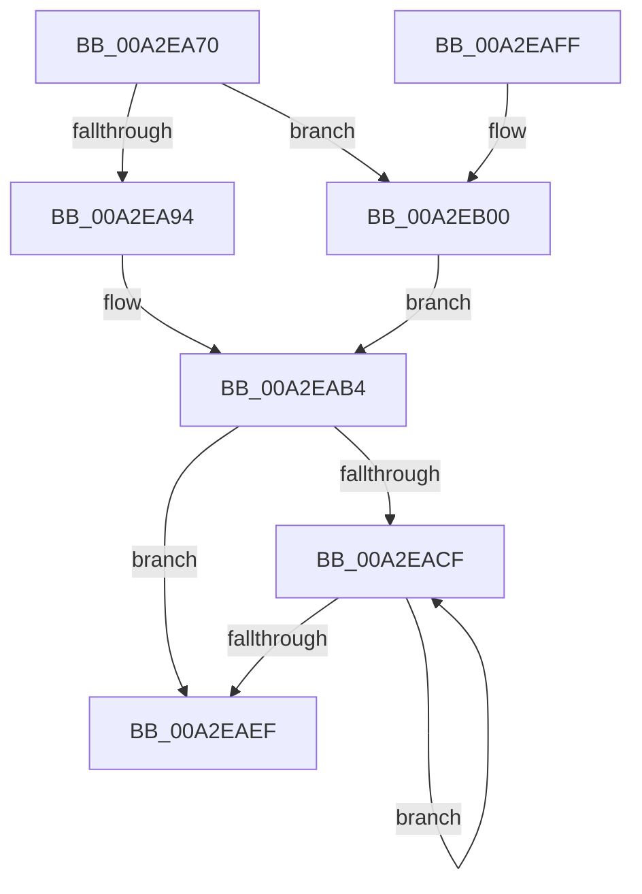

# ExInitializeRundownProtectionCacheAware

- RVA: `0x00A2EA70`–`0x00A2EB08` (길이 `152` bytes)
- VA: `0x0000000140A2EA70`
- 실행 섹션: `PAGE`
- PDB 이름 있음: `예`; PDB Function 태그: `아니요`
- unwind 정보 RVA: `0x000AC984`
- 디코드: `45`개 명령, `152/152` bytes 표시
- 미해석 바이트: `0` (있으면 어셈블리에 `.byte`로 보존)

> 이 문서는 커널 이미지의 기계어와 PDB 기호를 분석해 생성했습니다. 4번과 5번은 함수 원형과 자료형을 바이너리 사용 방식에서 추정한 C 해석이며 원본 소스 복구 결과는 아닙니다.

## 1. Dependencies

- 직접 호출 지점: **1**; 고유 호출 대상: **1**
- 직접 호출자로 확인된 함수: **0**
- RIP 상대 이미지 참조: **0**

### Outgoing calls
- `0x00A2EA94` → [KeGetRecommendedSharedDataAlignment](../../text/49/KeGetRecommendedSharedDataAlignment_function_00494040.md) (function, `0x00494040`)

### Direct callers
- 이 함수 시작 RVA로 연결되는 직접 call은 확인되지 않았습니다. 간접 호출은 완전히 역산할 수 없습니다.

### Static image references
- 디코드된 RIP-relative 메모리 참조가 없습니다.

## 2. Other-region calls and transfers

- 다른 실행 섹션으로 향하는 call: **1**
  - `0x00A2EA94` → [KeGetRecommendedSharedDataAlignment](../../text/49/KeGetRecommendedSharedDataAlignment_function_00494040.md) (`PAGE` → `.text`)
- 별도 외부 분기/꼬리 이동을 확인하지 못했습니다.

## 3. Assembly (complete function range)

```asm
00A2EA70  48 89 5C 24 08                  mov qword ptr [rsp + 8], rbx
00A2EA75  48 89 74 24 10                  mov qword ptr [rsp + 0x10], rsi
00A2EA7A  57                              push rdi
00A2EA7B  48 83 EC 20                     sub rsp, 0x20
00A2EA7F  8D 72 E8                        lea esi, [rdx - 0x18]
00A2EA82  41 B9 08 00 00 00               mov r9d, 8
00A2EA88  48 8D 79 18                     lea rdi, [rcx + 0x18]
00A2EA8C  48 8B D9                        mov rbx, rcx
00A2EA8F  41 3B F1                        cmp esi, r9d
00A2EA92  74 6C                           je 0x140a2eb00
00A2EA94  E8 A7 55 A6 FF                  call 0x140494040
00A2EA99  33 D2                           xor edx, edx
00A2EA9B  44 8B C8                        mov r9d, eax
00A2EA9E  8B C6                           mov eax, esi
00A2EAA0  41 F7 F1                        div r9d
00A2EAA3  41 8D 51 FF                     lea edx, [r9 - 1]
00A2EAA7  48 03 FA                        add rdi, rdx
00A2EAAA  48 F7 D2                        not rdx
00A2EAAD  48 23 FA                        and rdi, rdx
00A2EAB0  44 8D 40 FF                     lea r8d, [rax - 1]
00A2EAB4  44 89 4B 10                     mov dword ptr [rbx + 0x10], r9d
00A2EAB8  45 33 C9                        xor r9d, r9d
00A2EABB  48 89 3B                        mov qword ptr [rbx], rdi
00A2EABE  44 89 43 14                     mov dword ptr [rbx + 0x14], r8d
00A2EAC2  48 C7 43 08 11 CA AD 0B         mov qword ptr [rbx + 8], 0xbadca11
00A2EACA  45 85 C0                        test r8d, r8d
00A2EACD  74 20                           je 0x140a2eaef
00A2EACF  33 D2                           xor edx, edx
00A2EAD1  41 8B C1                        mov eax, r9d
00A2EAD4  41 F7 F0                        div r8d
00A2EAD7  48 8B 03                        mov rax, qword ptr [rbx]
00A2EADA  41 FF C1                        inc r9d
00A2EADD  0F AF 53 10                     imul edx, dword ptr [rbx + 0x10]
00A2EAE1  48 83 24 02 00                  and qword ptr [rdx + rax], 0
00A2EAE6  44 8B 43 14                     mov r8d, dword ptr [rbx + 0x14]
00A2EAEA  45 3B C8                        cmp r9d, r8d
00A2EAED  72 E0                           jb 0x140a2eacf
00A2EAEF  48 8B 5C 24 30                  mov rbx, qword ptr [rsp + 0x30]
00A2EAF4  48 8B 74 24 38                  mov rsi, qword ptr [rsp + 0x38]
00A2EAF9  48 83 C4 20                     add rsp, 0x20
00A2EAFD  5F                              pop rdi
00A2EAFE  C3                              ret
00A2EAFF  CC                              int3
00A2EB00  41 B8 01 00 00 00               mov r8d, 1
00A2EB06  EB AC                           jmp 0x140a2eab4
```

## 4. C-style interpretation (structured pseudocode)

```c
__int64 __fastcall ExInitializeRundownProtectionCacheAware(__int64 a1, __int64 a2)
{
    __int64 result;
    __int64 v_rdi;
    __int64 v_rsp;
    unsigned __int64 v_stack_p10;
    unsigned __int64 v_stack_p8;

    v_stack_p8 = v_rbx;
    v_stack_p10 = v_rsi;
    v_rsp = (v_rsp) - (32);
    if (((unsigned int)(a2 - 24)) == 8) goto loc_00A2EB00;
    result = KeGetRecommendedSharedDataAlignment(a1, a2, a3, 8);
    a2 = 0;
    v_rdi = (a1 + 24) + ((unsigned int)((unsigned int)(result)) - 1);
    a2 = ~((unsigned int)((unsigned int)(result)) - 1);
    v_rdi = (v_rdi) & (a2);
loc_00A2EAB4:
    *(unsigned int *)(a1 + 16) = (unsigned int)((unsigned int)((unsigned int)(result)));
    a4 = 0;
    *(unsigned __int64 *)(a1) = v_rdi;
    *(unsigned int *)(a1 + 20) = (unsigned int)((unsigned int)((unsigned int)(a2 - 24)) - 1);
    *(unsigned __int64 *)(a1 + 8) = 0xBADCA11ULL;
    if ((unsigned int)((unsigned int)((unsigned int)(a2 - 24)) - 1) == 0) goto loc_00A2EAEF;
loc_00A2EACF:
    a2 = 0;
    a4 = (unsigned int)((a4) + 1);
    a2 = (unsigned int)((a2) * (*(unsigned int *)(a1 + 16)));
    if (((unsigned int)(a4)) < ((unsigned int)((unsigned int)(*(unsigned int *)(a1 + 20))))) goto loc_00A2EACF;
loc_00A2EAEF:
    v_rsp = (v_rsp) + (32);
    return *(unsigned __int64 *)(a1);
loc_00A2EB00:
    goto loc_00A2EAB4;
}
```

## 5. (Beta) C Style

```c
int64_t ExInitializeRundownProtectionCacheAware(void *RundownProtectionCacheAware, void *Arg2)
{
    uint8_t *rundownProtectionCacheAware = (uint8_t *)RundownProtectionCacheAware;
    uint8_t *arg2 = (uint8_t *)Arg2;

    int64_t result;
    int64_t local_rdi;
    int64_t local_rsp;
    uint64_t v_stack_p10;
    uint64_t v_stack_p8;

    v_stack_p8 = local_rbx;
    v_stack_p10 = local_rsi;
    local_rsp = (local_rsp) - (32);
    if (((uint32_t)(Arg2 - 24)) == 8) goto loc_00A2EB00;
    result = KeGetRecommendedSharedDataAlignment(RundownProtectionCacheAware, Arg2, a3, 8);
    Arg2 = 0;
    local_rdi = (RundownProtectionCacheAware + 24) + ((uint32_t)((uint32_t)(result)) - 1);
    Arg2 = ~((uint32_t)((uint32_t)(result)) - 1);
    local_rdi = (local_rdi) & (Arg2);
loc_00A2EAB4:
    *(uint32_t *)(rundownProtectionCacheAware + 0x10) = (uint32_t)((uint32_t)((uint32_t)(result)));
    a4 = 0;
    *(uint64_t *)(rundownProtectionCacheAware) = local_rdi;
    *(uint32_t *)(rundownProtectionCacheAware + 0x14) = (uint32_t)((uint32_t)((uint32_t)(Arg2 - 24)) - 1);
    *(uint64_t *)(rundownProtectionCacheAware + 0x8) = 0xBADCA11ULL;
    if ((uint32_t)((uint32_t)((uint32_t)(Arg2 - 24)) - 1) == 0) goto loc_00A2EAEF;
loc_00A2EACF:
    Arg2 = 0;
    a4 = (uint32_t)((a4) + 1);
    Arg2 = (uint32_t)((Arg2) * (*(uint32_t *)(rundownProtectionCacheAware + 0x10)));
    if (((uint32_t)(a4)) < ((uint32_t)((uint32_t)(*(uint32_t *)(rundownProtectionCacheAware + 0x14))))) goto loc_00A2EACF;
loc_00A2EAEF:
    local_rsp = (local_rsp) + (32);
    return *(uint64_t *)(rundownProtectionCacheAware);
loc_00A2EB00:
    goto loc_00A2EAB4;
}
```

### 관측된 메모리 오프셋

구조체 형식이 확인되지 않은 접근은 인자 기준의 오프셋으로만 기록했습니다.

| 기준 인자 | 오프셋 표현 | 폭 (bit) | 접근 |
|---|---:|---:|---|
| `RundownProtectionCacheAware` | `+ 0x0` | `64` | `R` |
| `RundownProtectionCacheAware` | `+ 0x0` | `64` | `W` |
| `RundownProtectionCacheAware` | `+ 0x8` | `64` | `W` |
| `RundownProtectionCacheAware` | `+ 0x10` | `32` | `R` |
| `RundownProtectionCacheAware` | `+ 0x10` | `32` | `W` |
| `RundownProtectionCacheAware` | `+ 0x14` | `32` | `R` |
| `RundownProtectionCacheAware` | `+ 0x14` | `32` | `W` |
| `RundownProtectionCacheAware` | `+ 0x18` | `64` | `R` |
| `Arg2` | `- 0x18` | `32` | `R` |

## 6. Execution-region graph

[열기: 2D/3D 그래프와 함수 탐색 컨트롤 패널](../../../control-panel.html?section=page&rva=0x00A2EA70&view=graph)

- 2D 그래프는 위에서 아래로 흐르고, 3D 그래프는 빈 공간을 드래그해 회전합니다. Shift+드래그는 이동, 휠은 확대·축소, 함수 노드 선택은 대상 보고서 이동입니다.

### Static fallback


