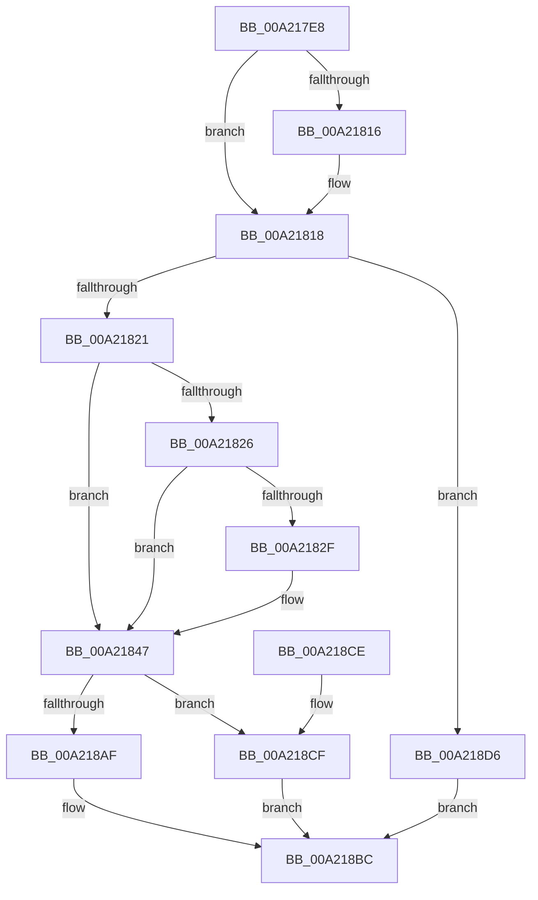

# ExIsRestrictedCaller

- RVA: `0x00A217E8`–`0x00A218DA` (길이 `242` bytes)
- VA: `0x0000000140A217E8`
- 실행 섹션: `PAGE`
- PDB 이름 있음: `예`; PDB Function 태그: `아니요`
- unwind 정보 RVA: `0x000AB0F0`
- 디코드: `65`개 명령, `242/242` bytes 표시
- 미해석 바이트: `0` (있으면 어셈블리에 `.byte`로 보존)

> 이 문서는 커널 이미지의 기계어와 PDB 기호를 분석해 생성했습니다. 4번과 5번은 함수 원형과 자료형을 바이너리 사용 방식에서 추정한 C 해석이며 원본 소스 복구 결과는 아닙니다.

## 1. Dependencies

- 직접 호출 지점: **5**; 고유 호출 대상: **5**
- 직접 호출자로 확인된 함수: **6**
- RIP 상대 이미지 참조: **3**

### Outgoing calls
- `0x00A21826` → [Feature_RestrictKernelAddressLeaks__private_IsEnabledDeviceUsageNoInline](../../text/49/Feature_RestrictKernelAddressLeaks__private_IsEnabledDeviceUsageNoInline_function_004918D8.md) (function, `0x004918D8`)
- `0x00A21839` → [SeSinglePrivilegeCheck](../87/SeSinglePrivilegeCheck_function_00871E20.md) (function, `0x00871E20`)
- `0x00A2184C` → [SeCaptureSubjectContext](../86/SeCaptureSubjectContext_function_0086B820.md) (function, `0x0086B820`)
- `0x00A2189A` → [SeAccessCheck](../../text/3A/SeAccessCheck_function_003A6BC0.md) (function, `0x003A6BC0`)
- `0x00A218A6` → [SeReleaseSubjectContext](../86/SeReleaseSubjectContext_function_0086B710.md) (function, `0x0086B710`)

### Direct callers
- [ExpProfileCreate](../7D/ExpProfileCreate_function_007D1AB8.md) at `0x007D1E0B`
- [ExpGetProcessInformation](../91/ExpGetProcessInformation_function_0091A878.md) at `0x0091A9F9`
- [ExProcessCounterSetCallback](../91/ExProcessCounterSetCallback_function_0091CDF0.md) at `0x0091CE45`
- [NtQueryInformationProcess](../9A/NtQueryInformationProcess_function_009AA250.md) at `0x009AC20B`
- [PspQueryWorkingSetWatch](PspQueryWorkingSetWatch_function_00A21478.md) at `0x00A214CF`
- [ExpQuerySystemInformation](../A5/ExpQuerySystemInformation_function_00A57858.md) at `0x00A57F80`
- [ExpQuerySystemInformation](../A5/ExpQuerySystemInformation_function_00A57858.md) at `0x00A5807A`
- [ExpQuerySystemInformation](../A5/ExpQuerySystemInformation_function_00A57858.md) at `0x00A58101`
- [ExpQuerySystemInformation](../A5/ExpQuerySystemInformation_function_00A57858.md) at `0x00A58160`
- [ExpQuerySystemInformation](../A5/ExpQuerySystemInformation_function_00A57858.md) at `0x00A58B76`
- [ExpQuerySystemInformation](../A5/ExpQuerySystemInformation_function_00A57858.md) at `0x00A58C32`
- [ExpQuerySystemInformation](../A5/ExpQuerySystemInformation_function_00A57858.md) at `0x00A58D32`

### Static image references
- `0x00A2182F` → RVA `0x00FD9A80` (`PAGEDATA`; read)
- `0x00A21851` → RVA `0x00FD9CB8` (`PAGEDATA`; read)
- `0x00A21885` → RVA `0x00B4B090` (`ExpRestrictedGenericMapping`; read)

## 2. Other-region calls and transfers

- 다른 실행 섹션으로 향하는 call: **2**
  - `0x00A21826` → [Feature_RestrictKernelAddressLeaks__private_IsEnabledDeviceUsageNoInline](../../text/49/Feature_RestrictKernelAddressLeaks__private_IsEnabledDeviceUsageNoInline_function_004918D8.md) (`PAGE` → `.text`)
  - `0x00A2189A` → [SeAccessCheck](../../text/3A/SeAccessCheck_function_003A6BC0.md) (`PAGE` → `.text`)
- 별도 외부 분기/꼬리 이동을 확인하지 못했습니다.

## 3. Assembly (complete function range)

```asm
00A217E8  48 8B C4                        mov rax, rsp
00A217EB  48 89 58 18                     mov qword ptr [rax + 0x18], rbx
00A217EF  48 89 70 20                     mov qword ptr [rax + 0x20], rsi
00A217F3  57                              push rdi
00A217F4  48 83 EC 70                     sub rsp, 0x70
00A217F8  33 FF                           xor edi, edi
00A217FA  0F 57 C0                        xorps xmm0, xmm0
00A217FD  89 78 08                        mov dword ptr [rax + 8], edi
00A21800  48 8B DA                        mov rbx, rdx
00A21803  89 78 10                        mov dword ptr [rax + 0x10], edi
00A21806  40 8A F1                        mov sil, cl
00A21809  0F 11 40 D8                     movups xmmword ptr [rax - 0x28], xmm0
00A2180D  0F 11 40 E8                     movups xmmword ptr [rax - 0x18], xmm0
00A21811  48 85 D2                        test rdx, rdx
00A21814  74 02                           je 0x140a21818
00A21816  89 3A                           mov dword ptr [rdx], edi
00A21818  40 84 F6                        test sil, sil
00A2181B  0F 84 B5 00 00 00               je 0x140a218d6
00A21821  48 85 DB                        test rbx, rbx
00A21824  74 21                           je 0x140a21847
00A21826  E8 AD 00 A7 FF                  call 0x1404918d8
00A2182B  85 C0                           test eax, eax
00A2182D  74 18                           je 0x140a21847
00A2182F  48 8B 0D 4A 82 5B 00            mov rcx, qword ptr [rip + 0x5b824a]
00A21836  40 8A D6                        mov dl, sil
00A21839  E8 E2 05 E5 FF                  call 0x140871e20
00A2183E  8B CF                           mov ecx, edi
00A21840  84 C0                           test al, al
00A21842  0F 94 C1                        sete cl
00A21845  89 0B                           mov dword ptr [rbx], ecx
00A21847  48 8D 4C 24 50                  lea rcx, [rsp + 0x50]
00A2184C  E8 CF 9F E4 FF                  call 0x14086b820
00A21851  48 8B 0D 60 84 5B 00            mov rcx, qword ptr [rip + 0x5b8460]
00A21858  48 8D 84 24 80 00 00 00         lea rax, [rsp + 0x80]
00A21860  48 89 44 24 48                  mov qword ptr [rsp + 0x48], rax
00A21865  48 8D 54 24 50                  lea rdx, [rsp + 0x50]
00A2186A  48 8D 84 24 88 00 00 00         lea rax, [rsp + 0x88]
00A21872  41 B9 00 00 02 00               mov r9d, 0x20000
00A21878  48 89 44 24 40                  mov qword ptr [rsp + 0x40], rax
00A2187D  45 33 C0                        xor r8d, r8d
00A21880  C6 44 24 38 01                  mov byte ptr [rsp + 0x38], 1
00A21885  48 8D 05 04 98 12 00            lea rax, [rip + 0x129804]
00A2188C  48 89 44 24 30                  mov qword ptr [rsp + 0x30], rax
00A21891  48 89 7C 24 28                  mov qword ptr [rsp + 0x28], rdi
00A21896  89 7C 24 20                     mov dword ptr [rsp + 0x20], edi
00A2189A  E8 21 53 98 FF                  call 0x1403a6bc0
00A2189F  48 8D 4C 24 50                  lea rcx, [rsp + 0x50]
00A218A4  8A D8                           mov bl, al
00A218A6  E8 65 9E E4 FF                  call 0x14086b710
00A218AB  84 DB                           test bl, bl
00A218AD  74 20                           je 0x140a218cf
00A218AF  39 BC 24 80 00 00 00            cmp dword ptr [rsp + 0x80], edi
00A218B6  40 0F 9C C7                     setl dil
00A218BA  8B C7                           mov eax, edi
00A218BC  4C 8D 5C 24 70                  lea r11, [rsp + 0x70]
00A218C1  49 8B 5B 20                     mov rbx, qword ptr [r11 + 0x20]
00A218C5  49 8B 73 28                     mov rsi, qword ptr [r11 + 0x28]
00A218C9  49 8B E3                        mov rsp, r11
00A218CC  5F                              pop rdi
00A218CD  C3                              ret
00A218CE  CC                              int3
00A218CF  B8 01 00 00 00                  mov eax, 1
00A218D4  EB E6                           jmp 0x140a218bc
00A218D6  33 C0                           xor eax, eax
00A218D8  EB E2                           jmp 0x140a218bc
```

## 4. C-style interpretation (structured pseudocode)

```c
__int64 __fastcall ExIsRestrictedCaller(unsigned __int8 a1, __int64 a2, int a3)
{
    __int64 result;
    __int64 v_rdi;
    __int64 v_rsp;
    unsigned __int64 v_stack_m28;
    unsigned __int64 v_stack_m30;
    unsigned __int64 v_stack_m38;
    unsigned __int8 v_stack_m40;
    unsigned __int64 v_stack_m48;
    unsigned __int64 v_stack_m50;
    unsigned int v_stack_m58;
    unsigned __int64 v_stack_m8;
    unsigned __int64 v_stack_p10;
    unsigned __int64 v_stack_p8;

    *(unsigned __int64 *)(v_rsp + 24) = v_rbx;
    *(unsigned __int64 *)(v_rsp + 32) = v_rsi;
    v_rsp = (v_rsp) - (112);
    v_rdi = 0;
    *(unsigned int *)(v_rsp + 8) = 0;
    *(unsigned int *)(v_rsp + 16) = 0;
    *(unsigned __int64 *)(v_rsp - 40) = v_xmm0;
    *(unsigned __int64 *)(v_rsp - 24) = v_xmm0;
    if (a2 != 0) {
        *(unsigned int *)(a2) = 0;
    }
    if (a1 == 0) goto loc_00A218D6;
    if (a2 == 0) goto loc_00A21847;
    result = Feature_RestrictKernelAddressLeaks__private_IsEnabledDeviceUsageNoInline(a1, a2, a3, a4);
    if ((unsigned int)(result) != 0) {
        a1 = *(unsigned __int64 *)(v_rip + 5997130);
        a2 = a1;
        result = SeSinglePrivilegeCheck(a1, a2, a3, a4);
        a1 = 0;
        a1 = ((unsigned __int8)(result) == 0) ? 1 : 0;
        *(unsigned int *)(a2) = a1;
    }
    result = SeCaptureSubjectContext(v_stack_m28, a2, a3, a4);
    v_stack_m30 = v_stack_p8;
    v_stack_m38 = v_stack_p10;
    a3 = 0;
    v_stack_m40 = 1;
    v_stack_m48 = v_rip + 1218564;
    v_stack_m50 = 0;
    v_stack_m58 = 0;
    result = SeAccessCheck(*(unsigned __int64 *)(v_rip + 5997664), v_stack_m28, a3, (unsigned int)(0x20000ULL));
    result = SeReleaseSubjectContext(v_stack_m28, v_stack_m28, a3, (unsigned int)(0x20000ULL));
    if ((unsigned __int8)((unsigned __int8)(result)) == 0) goto loc_00A218CF;
    v_rdi = (v_stack_p8 < 0) ? 1 : 0;
loc_00A218BC:
    return (unsigned int)((unsigned int)(v_rdi));
loc_00A218CF:
    goto loc_00A218BC;
loc_00A218D6:
    result = 0;
    goto loc_00A218BC;
}
```

## 5. (Beta) C Style

```c
int64_t ExIsRestrictedCaller(uint8_t Arg1, int64_t Arg2, int32_t Arg3)
{
    int64_t result;
    int64_t local_rdi;
    int64_t local_rsp;
    uint64_t v_stack_m28;
    uint64_t v_stack_m30;
    uint64_t v_stack_m38;
    uint8_t v_stack_m40;
    uint64_t v_stack_m48;
    uint64_t v_stack_m50;
    uint32_t v_stack_m58;
    uint64_t v_stack_m8;
    uint64_t v_stack_p10;
    uint64_t v_stack_p8;

    *(uint64_t *)(local_rsp + 0x18) = local_rbx;
    *(uint64_t *)(local_rsp + 0x20) = local_rsi;
    local_rsp = (local_rsp) - (112);
    local_rdi = 0;
    *(uint32_t *)(local_rsp + 0x8) = 0;
    *(uint32_t *)(local_rsp + 0x10) = 0;
    *(uint64_t *)(local_rsp - 0x28) = v_xmm0;
    *(uint64_t *)(local_rsp - 0x18) = v_xmm0;
    if (Arg2 != 0) {
        *(uint32_t *)(Arg2) = 0;
    }
    if (Arg1 == 0) goto loc_00A218D6;
    if (Arg2 == 0) goto loc_00A21847;
    result = Feature_RestrictKernelAddressLeaks__private_IsEnabledDeviceUsageNoInline(Arg1, Arg2, Arg3, a4);
    if ((uint32_t)(result) != 0) {
        Arg1 = *(uint64_t *)(v_rip + 0x5B824A);
        Arg2 = Arg1;
        result = SeSinglePrivilegeCheck(Arg1, Arg2, Arg3, a4);
        Arg1 = 0;
        Arg1 = ((uint8_t)(result) == 0) ? 1 : 0;
        *(uint32_t *)(Arg2) = Arg1;
    }
    result = SeCaptureSubjectContext(v_stack_m28, Arg2, Arg3, a4);
    v_stack_m30 = v_stack_p8;
    v_stack_m38 = v_stack_p10;
    Arg3 = 0;
    v_stack_m40 = 1;
    v_stack_m48 = v_rip + 1218564;
    v_stack_m50 = 0;
    v_stack_m58 = 0;
    result = SeAccessCheck(*(uint64_t *)(v_rip + 0x5B8460), v_stack_m28, Arg3, (uint32_t)(0x20000ULL));
    result = SeReleaseSubjectContext(v_stack_m28, v_stack_m28, Arg3, (uint32_t)(0x20000ULL));
    if ((uint8_t)((uint8_t)(result)) == 0) goto loc_00A218CF;
    local_rdi = (v_stack_p8 < 0) ? 1 : 0;
loc_00A218BC:
    return (uint32_t)((uint32_t)(local_rdi));
loc_00A218CF:
    goto loc_00A218BC;
loc_00A218D6:
    result = 0;
    goto loc_00A218BC;
}
```

## 6. Execution-region graph

[열기: 2D/3D 그래프와 함수 탐색 컨트롤 패널](../../../control-panel.html?section=page&rva=0x00A217E8&view=graph)

- 2D 그래프는 위에서 아래로 흐르고, 3D 그래프는 빈 공간을 드래그해 회전합니다. Shift+드래그는 이동, 휠은 확대·축소, 함수 노드 선택은 대상 보고서 이동입니다.

### Static fallback


