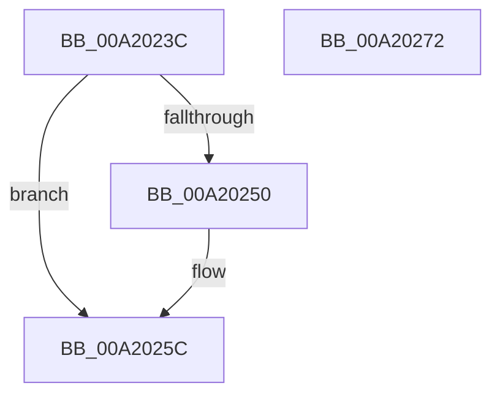

# ExReleaseTimeRefreshLockShared

- RVA: `0x00A2023C`–`0x00A20273` (길이 `55` bytes)
- VA: `0x0000000140A2023C`
- 실행 섹션: `PAGE`
- PDB 이름 있음: `예`; PDB Function 태그: `아니요`
- unwind 정보 RVA: `0x0005C788`
- 디코드: `13`개 명령, `55/55` bytes 표시
- 미해석 바이트: `0` (있으면 어셈블리에 `.byte`로 보존)

> 이 문서는 커널 이미지의 기계어와 PDB 기호를 분석해 생성했습니다. 4번과 5번은 함수 원형과 자료형을 바이너리 사용 방식에서 추정한 C 해석이며 원본 소스 복구 결과는 아닙니다.

## 1. Dependencies

- 직접 호출 지점: **3**; 고유 호출 대상: **3**
- 직접 호출자로 확인된 함수: **4**
- RIP 상대 이미지 참조: **1**

### Outgoing calls
- `0x00A20257` → [ExfReleasePushLockShared](../../text/26/ExfReleasePushLockShared_function_00263440.md) (function, `0x00263440`)
- `0x00A20263` → [KeAbPostRelease](../../text/2E/KeAbPostRelease_function_002E1600.md) (function, `0x002E1600`)
- `0x00A20268` → [KeLeaveCriticalRegion](../../text/25/KeLeaveCriticalRegion_function_0025D8B0.md) (function, `0x0025D8B0`)

### Direct callers
- [ExTraceTimerResolution](../../text/4B/ExTraceTimerResolution_function_004B348C.md) at `0x004B3528`
- [ExpSetTimeZoneInformation](../7C/ExpSetTimeZoneInformation_function_007C5240.md) at `0x007C547B`
- [PopPolicyTimeChange](PopPolicyTimeChange_function_00A20180.md) at `0x00A201B2`
- [ExpQuerySystemInformation](../A5/ExpQuerySystemInformation_function_00A57858.md) at `0x00A58440`
- [ExpQuerySystemInformation](../A5/ExpQuerySystemInformation_function_00A57858.md) at `0x00A5862B`
- [ExpQuerySystemInformation](../A5/ExpQuerySystemInformation_function_00A57858.md) at `0x00A593DC`

### Static image references
- `0x00A20245` → RVA `0x00EFEFC8` (`.data`; read)

## 2. Other-region calls and transfers

- 다른 실행 섹션으로 향하는 call: **3**
  - `0x00A20257` → [ExfReleasePushLockShared](../../text/26/ExfReleasePushLockShared_function_00263440.md) (`PAGE` → `.text`)
  - `0x00A20263` → [KeAbPostRelease](../../text/2E/KeAbPostRelease_function_002E1600.md) (`PAGE` → `.text`)
  - `0x00A20268` → [KeLeaveCriticalRegion](../../text/25/KeLeaveCriticalRegion_function_0025D8B0.md) (`PAGE` → `.text`)
- 별도 외부 분기/꼬리 이동을 확인하지 못했습니다.

## 3. Assembly (complete function range)

```asm
00A2023C  48 83 EC 28                     sub rsp, 0x28
00A20240  33 D2                           xor edx, edx
00A20242  8D 42 11                        lea eax, [rdx + 0x11]
00A20245  F0 48 0F B1 15 7A ED 4D 00      lock cmpxchg qword ptr [rip + 0x4ded7a], rdx
00A2024E  74 0C                           je 0x140a2025c
00A20250  48 8D 0D 71 ED 4D 00            lea rcx, [rip + 0x4ded71]
00A20257  E8 E4 31 84 FF                  call 0x140263440
00A2025C  48 8D 0D 65 ED 4D 00            lea rcx, [rip + 0x4ded65]
00A20263  E8 98 13 8C FF                  call 0x1402e1600
00A20268  E8 43 D6 83 FF                  call 0x14025d8b0
00A2026D  48 83 C4 28                     add rsp, 0x28
00A20271  C3                              ret
00A20272  CC                              int3
```

## 4. C-style interpretation (structured pseudocode)

```c
__int64 __fastcall ExReleaseTimeRefreshLockShared(__int64 a1, int a2)
{
    __int64 result;
    __int64 v_rsp;

    v_rsp = (v_rsp) - (40);
    a2 = 0;
    result = a2 + 17;
    if (!(condition_is_equal)) {
        a1 = v_rip + 5107057;
        result = ExfReleasePushLockShared(a1, a2, a3, a4);
    }
    result = KeAbPostRelease(v_rip + 5107045, a2, a3, a4);
    result = KeLeaveCriticalRegion(v_rip + 5107045, a2, a3, a4);
    v_rsp = (v_rsp) + (40);
    return result;
}
```

## 5. (Beta) C Style

```c
int64_t ExReleaseTimeRefreshLockShared(int64_t Arg1, int32_t Arg2)
{
    int64_t result;
    int64_t local_rsp;

    local_rsp = (local_rsp) - (40);
    Arg2 = 0;
    result = Arg2 + 17;
    if (!(condition_is_equal)) {
        Arg1 = v_rip + 5107057;
        result = ExfReleasePushLockShared(Arg1, Arg2, a3, a4);
    }
    result = KeAbPostRelease(v_rip + 5107045, Arg2, a3, a4);
    result = KeLeaveCriticalRegion(v_rip + 5107045, Arg2, a3, a4);
    local_rsp = (local_rsp) + (40);
    return result;
}
```

## 6. Execution-region graph

[열기: 2D/3D 그래프와 함수 탐색 컨트롤 패널](../../../control-panel.html?section=page&rva=0x00A2023C&view=graph)

- 2D 그래프는 위에서 아래로 흐르고, 3D 그래프는 빈 공간을 드래그해 회전합니다. Shift+드래그는 이동, 휠은 확대·축소, 함수 노드 선택은 대상 보고서 이동입니다.

### Static fallback


