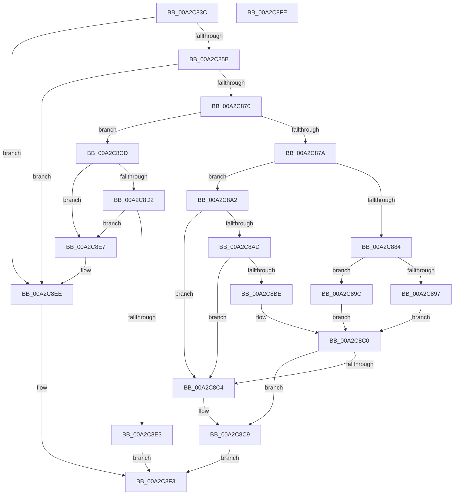

# ExpCheckIRTimerAccess

- RVA: `0x00A2C83C`–`0x00A2C8FF` (길이 `195` bytes)
- VA: `0x0000000140A2C83C`
- 실행 섹션: `PAGE`
- PDB 이름 있음: `예`; PDB Function 태그: `아니요`
- unwind 정보 RVA: `0x000AC4E4`
- 디코드: `64`개 명령, `195/195` bytes 표시
- 미해석 바이트: `0` (있으면 어셈블리에 `.byte`로 보존)

> 이 문서는 커널 이미지의 기계어와 PDB 기호를 분석해 생성했습니다. 4번과 5번은 함수 원형과 자료형을 바이너리 사용 방식에서 추정한 C 해석이며 원본 소스 복구 결과는 아닙니다.

## 1. Dependencies

- 직접 호출 지점: **5**; 고유 호출 대상: **4**
- 직접 호출자로 확인된 함수: **1**
- RIP 상대 이미지 참조: **0**

### Outgoing calls
- `0x00A2C85B` → [ExpGetIRTimerDesc](../../text/4E/ExpGetIRTimerDesc_function_004E3D04.md) (function, `0x004E3D04`)
- `0x00A2C88E` → [RtlCheckTokenMembership](../../text/3A/RtlCheckTokenMembership_function_003A5A10.md) (function, `0x003A5A10`)
- `0x00A2C8A4` → [ExpCheckWakeTimerAccess](../AB/ExpCheckWakeTimerAccess_function_00AB15FC.md) (function, `0x00AB15FC`)
- `0x00A2C8B5` → [ExCheckValidIRTimerId](../../text/4F/ExCheckValidIRTimerId_function_004FB980.md) (function, `0x004FB980`)
- `0x00A2C8DA` → [ExCheckValidIRTimerId](../../text/4F/ExCheckValidIRTimerId_function_004FB980.md) (function, `0x004FB980`)

### Direct callers
- [NtCreateTimer2](NtCreateTimer2_function_00A2C660.md) at `0x00A2C7F5`

### Static image references
- 디코드된 RIP-relative 메모리 참조가 없습니다.

## 2. Other-region calls and transfers

- 다른 실행 섹션으로 향하는 call: **4**
  - `0x00A2C85B` → [ExpGetIRTimerDesc](../../text/4E/ExpGetIRTimerDesc_function_004E3D04.md) (`PAGE` → `.text`)
  - `0x00A2C88E` → [RtlCheckTokenMembership](../../text/3A/RtlCheckTokenMembership_function_003A5A10.md) (`PAGE` → `.text`)
  - `0x00A2C8B5` → [ExCheckValidIRTimerId](../../text/4F/ExCheckValidIRTimerId_function_004FB980.md) (`PAGE` → `.text`)
  - `0x00A2C8DA` → [ExCheckValidIRTimerId](../../text/4F/ExCheckValidIRTimerId_function_004FB980.md) (`PAGE` → `.text`)
- 별도 외부 분기/꼬리 이동을 확인하지 못했습니다.

## 3. Assembly (complete function range)

```asm
00A2C83C  48 89 5C 24 10                  mov qword ptr [rsp + 0x10], rbx
00A2C841  89 4C 24 08                     mov dword ptr [rsp + 8], ecx
00A2C845  57                              push rdi
00A2C846  48 83 EC 20                     sub rsp, 0x20
00A2C84A  8B D9                           mov ebx, ecx
00A2C84C  0F B7 C9                        movzx ecx, cx
00A2C84F  8D 41 FF                        lea eax, [rcx - 1]
00A2C852  83 F8 12                        cmp eax, 0x12
00A2C855  0F 87 93 00 00 00               ja 0x140a2c8ee
00A2C85B  E8 A4 74 AB FF                  call 0x1404e3d04
00A2C860  8B CB                           mov ecx, ebx
00A2C862  C1 E9 10                        shr ecx, 0x10
00A2C865  44 0F B6 40 10                  movzx r8d, byte ptr [rax + 0x10]
00A2C86A  66 41 3B C8                     cmp cx, r8w
00A2C86E  77 7E                           ja 0x140a2c8ee
00A2C870  48 8B 40 08                     mov rax, qword ptr [rax + 8]
00A2C874  33 FF                           xor edi, edi
00A2C876  84 D2                           test dl, dl
00A2C878  74 53                           je 0x140a2c8cd
00A2C87A  40 88 7C 24 40                  mov byte ptr [rsp + 0x40], dil
00A2C87F  48 85 C0                        test rax, rax
00A2C882  74 1E                           je 0x140a2c8a2
00A2C884  4C 8D 44 24 40                  lea r8, [rsp + 0x40]
00A2C889  48 8B D0                        mov rdx, rax
00A2C88C  33 C9                           xor ecx, ecx
00A2C88E  E8 7D 91 97 FF                  call 0x1403a5a10
00A2C893  85 C0                           test eax, eax
00A2C895  79 05                           jns 0x140a2c89c
00A2C897  40 8A C7                        mov al, dil
00A2C89A  EB 24                           jmp 0x140a2c8c0
00A2C89C  8A 44 24 40                     mov al, byte ptr [rsp + 0x40]
00A2C8A0  EB 1E                           jmp 0x140a2c8c0
00A2C8A2  8A CA                           mov cl, dl
00A2C8A4  E8 53 4D 08 00                  call 0x140ab15fc
00A2C8A9  85 C0                           test eax, eax
00A2C8AB  78 17                           js 0x140a2c8c4
00A2C8AD  0F B7 54 24 32                  movzx edx, word ptr [rsp + 0x32]
00A2C8B2  0F B7 CB                        movzx ecx, bx
00A2C8B5  E8 C6 F0 AC FF                  call 0x1404fb980
00A2C8BA  84 C0                           test al, al
00A2C8BC  74 06                           je 0x140a2c8c4
00A2C8BE  B0 01                           mov al, 1
00A2C8C0  84 C0                           test al, al
00A2C8C2  75 05                           jne 0x140a2c8c9
00A2C8C4  BF 22 00 00 C0                  mov edi, 0xc0000022
00A2C8C9  8B C7                           mov eax, edi
00A2C8CB  EB 26                           jmp 0x140a2c8f3
00A2C8CD  48 85 C0                        test rax, rax
00A2C8D0  75 15                           jne 0x140a2c8e7
00A2C8D2  0F B7 54 24 32                  movzx edx, word ptr [rsp + 0x32]
00A2C8D7  0F B7 CB                        movzx ecx, bx
00A2C8DA  E8 A1 F0 AC FF                  call 0x1404fb980
00A2C8DF  84 C0                           test al, al
00A2C8E1  74 04                           je 0x140a2c8e7
00A2C8E3  33 C0                           xor eax, eax
00A2C8E5  EB 0C                           jmp 0x140a2c8f3
00A2C8E7  B9 05 00 00 00                  mov ecx, 5
00A2C8EC  CD 29                           int 0x29
00A2C8EE  B8 0D 00 00 C0                  mov eax, 0xc000000d
00A2C8F3  48 8B 5C 24 38                  mov rbx, qword ptr [rsp + 0x38]
00A2C8F8  48 83 C4 20                     add rsp, 0x20
00A2C8FC  5F                              pop rdi
00A2C8FD  C3                              ret
00A2C8FE  CC                              int3
```

## 4. C-style interpretation (structured pseudocode)

```c
__int64 __fastcall ExpCheckIRTimerAccess(int a1, unsigned __int8 a2)
{
    __int64 result;
    __int64 v_rdi;
    __int64 v_rsp;
    unsigned __int64 v_stack_p10;
    unsigned __int8 v_stack_p18;
    unsigned int v_stack_p8;
    unsigned __int16 v_stack_pA;

    v_stack_p10 = v_rbx;
    v_stack_p8 = a1;
    v_rsp = (v_rsp) - (32);
    if (((unsigned int)((unsigned __int16)(a1) - 1)) > 18) goto loc_00A2C8EE;
    result = ExpGetIRTimerDesc((unsigned __int16)(a1), a2, a3, a4);
    a1 = (unsigned int)(((unsigned int)((unsigned int)((unsigned int)(a1)))) >> (16));
    if (((unsigned __int16)(a1)) > ((unsigned __int16)(*(unsigned __int8 *)(result + 16)))) goto loc_00A2C8EE;
    v_rdi = 0;
    if (a2 == 0) goto loc_00A2C8CD;
    v_stack_p18 = 0;
    if (*(unsigned __int64 *)(result + 8) == 0) goto loc_00A2C8A2;
    a1 = 0;
    result = RtlCheckTokenMembership(a1, *(unsigned __int64 *)(result + 8), v_stack_p18, a4);
    if (!sign_flag) goto loc_00A2C89C;
    goto loc_00A2C8C0;
loc_00A2C89C:
    goto loc_00A2C8C0;
loc_00A2C8A2:
    result = ExpCheckWakeTimerAccess((unsigned __int8)(*(unsigned __int64 *)(result + 8)), *(unsigned __int64 *)(result + 8), v_stack_p18, a4);
    if (sign_flag) goto loc_00A2C8C4;
    result = ExCheckValidIRTimerId((unsigned __int16)((unsigned int)(a1)), v_stack_pA, v_stack_p18, a4);
    if ((unsigned __int8)(result) == 0) goto loc_00A2C8C4;
loc_00A2C8C0:
    if (1 == 0) {
        v_rdi = 0xC0000022ULL;
    }
    goto loc_00A2C8F3;
loc_00A2C8CD:
    if ((unsigned int)((unsigned int)(v_rdi)) != 0) goto loc_00A2C8E7;
    result = ExCheckValidIRTimerId((unsigned __int16)((unsigned int)(a1)), v_stack_pA, v_stack_p18, a4);
    if ((unsigned __int8)(result) == 0) goto loc_00A2C8E7;
    result = 0;
    goto loc_00A2C8F3;
loc_00A2C8E7:
loc_00A2C8EE:
loc_00A2C8F3:
    v_rsp = (v_rsp) + (32);
    return (unsigned int)(0xC000000DULL);
}
```

## 5. (Beta) C Style

```c
int64_t ExpCheckIRTimerAccess(void *Arg1, uint8_t Arg2)
{
    uint8_t *arg1 = (uint8_t *)Arg1;

    int64_t result;
    int64_t local_rdi;
    int64_t local_rsp;
    uint64_t v_stack_p10;
    uint8_t v_stack_p18;
    uint32_t v_stack_p8;
    uint16_t v_stack_pA;

    v_stack_p10 = local_rbx;
    v_stack_p8 = Arg1;
    local_rsp = (local_rsp) - (32);
    if (((uint32_t)((uint16_t)(Arg1) - 1)) > 18) goto loc_00A2C8EE;
    result = ExpGetIRTimerDesc((uint16_t)(Arg1), Arg2, a3, a4);
    Arg1 = (uint32_t)(((uint32_t)((uint32_t)((uint32_t)(Arg1)))) >> (16));
    if (((uint16_t)(Arg1)) > ((uint16_t)(*(uint8_t *)(result + 0x10)))) goto loc_00A2C8EE;
    local_rdi = 0;
    if (Arg2 == 0) goto loc_00A2C8CD;
    v_stack_p18 = 0;
    if (*(uint64_t *)(result + 0x8) == 0) goto loc_00A2C8A2;
    Arg1 = 0;
    result = RtlCheckTokenMembership(Arg1, *(uint64_t *)(result + 0x8), v_stack_p18, a4);
    if (!sign_flag) goto loc_00A2C89C;
    goto loc_00A2C8C0;
loc_00A2C89C:
    goto loc_00A2C8C0;
loc_00A2C8A2:
    result = ExpCheckWakeTimerAccess((uint8_t)(*(uint64_t *)(result + 0x8)), *(uint64_t *)(result + 0x8), v_stack_p18, a4);
    if (sign_flag) goto loc_00A2C8C4;
    result = ExCheckValidIRTimerId((uint16_t)((uint32_t)(Arg1)), v_stack_pA, v_stack_p18, a4);
    if ((uint8_t)(result) == 0) goto loc_00A2C8C4;
loc_00A2C8C0:
    if (1 == 0) {
        local_rdi = 0xC0000022ULL;
    }
    goto loc_00A2C8F3;
loc_00A2C8CD:
    if ((uint32_t)((uint32_t)(local_rdi)) != 0) goto loc_00A2C8E7;
    result = ExCheckValidIRTimerId((uint16_t)((uint32_t)(Arg1)), v_stack_pA, v_stack_p18, a4);
    if ((uint8_t)(result) == 0) goto loc_00A2C8E7;
    result = 0;
    goto loc_00A2C8F3;
loc_00A2C8E7:
loc_00A2C8EE:
loc_00A2C8F3:
    local_rsp = (local_rsp) + (32);
    return (uint32_t)(0xC000000DULL);
}
```

### 관측된 메모리 오프셋

구조체 형식이 확인되지 않은 접근은 인자 기준의 오프셋으로만 기록했습니다.

| 기준 인자 | 오프셋 표현 | 폭 (bit) | 접근 |
|---|---:|---:|---|
| `Arg1` | `- 0x1` | `32` | `R` |

## 6. Execution-region graph

[열기: 2D/3D 그래프와 함수 탐색 컨트롤 패널](../../../control-panel.html?section=page&rva=0x00A2C83C&view=graph)

- 2D 그래프는 위에서 아래로 흐르고, 3D 그래프는 빈 공간을 드래그해 회전합니다. Shift+드래그는 이동, 휠은 확대·축소, 함수 노드 선택은 대상 보고서 이동입니다.

### Static fallback


