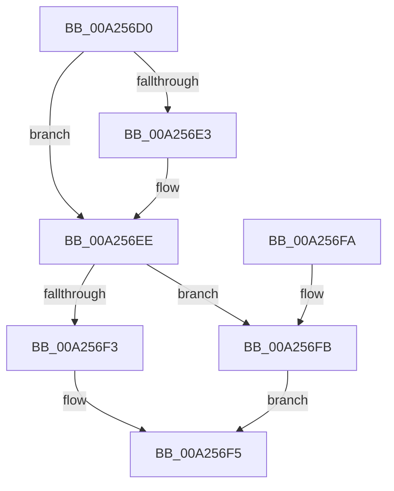

# ExpIsBootEntry

- RVA: `0x00A256D0`–`0x00A2570F` (길이 `63` bytes)
- VA: `0x0000000140A256D0`
- 실행 섹션: `PAGE`
- PDB 이름 있음: `예`; PDB Function 태그: `아니요`
- unwind 정보 RVA: `0x0008A618`
- 디코드: `19`개 명령, `63/63` bytes 표시
- 미해석 바이트: `0` (있으면 어셈블리에 `.byte`로 보존)

> 이 문서는 커널 이미지의 기계어와 PDB 기호를 분석해 생성했습니다. 4번과 5번은 함수 원형과 자료형을 바이너리 사용 방식에서 추정한 C 해석이며 원본 소스 복구 결과는 아닙니다.

## 1. Dependencies

- 직접 호출 지점: **1**; 고유 호출 대상: **1**
- 직접 호출자로 확인된 함수: **1**
- RIP 상대 이미지 참조: **2**

### Outgoing calls
- `0x00A25703` → [ExpTranslateBootEntryNameToId](ExpTranslateBootEntryNameToId_function_00A25718.md) (function, `0x00A25718`)

### Direct callers
- [HalpEnumerateEnvironmentVariablesWithFilter](../../text/44/HalpEnumerateEnvironmentVariablesWithFilter_function_004492D0.md) at `0x0044947A`

### Static image references
- `0x00A256DA` → RVA `0x00019EF0` (`.rdata`; read)
- `0x00A256E7` → RVA `0x00019EF8` (`.rdata`; read)

## 2. Other-region calls and transfers

- 다른 실행 섹션으로 향하는 call: **0**
- 별도 외부 분기/꼬리 이동을 확인하지 못했습니다.

## 3. Assembly (complete function range)

```asm
00A256D0  48 83 EC 28                     sub rsp, 0x28
00A256D4  48 8B 01                        mov rax, qword ptr [rcx]
00A256D7  4C 8B C2                        mov r8, rdx
00A256DA  48 2B 05 0F 48 5F FF            sub rax, qword ptr [rip - 0xa0b7f1]
00A256E1  75 0B                           jne 0x140a256ee
00A256E3  48 8B 41 08                     mov rax, qword ptr [rcx + 8]
00A256E7  48 2B 05 0A 48 5F FF            sub rax, qword ptr [rip - 0xa0b7f6]
00A256EE  48 85 C0                        test rax, rax
00A256F1  74 08                           je 0x140a256fb
00A256F3  32 C0                           xor al, al
00A256F5  48 83 C4 28                     add rsp, 0x28
00A256F9  C3                              ret
00A256FA  CC                              int3
00A256FB  48 8D 54 24 40                  lea rdx, [rsp + 0x40]
00A25700  49 8B C8                        mov rcx, r8
00A25703  E8 10 00 00 00                  call 0x140a25718
00A25708  85 C0                           test eax, eax
00A2570A  0F 95 C0                        setne al
00A2570D  EB E6                           jmp 0x140a256f5
```

## 4. C-style interpretation (structured pseudocode)

```c
__int64 __fastcall ExpIsBootEntry(__int64 a1, __int64 a2)
{
    __int64 result;
    __int64 v_rsp;
    unsigned __int64 v_stack_p40;

    v_rsp = (v_rsp) - (40);
    result = (*(unsigned __int64 *)(a1)) - (*(unsigned __int64 *)(v_rip - 10532849));
    if (!(condition_is_not_equal)) {
        result = *(unsigned __int64 *)(a1 + 8);
        result = (result) - (*(unsigned __int64 *)(v_rip - 10532854));
    }
    if (result == 0) goto loc_00A256FB;
    result = 0;
loc_00A256F5:
    v_rsp = (v_rsp) + (40);
    return result;
loc_00A256FB:
    result = ExpTranslateBootEntryNameToId(a2, v_stack_p40, a2, a4);
    result = ((unsigned int)(result) != 0) ? 1 : 0;
    goto loc_00A256F5;
}
```

## 5. (Beta) C Style

```c
int64_t ExpIsBootEntry(void *Arg1, int64_t Arg2)
{
    uint8_t *arg1 = (uint8_t *)Arg1;

    int64_t result;
    int64_t local_rsp;
    uint64_t v_stack_p40;

    local_rsp = (local_rsp) - (40);
    result = (*(uint64_t *)(arg1)) - (*(uint64_t *)(v_rip - 0xA0B7F1));
    if (!(condition_is_not_equal)) {
        result = *(uint64_t *)(arg1 + 0x8);
        result = (result) - (*(uint64_t *)(v_rip - 0xA0B7F6));
    }
    if (result == 0) goto loc_00A256FB;
    result = 0;
loc_00A256F5:
    local_rsp = (local_rsp) + (40);
    return result;
loc_00A256FB:
    result = ExpTranslateBootEntryNameToId(Arg2, v_stack_p40, Arg2, a4);
    result = ((uint32_t)(result) != 0) ? 1 : 0;
    goto loc_00A256F5;
}
```

### 관측된 메모리 오프셋

구조체 형식이 확인되지 않은 접근은 인자 기준의 오프셋으로만 기록했습니다.

| 기준 인자 | 오프셋 표현 | 폭 (bit) | 접근 |
|---|---:|---:|---|
| `Arg1` | `+ 0x0` | `64` | `R` |
| `Arg1` | `+ 0x8` | `64` | `R` |

## 6. Execution-region graph

[열기: 2D/3D 그래프와 함수 탐색 컨트롤 패널](../../../control-panel.html?section=page&rva=0x00A256D0&view=graph)

- 2D 그래프는 위에서 아래로 흐르고, 3D 그래프는 빈 공간을 드래그해 회전합니다. Shift+드래그는 이동, 휠은 확대·축소, 함수 노드 선택은 대상 보고서 이동입니다.

### Static fallback


