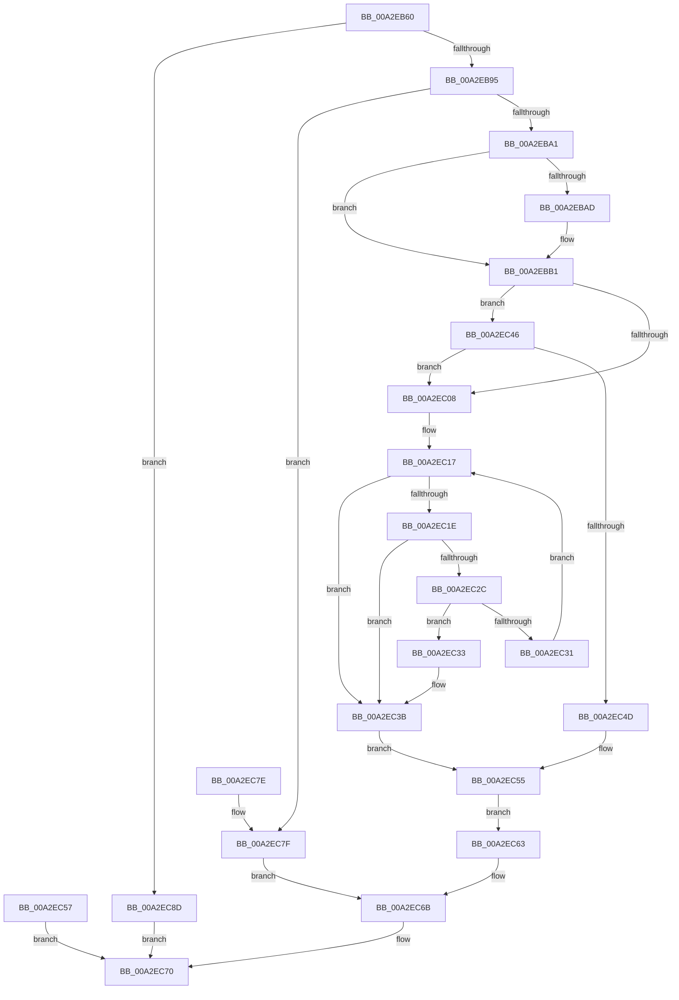

# ExpQueryModuleInformationImage

- RVA: `0x00A2EB60`–`0x00A2EC96` (길이 `310` bytes)
- VA: `0x0000000140A2EB60`
- 실행 섹션: `PAGE`
- PDB 이름 있음: `예`; PDB Function 태그: `아니요`
- unwind 정보 RVA: `0x000AC9C8`
- 디코드: `87`개 명령, `310/310` bytes 표시
- 미해석 바이트: `0` (있으면 어셈블리에 `.byte`로 보존)

> 이 문서는 커널 이미지의 기계어와 PDB 기호를 분석해 생성했습니다. 4번과 5번은 함수 원형과 자료형을 바이너리 사용 방식에서 추정한 C 해석이며 원본 소스 복구 결과는 아닙니다.

## 1. Dependencies

- 직접 호출 지점: **1**; 고유 호출 대상: **1**
- 직접 호출자로 확인된 함수: **0**
- RIP 상대 이미지 참조: **0**

### Outgoing calls
- `0x00A2EBF3` → [RtlUnicodeStringToAnsiString](../90/RtlUnicodeStringToAnsiString_function_0090D1F0.md) (function, `0x0090D1F0`)

### Direct callers
- 이 함수 시작 RVA로 연결되는 직접 call은 확인되지 않았습니다. 간접 호출은 완전히 역산할 수 없습니다.

### Static image references
- 디코드된 RIP-relative 메모리 참조가 없습니다.

## 2. Other-region calls and transfers

- 다른 실행 섹션으로 향하는 call: **0**
- 별도 외부 분기/꼬리 이동을 확인하지 못했습니다.

## 3. Assembly (complete function range)

```asm
00A2EB60  48 89 5C 24 08                  mov qword ptr [rsp + 8], rbx
00A2EB65  56                              push rsi
00A2EB66  57                              push rdi
00A2EB67  41 56                           push r14
00A2EB69  48 83 EC 50                     sub rsp, 0x50
00A2EB6D  48 8B DA                        mov rbx, rdx
00A2EB70  0F 57 C0                        xorps xmm0, xmm0
00A2EB73  0F 11 44 24 38                  movups xmmword ptr [rsp + 0x38], xmm0
00A2EB78  48 89 94 24 80 00 00 00         mov qword ptr [rsp + 0x80], rdx
00A2EB80  48 8B 7A 08                     mov rdi, qword ptr [rdx + 8]
00A2EB84  8B 42 14                        mov eax, dword ptr [rdx + 0x14]
00A2EB87  8D 90 28 01 00 00               lea edx, [rax + 0x128]
00A2EB8D  3B D0                           cmp edx, eax
00A2EB8F  0F 82 F8 00 00 00               jb 0x140a2ec8d
00A2EB95  89 53 14                        mov dword ptr [rbx + 0x14], edx
00A2EB98  39 53 10                        cmp dword ptr [rbx + 0x10], edx
00A2EB9B  0F 82 DE 00 00 00               jb 0x140a2ec7f
00A2EBA1  45 33 F6                        xor r14d, r14d
00A2EBA4  44 39 73 20                     cmp dword ptr [rbx + 0x20], r14d
00A2EBA8  41 8B C6                        mov eax, r14d
00A2EBAB  75 04                           jne 0x140a2ebb1
00A2EBAD  48 8B 41 30                     mov rax, qword ptr [rcx + 0x30]
00A2EBB1  48 89 47 10                     mov qword ptr [rdi + 0x10], rax
00A2EBB5  8B 41 40                        mov eax, dword ptr [rcx + 0x40]
00A2EBB8  89 47 18                        mov dword ptr [rdi + 0x18], eax
00A2EBBB  8B 41 68                        mov eax, dword ptr [rcx + 0x68]
00A2EBBE  89 47 1C                        mov dword ptr [rdi + 0x1c], eax
00A2EBC1  0F B7 41 6C                     movzx eax, word ptr [rcx + 0x6c]
00A2EBC5  66 89 47 24                     mov word ptr [rdi + 0x24], ax
00A2EBC9  0F B7 43 24                     movzx eax, word ptr [rbx + 0x24]
00A2EBCD  66 89 47 20                     mov word ptr [rdi + 0x20], ax
00A2EBD1  66 44 89 77 22                  mov word ptr [rdi + 0x22], r14w
00A2EBD6  48 8D 77 28                     lea rsi, [rdi + 0x28]
00A2EBDA  48 89 74 24 40                  mov qword ptr [rsp + 0x40], rsi
00A2EBDF  C7 44 24 38 00 00 00 01         mov dword ptr [rsp + 0x38], 0x1000000
00A2EBE7  48 8D 51 48                     lea rdx, [rcx + 0x48]
00A2EBEB  45 33 C0                        xor r8d, r8d
00A2EBEE  48 8D 4C 24 38                  lea rcx, [rsp + 0x38]
00A2EBF3  E8 F8 E5 ED FF                  call 0x14090d1f0
00A2EBF8  89 44 24 78                     mov dword ptr [rsp + 0x78], eax
00A2EBFC  BA 00 00 00 80                  mov edx, 0x80000000
00A2EC01  8D 0C 10                        lea ecx, [rax + rdx]
00A2EC04  85 CA                           test edx, ecx
00A2EC06  74 3E                           je 0x140a2ec46
00A2EC08  0F B7 44 24 38                  movzx eax, word ptr [rsp + 0x38]
00A2EC0D  48 03 44 24 40                  add rax, qword ptr [rsp + 0x40]
00A2EC12  48 89 44 24 28                  mov qword ptr [rsp + 0x28], rax
00A2EC17  48 3B 44 24 40                  cmp rax, qword ptr [rsp + 0x40]
00A2EC1C  76 1D                           jbe 0x140a2ec3b
00A2EC1E  48 FF C8                        dec rax
00A2EC21  48 89 44 24 28                  mov qword ptr [rsp + 0x28], rax
00A2EC26  8A 08                           mov cl, byte ptr [rax]
00A2EC28  84 C9                           test cl, cl
00A2EC2A  74 0F                           je 0x140a2ec3b
00A2EC2C  80 F9 5C                        cmp cl, 0x5c
00A2EC2F  74 02                           je 0x140a2ec33
00A2EC31  EB E4                           jmp 0x140a2ec17
00A2EC33  48 FF C0                        inc rax
00A2EC36  48 89 44 24 28                  mov qword ptr [rsp + 0x28], rax
00A2EC3B  66 2B 44 24 40                  sub ax, word ptr [rsp + 0x40]
00A2EC40  66 89 47 26                     mov word ptr [rdi + 0x26], ax
00A2EC44  EB 0F                           jmp 0x140a2ec55
00A2EC46  3D 05 00 00 80                  cmp eax, 0x80000005
00A2EC4B  74 BB                           je 0x140a2ec08
00A2EC4D  44 88 36                        mov byte ptr [rsi], r14b
00A2EC50  66 44 89 77 26                  mov word ptr [rdi + 0x26], r14w
00A2EC55  EB 0C                           jmp 0x140a2ec63
00A2EC57  48 8B 8C 24 80 00 00 00         mov rcx, qword ptr [rsp + 0x80]
00A2EC5F  89 01                           mov dword ptr [rcx], eax
00A2EC61  EB 0D                           jmp 0x140a2ec70
00A2EC63  48 81 43 08 28 01 00 00         add qword ptr [rbx + 8], 0x128
00A2EC6B  FF 43 24                        inc dword ptr [rbx + 0x24]
00A2EC6E  33 C0                           xor eax, eax
00A2EC70  48 8B 5C 24 70                  mov rbx, qword ptr [rsp + 0x70]
00A2EC75  48 83 C4 50                     add rsp, 0x50
00A2EC79  41 5E                           pop r14
00A2EC7B  5F                              pop rdi
00A2EC7C  5E                              pop rsi
00A2EC7D  C3                              ret
00A2EC7E  CC                              int3
00A2EC7F  48 8B 43 18                     mov rax, qword ptr [rbx + 0x18]
00A2EC83  89 10                           mov dword ptr [rax], edx
00A2EC85  C7 03 04 00 00 C0               mov dword ptr [rbx], 0xc0000004
00A2EC8B  EB DE                           jmp 0x140a2ec6b
00A2EC8D  B8 01 00 00 C0                  mov eax, 0xc0000001
00A2EC92  89 03                           mov dword ptr [rbx], eax
00A2EC94  EB DA                           jmp 0x140a2ec70
```

## 4. C-style interpretation (structured pseudocode)

```c
__int64 __fastcall ExpQueryModuleInformationImage(__int64 a1, __int64 a2, int a3)
{
    __int64 result;
    __int64 v_r14;
    __int64 v_rsp;
    unsigned __int64 v_stack_m28;
    unsigned __int64 v_stack_m30;
    unsigned __int64 v_stack_m40;
    unsigned int v_stack_p10;
    unsigned __int64 v_stack_p18;
    unsigned __int64 v_stack_p8;

    v_stack_p8 = v_rbx;
    v_rsp = (v_rsp) - (80);
    v_stack_m30 = v_xmm0;
    v_stack_p18 = a2;
    if (((unsigned int)((unsigned int)(*(unsigned int *)(a2 + 20)) + 296)) < ((unsigned int)((unsigned int)(*(unsigned int *)(a2 + 20))))) goto loc_00A2EC8D;
    *(unsigned int *)(a2 + 20) = (unsigned int)((unsigned int)(*(unsigned int *)(a2 + 20)) + 296);
    if ((*(unsigned int *)(a2 + 16)) < ((unsigned int)((unsigned int)(*(unsigned int *)(a2 + 20)) + 296))) goto loc_00A2EC7F;
    v_r14 = 0;
    result = 0;
    if ((*(unsigned int *)(a2 + 32)) == 0) {
        result = *(unsigned __int64 *)(a1 + 48);
    }
    *(unsigned __int64 *)(*(unsigned __int64 *)(a2 + 8) + 16) = result;
    *(unsigned int *)(*(unsigned __int64 *)(a2 + 8) + 24) = (unsigned int)((unsigned int)(*(unsigned int *)(a1 + 64)));
    *(unsigned int *)(*(unsigned __int64 *)(a2 + 8) + 28) = (unsigned int)((unsigned int)(*(unsigned int *)(a1 + 104)));
    *(unsigned __int16 *)(*(unsigned __int64 *)(a2 + 8) + 36) = (unsigned __int16)(*(unsigned __int16 *)(a1 + 108));
    *(unsigned __int16 *)(*(unsigned __int64 *)(a2 + 8) + 32) = (unsigned __int16)(*(unsigned __int16 *)(a2 + 36));
    *(unsigned __int16 *)(*(unsigned __int64 *)(a2 + 8) + 34) = 0;
    v_stack_m28 = *(unsigned __int64 *)(a2 + 8) + 40;
    v_stack_m30 = 0x1000000ULL;
    a3 = 0;
    result = RtlUnicodeStringToAnsiString(v_stack_m30, a1 + 72, a3, a4);
    v_stack_p10 = (unsigned int)(result);
    if ((((unsigned int)((unsigned int)(0x80000000ULL))) & ((unsigned int)(result + (unsigned int)(0x80000000ULL) * 1))) == 0) goto loc_00A2EC46;
loc_00A2EC08:
    result = (v_stack_m30) + (v_stack_m28);
    v_stack_m40 = result;
loc_00A2EC17:
    if (result <= v_stack_m28) goto loc_00A2EC3B;
    result = (result) - 1;
    v_stack_m40 = result;
    if ((unsigned __int8)(*(unsigned __int8 *)(result)) == 0) goto loc_00A2EC3B;
    if (((unsigned __int8)(*(unsigned __int8 *)(result))) == 92) goto loc_00A2EC33;
    goto loc_00A2EC17;
loc_00A2EC33:
    result = (result) + 1;
    v_stack_m40 = result;
loc_00A2EC3B:
    result = (unsigned __int16)((result) - (v_stack_m28));
    *(unsigned __int16 *)(*(unsigned __int64 *)(a2 + 8) + 38) = (unsigned __int16)(result);
    goto loc_00A2EC55;
loc_00A2EC46:
    if (((unsigned int)(result)) == 0x80000005ULL) goto loc_00A2EC08;
    *(unsigned __int8 *)(*(unsigned __int64 *)(a2 + 8) + 40) = 0;
    *(unsigned __int16 *)(*(unsigned __int64 *)(a2 + 8) + 38) = 0;
loc_00A2EC55:
    goto loc_00A2EC63;
loc_00A2EC63:
loc_00A2EC6B:
    result = 0;
loc_00A2EC70:
    v_rsp = (v_rsp) + (80);
    return result;
loc_00A2EC7F:
    *(unsigned int *)(*(unsigned __int64 *)(v_stack_p8 + 24)) = (unsigned int)((unsigned int)(0x80000000ULL));
    *(unsigned int *)(v_stack_p8) = 0xC0000004ULL;
    goto loc_00A2EC6B;
loc_00A2EC8D:
    *(unsigned int *)(v_stack_p8) = (unsigned int)((unsigned int)(0xC0000001ULL));
    goto loc_00A2EC70;
}
```

## 5. (Beta) C Style

```c
int64_t ExpQueryModuleInformationImage(void *Arg1, void *Arg2, int32_t Arg3)
{
    uint8_t *arg1 = (uint8_t *)Arg1;
    uint8_t *arg2 = (uint8_t *)Arg2;

    int64_t result;
    int64_t local_r14;
    int64_t local_rsp;
    uint64_t v_stack_m28;
    uint64_t v_stack_m30;
    uint64_t v_stack_m40;
    uint32_t v_stack_p10;
    uint64_t v_stack_p18;
    uint64_t v_stack_p8;

    v_stack_p8 = local_rbx;
    local_rsp = (local_rsp) - (80);
    v_stack_m30 = v_xmm0;
    v_stack_p18 = Arg2;
    if (((uint32_t)((uint32_t)(*(uint32_t *)(arg2 + 0x14)) + 296)) < ((uint32_t)((uint32_t)(*(uint32_t *)(arg2 + 0x14))))) goto loc_00A2EC8D;
    *(uint32_t *)(arg2 + 0x14) = (uint32_t)((uint32_t)(*(uint32_t *)(arg2 + 0x14)) + 296);
    if ((*(uint32_t *)(arg2 + 0x10)) < ((uint32_t)((uint32_t)(*(uint32_t *)(arg2 + 0x14)) + 296))) goto loc_00A2EC7F;
    local_r14 = 0;
    result = 0;
    if ((*(uint32_t *)(arg2 + 0x20)) == 0) {
        result = *(uint64_t *)(arg1 + 0x30);
    }
    *(uint64_t *)(*(uint64_t *)(arg2 + 0x8) + 0x10) = result;
    *(uint32_t *)(*(uint64_t *)(arg2 + 0x8) + 0x18) = (uint32_t)((uint32_t)(*(uint32_t *)(arg1 + 0x40)));
    *(uint32_t *)(*(uint64_t *)(arg2 + 0x8) + 0x1C) = (uint32_t)((uint32_t)(*(uint32_t *)(arg1 + 0x68)));
    *(uint16_t *)(*(uint64_t *)(arg2 + 0x8) + 0x24) = (uint16_t)(*(uint16_t *)(arg1 + 0x6C));
    *(uint16_t *)(*(uint64_t *)(arg2 + 0x8) + 0x20) = (uint16_t)(*(uint16_t *)(arg2 + 0x24));
    *(uint16_t *)(*(uint64_t *)(arg2 + 0x8) + 0x22) = 0;
    v_stack_m28 = *(uint64_t *)(arg2 + 0x8) + 40;
    v_stack_m30 = 0x1000000ULL;
    Arg3 = 0;
    result = RtlUnicodeStringToAnsiString(v_stack_m30, Arg1 + 72, Arg3, a4);
    v_stack_p10 = (uint32_t)(result);
    if ((((uint32_t)((uint32_t)(0x80000000ULL))) & ((uint32_t)(result + (uint32_t)(0x80000000ULL) * 1))) == 0) goto loc_00A2EC46;
loc_00A2EC08:
    result = (v_stack_m30) + (v_stack_m28);
    v_stack_m40 = result;
loc_00A2EC17:
    if (result <= v_stack_m28) goto loc_00A2EC3B;
    result = (result) - 1;
    v_stack_m40 = result;
    if ((uint8_t)(*(uint8_t *)(result)) == 0) goto loc_00A2EC3B;
    if (((uint8_t)(*(uint8_t *)(result))) == 92) goto loc_00A2EC33;
    goto loc_00A2EC17;
loc_00A2EC33:
    result = (result) + 1;
    v_stack_m40 = result;
loc_00A2EC3B:
    result = (uint16_t)((result) - (v_stack_m28));
    *(uint16_t *)(*(uint64_t *)(arg2 + 0x8) + 0x26) = (uint16_t)(result);
    goto loc_00A2EC55;
loc_00A2EC46:
    if (((uint32_t)(result)) == 0x80000005ULL) goto loc_00A2EC08;
    *(uint8_t *)(*(uint64_t *)(arg2 + 0x8) + 0x28) = 0;
    *(uint16_t *)(*(uint64_t *)(arg2 + 0x8) + 0x26) = 0;
loc_00A2EC55:
    goto loc_00A2EC63;
loc_00A2EC63:
loc_00A2EC6B:
    result = 0;
loc_00A2EC70:
    local_rsp = (local_rsp) + (80);
    return result;
loc_00A2EC7F:
    *(uint32_t *)(*(uint64_t *)(v_stack_p8 + 0x18)) = (uint32_t)((uint32_t)(0x80000000ULL));
    *(uint32_t *)(v_stack_p8) = 0xC0000004ULL;
    goto loc_00A2EC6B;
loc_00A2EC8D:
    *(uint32_t *)(v_stack_p8) = (uint32_t)((uint32_t)(0xC0000001ULL));
    goto loc_00A2EC70;
}
```

### 관측된 메모리 오프셋

구조체 형식이 확인되지 않은 접근은 인자 기준의 오프셋으로만 기록했습니다.

| 기준 인자 | 오프셋 표현 | 폭 (bit) | 접근 |
|---|---:|---:|---|
| `Arg1` | `+ 0x30` | `64` | `R` |
| `Arg1` | `+ 0x40` | `32` | `R` |
| `Arg1` | `+ 0x48` | `64` | `R` |
| `Arg1` | `+ 0x68` | `32` | `R` |
| `Arg1` | `+ 0x6C` | `16` | `R` |
| `Arg2` | `+ 0x0` | `32` | `W` |
| `Arg2` | `+ 0x8` | `64` | `R` |
| `Arg2` | `+ 0x8` | `64` | `R/W` |
| `Arg2` | `+ 0x10` | `32` | `R` |
| `Arg2` | `+ 0x14` | `32` | `R` |
| `Arg2` | `+ 0x14` | `32` | `W` |
| `Arg2` | `+ 0x18` | `64` | `R` |
| `Arg2` | `+ 0x20` | `32` | `R` |
| `Arg2` | `+ 0x24` | `16` | `R` |
| `Arg2` | `+ 0x24` | `32` | `R/W` |

## 6. Execution-region graph

[열기: 2D/3D 그래프와 함수 탐색 컨트롤 패널](../../../control-panel.html?section=page&rva=0x00A2EB60&view=graph)

- 2D 그래프는 위에서 아래로 흐르고, 3D 그래프는 빈 공간을 드래그해 회전합니다. Shift+드래그는 이동, 휠은 확대·축소, 함수 노드 선택은 대상 보고서 이동입니다.

### Static fallback


