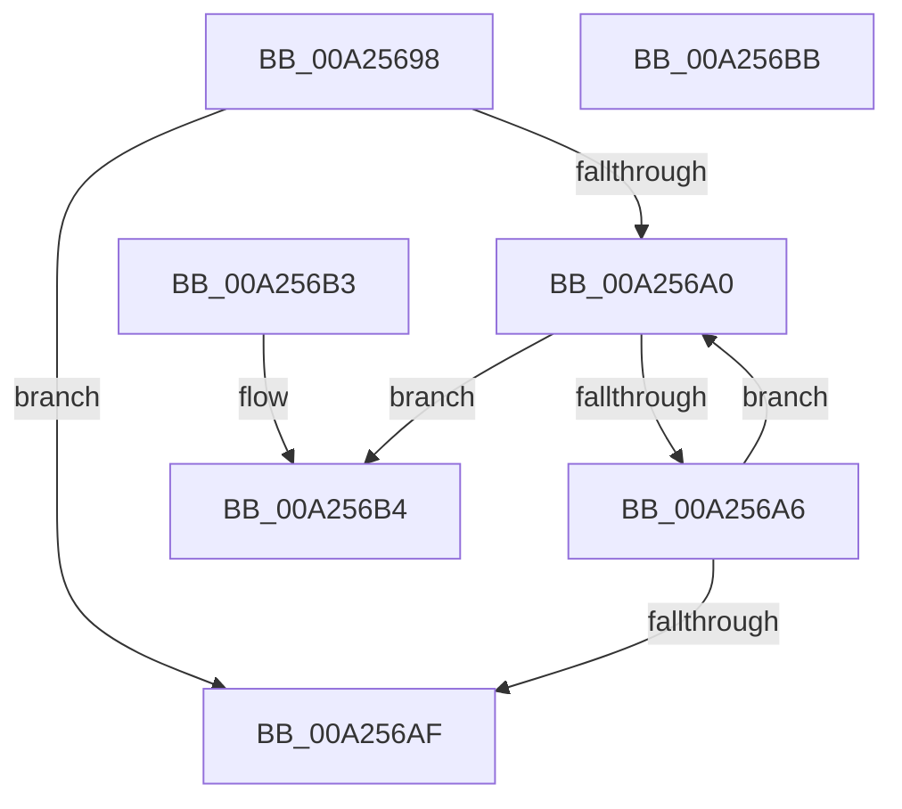

# ExpSafeWcslen

- RVA: `0x00A25698`–`0x00A256BC` (길이 `36` bytes)
- VA: `0x0000000140A25698`
- 실행 섹션: `PAGE`
- PDB 이름 있음: `예`; PDB Function 태그: `아니요`
- unwind 정보 RVA: `0x000DB714`
- 디코드: `15`개 명령, `36/36` bytes 표시
- 미해석 바이트: `0` (있으면 어셈블리에 `.byte`로 보존)

> 이 문서는 커널 이미지의 기계어와 PDB 기호를 분석해 생성했습니다. 4번과 5번은 함수 원형과 자료형을 바이너리 사용 방식에서 추정한 C 해석이며 원본 소스 복구 결과는 아닙니다.

## 1. Dependencies

- 직접 호출 지점: **0**; 고유 호출 대상: **0**
- 직접 호출자로 확인된 함수: **6**
- RIP 상대 이미지 참조: **0**

### Outgoing calls
- 직접 디코드된 call 명령이 없습니다.

### Direct callers
- [ExpSetBootEntry](../7C/ExpSetBootEntry_function_007CBD2C.md) at `0x007CBF52`
- [ExpSetDriverEntry](../7C/ExpSetDriverEntry_function_007CC424.md) at `0x007CC5C8`
- [NtEnumerateDriverEntries](../7C/NtEnumerateDriverEntries_function_007CD5D0.md) at `0x007CD856`
- [ExpVerifyWindowsOsOptions](ExpVerifyWindowsOsOptions_function_00A24CD8.md) at `0x00A24CEB`
- [NtEnumerateBootEntries](NtEnumerateBootEntries_function_00A25040.md) at `0x00A2527E`
- [ExpVerifyFilePath](ExpVerifyFilePath_function_00A257F0.md) at `0x00A258EF`
- [ExpVerifyFilePath](ExpVerifyFilePath_function_00A257F0.md) at `0x00A25906`
- [ExpVerifyFilePath](ExpVerifyFilePath_function_00A257F0.md) at `0x00A25914`

### Static image references
- 디코드된 RIP-relative 메모리 참조가 없습니다.

## 2. Other-region calls and transfers

- 다른 실행 섹션으로 향하는 call: **0**
- 별도 외부 분기/꼬리 이동을 확인하지 못했습니다.

## 3. Assembly (complete function range)

```asm
00A25698  48 8B C1                        mov rax, rcx
00A2569B  48 3B CA                        cmp rcx, rdx
00A2569E  73 0F                           jae 0x140a256af
00A256A0  66 83 38 00                     cmp word ptr [rax], 0
00A256A4  74 0E                           je 0x140a256b4
00A256A6  48 83 C0 02                     add rax, 2
00A256AA  48 3B C2                        cmp rax, rdx
00A256AD  72 F1                           jb 0x140a256a0
00A256AF  83 C8 FF                        or eax, 0xffffffff
00A256B2  C3                              ret
00A256B3  CC                              int3
00A256B4  48 2B C1                        sub rax, rcx
00A256B7  48 D1 F8                        sar rax, 1
00A256BA  C3                              ret
00A256BB  CC                              int3
```

## 4. C-style interpretation (structured pseudocode)

```c
__int64 __fastcall ExpSafeWcslen(__int64 a1, __int64 a2)
{
    __int64 result;

    if (a1 >= a2) goto loc_00A256AF;
loc_00A256A0:
    if ((*(unsigned __int16 *)(a1)) == 0) goto loc_00A256B4;
    result = (a1) + (2);
    if (result < a2) goto loc_00A256A0;
loc_00A256AF:
    result = (unsigned int)((result) | (0xFFFFFFFFULL));
    return result;
loc_00A256B4:
    result = (result) - (a1);
    result = (result) >> (1);
    return result;
}
```

## 5. (Beta) C Style

```c
int64_t ExpSafeWcslen(int64_t Arg1, int64_t Arg2)
{
    int64_t result;

    if (Arg1 >= Arg2) goto loc_00A256AF;
loc_00A256A0:
    if ((*(uint16_t *)(Arg1)) == 0) goto loc_00A256B4;
    result = (Arg1) + (2);
    if (result < Arg2) goto loc_00A256A0;
loc_00A256AF:
    result = (uint32_t)((result) | (0xFFFFFFFFULL));
    return result;
loc_00A256B4:
    result = (result) - (Arg1);
    result = (result) >> (1);
    return result;
}
```

## 6. Execution-region graph

[열기: 2D/3D 그래프와 함수 탐색 컨트롤 패널](../../../control-panel.html?section=page&rva=0x00A25698&view=graph)

- 2D 그래프는 위에서 아래로 흐르고, 3D 그래프는 빈 공간을 드래그해 회전합니다. Shift+드래그는 이동, 휠은 확대·축소, 함수 노드 선택은 대상 보고서 이동입니다.

### Static fallback


