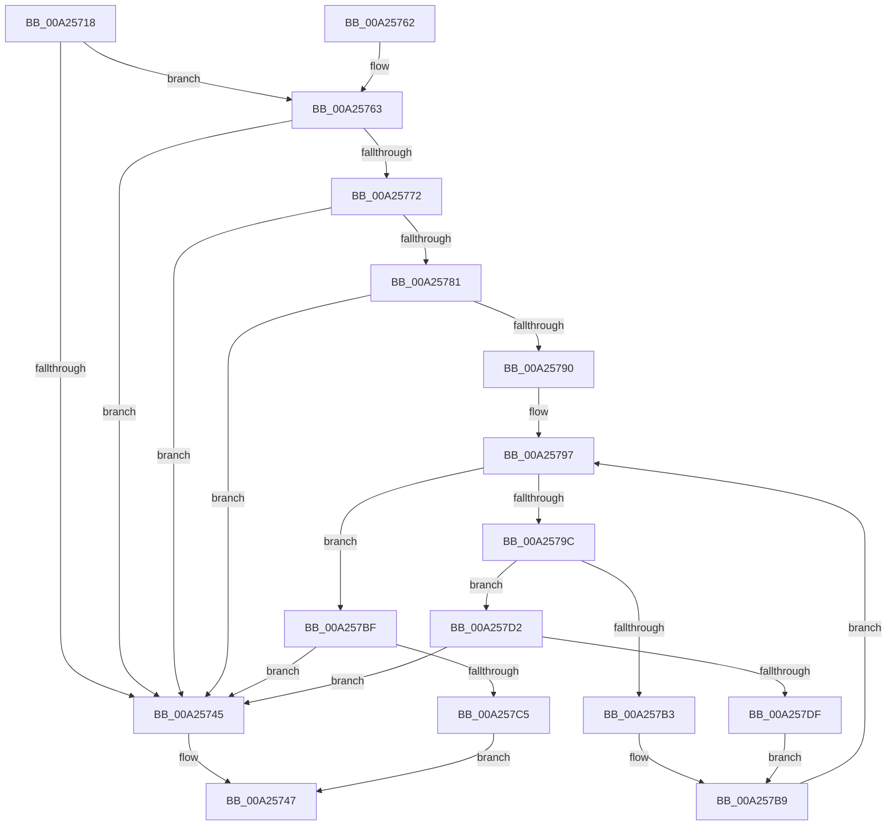

# ExpTranslateBootEntryNameToId

- RVA: `0x00A25718`–`0x00A257E7` (길이 `207` bytes)
- VA: `0x0000000140A25718`
- 실행 섹션: `PAGE`
- PDB 이름 있음: `예`; PDB Function 태그: `아니요`
- unwind 정보 RVA: `0x0007827C`
- 디코드: `62`개 명령, `207/207` bytes 표시
- 미해석 바이트: `0` (있으면 어셈블리에 `.byte`로 보존)

> 이 문서는 커널 이미지의 기계어와 PDB 기호를 분석해 생성했습니다. 4번과 5번은 함수 원형과 자료형을 바이너리 사용 방식에서 추정한 C 해석이며 원본 소스 복구 결과는 아닙니다.

## 1. Dependencies

- 직접 호출 지점: **5**; 고유 호출 대상: **1**
- 직접 호출자로 확인된 함수: **2**
- RIP 상대 이미지 참조: **0**

### Outgoing calls
- `0x00A2573A` → [towlower](../../text/50/towlower_function_005018E0.md) (function, `0x005018E0`)
- `0x00A25767` → [towlower](../../text/50/towlower_function_005018E0.md) (function, `0x005018E0`)
- `0x00A25776` → [towlower](../../text/50/towlower_function_005018E0.md) (function, `0x005018E0`)
- `0x00A25785` → [towlower](../../text/50/towlower_function_005018E0.md) (function, `0x005018E0`)
- `0x00A257A2` → [towlower](../../text/50/towlower_function_005018E0.md) (function, `0x005018E0`)

### Direct callers
- [NtEnumerateBootEntries](NtEnumerateBootEntries_function_00A25040.md) at `0x00A2523B`
- [ExpIsBootEntry](ExpIsBootEntry_function_00A256D0.md) at `0x00A25703`

### Static image references
- 디코드된 RIP-relative 메모리 참조가 없습니다.

## 2. Other-region calls and transfers

- 다른 실행 섹션으로 향하는 call: **5**
  - `0x00A2573A` → [towlower](../../text/50/towlower_function_005018E0.md) (`PAGE` → `.text`)
  - `0x00A25767` → [towlower](../../text/50/towlower_function_005018E0.md) (`PAGE` → `.text`)
  - `0x00A25776` → [towlower](../../text/50/towlower_function_005018E0.md) (`PAGE` → `.text`)
  - `0x00A25785` → [towlower](../../text/50/towlower_function_005018E0.md) (`PAGE` → `.text`)
  - `0x00A257A2` → [towlower](../../text/50/towlower_function_005018E0.md) (`PAGE` → `.text`)
- 별도 외부 분기/꼬리 이동을 확인하지 못했습니다.

## 3. Assembly (complete function range)

```asm
00A25718  48 8B C4                        mov rax, rsp
00A2571B  48 89 58 08                     mov qword ptr [rax + 8], rbx
00A2571F  48 89 68 10                     mov qword ptr [rax + 0x10], rbp
00A25723  48 89 70 18                     mov qword ptr [rax + 0x18], rsi
00A25727  48 89 78 20                     mov qword ptr [rax + 0x20], rdi
00A2572B  41 56                           push r14
00A2572D  48 83 EC 20                     sub rsp, 0x20
00A25731  48 8B F9                        mov rdi, rcx
00A25734  4C 8B F2                        mov r14, rdx
00A25737  0F B7 09                        movzx ecx, word ptr [rcx]
00A2573A  E8 A1 C1 AD FF                  call 0x1405018e0
00A2573F  66 83 F8 62                     cmp ax, 0x62
00A25743  74 1E                           je 0x140a25763
00A25745  33 C0                           xor eax, eax
00A25747  48 8B 5C 24 30                  mov rbx, qword ptr [rsp + 0x30]
00A2574C  48 8B 6C 24 38                  mov rbp, qword ptr [rsp + 0x38]
00A25751  48 8B 74 24 40                  mov rsi, qword ptr [rsp + 0x40]
00A25756  48 8B 7C 24 48                  mov rdi, qword ptr [rsp + 0x48]
00A2575B  48 83 C4 20                     add rsp, 0x20
00A2575F  41 5E                           pop r14
00A25761  C3                              ret
00A25762  CC                              int3
00A25763  0F B7 4F 02                     movzx ecx, word ptr [rdi + 2]
00A25767  E8 74 C1 AD FF                  call 0x1405018e0
00A2576C  66 83 F8 6F                     cmp ax, 0x6f
00A25770  75 D3                           jne 0x140a25745
00A25772  0F B7 4F 04                     movzx ecx, word ptr [rdi + 4]
00A25776  E8 65 C1 AD FF                  call 0x1405018e0
00A2577B  66 83 F8 6F                     cmp ax, 0x6f
00A2577F  75 C4                           jne 0x140a25745
00A25781  0F B7 4F 06                     movzx ecx, word ptr [rdi + 6]
00A25785  E8 56 C1 AD FF                  call 0x1405018e0
00A2578A  66 83 F8 74                     cmp ax, 0x74
00A2578E  75 B5                           jne 0x140a25745
00A25790  33 ED                           xor ebp, ebp
00A25792  8B DD                           mov ebx, ebp
00A25794  8D 75 04                        lea esi, [rbp + 4]
00A25797  83 FE 08                        cmp esi, 8
00A2579A  73 23                           jae 0x140a257bf
00A2579C  8B CE                           mov ecx, esi
00A2579E  0F B7 0C 4F                     movzx ecx, word ptr [rdi + rcx*2]
00A257A2  E8 39 C1 AD FF                  call 0x1405018e0
00A257A7  0F B7 D0                        movzx edx, ax
00A257AA  8D 4A D0                        lea ecx, [rdx - 0x30]
00A257AD  66 83 F9 09                     cmp cx, 9
00A257B1  77 1F                           ja 0x140a257d2
00A257B3  C1 E3 04                        shl ebx, 4
00A257B6  83 C3 D0                        add ebx, -0x30
00A257B9  03 DA                           add ebx, edx
00A257BB  FF C6                           inc esi
00A257BD  EB D8                           jmp 0x140a25797
00A257BF  66 39 6F 10                     cmp word ptr [rdi + 0x10], bp
00A257C3  75 80                           jne 0x140a25745
00A257C5  41 89 1E                        mov dword ptr [r14], ebx
00A257C8  B8 01 00 00 00                  mov eax, 1
00A257CD  E9 75 FF FF FF                  jmp 0x140a25747
00A257D2  8D 42 9F                        lea eax, [rdx - 0x61]
00A257D5  66 83 F8 05                     cmp ax, 5
00A257D9  0F 87 66 FF FF FF               ja 0x140a25745
00A257DF  C1 E3 04                        shl ebx, 4
00A257E2  83 C3 A9                        add ebx, -0x57
00A257E5  EB D2                           jmp 0x140a257b9
```

## 4. C-style interpretation (structured pseudocode)

```c
__int64 __fastcall ExpTranslateBootEntryNameToId(__int64 a1, __int64 a2)
{
    __int64 result;
    __int64 v_rbp;
    __int64 v_rbx;
    __int64 v_rsi;
    __int64 v_rsp;
    unsigned __int64 v_stack_p10;
    unsigned __int64 v_stack_p18;
    unsigned __int64 v_stack_p20;
    unsigned __int64 v_stack_p8;

    *(unsigned __int64 *)(v_rsp + 8) = v_rbx;
    *(unsigned __int64 *)(v_rsp + 16) = v_rbp;
    *(unsigned __int64 *)(v_rsp + 24) = v_rsi;
    *(unsigned __int64 *)(v_rsp + 32) = v_rdi;
    v_rsp = (v_rsp) - (32);
    result = towlower(*(unsigned __int16 *)(a1), a2, a3, a4);
    if (((unsigned __int16)(result)) == 98) goto loc_00A25763;
loc_00A25745:
    result = 0;
loc_00A25747:
    v_rsp = (v_rsp) + (32);
    return result;
loc_00A25763:
    result = towlower(*(unsigned __int16 *)(v_stack_p20 + 2), a2, a3, a4);
    if (((unsigned __int16)(result)) != 111) goto loc_00A25745;
    result = towlower(*(unsigned __int16 *)(v_stack_p20 + 4), a2, a3, a4);
    if (((unsigned __int16)(result)) != 111) goto loc_00A25745;
    result = towlower(*(unsigned __int16 *)(v_stack_p20 + 6), a2, a3, a4);
    if (((unsigned __int16)(result)) != 116) goto loc_00A25745;
    v_rbp = 0;
loc_00A25797:
    if (((unsigned int)(v_rbp + 4)) >= 8) goto loc_00A257BF;
    result = towlower(*(unsigned __int16 *)(v_stack_p20 + (unsigned int)((unsigned int)(v_rbp + 4)) * 2), a2, a3, a4);
    if (((unsigned __int16)((unsigned __int16)(result) - 48)) > 9) goto loc_00A257D2;
    v_rbx = (unsigned int)((0) << (4));
    v_rbx = (unsigned int)((v_rbx) + (-48));
loc_00A257B9:
    v_rbx = (unsigned int)((v_rbx) + ((unsigned int)((unsigned __int16)(result))));
    v_rsi = (unsigned int)((v_rbp + 4) + 1);
    goto loc_00A25797;
loc_00A257BF:
    if ((*(unsigned __int16 *)(v_stack_p20 + 16)) != 0) goto loc_00A25745;
    *(unsigned int *)(a2) = (unsigned int)(v_rbx);
    goto loc_00A25747;
loc_00A257D2:
    if (((unsigned __int16)((unsigned __int16)(result) - 97)) > 5) goto loc_00A25745;
    v_rbx = (unsigned int)((v_rbx) << (4));
    v_rbx = (unsigned int)((v_rbx) + (-87));
    goto loc_00A257B9;
}
```

## 5. (Beta) C Style

```c
int64_t ExpTranslateBootEntryNameToId(void *Arg1, void *Arg2)
{
    uint8_t *arg1 = (uint8_t *)Arg1;
    uint8_t *arg2 = (uint8_t *)Arg2;

    int64_t result;
    int64_t local_rbp;
    int64_t local_rbx;
    int64_t local_rsi;
    int64_t local_rsp;
    uint64_t v_stack_p10;
    uint64_t v_stack_p18;
    uint64_t v_stack_p20;
    uint64_t v_stack_p8;

    *(uint64_t *)(local_rsp + 0x8) = local_rbx;
    *(uint64_t *)(local_rsp + 0x10) = local_rbp;
    *(uint64_t *)(local_rsp + 0x18) = local_rsi;
    *(uint64_t *)(local_rsp + 0x20) = local_rdi;
    local_rsp = (local_rsp) - (32);
    result = towlower(*(uint16_t *)(arg1), Arg2, a3, a4);
    if (((uint16_t)(result)) == 98) goto loc_00A25763;
loc_00A25745:
    result = 0;
loc_00A25747:
    local_rsp = (local_rsp) + (32);
    return result;
loc_00A25763:
    result = towlower(*(uint16_t *)(v_stack_p20 + 0x2), Arg2, a3, a4);
    if (((uint16_t)(result)) != 111) goto loc_00A25745;
    result = towlower(*(uint16_t *)(v_stack_p20 + 0x4), Arg2, a3, a4);
    if (((uint16_t)(result)) != 111) goto loc_00A25745;
    result = towlower(*(uint16_t *)(v_stack_p20 + 0x6), Arg2, a3, a4);
    if (((uint16_t)(result)) != 116) goto loc_00A25745;
    local_rbp = 0;
loc_00A25797:
    if (((uint32_t)(local_rbp + 4)) >= 8) goto loc_00A257BF;
    result = towlower(*(uint16_t *)(v_stack_p20 + (uint32_t)((uint32_t)(local_rbp + 0x4)) * 2), Arg2, a3, a4);
    if (((uint16_t)((uint16_t)(result) - 48)) > 9) goto loc_00A257D2;
    local_rbx = (uint32_t)((0) << (4));
    local_rbx = (uint32_t)((local_rbx) + (-48));
loc_00A257B9:
    local_rbx = (uint32_t)((local_rbx) + ((uint32_t)((uint16_t)(result))));
    local_rsi = (uint32_t)((local_rbp + 4) + 1);
    goto loc_00A25797;
loc_00A257BF:
    if ((*(uint16_t *)(v_stack_p20 + 0x10)) != 0) goto loc_00A25745;
    *(uint32_t *)(arg2) = (uint32_t)(local_rbx);
    goto loc_00A25747;
loc_00A257D2:
    if (((uint16_t)((uint16_t)(result) - 97)) > 5) goto loc_00A25745;
    local_rbx = (uint32_t)((local_rbx) << (4));
    local_rbx = (uint32_t)((local_rbx) + (-87));
    goto loc_00A257B9;
}
```

### 관측된 메모리 오프셋

구조체 형식이 확인되지 않은 접근은 인자 기준의 오프셋으로만 기록했습니다.

| 기준 인자 | 오프셋 표현 | 폭 (bit) | 접근 |
|---|---:|---:|---|
| `Arg1` | `+ 0x0` | `16` | `R` |
| `Arg1` | `+ 0x0 + rcx*2` | `16` | `R` |
| `Arg1` | `+ 0x2` | `16` | `R` |
| `Arg1` | `+ 0x4` | `16` | `R` |
| `Arg1` | `+ 0x6` | `16` | `R` |
| `Arg1` | `+ 0x10` | `16` | `R` |
| `Arg2` | `+ 0x0` | `32` | `W` |

## 6. Execution-region graph

[열기: 2D/3D 그래프와 함수 탐색 컨트롤 패널](../../../control-panel.html?section=page&rva=0x00A25718&view=graph)

- 2D 그래프는 위에서 아래로 흐르고, 3D 그래프는 빈 공간을 드래그해 회전합니다. Shift+드래그는 이동, 휠은 확대·축소, 함수 노드 선택은 대상 보고서 이동입니다.

### Static fallback


