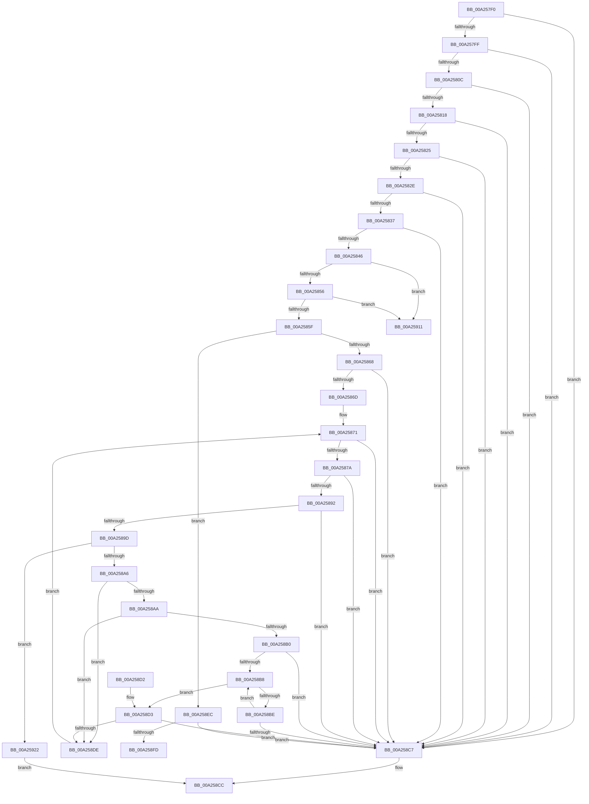

# ExpVerifyFilePath

- RVA: `0x00A257F0`–`0x00A25926` (길이 `310` bytes)
- VA: `0x0000000140A257F0`
- 실행 섹션: `PAGE`
- PDB 이름 있음: `예`; PDB Function 태그: `예`
- unwind 정보 RVA: `0x00063DA4`
- 디코드: `93`개 명령, `310/310` bytes 표시
- 미해석 바이트: `0` (있으면 어셈블리에 `.byte`로 보존)

> 이 문서는 커널 이미지의 기계어와 PDB 기호를 분석해 생성했습니다. 4번과 5번은 함수 원형과 자료형을 바이너리 사용 방식에서 추정한 C 해석이며 원본 소스 복구 결과는 아닙니다.

## 1. Dependencies

- 직접 호출 지점: **3**; 고유 호출 대상: **1**
- 직접 호출자로 확인된 함수: **5**
- RIP 상대 이미지 참조: **0**

### Outgoing calls
- `0x00A258EF` → [ExpSafeWcslen](ExpSafeWcslen_function_00A25698.md) (function, `0x00A25698`)
- `0x00A25906` → [ExpSafeWcslen](ExpSafeWcslen_function_00A25698.md) (function, `0x00A25698`)
- `0x00A25914` → [ExpSafeWcslen](ExpSafeWcslen_function_00A25698.md) (function, `0x00A25698`)

### Direct callers
- [ExpSetBootEntry](../7C/ExpSetBootEntry_function_007CBD2C.md) at `0x007CBF73`
- [ExpSetDriverEntry](../7C/ExpSetDriverEntry_function_007CC424.md) at `0x007CC5E1`
- [ExpVerifyWindowsOsOptions](ExpVerifyWindowsOsOptions_function_00A24CD8.md) at `0x00A24D37`
- [NtTranslateFilePath](NtTranslateFilePath_function_00A24D50.md) at `0x00A24F75`
- [NtEnumerateBootEntries](NtEnumerateBootEntries_function_00A25040.md) at `0x00A2533F`

### Static image references
- 디코드된 RIP-relative 메모리 참조가 없습니다.

## 2. Other-region calls and transfers

- 다른 실행 섹션으로 향하는 call: **0**
- call이 아닌 외부 분기/꼬리 이동: **2**
  - `0x00A2590C` → [sub_00B37D3A](../B3/Unknown_function_00B37D3A.md) (`tail-transfer`)
  - `0x00A2591D` → [sub_00B37D3A](../B3/Unknown_function_00B37D3A.md) (`tail-transfer`)

## 3. Assembly (complete function range)

```asm
00A257F0  40 53                           push rbx
00A257F2  48 83 EC 20                     sub rsp, 0x20
00A257F6  48 3B CA                        cmp rcx, rdx
00A257F9  0F 87 C8 00 00 00               ja 0x140a258c7
00A257FF  4C 8D 41 0C                     lea r8, [rcx + 0xc]
00A25803  4C 3B C2                        cmp r8, rdx
00A25806  0F 87 BB 00 00 00               ja 0x140a258c7
00A2580C  8B 41 04                        mov eax, dword ptr [rcx + 4]
00A2580F  83 F8 0C                        cmp eax, 0xc
00A25812  0F 82 AF 00 00 00               jb 0x140a258c7
00A25818  4C 8D 0C 01                     lea r9, [rcx + rax]
00A2581C  4C 3B C9                        cmp r9, rcx
00A2581F  0F 82 A2 00 00 00               jb 0x140a258c7
00A25825  4C 3B CA                        cmp r9, rdx
00A25828  0F 87 99 00 00 00               ja 0x140a258c7
00A2582E  83 39 01                        cmp dword ptr [rcx], 1
00A25831  0F 85 90 00 00 00               jne 0x140a258c7
00A25837  8B 49 08                        mov ecx, dword ptr [rcx + 8]
00A2583A  8D 41 FF                        lea eax, [rcx - 1]
00A2583D  83 F8 04                        cmp eax, 4
00A25840  0F 87 81 00 00 00               ja 0x140a258c7
00A25846  4C 3B CA                        cmp r9, rdx
00A25849  49 0F 42 D1                     cmovb rdx, r9
00A2584D  83 E9 01                        sub ecx, 1
00A25850  0F 84 BB 00 00 00               je 0x140a25911
00A25856  83 E9 01                        sub ecx, 1
00A25859  0F 84 B2 00 00 00               je 0x140a25911
00A2585F  83 E9 01                        sub ecx, 1
00A25862  0F 84 84 00 00 00               je 0x140a258ec
00A25868  83 F9 01                        cmp ecx, 1
00A2586B  75 5A                           jne 0x140a258c7
00A2586D  41 83 C9 FF                     or r9d, 0xffffffff
00A25871  49 8D 48 04                     lea rcx, [r8 + 4]
00A25875  48 3B CA                        cmp rcx, rdx
00A25878  77 4D                           ja 0x140a258c7
00A2587A  45 0F B6 50 03                  movzx r10d, byte ptr [r8 + 3]
00A2587F  41 0F B6 58 02                  movzx ebx, byte ptr [r8 + 2]
00A25884  41 C1 E2 08                     shl r10d, 8
00A25888  8B C3                           mov eax, ebx
00A2588A  41 0B C2                        or eax, r10d
00A2588D  83 F8 04                        cmp eax, 4
00A25890  72 35                           jb 0x140a258c7
00A25892  44 8B D8                        mov r11d, eax
00A25895  4D 03 D8                        add r11, r8
00A25898  4C 3B DA                        cmp r11, rdx
00A2589B  77 2A                           ja 0x140a258c7
00A2589D  41 8A 00                        mov al, byte ptr [r8]
00A258A0  24 7F                           and al, 0x7f
00A258A2  3C 7F                           cmp al, 0x7f
00A258A4  74 7C                           je 0x140a25922
00A258A6  3C 04                           cmp al, 4
00A258A8  75 34                           jne 0x140a258de
00A258AA  41 38 40 01                     cmp byte ptr [r8 + 1], al
00A258AE  75 2E                           jne 0x140a258de
00A258B0  48 8B C1                        mov rax, rcx
00A258B3  49 3B CB                        cmp rcx, r11
00A258B6  73 0F                           jae 0x140a258c7
00A258B8  66 83 38 00                     cmp word ptr [rax], 0
00A258BC  74 15                           je 0x140a258d3
00A258BE  48 83 C0 02                     add rax, 2
00A258C2  49 3B C3                        cmp rax, r11
00A258C5  72 F1                           jb 0x140a258b8
00A258C7  B8 0D 00 00 C0                  mov eax, 0xc000000d
00A258CC  48 83 C4 20                     add rsp, 0x20
00A258D0  5B                              pop rbx
00A258D1  C3                              ret
00A258D2  CC                              int3
00A258D3  48 2B C1                        sub rax, rcx
00A258D6  48 D1 F8                        sar rax, 1
00A258D9  41 3B C1                        cmp eax, r9d
00A258DC  74 E9                           je 0x140a258c7
00A258DE  48 8B CB                        mov rcx, rbx
00A258E1  41 8B C2                        mov eax, r10d
00A258E4  48 0B C8                        or rcx, rax
00A258E7  4C 03 C1                        add r8, rcx
00A258EA  EB 85                           jmp 0x140a25871
00A258EC  49 8B C8                        mov rcx, r8
00A258EF  E8 A4 FD FF FF                  call 0x140a25698
00A258F4  41 83 C9 FF                     or r9d, 0xffffffff
00A258F8  41 3B C1                        cmp eax, r9d
00A258FB  74 CA                           je 0x140a258c7
00A258FD  8B C0                           mov eax, eax
00A258FF  48 FF C0                        inc rax
00A25902  49 8D 0C 40                     lea rcx, [r8 + rax*2]
00A25906  E8 8D FD FF FF                  call 0x140a25698
00A2590B  90                              nop
00A2590C  E9 29 24 11 00                  jmp 0x140b37d3a
00A25911  49 8B C8                        mov rcx, r8
00A25914  E8 7F FD FF FF                  call 0x140a25698
00A25919  41 83 C9 FF                     or r9d, 0xffffffff
00A2591D  E9 18 24 11 00                  jmp 0x140b37d3a
00A25922  33 C0                           xor eax, eax
00A25924  EB A6                           jmp 0x140a258cc
```

## 4. C-style interpretation (structured pseudocode)

```c
__int64 __fastcall ExpVerifyFilePath(__int64 a1, __int64 a2)
{
    __int64 result;
    __int64 v_r10;
    __int64 v_r11;
    __int64 v_rsp;

    v_rsp = (v_rsp) - (32);
    if (a1 > a2) goto loc_00A258C7;
    if ((a1 + 12) > a2) goto loc_00A258C7;
    if (((unsigned int)((unsigned int)(*(unsigned int *)(a1 + 4)))) < 12) goto loc_00A258C7;
    if ((a1 + (unsigned int)(*(unsigned int *)(a1 + 4)) * 1) < a1) goto loc_00A258C7;
    if ((a1 + (unsigned int)(*(unsigned int *)(a1 + 4)) * 1) > a2) goto loc_00A258C7;
    if ((*(unsigned int *)(a1)) != 1) goto loc_00A258C7;
    if (((unsigned int)((unsigned int)(*(unsigned int *)(a1 + 8)) - 1)) > 4) goto loc_00A258C7;
    if ((a1 + (unsigned int)(*(unsigned int *)(a1 + 4)) * 1) < a2) { a2 = a1 + (unsigned int)(*(unsigned int *)(a1 + 4)) * 1; }
    a1 = (unsigned int)(((unsigned int)(*(unsigned int *)(a1 + 8))) - (1));
    if (condition_is_equal) goto loc_00A25911;
    a1 = (unsigned int)((a1) - (1));
    if (condition_is_equal) goto loc_00A25911;
    a1 = (unsigned int)((a1) - (1));
    if (condition_is_equal) goto loc_00A258EC;
    if (((unsigned int)(a1)) != 1) goto loc_00A258C7;
    a4 = (unsigned int)((a1 + (unsigned int)(*(unsigned int *)(a1 + 4)) * 1) | (0xFFFFFFFFULL));
loc_00A25871:
    if ((a1 + 12 + 4) > a2) goto loc_00A258C7;
    v_r10 = (unsigned int)((*(unsigned __int8 *)(a1 + 12 + 3)) << (8));
    result = (unsigned int)(((unsigned int)((unsigned int)(*(unsigned __int8 *)(a1 + 12 + 2)))) | ((unsigned int)(v_r10)));
    if (((unsigned int)(result)) < 4) goto loc_00A258C7;
    v_r11 = ((unsigned int)((unsigned int)(result))) + (a1 + 12);
    if (v_r11 > a2) goto loc_00A258C7;
    result = (unsigned __int8)((*(unsigned __int8 *)(a1 + 12)) & (127));
    if (((unsigned __int8)(result)) == 127) goto loc_00A25922;
    if (((unsigned __int8)(result)) != 4) goto loc_00A258DE;
    if ((*(unsigned __int8 *)(a1 + 12 + 1)) != ((unsigned __int8)(result))) goto loc_00A258DE;
    if ((a1 + 12 + 4) >= v_r11) goto loc_00A258C7;
loc_00A258B8:
    if ((*(unsigned __int16 *)(a1 + 12 + 4)) == 0) goto loc_00A258D3;
    result = (a1 + 12 + 4) + (2);
    if (result < v_r11) goto loc_00A258B8;
loc_00A258C7:
loc_00A258CC:
    v_rsp = (v_rsp) + (32);
    return (unsigned int)(0xC000000DULL);
loc_00A258D3:
    result = ((unsigned int)(0xC000000DULL)) - (a1 + 12 + 4);
    result = (result) >> (1);
    if (((unsigned int)(result)) == ((unsigned int)(a4))) goto loc_00A258C7;
loc_00A258DE:
    a1 = (*(unsigned __int8 *)(a1 + 12 + 2)) | ((unsigned int)((unsigned int)(v_r10)));
    a3 = (a1 + 12) + (a1);
    goto loc_00A25871;
loc_00A258EC:
    result = ExpSafeWcslen(a3, a2, a3, a4);
    a4 = (unsigned int)((a4) | (0xFFFFFFFFULL));
    if (((unsigned int)(result)) == ((unsigned int)(a4))) goto loc_00A258C7;
    result = ((unsigned int)((unsigned int)(result))) + 1;
    result = ExpSafeWcslen(a3 + result * 2, a2, a3, a4);
loc_00A25911:
    result = ExpSafeWcslen(a3, a2, a3, a4);
    a4 = (unsigned int)((a4) | (0xFFFFFFFFULL));
loc_00A25922:
    result = 0;
    goto loc_00A258CC;
}
```

## 5. (Beta) C Style

```c
int64_t ExpVerifyFilePath(int64_t Arg1, int64_t Arg2)
{
    int64_t result;
    int64_t local_r10;
    int64_t local_r11;
    int64_t local_rsp;

    local_rsp = (local_rsp) - (32);
    if (Arg1 > Arg2) goto loc_00A258C7;
    if ((Arg1 + 12) > Arg2) goto loc_00A258C7;
    if (((uint32_t)((uint32_t)(*(uint32_t *)(Arg1 + 0x4)))) < 12) goto loc_00A258C7;
    if ((Arg1 + (uint32_t)(*(uint32_t *)(Arg1 + 0x4)) * 1) < Arg1) goto loc_00A258C7;
    if ((Arg1 + (uint32_t)(*(uint32_t *)(Arg1 + 0x4)) * 1) > Arg2) goto loc_00A258C7;
    if ((*(uint32_t *)(Arg1)) != 1) goto loc_00A258C7;
    if (((uint32_t)((uint32_t)(*(uint32_t *)(Arg1 + 0x8)) - 1)) > 4) goto loc_00A258C7;
    if ((Arg1 + (uint32_t)(*(uint32_t *)(Arg1 + 0x4)) * 1) < Arg2) { Arg2 = Arg1 + (uint32_t)(*(uint32_t *)(Arg1 + 0x4)) * 1; }
    Arg1 = (uint32_t)(((uint32_t)(*(uint32_t *)(Arg1 + 0x8))) - (1));
    if (condition_is_equal) goto loc_00A25911;
    Arg1 = (uint32_t)((Arg1) - (1));
    if (condition_is_equal) goto loc_00A25911;
    Arg1 = (uint32_t)((Arg1) - (1));
    if (condition_is_equal) goto loc_00A258EC;
    if (((uint32_t)(Arg1)) != 1) goto loc_00A258C7;
    a4 = (uint32_t)((Arg1 + (uint32_t)(*(uint32_t *)(Arg1 + 0x4)) * 1) | (0xFFFFFFFFULL));
loc_00A25871:
    if ((Arg1 + 12 + 4) > Arg2) goto loc_00A258C7;
    local_r10 = (uint32_t)((*(uint8_t *)(Arg1 + 0xC + 0x3)) << (8));
    result = (uint32_t)(((uint32_t)((uint32_t)(*(uint8_t *)(Arg1 + 0xC + 0x2)))) | ((uint32_t)(local_r10)));
    if (((uint32_t)(result)) < 4) goto loc_00A258C7;
    local_r11 = ((uint32_t)((uint32_t)(result))) + (Arg1 + 12);
    if (local_r11 > Arg2) goto loc_00A258C7;
    result = (uint8_t)((*(uint8_t *)(Arg1 + 0xC)) & (127));
    if (((uint8_t)(result)) == 127) goto loc_00A25922;
    if (((uint8_t)(result)) != 4) goto loc_00A258DE;
    if ((*(uint8_t *)(Arg1 + 0xC + 0x1)) != ((uint8_t)(result))) goto loc_00A258DE;
    if ((Arg1 + 12 + 4) >= local_r11) goto loc_00A258C7;
loc_00A258B8:
    if ((*(uint16_t *)(Arg1 + 0xC + 0x4)) == 0) goto loc_00A258D3;
    result = (Arg1 + 12 + 4) + (2);
    if (result < local_r11) goto loc_00A258B8;
loc_00A258C7:
loc_00A258CC:
    local_rsp = (local_rsp) + (32);
    return (uint32_t)(0xC000000DULL);
loc_00A258D3:
    result = ((uint32_t)(0xC000000DULL)) - (Arg1 + 12 + 4);
    result = (result) >> (1);
    if (((uint32_t)(result)) == ((uint32_t)(a4))) goto loc_00A258C7;
loc_00A258DE:
    Arg1 = (*(uint8_t *)(Arg1 + 0xC + 0x2)) | ((uint32_t)((uint32_t)(local_r10)));
    a3 = (Arg1 + 12) + (Arg1);
    goto loc_00A25871;
loc_00A258EC:
    result = ExpSafeWcslen(a3, Arg2, a3, a4);
    a4 = (uint32_t)((a4) | (0xFFFFFFFFULL));
    if (((uint32_t)(result)) == ((uint32_t)(a4))) goto loc_00A258C7;
    result = ((uint32_t)((uint32_t)(result))) + 1;
    result = ExpSafeWcslen(a3 + result * 2, Arg2, a3, a4);
loc_00A25911:
    result = ExpSafeWcslen(a3, Arg2, a3, a4);
    a4 = (uint32_t)((a4) | (0xFFFFFFFFULL));
loc_00A25922:
    result = 0;
    goto loc_00A258CC;
}
```

## 6. Execution-region graph

[열기: 2D/3D 그래프와 함수 탐색 컨트롤 패널](../../../control-panel.html?section=page&rva=0x00A257F0&view=graph)

- 2D 그래프는 위에서 아래로 흐르고, 3D 그래프는 빈 공간을 드래그해 회전합니다. Shift+드래그는 이동, 휠은 확대·축소, 함수 노드 선택은 대상 보고서 이동입니다.

### Static fallback


