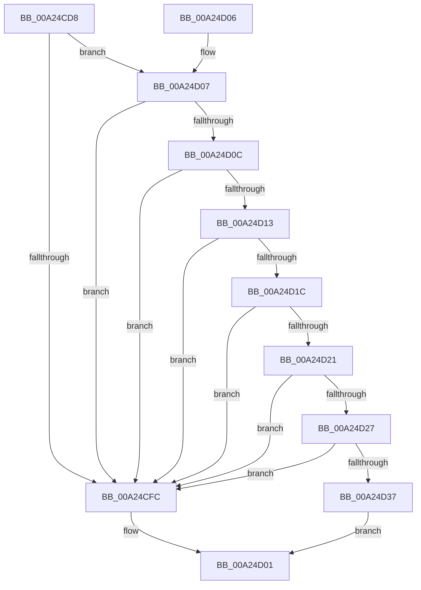

# ExpVerifyWindowsOsOptions

- RVA: `0x00A24CD8`–`0x00A24D3E` (길이 `102` bytes)
- VA: `0x0000000140A24CD8`
- 실행 섹션: `PAGE`
- PDB 이름 있음: `예`; PDB Function 태그: `아니요`
- unwind 정보 RVA: `0x0008FD0C`
- 디코드: `33`개 명령, `102/102` bytes 표시
- 미해석 바이트: `0` (있으면 어셈블리에 `.byte`로 보존)

> 이 문서는 커널 이미지의 기계어와 PDB 기호를 분석해 생성했습니다. 4번과 5번은 함수 원형과 자료형을 바이너리 사용 방식에서 추정한 C 해석이며 원본 소스 복구 결과는 아닙니다.

## 1. Dependencies

- 직접 호출 지점: **2**; 고유 호출 대상: **2**
- 직접 호출자로 확인된 함수: **2**
- RIP 상대 이미지 참조: **0**

### Outgoing calls
- `0x00A24CEB` → [ExpSafeWcslen](ExpSafeWcslen_function_00A25698.md) (function, `0x00A25698`)
- `0x00A24D37` → [ExpVerifyFilePath](ExpVerifyFilePath_function_00A257F0.md) (function, `0x00A257F0`)

### Direct callers
- [ExpSetBootEntry](../7C/ExpSetBootEntry_function_007CBD2C.md) at `0x007CBF1D`
- [NtEnumerateBootEntries](NtEnumerateBootEntries_function_00A25040.md) at `0x00A2557C`

### Static image references
- 디코드된 RIP-relative 메모리 참조가 없습니다.

## 2. Other-region calls and transfers

- 다른 실행 섹션으로 향하는 call: **0**
- 별도 외부 분기/꼬리 이동을 확인하지 못했습니다.

## 3. Assembly (complete function range)

```asm
00A24CD8  48 83 EC 28                     sub rsp, 0x28
00A24CDC  44 8B CA                        mov r9d, edx
00A24CDF  4C 8B C1                        mov r8, rcx
00A24CE2  8B D2                           mov edx, edx
00A24CE4  48 03 D1                        add rdx, rcx
00A24CE7  48 83 C1 14                     add rcx, 0x14
00A24CEB  E8 A8 09 00 00                  call 0x140a25698
00A24CF0  44 8B D0                        mov r10d, eax
00A24CF3  41 8B 40 0C                     mov eax, dword ptr [r8 + 0xc]
00A24CF7  83 F8 14                        cmp eax, 0x14
00A24CFA  73 0B                           jae 0x140a24d07
00A24CFC  B8 0D 00 00 C0                  mov eax, 0xc000000d
00A24D01  48 83 C4 28                     add rsp, 0x28
00A24D05  C3                              ret
00A24D06  CC                              int3
00A24D07  41 3B C1                        cmp eax, r9d
00A24D0A  77 F0                           ja 0x140a24cfc
00A24D0C  41 83 78 08 01                  cmp dword ptr [r8 + 8], 1
00A24D11  75 E9                           jne 0x140a24cfc
00A24D13  41 8B 48 10                     mov ecx, dword ptr [r8 + 0x10]
00A24D17  F6 C1 03                        test cl, 3
00A24D1A  75 E0                           jne 0x140a24cfc
00A24D1C  41 3B C9                        cmp ecx, r9d
00A24D1F  73 DB                           jae 0x140a24cfc
00A24D21  41 83 FA FF                     cmp r10d, -1
00A24D25  74 D5                           je 0x140a24cfc
00A24D27  49 03 C8                        add rcx, r8
00A24D2A  4F 8D 04 50                     lea r8, [r8 + r10*2]
00A24D2E  49 83 C0 16                     add r8, 0x16
00A24D32  4C 3B C1                        cmp r8, rcx
00A24D35  77 C5                           ja 0x140a24cfc
00A24D37  E8 B4 0A 00 00                  call 0x140a257f0
00A24D3C  EB C3                           jmp 0x140a24d01
```

## 4. C-style interpretation (structured pseudocode)

```c
__int64 __fastcall ExpVerifyWindowsOsOptions(__int64 a1, int a2)
{
    __int64 result;
    __int64 v_rsp;

    v_rsp = (v_rsp) - (40);
    a2 = ((unsigned int)(a2)) + (a1);
    a1 = (a1) + (20);
    result = ExpSafeWcslen(a1, a2, a1, (unsigned int)(a2));
    if (((unsigned int)((unsigned int)(*(unsigned int *)(a1 + 12)))) >= 20) goto loc_00A24D07;
loc_00A24CFC:
loc_00A24D01:
    v_rsp = (v_rsp) + (40);
    return (unsigned int)(0xC000000DULL);
loc_00A24D07:
    if (((unsigned int)((unsigned int)(0xC000000DULL))) > ((unsigned int)((unsigned int)(a2)))) goto loc_00A24CFC;
    if ((*(unsigned int *)(a1 + 8)) != 1) goto loc_00A24CFC;
    if ((((unsigned __int8)((unsigned int)(*(unsigned int *)(a1 + 16)))) & (3)) != 0) goto loc_00A24CFC;
    if (((unsigned int)((unsigned int)(*(unsigned int *)(a1 + 16)))) >= ((unsigned int)((unsigned int)(a2)))) goto loc_00A24CFC;
    if (((unsigned int)((unsigned int)((unsigned int)(result)))) == -1) goto loc_00A24CFC;
    a1 = ((unsigned int)(*(unsigned int *)(a1 + 16))) + (a1);
    a3 = (a1 + (unsigned int)((unsigned int)(result)) * 2) + (22);
    if (a3 > a1) goto loc_00A24CFC;
    result = ExpVerifyFilePath(a1, a2, a3, (unsigned int)(a2));
    goto loc_00A24D01;
}
```

## 5. (Beta) C Style

```c
int64_t ExpVerifyWindowsOsOptions(int64_t Arg1, int32_t Arg2)
{
    int64_t result;
    int64_t local_rsp;

    local_rsp = (local_rsp) - (40);
    Arg2 = ((uint32_t)(Arg2)) + (Arg1);
    Arg1 = (Arg1) + (20);
    result = ExpSafeWcslen(Arg1, Arg2, Arg1, (uint32_t)(Arg2));
    if (((uint32_t)((uint32_t)(*(uint32_t *)(Arg1 + 0xC)))) >= 20) goto loc_00A24D07;
loc_00A24CFC:
loc_00A24D01:
    local_rsp = (local_rsp) + (40);
    return (uint32_t)(0xC000000DULL);
loc_00A24D07:
    if (((uint32_t)((uint32_t)(0xC000000DULL))) > ((uint32_t)((uint32_t)(Arg2)))) goto loc_00A24CFC;
    if ((*(uint32_t *)(Arg1 + 0x8)) != 1) goto loc_00A24CFC;
    if ((((uint8_t)((uint32_t)(*(uint32_t *)(Arg1 + 0x10)))) & (3)) != 0) goto loc_00A24CFC;
    if (((uint32_t)((uint32_t)(*(uint32_t *)(Arg1 + 0x10)))) >= ((uint32_t)((uint32_t)(Arg2)))) goto loc_00A24CFC;
    if (((uint32_t)((uint32_t)((uint32_t)(result)))) == -1) goto loc_00A24CFC;
    Arg1 = ((uint32_t)(*(uint32_t *)(Arg1 + 0x10))) + (Arg1);
    a3 = (Arg1 + (uint32_t)((uint32_t)(result)) * 2) + (22);
    if (a3 > Arg1) goto loc_00A24CFC;
    result = ExpVerifyFilePath(Arg1, Arg2, a3, (uint32_t)(Arg2));
    goto loc_00A24D01;
}
```

## 6. Execution-region graph

[열기: 2D/3D 그래프와 함수 탐색 컨트롤 패널](../../../control-panel.html?section=page&rva=0x00A24CD8&view=graph)

- 2D 그래프는 위에서 아래로 흐르고, 3D 그래프는 빈 공간을 드래그해 회전합니다. Shift+드래그는 이동, 휠은 확대·축소, 함수 노드 선택은 대상 보고서 이동입니다.

### Static fallback


