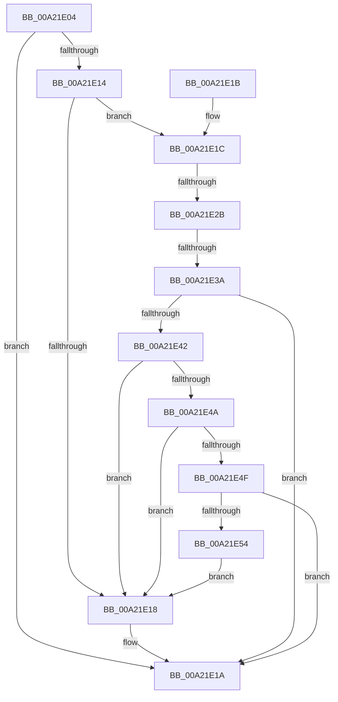

# FsRtlpOplockUpperLowerCompatible

- RVA: `0x00A21E04`–`0x00A21E56` (길이 `82` bytes)
- VA: `0x0000000140A21E04`
- 실행 섹션: `PAGE`
- PDB 이름 있음: `예`; PDB Function 태그: `예`
- unwind 정보 RVA: `0x000DB714`
- 디코드: `24`개 명령, `82/82` bytes 표시
- 미해석 바이트: `0` (있으면 어셈블리에 `.byte`로 보존)

> 이 문서는 커널 이미지의 기계어와 PDB 기호를 분석해 생성했습니다. 4번과 5번은 함수 원형과 자료형을 바이너리 사용 방식에서 추정한 C 해석이며 원본 소스 복구 결과는 아닙니다.

## 1. Dependencies

- 직접 호출 지점: **0**; 고유 호출 대상: **0**
- 직접 호출자로 확인된 함수: **6**
- RIP 상대 이미지 참조: **0**

### Outgoing calls
- 직접 디코드된 call 명령이 없습니다.

### Direct callers
- [FsRtlpAcknowledgeOplockBreakByCacheFlags](../../text/3F/FsRtlpAcknowledgeOplockBreakByCacheFlags_function_003F1988.md) at `0x003F1DF5`
- [FsRtlpAcknowledgeOplockBreakByCacheFlags](../../text/3F/FsRtlpAcknowledgeOplockBreakByCacheFlags_function_003F1988.md) at `0x003F1E96`
- [FsRtlpRequestExclusiveOplock](../../text/3F/FsRtlpRequestExclusiveOplock_function_003F3800.md) at `0x003F3A0E`
- [FsRtlpRequestShareableOplock](../../text/4E/FsRtlpRequestShareableOplock_function_004E6EC8.md) at `0x004E70E7`
- [FsRtlpAcknowledgeOplockBreak](../../text/58/FsRtlpAcknowledgeOplockBreak_function_00582144.md) at `0x005821C7`
- [FsRtlCheckUpperOplock](../71/FsRtlCheckUpperOplock_function_007145F0.md) at `0x0071472B`
- [FsRtlUpperOplockFsctrl](../71/FsRtlUpperOplockFsctrl_function_00714B40.md) at `0x00714C4C`

### Static image references
- 디코드된 RIP-relative 메모리 참조가 없습니다.

## 2. Other-region calls and transfers

- 다른 실행 섹션으로 향하는 call: **0**
- call이 아닌 외부 분기/꼬리 이동: **2**
  - `0x00A21E25` → `0x00B379D3` (`tail-transfer`)
  - `0x00A21E34` → `0x00B379CA` (`tail-transfer`)

## 3. Assembly (complete function range)

```asm
00A21E04  81 E1 1E 70 01 00               and ecx, 0x1701e
00A21E0A  B0 01                           mov al, 1
00A21E0C  F7 C1 FF FF FE FF               test ecx, 0xfffeffff
00A21E12  74 06                           je 0x140a21e1a
00A21E14  85 D2                           test edx, edx
00A21E16  75 04                           jne 0x140a21e1c
00A21E18  32 C0                           xor al, al
00A21E1A  C3                              ret
00A21E1B  CC                              int3
00A21E1C  41 B8 00 10 00 00               mov r8d, 0x1000
00A21E22  41 3B D0                        cmp edx, r8d
00A21E25  0F 84 A8 5B 11 00               je 0x140b379d3
00A21E2B  41 B9 00 30 00 00               mov r9d, 0x3000
00A21E31  41 3B D1                        cmp edx, r9d
00A21E34  0F 84 90 5B 11 00               je 0x140b379ca
00A21E3A  81 FA 00 50 00 00               cmp edx, 0x5000
00A21E40  75 D8                           jne 0x140a21e1a
00A21E42  81 F9 00 70 00 00               cmp ecx, 0x7000
00A21E48  74 CE                           je 0x140a21e18
00A21E4A  41 3B C9                        cmp ecx, r9d
00A21E4D  74 C9                           je 0x140a21e18
00A21E4F  83 F9 04                        cmp ecx, 4
00A21E52  75 C6                           jne 0x140a21e1a
00A21E54  EB C2                           jmp 0x140a21e18
```

## 4. C-style interpretation (structured pseudocode)

```c
__int64 __fastcall FsRtlpOplockUpperLowerCompatible(int a1, int a2)
{
    __int64 result;

    a1 = (unsigned int)((a1) & (0x1701EULL));
    if (((a1) & (0xFFFEFFFFULL)) == 0) goto loc_00A21E1A;
    if (a2 != 0) goto loc_00A21E1C;
loc_00A21E18:
    result = 0;
loc_00A21E1A:
    return result;
loc_00A21E1C:
    if (a2 != 0x5000ULL) goto loc_00A21E1A;
    if (a1 == 0x7000ULL) goto loc_00A21E18;
    if (a1 == ((unsigned int)((unsigned int)(0x3000ULL)))) goto loc_00A21E18;
    if (a1 != 4) goto loc_00A21E1A;
    goto loc_00A21E18;
}
```

## 5. (Beta) C Style

```c
int64_t FsRtlpOplockUpperLowerCompatible(int32_t Arg1, int32_t Arg2)
{
    int64_t result;

    Arg1 = (uint32_t)((Arg1) & (0x1701EULL));
    if (((Arg1) & (0xFFFEFFFFULL)) == 0) goto loc_00A21E1A;
    if (Arg2 != 0) goto loc_00A21E1C;
loc_00A21E18:
    result = 0;
loc_00A21E1A:
    return result;
loc_00A21E1C:
    if (Arg2 != 0x5000ULL) goto loc_00A21E1A;
    if (Arg1 == 0x7000ULL) goto loc_00A21E18;
    if (Arg1 == ((uint32_t)((uint32_t)(0x3000ULL)))) goto loc_00A21E18;
    if (Arg1 != 4) goto loc_00A21E1A;
    goto loc_00A21E18;
}
```

## 6. Execution-region graph

[열기: 2D/3D 그래프와 함수 탐색 컨트롤 패널](../../../control-panel.html?section=page&rva=0x00A21E04&view=graph)

- 2D 그래프는 위에서 아래로 흐르고, 3D 그래프는 빈 공간을 드래그해 회전합니다. Shift+드래그는 이동, 휠은 확대·축소, 함수 노드 선택은 대상 보고서 이동입니다.

### Static fallback


