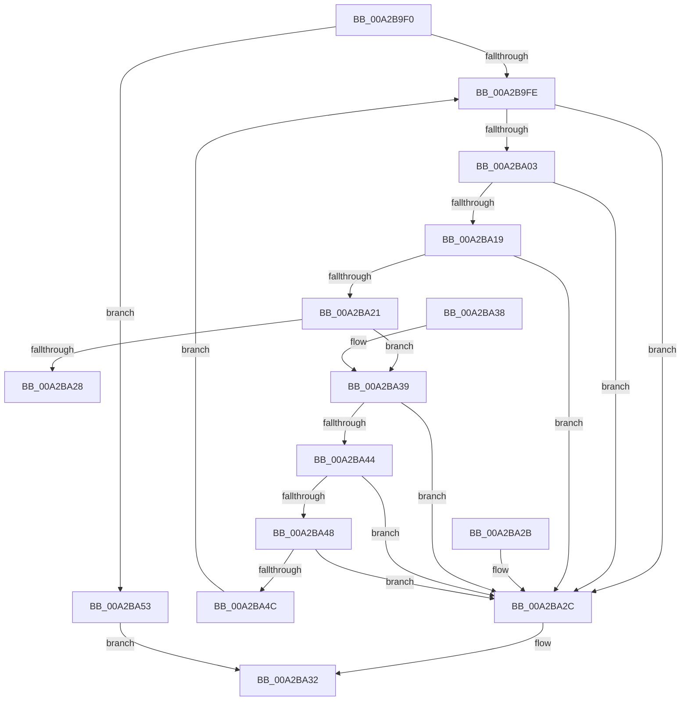

# IoCheckEaBufferValidity

- RVA: `0x00A2B9F0`–`0x00A2BA59` (길이 `105` bytes)
- VA: `0x0000000140A2B9F0`
- 실행 섹션: `PAGE`
- PDB 이름 있음: `예`; PDB Function 태그: `아니요`
- unwind 정보 RVA: `0x000DB714`
- 디코드: `38`개 명령, `105/105` bytes 표시
- 미해석 바이트: `0` (있으면 어셈블리에 `.byte`로 보존)

> 이 문서는 커널 이미지의 기계어와 PDB 기호를 분석해 생성했습니다. 4번과 5번은 함수 원형과 자료형을 바이너리 사용 방식에서 추정한 C 해석이며 원본 소스 복구 결과는 아닙니다.

## 1. Dependencies

- 직접 호출 지점: **0**; 고유 호출 대상: **0**
- 직접 호출자로 확인된 함수: **3**
- RIP 상대 이미지 참조: **0**

### Outgoing calls
- 직접 디코드된 call 명령이 없습니다.

### Direct callers
- [IopCreateFile](../8A/IopCreateFile_function_008AB298.md) at `0x008ABDB7`
- [sub_00B19FF6](../B1/Unknown_function_00B19FF6.md) at `0x00B1A21E`
- [sub_00B41AB2](../B4/Unknown_function_00B41AB2.md) at `0x00B41B0F`

### Static image references
- 디코드된 RIP-relative 메모리 참조가 없습니다.

## 2. Other-region calls and transfers

- 다른 실행 섹션으로 향하는 call: **0**
- 별도 외부 분기/꼬리 이동을 확인하지 못했습니다.

## 3. Assembly (complete function range)

```asm
00A2B9F0  4C 8B D1                        mov r10, rcx
00A2B9F3  4C 8B C9                        mov r9, rcx
00A2B9F6  81 FA FF FF FF 7F               cmp edx, 0x7fffffff
00A2B9FC  77 55                           ja 0x140a2ba53
00A2B9FE  83 FA 08                        cmp edx, 8
00A2BA01  72 29                           jb 0x140a2ba2c
00A2BA03  41 0F B6 49 05                  movzx ecx, byte ptr [r9 + 5]
00A2BA08  41 0F B7 41 06                  movzx eax, word ptr [r9 + 6]
00A2BA0D  44 8D 59 09                     lea r11d, [rcx + 9]
00A2BA11  44 03 D8                        add r11d, eax
00A2BA14  41 3B D3                        cmp edx, r11d
00A2BA17  72 13                           jb 0x140a2ba2c
00A2BA19  42 80 7C 09 08 00               cmp byte ptr [rcx + r9 + 8], 0
00A2BA1F  75 0B                           jne 0x140a2ba2c
00A2BA21  41 8B 09                        mov ecx, dword ptr [r9]
00A2BA24  85 C9                           test ecx, ecx
00A2BA26  75 11                           jne 0x140a2ba39
00A2BA28  33 C0                           xor eax, eax
00A2BA2A  C3                              ret
00A2BA2B  CC                              int3
00A2BA2C  45 2B CA                        sub r9d, r10d
00A2BA2F  45 89 08                        mov dword ptr [r8], r9d
00A2BA32  B8 14 00 00 80                  mov eax, 0x80000014
00A2BA37  C3                              ret
00A2BA38  CC                              int3
00A2BA39  41 8D 43 03                     lea eax, [r11 + 3]
00A2BA3D  83 E0 FC                        and eax, 0xfffffffc
00A2BA40  3B C1                           cmp eax, ecx
00A2BA42  75 E8                           jne 0x140a2ba2c
00A2BA44  85 C9                           test ecx, ecx
00A2BA46  78 E4                           js 0x140a2ba2c
00A2BA48  3B D1                           cmp edx, ecx
00A2BA4A  72 E0                           jb 0x140a2ba2c
00A2BA4C  2B D1                           sub edx, ecx
00A2BA4E  4C 03 C9                        add r9, rcx
00A2BA51  EB AB                           jmp 0x140a2b9fe
00A2BA53  41 83 20 00                     and dword ptr [r8], 0
00A2BA57  EB D9                           jmp 0x140a2ba32
```

## 4. C-style interpretation (structured pseudocode)

```c
__int64 __fastcall IoCheckEaBufferValidity(__int64 a1, int a2, __int64 a3)
{
    __int64 result;
    __int64 v_r11;

    if (a2 > 0x7FFFFFFFULL) goto loc_00A2BA53;
loc_00A2B9FE:
    if (a2 < 8) goto loc_00A2BA2C;
    v_r11 = (unsigned int)((*(unsigned __int8 *)(a1 + 5) + 9) + ((unsigned int)(*(unsigned __int16 *)(a1 + 6))));
    if (a2 < ((unsigned int)(v_r11))) goto loc_00A2BA2C;
    if ((*(unsigned __int8 *)(*(unsigned __int8 *)(a1 + 5) + a1 * 1 + 8)) != 0) goto loc_00A2BA2C;
    if ((unsigned int)((unsigned int)(*(unsigned int *)(a1))) != 0) goto loc_00A2BA39;
    result = 0;
    return result;
loc_00A2BA2C:
    a4 = (unsigned int)((a1) - ((unsigned int)(a1)));
    *(unsigned int *)(a3) = (unsigned int)(a4);
loc_00A2BA32:
    return (unsigned int)(0x80000014ULL);
loc_00A2BA39:
    result = (unsigned int)((v_r11 + 3) & (0xFFFFFFFCULL));
    if (((unsigned int)(result)) != ((unsigned int)((unsigned int)(*(unsigned int *)(a1))))) goto loc_00A2BA2C;
    if (sign_flag) goto loc_00A2BA2C;
    if (a2 < ((unsigned int)((unsigned int)(*(unsigned int *)(a1))))) goto loc_00A2BA2C;
    a2 = (unsigned int)((a2) - ((unsigned int)((unsigned int)(*(unsigned int *)(a1)))));
    a4 = (a4) + ((unsigned int)(*(unsigned int *)(a1)));
    goto loc_00A2B9FE;
loc_00A2BA53:
    goto loc_00A2BA32;
}
```

## 5. (Beta) C Style

```c
int64_t IoCheckEaBufferValidity(void *Arg1, int32_t Arg2, void *Arg3)
{
    uint8_t *arg1 = (uint8_t *)Arg1;
    uint8_t *arg3 = (uint8_t *)Arg3;

    int64_t result;
    int64_t local_r11;

    if (Arg2 > 0x7FFFFFFFULL) goto loc_00A2BA53;
loc_00A2B9FE:
    if (Arg2 < 8) goto loc_00A2BA2C;
    local_r11 = (uint32_t)((*(uint8_t *)(arg1 + 0x5) + 9) + ((uint32_t)(*(uint16_t *)(arg1 + 0x6))));
    if (Arg2 < ((uint32_t)(local_r11))) goto loc_00A2BA2C;
    if ((*(uint8_t *)(*(uint8_t *)(arg1 + 0x5) + arg1 * 1 + 0x8)) != 0) goto loc_00A2BA2C;
    if ((uint32_t)((uint32_t)(*(uint32_t *)(arg1))) != 0) goto loc_00A2BA39;
    result = 0;
    return result;
loc_00A2BA2C:
    a4 = (uint32_t)((Arg1) - ((uint32_t)(Arg1)));
    *(uint32_t *)(arg3) = (uint32_t)(a4);
loc_00A2BA32:
    return (uint32_t)(0x80000014ULL);
loc_00A2BA39:
    result = (uint32_t)((local_r11 + 3) & (0xFFFFFFFCULL));
    if (((uint32_t)(result)) != ((uint32_t)((uint32_t)(*(uint32_t *)(arg1))))) goto loc_00A2BA2C;
    if (sign_flag) goto loc_00A2BA2C;
    if (Arg2 < ((uint32_t)((uint32_t)(*(uint32_t *)(arg1))))) goto loc_00A2BA2C;
    Arg2 = (uint32_t)((Arg2) - ((uint32_t)((uint32_t)(*(uint32_t *)(arg1)))));
    a4 = (a4) + ((uint32_t)(*(uint32_t *)(arg1)));
    goto loc_00A2B9FE;
loc_00A2BA53:
    goto loc_00A2BA32;
}
```

### 관측된 메모리 오프셋

구조체 형식이 확인되지 않은 접근은 인자 기준의 오프셋으로만 기록했습니다.

| 기준 인자 | 오프셋 표현 | 폭 (bit) | 접근 |
|---|---:|---:|---|
| `Arg1` | `+ 0x0` | `32` | `R` |
| `Arg1` | `+ 0x5` | `8` | `R` |
| `Arg1` | `+ 0x6` | `16` | `R` |
| `Arg3` | `+ 0x0` | `32` | `R/W` |
| `Arg3` | `+ 0x0` | `32` | `W` |

## 6. Execution-region graph

[열기: 2D/3D 그래프와 함수 탐색 컨트롤 패널](../../../control-panel.html?section=page&rva=0x00A2B9F0&view=graph)

- 2D 그래프는 위에서 아래로 흐르고, 3D 그래프는 빈 공간을 드래그해 회전합니다. Shift+드래그는 이동, 휠은 확대·축소, 함수 노드 선택은 대상 보고서 이동입니다.

### Static fallback


