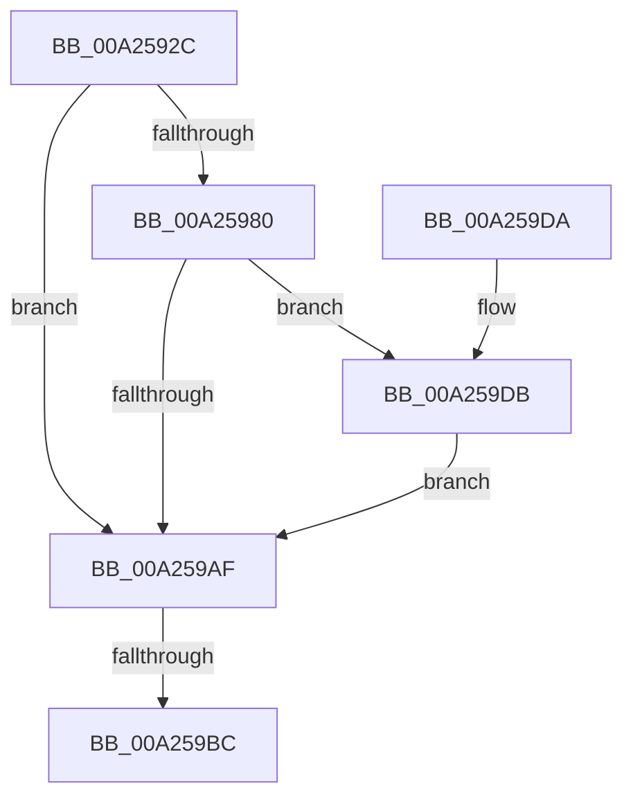

# IoEnumerateEnvironmentVariablesEx

- RVA: `0x00A2592C`–`0x00A259E5` (길이 `185` bytes)
- VA: `0x0000000140A2592C`
- 실행 섹션: `PAGE`
- PDB 이름 있음: `예`; PDB Function 태그: `예`
- unwind 정보 RVA: `0x000AB9B4`
- 디코드: `56`개 명령, `185/185` bytes 표시
- 미해석 바이트: `0` (있으면 어셈블리에 `.byte`로 보존)

> 이 문서는 커널 이미지의 기계어와 PDB 기호를 분석해 생성했습니다. 4번과 5번은 함수 원형과 자료형을 바이너리 사용 방식에서 추정한 C 해석이며 원본 소스 복구 결과는 아닙니다.

## 1. Dependencies

- 직접 호출 지점: **4**; 고유 호출 대상: **4**
- 직접 호출자로 확인된 함수: **3**
- RIP 상대 이미지 참조: **2**

### Outgoing calls
- `0x00A25975` → [IopOpenSystemVariableDevice](../95/IopOpenSystemVariableDevice_function_00952910.md) (function, `0x00952910`)
- `0x00A259A3` → [guard_dispatch_icall](../../text/6B/guard_dispatch_icall_function_006BAAD0.md) (function, `0x006BAAD0`)
- `0x00A259C5` → [_security_check_cookie](../../text/6A/_security_check_cookie_function_006AC640.md) (function, `0x006AC640`)
- `0x00A259DE` → [ObfDereferenceObject](../../text/2F/ObfDereferenceObject_function_002F9350.md) (function, `0x002F9350`)

### Direct callers
- [NtEnumerateDriverEntries](../7C/NtEnumerateDriverEntries_function_007CD5D0.md) at `0x007CD74E`
- [NtEnumerateDriverEntries](../7C/NtEnumerateDriverEntries_function_007CD5D0.md) at `0x007CD7A7`
- [NtEnumerateSystemEnvironmentValuesEx](../7C/NtEnumerateSystemEnvironmentValuesEx_function_007CDA30.md) at `0x007CDB5F`
- [NtEnumerateBootEntries](NtEnumerateBootEntries_function_00A25040.md) at `0x00A251BB`

### Static image references
- `0x00A25941` → RVA `0x00E0A740` (`.data`; read)
- `0x00A259AF` → RVA `0x00E06ED8` (`.data`; read)

## 2. Other-region calls and transfers

- 다른 실행 섹션으로 향하는 call: **3**
  - `0x00A259A3` → [guard_dispatch_icall](../../text/6B/guard_dispatch_icall_function_006BAAD0.md) (`PAGE` → `.text`)
  - `0x00A259C5` → [_security_check_cookie](../../text/6A/_security_check_cookie_function_006AC640.md) (`PAGE` → `.text`)
  - `0x00A259DE` → [ObfDereferenceObject](../../text/2F/ObfDereferenceObject_function_002F9350.md) (`PAGE` → `.text`)
- call이 아닌 외부 분기/꼬리 이동: **1**
  - `0x00A259B6` → [sub_00B37D48](../B3/Unknown_function_00B37D48.md) (`tail-transfer`)

## 3. Assembly (complete function range)

```asm
00A2592C  40 55                           push rbp
00A2592E  53                              push rbx
00A2592F  56                              push rsi
00A25930  57                              push rdi
00A25931  41 56                           push r14
00A25933  41 57                           push r15
00A25935  48 8D 6C 24 D1                  lea rbp, [rsp - 0x2f]
00A2593A  48 81 EC D8 00 00 00            sub rsp, 0xd8
00A25941  48 8B 05 F8 4D 3E 00            mov rax, qword ptr [rip + 0x3e4df8]
00A25948  48 33 C4                        xor rax, rsp
00A2594B  48 89 45 17                     mov qword ptr [rbp + 0x17], rax
00A2594F  48 83 65 A7 00                  and qword ptr [rbp - 0x59], 0
00A25954  49 8B F8                        mov rdi, r8
00A25957  48 83 65 9F 00                  and qword ptr [rbp - 0x61], 0
00A2595C  4C 8D 45 AF                     lea r8, [rbp - 0x51]
00A25960  48 83 65 AF 00                  and qword ptr [rbp - 0x51], 0
00A25965  4C 8B F2                        mov r14, rdx
00A25968  8B F1                           mov esi, ecx
00A2596A  48 8D 55 A7                     lea rdx, [rbp - 0x59]
00A2596E  48 8D 4D 9F                     lea rcx, [rbp - 0x61]
00A25972  4D 8B F9                        mov r15, r9
00A25975  E8 96 CF F2 FF                  call 0x140952910
00A2597A  8B D8                           mov ebx, eax
00A2597C  85 C0                           test eax, eax
00A2597E  78 2F                           js 0x140a259af
00A25980  48 8B 45 AF                     mov rax, qword ptr [rbp - 0x51]
00A25984  4D 8B CE                        mov r9, r14
00A25987  48 8B 55 A7                     mov rdx, qword ptr [rbp - 0x59]
00A2598B  44 8B C6                        mov r8d, esi
00A2598E  4C 89 7C 24 28                  mov qword ptr [rsp + 0x28], r15
00A25993  48 89 7C 24 20                  mov qword ptr [rsp + 0x20], rdi
00A25998  48 8B 7D 9F                     mov rdi, qword ptr [rbp - 0x61]
00A2599C  48 8B 40 10                     mov rax, qword ptr [rax + 0x10]
00A259A0  48 8B CF                        mov rcx, rdi
00A259A3  E8 28 51 C9 FF                  call 0x1406baad0
00A259A8  8B D8                           mov ebx, eax
00A259AA  48 85 FF                        test rdi, rdi
00A259AD  75 2C                           jne 0x140a259db
00A259AF  83 3D 22 15 3E 00 05            cmp dword ptr [rip + 0x3e1522], 5
00A259B6  0F 87 8C 23 11 00               ja 0x140b37d48
00A259BC  8B C3                           mov eax, ebx
00A259BE  48 8B 4D 17                     mov rcx, qword ptr [rbp + 0x17]
00A259C2  48 33 CC                        xor rcx, rsp
00A259C5  E8 76 6C C8 FF                  call 0x1406ac640
00A259CA  48 81 C4 D8 00 00 00            add rsp, 0xd8
00A259D1  41 5F                           pop r15
00A259D3  41 5E                           pop r14
00A259D5  5F                              pop rdi
00A259D6  5E                              pop rsi
00A259D7  5B                              pop rbx
00A259D8  5D                              pop rbp
00A259D9  C3                              ret
00A259DA  CC                              int3
00A259DB  48 8B CF                        mov rcx, rdi
00A259DE  E8 6D 39 8D FF                  call 0x1402f9350
00A259E3  EB CA                           jmp 0x140a259af
```

## 4. C-style interpretation (structured pseudocode)

```c
__int64 __fastcall IoEnumerateEnvironmentVariablesEx(int a1, __int64 a2, __int64 a3, __int64 a4)
{
    __int64 result;
    __int64 v_rsp;
    unsigned __int64 v_stack_m48;
    unsigned __int64 v_stack_m5F;
    unsigned __int64 v_stack_mB0;
    unsigned __int64 v_stack_mB8;
    unsigned __int64 v_stack_mC0;
    unsigned __int64 v_stack_mE0;
    unsigned __int64 v_stack_mE8;

    v_rsp = (v_rsp) - (216);
    result = (*(unsigned __int64 *)(v_rip + 4083192)) ^ (v_rsp);
    v_stack_m48 = result;
    result = IopOpenSystemVariableDevice(v_stack_mC0, v_stack_mB8, v_stack_mB0, a4);
    if (sign_flag) goto loc_00A259AF;
    v_stack_mE0 = a4;
    v_stack_mE8 = a3;
    result = guard_dispatch_icall(v_stack_mC0, v_stack_mB8, (unsigned int)((unsigned int)((unsigned int)(a1))), a2);
    if (v_stack_mC0 != 0) goto loc_00A259DB;
loc_00A259AF:
    a1 = (v_stack_m48) ^ (v_rsp);
    result = _security_check_cookie(a1, v_stack_mB8, (unsigned int)((unsigned int)((unsigned int)(a1))), a2);
    v_rsp = (v_rsp) + (216);
    return result;
loc_00A259DB:
    result = ObfDereferenceObject(v_stack_mC0, v_stack_mB8, (unsigned int)((unsigned int)((unsigned int)(a1))), a2);
    goto loc_00A259AF;
}
```

## 5. (Beta) C Style

```c
int64_t IoEnumerateEnvironmentVariablesEx(int32_t Arg1, int64_t Arg2, int64_t Arg3, int64_t Arg4)
{
    int64_t result;
    int64_t local_rsp;
    uint64_t v_stack_m48;
    uint64_t v_stack_m5F;
    uint64_t v_stack_mB0;
    uint64_t v_stack_mB8;
    uint64_t v_stack_mC0;
    uint64_t v_stack_mE0;
    uint64_t v_stack_mE8;

    local_rsp = (local_rsp) - (216);
    result = (*(uint64_t *)(v_rip + 0x3E4DF8)) ^ (local_rsp);
    v_stack_m48 = result;
    result = IopOpenSystemVariableDevice(v_stack_mC0, v_stack_mB8, v_stack_mB0, Arg4);
    if (sign_flag) goto loc_00A259AF;
    v_stack_mE0 = Arg4;
    v_stack_mE8 = Arg3;
    result = guard_dispatch_icall(v_stack_mC0, v_stack_mB8, (uint32_t)((uint32_t)((uint32_t)(Arg1))), Arg2);
    if (v_stack_mC0 != 0) goto loc_00A259DB;
loc_00A259AF:
    Arg1 = (v_stack_m48) ^ (local_rsp);
    result = _security_check_cookie(Arg1, v_stack_mB8, (uint32_t)((uint32_t)((uint32_t)(Arg1))), Arg2);
    local_rsp = (local_rsp) + (216);
    return result;
loc_00A259DB:
    result = ObfDereferenceObject(v_stack_mC0, v_stack_mB8, (uint32_t)((uint32_t)((uint32_t)(Arg1))), Arg2);
    goto loc_00A259AF;
}
```

## 6. Execution-region graph

[열기: 2D/3D 그래프와 함수 탐색 컨트롤 패널](../../../control-panel.html?section=page&rva=0x00A2592C&view=graph)

- 2D 그래프는 위에서 아래로 흐르고, 3D 그래프는 빈 공간을 드래그해 회전합니다. Shift+드래그는 이동, 휠은 확대·축소, 함수 노드 선택은 대상 보고서 이동입니다.

### Static fallback


