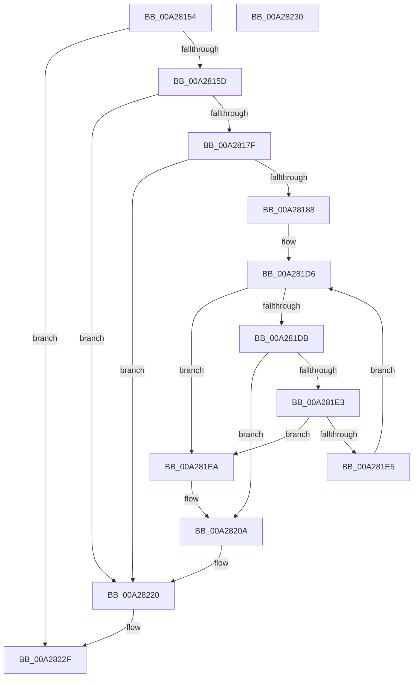

# IopInsertLegacyBusDeviceNode

- RVA: `0x00A28154`–`0x00A28231` (길이 `221` bytes)
- VA: `0x0000000140A28154`
- 실행 섹션: `PAGE`
- PDB 이름 있음: `예`; PDB Function 태그: `아니요`
- unwind 정보 RVA: `0x000AC034`
- 디코드: `57`개 명령, `221/221` bytes 표시
- 미해석 바이트: `0` (있으면 어셈블리에 `.byte`로 보존)

> 이 문서는 커널 이미지의 기계어와 PDB 기호를 분석해 생성했습니다. 4번과 5번은 함수 원형과 자료형을 바이너리 사용 방식에서 추정한 C 해석이며 원본 소스 복구 결과는 아닙니다.

## 1. Dependencies

- 직접 호출 지점: **3**; 고유 호출 대상: **3**
- 직접 호출자로 확인된 함수: **1**
- RIP 상대 이미지 참조: **2**

### Outgoing calls
- `0x00A281AF` → [KeWaitForSingleObject](../../text/20/KeWaitForSingleObject_function_0020E6B0.md) (function, `0x0020E6B0`)
- `0x00A28216` → [KeReleaseSemaphore](../../text/39/KeReleaseSemaphore_function_00397080.md) (function, `0x00397080`)
- `0x00A2821B` → [KeLeaveCriticalRegion](../../text/25/KeLeaveCriticalRegion_function_0025D8B0.md) (function, `0x0025D8B0`)

### Direct callers
- [PipCallDriverAddDevice](PipCallDriverAddDevice_function_00A272E0.md) at `0x00A27767`

### Static image references
- `0x00A281A7` → RVA `0x00F8C360` (`.data`; read)
- `0x00A281B7` → RVA `0x00F8C160` (`.data`; read)

## 2. Other-region calls and transfers

- 다른 실행 섹션으로 향하는 call: **3**
  - `0x00A281AF` → [KeWaitForSingleObject](../../text/20/KeWaitForSingleObject_function_0020E6B0.md) (`PAGE` → `.text`)
  - `0x00A28216` → [KeReleaseSemaphore](../../text/39/KeReleaseSemaphore_function_00397080.md) (`PAGE` → `.text`)
  - `0x00A2821B` → [KeLeaveCriticalRegion](../../text/25/KeLeaveCriticalRegion_function_0025D8B0.md) (`PAGE` → `.text`)
- 별도 외부 분기/꼬리 이동을 확인하지 못했습니다.

## 3. Assembly (complete function range)

```asm
00A28154  83 FA 12                        cmp edx, 0x12
00A28157  0F 8D D2 00 00 00               jge 0x140a2822f
00A2815D  48 89 5C 24 08                  mov qword ptr [rsp + 8], rbx
00A28162  48 89 74 24 10                  mov qword ptr [rsp + 0x10], rsi
00A28167  57                              push rdi
00A28168  48 83 EC 30                     sub rsp, 0x30
00A2816C  48 8B F1                        mov rsi, rcx
00A2816F  41 8B F8                        mov edi, r8d
00A28172  83 C9 FF                        or ecx, 0xffffffff
00A28175  8B DA                           mov ebx, edx
00A28177  3B D1                           cmp edx, ecx
00A28179  0F 8E A1 00 00 00               jle 0x140a28220
00A2817F  83 FA 0F                        cmp edx, 0xf
00A28182  0F 84 98 00 00 00               je 0x140a28220
00A28188  65 48 8B 04 25 88 01 00 00      mov rax, qword ptr gs:[0x188]
00A28191  8D 51 05                        lea edx, [rcx + 5]
00A28194  48 83 64 24 20 00               and qword ptr [rsp + 0x20], 0
00A2819A  45 33 C9                        xor r9d, r9d
00A2819D  45 33 C0                        xor r8d, r8d
00A281A0  66 01 88 E4 01 00 00            add word ptr [rax + 0x1e4], cx
00A281A7  48 8D 0D B2 41 56 00            lea rcx, [rip + 0x5641b2]
00A281AE  90                              nop
00A281AF  E8 FC 64 7E FF                  call 0x14020e6b0
00A281B4  83 FB 02                        cmp ebx, 2
00A281B7  48 8D 0D A2 3F 56 00            lea rcx, [rip + 0x563fa2]
00A281BE  41 B8 01 00 00 00               mov r8d, 1
00A281C4  41 8B C0                        mov eax, r8d
00A281C7  0F 45 C3                        cmovne eax, ebx
00A281CA  48 98                           cdqe
00A281CC  48 C1 E0 04                     shl rax, 4
00A281D0  48 03 C8                        add rcx, rax
00A281D3  48 8B 11                        mov rdx, qword ptr [rcx]
00A281D6  48 3B D1                        cmp rdx, rcx
00A281D9  74 0F                           je 0x140a281ea
00A281DB  39 BA 54 FF FF FF               cmp dword ptr [rdx - 0xac], edi
00A281E1  74 27                           je 0x140a2820a
00A281E3  77 05                           ja 0x140a281ea
00A281E5  48 8B 12                        mov rdx, qword ptr [rdx]
00A281E8  EB EC                           jmp 0x140a281d6
00A281EA  48 8B 42 08                     mov rax, qword ptr [rdx + 8]
00A281EE  48 8D 8E 70 02 00 00            lea rcx, [rsi + 0x270]
00A281F5  48 89 86 78 02 00 00            mov qword ptr [rsi + 0x278], rax
00A281FC  48 89 11                        mov qword ptr [rcx], rdx
00A281FF  48 8B 42 08                     mov rax, qword ptr [rdx + 8]
00A28203  48 89 08                        mov qword ptr [rax], rcx
00A28206  48 89 4A 08                     mov qword ptr [rdx + 8], rcx
00A2820A  45 33 C9                        xor r9d, r9d
00A2820D  48 8D 0D 4C 41 56 00            lea rcx, [rip + 0x56414c]
00A28214  33 D2                           xor edx, edx
00A28216  E8 65 EE 96 FF                  call 0x140397080
00A2821B  E8 90 56 83 FF                  call 0x14025d8b0
00A28220  48 8B 5C 24 40                  mov rbx, qword ptr [rsp + 0x40]
00A28225  48 8B 74 24 48                  mov rsi, qword ptr [rsp + 0x48]
00A2822A  48 83 C4 30                     add rsp, 0x30
00A2822E  5F                              pop rdi
00A2822F  C3                              ret
00A28230  CC                              int3
```

## 4. C-style interpretation (structured pseudocode)

```c
__int64 __fastcall IopInsertLegacyBusDeviceNode(__int64 a1, int a2, int a3, int a4)
{
    __int64 result;
    __int64 v_rsp;
    unsigned __int64 v_stack_m18;
    unsigned __int64 v_stack_p10;
    unsigned __int64 v_stack_p8;

    if (a2 >= 18) goto loc_00A2822F;
    v_stack_p8 = v_rbx;
    v_stack_p10 = v_rsi;
    v_rsp = (v_rsp) - (48);
    a1 = (unsigned int)((a1) | (0xFFFFFFFFULL));
    if (a2 <= ((unsigned int)(a1))) goto loc_00A28220;
    if (a2 == 15) goto loc_00A28220;
    a4 = 0;
    a3 = 0;
    result = KeWaitForSingleObject(v_rip + 5652914, a1 + 5, a3, a4);
    result = 1;
    if (((unsigned int)((unsigned int)(a2))) != 2) { result = (unsigned int)((unsigned int)(a2)); }
    result = (result) << (4);
    a1 = (v_rip + 5652386) + (result);
loc_00A281D6:
    if ((*(unsigned __int64 *)(a1)) == a1) goto loc_00A281EA;
    if ((*(unsigned int *)(*(unsigned __int64 *)(a1) - 172)) == ((unsigned int)((unsigned int)(a3)))) goto loc_00A2820A;
    if ((*(unsigned int *)(*(unsigned __int64 *)(a1) - 172)) > ((unsigned int)((unsigned int)(a3)))) goto loc_00A281EA;
    goto loc_00A281D6;
loc_00A281EA:
    *(unsigned __int64 *)(a1 + 632) = *(unsigned __int64 *)(*(unsigned __int64 *)(*(unsigned __int64 *)(a1)) + 8);
    *(unsigned __int64 *)(a1 + 624) = *(unsigned __int64 *)(*(unsigned __int64 *)(a1));
    *(unsigned __int64 *)(*(unsigned __int64 *)(*(unsigned __int64 *)(*(unsigned __int64 *)(a1)) + 8)) = a1 + 624;
    *(unsigned __int64 *)(*(unsigned __int64 *)(*(unsigned __int64 *)(a1)) + 8) = a1 + 624;
loc_00A2820A:
    a4 = 0;
    a2 = 0;
    result = KeReleaseSemaphore(v_rip + 5652812, a2, 1, a4);
    result = KeLeaveCriticalRegion(v_rip + 5652812, a2, 1, a4);
loc_00A28220:
    v_rsp = (v_rsp) + (48);
loc_00A2822F:
    return result;
}
```

## 5. (Beta) C Style

```c
int64_t IopInsertLegacyBusDeviceNode(void *Arg1, int32_t Arg2, int32_t Arg3, int32_t Arg4)
{
    uint8_t *arg1 = (uint8_t *)Arg1;

    int64_t result;
    int64_t local_rsp;
    uint64_t v_stack_m18;
    uint64_t v_stack_p10;
    uint64_t v_stack_p8;

    if (Arg2 >= 18) goto loc_00A2822F;
    v_stack_p8 = local_rbx;
    v_stack_p10 = local_rsi;
    local_rsp = (local_rsp) - (48);
    Arg1 = (uint32_t)((Arg1) | (0xFFFFFFFFULL));
    if (Arg2 <= ((uint32_t)(Arg1))) goto loc_00A28220;
    if (Arg2 == 15) goto loc_00A28220;
    Arg4 = 0;
    Arg3 = 0;
    result = KeWaitForSingleObject(v_rip + 5652914, Arg1 + 5, Arg3, Arg4);
    result = 1;
    if (((uint32_t)((uint32_t)(Arg2))) != 2) { result = (uint32_t)((uint32_t)(Arg2)); }
    result = (result) << (4);
    Arg1 = (v_rip + 5652386) + (result);
loc_00A281D6:
    if ((*(uint64_t *)(arg1)) == Arg1) goto loc_00A281EA;
    if ((*(uint32_t *)(*(uint64_t *)(arg1) - 0xAC)) == ((uint32_t)((uint32_t)(Arg3)))) goto loc_00A2820A;
    if ((*(uint32_t *)(*(uint64_t *)(arg1) - 0xAC)) > ((uint32_t)((uint32_t)(Arg3)))) goto loc_00A281EA;
    goto loc_00A281D6;
loc_00A281EA:
    *(uint64_t *)(arg1 + 0x278) = *(uint64_t *)(*(uint64_t *)(*(uint64_t *)(arg1)) + 0x8);
    *(uint64_t *)(arg1 + 0x270) = *(uint64_t *)(*(uint64_t *)(arg1));
    *(void **)(*(uint64_t *)(*(uint64_t *)(*(uint64_t *)(arg1)) + 0x8)) = Arg1 + 624;
    *(void **)(*(uint64_t *)(*(uint64_t *)(arg1)) + 0x8) = Arg1 + 624;
loc_00A2820A:
    Arg4 = 0;
    Arg2 = 0;
    result = KeReleaseSemaphore(v_rip + 5652812, Arg2, 1, Arg4);
    result = KeLeaveCriticalRegion(v_rip + 5652812, Arg2, 1, Arg4);
loc_00A28220:
    local_rsp = (local_rsp) + (48);
loc_00A2822F:
    return result;
}
```

### 관측된 메모리 오프셋

구조체 형식이 확인되지 않은 접근은 인자 기준의 오프셋으로만 기록했습니다.

| 기준 인자 | 오프셋 표현 | 폭 (bit) | 접근 |
|---|---:|---:|---|
| `Arg1` | `+ 0x0` | `64` | `W` |
| `Arg1` | `+ 0x5` | `32` | `R` |
| `Arg1` | `+ 0x270` | `64` | `R` |
| `Arg1` | `+ 0x278` | `64` | `W` |

## 6. Execution-region graph

[열기: 2D/3D 그래프와 함수 탐색 컨트롤 패널](../../../control-panel.html?section=page&rva=0x00A28154&view=graph)

- 2D 그래프는 위에서 아래로 흐르고, 3D 그래프는 빈 공간을 드래그해 회전합니다. Shift+드래그는 이동, 휠은 확대·축소, 함수 노드 선택은 대상 보고서 이동입니다.

### Static fallback


