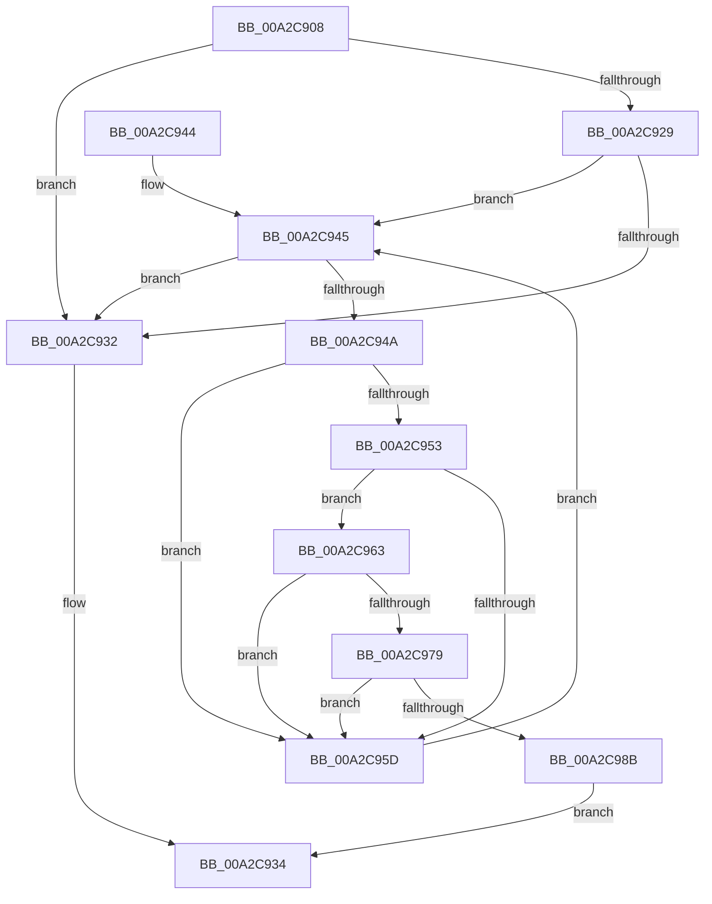

# IopIsIosbInLockedRange

- RVA: `0x00A2C908`–`0x00A2C99A` (길이 `146` bytes)
- VA: `0x0000000140A2C908`
- 실행 섹션: `PAGE`
- PDB 이름 있음: `예`; PDB Function 태그: `아니요`
- unwind 정보 RVA: `0x000AC5D4`
- 디코드: `44`개 명령, `146/146` bytes 표시
- 미해석 바이트: `0` (있으면 어셈블리에 `.byte`로 보존)

> 이 문서는 커널 이미지의 기계어와 PDB 기호를 분석해 생성했습니다. 4번과 5번은 함수 원형과 자료형을 바이너리 사용 방식에서 추정한 C 해석이며 원본 소스 복구 결과는 아닙니다.

## 1. Dependencies

- 직접 호출 지점: **1**; 고유 호출 대상: **1**
- 직접 호출자로 확인된 함수: **2**
- RIP 상대 이미지 참조: **0**

### Outgoing calls
- `0x00A2C982` → [IopQueueIrpToFileObject](../../text/40/IopQueueIrpToFileObject_function_00409864.md) (function, `0x00409864`)

### Direct callers
- [IopQueueIrpForServiceTail](../71/IopQueueIrpForServiceTail_function_0071BCC0.md) at `0x0071BD42`
- [IopSynchronousServiceTail](../8E/IopSynchronousServiceTail_function_008EB440.md) at `0x008EB597`

### Static image references
- 디코드된 RIP-relative 메모리 참조가 없습니다.

## 2. Other-region calls and transfers

- 다른 실행 섹션으로 향하는 call: **1**
  - `0x00A2C982` → [IopQueueIrpToFileObject](../../text/40/IopQueueIrpToFileObject_function_00409864.md) (`PAGE` → `.text`)
- 별도 외부 분기/꼬리 이동을 확인하지 못했습니다.

## 3. Assembly (complete function range)

```asm
00A2C908  48 89 5C 24 08                  mov qword ptr [rsp + 8], rbx
00A2C90D  48 89 74 24 10                  mov qword ptr [rsp + 0x10], rsi
00A2C912  57                              push rdi
00A2C913  48 83 EC 20                     sub rsp, 0x20
00A2C917  48 8B 99 D0 00 00 00            mov rbx, qword ptr [rcx + 0xd0]
00A2C91E  48 8B FA                        mov rdi, rdx
00A2C921  48 8B F1                        mov rsi, rcx
00A2C924  48 85 DB                        test rbx, rbx
00A2C927  74 09                           je 0x140a2c932
00A2C929  48 8B 5B 18                     mov rbx, qword ptr [rbx + 0x18]
00A2C92D  48 85 DB                        test rbx, rbx
00A2C930  75 13                           jne 0x140a2c945
00A2C932  32 C0                           xor al, al
00A2C934  48 8B 5C 24 30                  mov rbx, qword ptr [rsp + 0x30]
00A2C939  48 8B 74 24 38                  mov rsi, qword ptr [rsp + 0x38]
00A2C93E  48 83 C4 20                     add rsp, 0x20
00A2C942  5F                              pop rdi
00A2C943  C3                              ret
00A2C944  CC                              int3
00A2C945  48 85 DB                        test rbx, rbx
00A2C948  74 E8                           je 0x140a2c932
00A2C94A  48 8B 47 48                     mov rax, qword ptr [rdi + 0x48]
00A2C94E  48 3B 03                        cmp rax, qword ptr [rbx]
00A2C951  72 0A                           jb 0x140a2c95d
00A2C953  48 83 C0 10                     add rax, 0x10
00A2C957  48 3B 43 08                     cmp rax, qword ptr [rbx + 8]
00A2C95B  76 06                           jbe 0x140a2c963
00A2C95D  48 8B 5B 28                     mov rbx, qword ptr [rbx + 0x28]
00A2C961  EB E2                           jmp 0x140a2c945
00A2C963  65 48 8B 04 25 88 01 00 00      mov rax, qword ptr gs:[0x188]
00A2C96C  48 8B 88 B8 00 00 00            mov rcx, qword ptr [rax + 0xb8]
00A2C973  48 39 4B 20                     cmp qword ptr [rbx + 0x20], rcx
00A2C977  75 E4                           jne 0x140a2c95d
00A2C979  45 33 C0                        xor r8d, r8d
00A2C97C  48 8B D6                        mov rdx, rsi
00A2C97F  48 8B CF                        mov rcx, rdi
00A2C982  E8 DD CE 9D FF                  call 0x140409864
00A2C987  84 C0                           test al, al
00A2C989  74 D2                           je 0x140a2c95d
00A2C98B  48 8B 4B 18                     mov rcx, qword ptr [rbx + 0x18]
00A2C98F  B0 01                           mov al, 1
00A2C991  48 2B 0B                        sub rcx, qword ptr [rbx]
00A2C994  48 01 4F 48                     add qword ptr [rdi + 0x48], rcx
00A2C998  EB 9A                           jmp 0x140a2c934
```

## 4. C-style interpretation (structured pseudocode)

```c
__int64 __fastcall IopIsIosbInLockedRange(__int64 a1, __int64 a2, int a3)
{
    __int64 result;
    __int64 v_rsp;
    unsigned __int64 v_stack_p10;
    unsigned __int64 v_stack_p8;

    v_stack_p8 = v_rbx;
    v_stack_p10 = v_rsi;
    v_rsp = (v_rsp) - (32);
    if (*(unsigned __int64 *)(a1 + 208) == 0) goto loc_00A2C932;
    if (*(unsigned __int64 *)(*(unsigned __int64 *)(a1 + 208) + 24) != 0) goto loc_00A2C945;
loc_00A2C932:
    result = 0;
loc_00A2C934:
    v_rsp = (v_rsp) + (32);
    return result;
loc_00A2C945:
    if (v_stack_p8 == 0) goto loc_00A2C932;
    if ((*(unsigned __int64 *)(a2 + 72)) < (*(unsigned __int64 *)(v_stack_p8))) goto loc_00A2C95D;
    result = (*(unsigned __int64 *)(a2 + 72)) + (16);
    if (result <= (*(unsigned __int64 *)(v_stack_p8 + 8))) goto loc_00A2C963;
loc_00A2C95D:
    goto loc_00A2C945;
loc_00A2C963:
    if ((*(unsigned __int64 *)(*(unsigned __int64 *)(v_stack_p8 + 40) + 32)) != (*(unsigned __int64 *)(*(unsigned __int64 *)(gs_base + (0 + 392)) + 184))) goto loc_00A2C95D;
    a3 = 0;
    result = IopQueueIrpToFileObject(a2, v_stack_p10, a3, a4);
    if ((unsigned __int8)(result) == 0) goto loc_00A2C95D;
    a1 = (*(unsigned __int64 *)(*(unsigned __int64 *)(v_stack_p8 + 40) + 24)) - (*(unsigned __int64 *)(*(unsigned __int64 *)(v_stack_p8 + 40)));
    goto loc_00A2C934;
}
```

## 5. (Beta) C Style

```c
int64_t IopIsIosbInLockedRange(void *Arg1, void *Arg2, int32_t Arg3)
{
    uint8_t *arg1 = (uint8_t *)Arg1;
    uint8_t *arg2 = (uint8_t *)Arg2;

    int64_t result;
    int64_t local_rsp;
    uint64_t v_stack_p10;
    uint64_t v_stack_p8;

    v_stack_p8 = local_rbx;
    v_stack_p10 = local_rsi;
    local_rsp = (local_rsp) - (32);
    if (*(uint64_t *)(arg1 + 0xD0) == 0) goto loc_00A2C932;
    if (*(uint64_t *)(*(uint64_t *)(arg1 + 0xD0) + 0x18) != 0) goto loc_00A2C945;
loc_00A2C932:
    result = 0;
loc_00A2C934:
    local_rsp = (local_rsp) + (32);
    return result;
loc_00A2C945:
    if (v_stack_p8 == 0) goto loc_00A2C932;
    if ((*(uint64_t *)(arg2 + 0x48)) < (*(uint64_t *)(v_stack_p8))) goto loc_00A2C95D;
    result = (*(uint64_t *)(arg2 + 0x48)) + (16);
    if (result <= (*(uint64_t *)(v_stack_p8 + 0x8))) goto loc_00A2C963;
loc_00A2C95D:
    goto loc_00A2C945;
loc_00A2C963:
    if ((*(uint64_t *)(*(uint64_t *)(v_stack_p8 + 0x28) + 0x20)) != (*(uint64_t *)(*(uint64_t *)(gs_base + (0 + 0x188)) + 0xB8))) goto loc_00A2C95D;
    Arg3 = 0;
    result = IopQueueIrpToFileObject(Arg2, v_stack_p10, Arg3, a4);
    if ((uint8_t)(result) == 0) goto loc_00A2C95D;
    Arg1 = (*(uint64_t *)(*(uint64_t *)(v_stack_p8 + 0x28) + 0x18)) - (*(uint64_t *)(*(uint64_t *)(v_stack_p8 + 0x28)));
    goto loc_00A2C934;
}
```

### 관측된 메모리 오프셋

구조체 형식이 확인되지 않은 접근은 인자 기준의 오프셋으로만 기록했습니다.

| 기준 인자 | 오프셋 표현 | 폭 (bit) | 접근 |
|---|---:|---:|---|
| `Arg1` | `+ 0xD0` | `64` | `R` |
| `Arg2` | `+ 0x48` | `64` | `R` |
| `Arg2` | `+ 0x48` | `64` | `R/W` |

## 6. Execution-region graph

[열기: 2D/3D 그래프와 함수 탐색 컨트롤 패널](../../../control-panel.html?section=page&rva=0x00A2C908&view=graph)

- 2D 그래프는 위에서 아래로 흐르고, 3D 그래프는 빈 공간을 드래그해 회전합니다. Shift+드래그는 이동, 휠은 확대·축소, 함수 노드 선택은 대상 보고서 이동입니다.

### Static fallback


