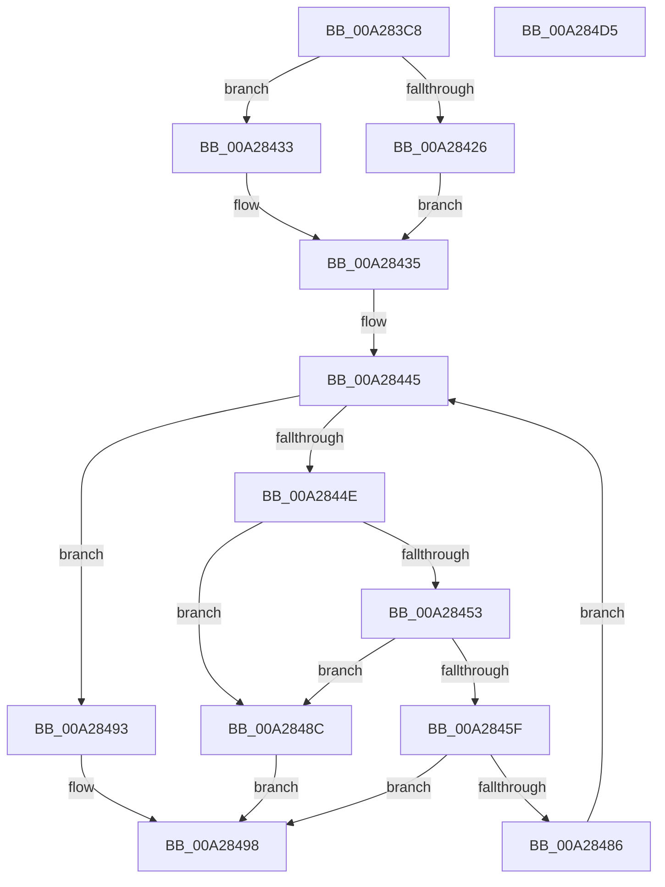

# IopQueryInterfaceRecurseUp

- RVA: `0x00A283C8`–`0x00A284D6` (길이 `270` bytes)
- VA: `0x0000000140A283C8`
- 실행 섹션: `PAGE`
- PDB 이름 있음: `예`; PDB Function 태그: `아니요`
- unwind 정보 RVA: `0x0008C20C`
- 디코드: `70`개 명령, `270/270` bytes 표시
- 미해석 바이트: `0` (있으면 어셈블리에 `.byte`로 보존)

> 이 문서는 커널 이미지의 기계어와 PDB 기호를 분석해 생성했습니다. 4번과 5번은 함수 원형과 자료형을 바이너리 사용 방식에서 추정한 C 해석이며 원본 소스 복구 결과는 아닙니다.

## 1. Dependencies

- 직접 호출 지점: **6**; 고유 호출 대상: **6**
- 직접 호출자로 확인된 함수: **1**
- RIP 상대 이미지 참조: **2**

### Outgoing calls
- `0x00A2840C` → [ExAcquireResourceSharedLite](../../text/21/ExAcquireResourceSharedLite_function_00211BC0.md) (function, `0x00211BC0`)
- `0x00A28419` → [IoGetDeviceAttachmentBaseRefWithTag](../../text/27/IoGetDeviceAttachmentBaseRefWithTag_function_00272788.md) (function, `0x00272788`)
- `0x00A28478` → [PnpQueryInterface](PnpQueryInterface_function_00A28D38.md) (function, `0x00A28D38`)
- `0x00A284A0` → [ObfDereferenceObjectWithTag](../../text/2F/ObfDereferenceObjectWithTag_function_002F78E0.md) (function, `0x002F78E0`)
- `0x00A284AC` → [ExReleaseResourceLite](../../text/25/ExReleaseResourceLite_function_0025FA10.md) (function, `0x0025FA10`)
- `0x00A284B1` → [KeLeaveCriticalRegion](../../text/25/KeLeaveCriticalRegion_function_0025D8B0.md) (function, `0x0025D8B0`)

### Direct callers
- [IoQueryInterface](../72/IoQueryInterface_function_00729930.md) at `0x00729961`

### Static image references
- `0x00A283F5` → RVA `0x00F8C560` (`.data`; read)
- `0x00A28445` → RVA `0x00F8C438` (`.data`; read)

## 2. Other-region calls and transfers

- 다른 실행 섹션으로 향하는 call: **5**
  - `0x00A2840C` → [ExAcquireResourceSharedLite](../../text/21/ExAcquireResourceSharedLite_function_00211BC0.md) (`PAGE` → `.text`)
  - `0x00A28419` → [IoGetDeviceAttachmentBaseRefWithTag](../../text/27/IoGetDeviceAttachmentBaseRefWithTag_function_00272788.md) (`PAGE` → `.text`)
  - `0x00A284A0` → [ObfDereferenceObjectWithTag](../../text/2F/ObfDereferenceObjectWithTag_function_002F78E0.md) (`PAGE` → `.text`)
  - `0x00A284AC` → [ExReleaseResourceLite](../../text/25/ExReleaseResourceLite_function_0025FA10.md) (`PAGE` → `.text`)
  - `0x00A284B1` → [KeLeaveCriticalRegion](../../text/25/KeLeaveCriticalRegion_function_0025D8B0.md) (`PAGE` → `.text`)
- 별도 외부 분기/꼬리 이동을 확인하지 못했습니다.

## 3. Assembly (complete function range)

```asm
00A283C8  48 89 5C 24 08                  mov qword ptr [rsp + 8], rbx
00A283CD  48 89 6C 24 10                  mov qword ptr [rsp + 0x10], rbp
00A283D2  48 89 74 24 18                  mov qword ptr [rsp + 0x18], rsi
00A283D7  57                              push rdi
00A283D8  41 54                           push r12
00A283DA  41 55                           push r13
00A283DC  41 56                           push r14
00A283DE  41 57                           push r15
00A283E0  48 83 EC 30                     sub rsp, 0x30
00A283E4  65 48 8B 04 25 88 01 00 00      mov rax, qword ptr gs:[0x188]
00A283ED  4C 8B EA                        mov r13, rdx
00A283F0  48 8B D9                        mov rbx, rcx
00A283F3  B2 01                           mov dl, 1
00A283F5  48 8D 0D 64 41 56 00            lea rcx, [rip + 0x564164]
00A283FC  45 0F B7 F9                     movzx r15d, r9w
00A28400  45 0F B7 E0                     movzx r12d, r8w
00A28404  66 FF 88 E4 01 00 00            dec word ptr [rax + 0x1e4]
00A2840B  90                              nop
00A2840C  E8 AF 97 7E FF                  call 0x140211bc0
00A28411  BA 50 6E 70 49                  mov edx, 0x49706e50
00A28416  48 8B CB                        mov rcx, rbx
00A28419  E8 6A A3 84 FF                  call 0x140272788
00A2841E  48 8B F0                        mov rsi, rax
00A28421  48 85 C0                        test rax, rax
00A28424  74 0D                           je 0x140a28433
00A28426  48 8B 88 38 01 00 00            mov rcx, qword ptr [rax + 0x138]
00A2842D  48 8B 59 28                     mov rbx, qword ptr [rcx + 0x28]
00A28431  EB 02                           jmp 0x140a28435
00A28433  33 DB                           xor ebx, ebx
00A28435  48 8B AC 24 88 00 00 00         mov rbp, qword ptr [rsp + 0x88]
00A2843D  4C 8B B4 24 80 00 00 00         mov r14, qword ptr [rsp + 0x80]
00A28445  48 3B 1D EC 3F 56 00            cmp rbx, qword ptr [rip + 0x563fec]
00A2844C  74 45                           je 0x140a28493
00A2844E  48 85 DB                        test rbx, rbx
00A28451  74 39                           je 0x140a2848c
00A28453  81 BB 2C 01 00 00 16 03 00 00   cmp dword ptr [rbx + 0x12c], 0x316
00A2845D  74 2D                           je 0x140a2848c
00A2845F  48 8B 4B 20                     mov rcx, qword ptr [rbx + 0x20]
00A28463  45 0F B7 CC                     movzx r9d, r12w
00A28467  48 89 6C 24 28                  mov qword ptr [rsp + 0x28], rbp
00A2846C  45 0F B7 C7                     movzx r8d, r15w
00A28470  49 8B D5                        mov rdx, r13
00A28473  4C 89 74 24 20                  mov qword ptr [rsp + 0x20], r14
00A28478  E8 BB 08 00 00                  call 0x140a28d38
00A2847D  8B F8                           mov edi, eax
00A2847F  3D BB 00 00 C0                  cmp eax, 0xc00000bb
00A28484  75 12                           jne 0x140a28498
00A28486  48 8B 5B 10                     mov rbx, qword ptr [rbx + 0x10]
00A2848A  EB B9                           jmp 0x140a28445
00A2848C  BF B6 02 00 C0                  mov edi, 0xc00002b6
00A28491  EB 05                           jmp 0x140a28498
00A28493  BF BB 00 00 C0                  mov edi, 0xc00000bb
00A28498  BA 50 6E 70 49                  mov edx, 0x49706e50
00A2849D  48 8B CE                        mov rcx, rsi
00A284A0  E8 3B F4 8C FF                  call 0x1402f78e0
00A284A5  48 8D 0D B4 40 56 00            lea rcx, [rip + 0x5640b4]
00A284AC  E8 5F 75 83 FF                  call 0x14025fa10
00A284B1  E8 FA 53 83 FF                  call 0x14025d8b0
00A284B6  48 8B 5C 24 60                  mov rbx, qword ptr [rsp + 0x60]
00A284BB  8B C7                           mov eax, edi
00A284BD  48 8B 6C 24 68                  mov rbp, qword ptr [rsp + 0x68]
00A284C2  48 8B 74 24 70                  mov rsi, qword ptr [rsp + 0x70]
00A284C7  48 83 C4 30                     add rsp, 0x30
00A284CB  41 5F                           pop r15
00A284CD  41 5E                           pop r14
00A284CF  41 5D                           pop r13
00A284D1  41 5C                           pop r12
00A284D3  5F                              pop rdi
00A284D4  C3                              ret
00A284D5  CC                              int3
```

## 4. C-style interpretation (structured pseudocode)

```c
__int64 __fastcall IopQueryInterfaceRecurseUp(__int64 a1, __int64 a2, unsigned __int16 a3, unsigned __int16 a4, __int64 a5, __int64 a6)
{
    __int64 result;
    __int64 v_rbx;
    __int64 v_rsp;
    unsigned __int64 v_stack_m30;
    unsigned __int64 v_stack_m38;
    unsigned __int64 v_stack_p10;
    unsigned __int64 v_stack_p18;
    unsigned __int64 v_stack_p8;

    v_stack_p8 = v_rbx;
    v_stack_p10 = v_rbp;
    v_stack_p18 = v_rsi;
    v_rsp = (v_rsp) - (48);
    result = ExAcquireResourceSharedLite(v_rip + 5652836, 1, a3, a4);
    result = IoGetDeviceAttachmentBaseRefWithTag(a1, (unsigned int)(0x49706E50ULL), a3, a4);
    if (result == 0) goto loc_00A28433;
    goto loc_00A28435;
loc_00A28433:
    v_rbx = 0;
loc_00A28435:
loc_00A28445:
    if (0 == (*(unsigned __int64 *)(v_rip + 5652460))) goto loc_00A28493;
    if (0 == 0) goto loc_00A2848C;
    if ((*(unsigned int *)(v_rbx + 300)) == 790) goto loc_00A2848C;
    v_stack_m30 = a6;
    v_stack_m38 = a5;
    result = PnpQueryInterface(*(unsigned __int64 *)(v_rbx + 32), a2, a4, a3);
    if (((unsigned int)(result)) != 0xC00000BBULL) goto loc_00A28498;
    goto loc_00A28445;
loc_00A2848C:
    goto loc_00A28498;
loc_00A28493:
loc_00A28498:
    result = ObfDereferenceObjectWithTag(result, (unsigned int)(0x49706E50ULL), a4, a3);
    result = ExReleaseResourceLite(v_rip + 5652660, (unsigned int)(0x49706E50ULL), a4, a3);
    result = KeLeaveCriticalRegion(v_rip + 5652660, (unsigned int)(0x49706E50ULL), a4, a3);
    v_rsp = (v_rsp) + (48);
    return (unsigned int)((unsigned int)((unsigned int)(0xC00000BBULL)));
}
```

## 5. (Beta) C Style

```c
int64_t IopQueryInterfaceRecurseUp(int64_t Arg1, int64_t Arg2, uint16_t Arg3, uint16_t Arg4, int64_t Arg5, int64_t Arg6)
{
    int64_t result;
    int64_t local_rbx;
    int64_t local_rsp;
    uint64_t v_stack_m30;
    uint64_t v_stack_m38;
    uint64_t v_stack_p10;
    uint64_t v_stack_p18;
    uint64_t v_stack_p8;

    v_stack_p8 = local_rbx;
    v_stack_p10 = local_rbp;
    v_stack_p18 = local_rsi;
    local_rsp = (local_rsp) - (48);
    result = ExAcquireResourceSharedLite(v_rip + 5652836, 1, Arg3, Arg4);
    result = IoGetDeviceAttachmentBaseRefWithTag(Arg1, (uint32_t)(0x49706E50ULL), Arg3, Arg4);
    if (result == 0) goto loc_00A28433;
    goto loc_00A28435;
loc_00A28433:
    local_rbx = 0;
loc_00A28435:
loc_00A28445:
    if (0 == (*(uint64_t *)(v_rip + 0x563FEC))) goto loc_00A28493;
    if (0 == 0) goto loc_00A2848C;
    if ((*(uint32_t *)(local_rbx + 0x12C)) == 790) goto loc_00A2848C;
    v_stack_m30 = Arg6;
    v_stack_m38 = Arg5;
    result = PnpQueryInterface(*(uint64_t *)(local_rbx + 0x20), Arg2, Arg4, Arg3);
    if (((uint32_t)(result)) != 0xC00000BBULL) goto loc_00A28498;
    goto loc_00A28445;
loc_00A2848C:
    goto loc_00A28498;
loc_00A28493:
loc_00A28498:
    result = ObfDereferenceObjectWithTag(result, (uint32_t)(0x49706E50ULL), Arg4, Arg3);
    result = ExReleaseResourceLite(v_rip + 5652660, (uint32_t)(0x49706E50ULL), Arg4, Arg3);
    result = KeLeaveCriticalRegion(v_rip + 5652660, (uint32_t)(0x49706E50ULL), Arg4, Arg3);
    local_rsp = (local_rsp) + (48);
    return (uint32_t)((uint32_t)((uint32_t)(0xC00000BBULL)));
}
```

## 6. Execution-region graph

[열기: 2D/3D 그래프와 함수 탐색 컨트롤 패널](../../../control-panel.html?section=page&rva=0x00A283C8&view=graph)

- 2D 그래프는 위에서 아래로 흐르고, 3D 그래프는 빈 공간을 드래그해 회전합니다. Shift+드래그는 이동, 휠은 확대·축소, 함수 노드 선택은 대상 보고서 이동입니다.

### Static fallback


