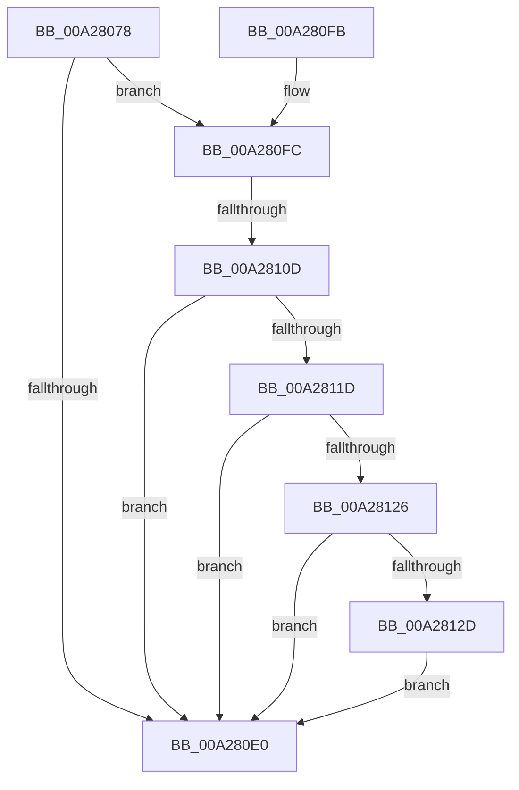

# IopQueryLegacyBusInformation

- RVA: `0x00A28078`–`0x00A2814B` (길이 `211` bytes)
- VA: `0x0000000140A28078`
- 실행 섹션: `PAGE`
- PDB 이름 있음: `예`; PDB Function 태그: `예`
- unwind 정보 RVA: `0x000AC00C`
- 디코드: `53`개 명령, `211/211` bytes 표시
- 미해석 바이트: `0` (있으면 어셈블리에 `.byte`로 보존)

> 이 문서는 커널 이미지의 기계어와 PDB 기호를 분석해 생성했습니다. 4번과 5번은 함수 원형과 자료형을 바이너리 사용 방식에서 추정한 C 해석이며 원본 소스 복구 결과는 아닙니다.

## 1. Dependencies

- 직접 호출 지점: **4**; 고유 호출 대상: **3**
- 직접 호출자로 확인된 함수: **1**
- RIP 상대 이미지 참조: **2**

### Outgoing calls
- `0x00A280AB` → [memset](../../text/6C/memset_function_006C6C40.md) (function, `0x006C6C40`)
- `0x00A280D5` → [IopSynchronousCall](../8F/IopSynchronousCall_function_008FB018.md) (function, `0x008FB018`)
- `0x00A28138` → [DbgPrint](../../text/35/DbgPrint_function_00358CB0.md) (function, `0x00358CB0`)
- `0x00A28144` → [DbgPrint](../../text/35/DbgPrint_function_00358CB0.md) (function, `0x00358CB0`)

### Direct callers
- [PipCallDriverAddDevice](PipCallDriverAddDevice_function_00A272E0.md) at `0x00A27752`

### Static image references
- `0x00A28131` → RVA `0x00B00130` (` ?? ::NNGAKEGL::`string'`; read)
- `0x00A2813D` → RVA `0x00B00180` (` ?? ::NNGAKEGL::`string'`; read)

## 2. Other-region calls and transfers

- 다른 실행 섹션으로 향하는 call: **3**
  - `0x00A280AB` → [memset](../../text/6C/memset_function_006C6C40.md) (`PAGE` → `.text`)
  - `0x00A28138` → [DbgPrint](../../text/35/DbgPrint_function_00358CB0.md) (`PAGE` → `.text`)
  - `0x00A28144` → [DbgPrint](../../text/35/DbgPrint_function_00358CB0.md) (`PAGE` → `.text`)
- call이 아닌 외부 분기/꼬리 이동: **1**
  - `0x00A28107` → [sub_00B3875C](../B3/Unknown_function_00B3875C.md) (`tail-transfer`)

## 3. Assembly (complete function range)

```asm
00A28078  48 8B C4                        mov rax, rsp
00A2807B  48 89 58 08                     mov qword ptr [rax + 8], rbx
00A2807F  48 89 68 18                     mov qword ptr [rax + 0x18], rbp
00A28083  48 89 70 20                     mov qword ptr [rax + 0x20], rsi
00A28087  48 89 50 10                     mov qword ptr [rax + 0x10], rdx
00A2808B  57                              push rdi
00A2808C  48 81 EC 80 00 00 00            sub rsp, 0x80
00A28093  48 83 60 10 00                  and qword ptr [rax + 0x10], 0
00A28098  33 D2                           xor edx, edx
00A2809A  49 8B F8                        mov rdi, r8
00A2809D  48 8B F1                        mov rsi, rcx
00A280A0  48 8D 48 A8                     lea rcx, [rax - 0x58]
00A280A4  49 8B D9                        mov rbx, r9
00A280A7  44 8D 42 48                     lea r8d, [rdx + 0x48]
00A280AB  E8 90 EB C9 FF                  call 0x1406c6c40
00A280B0  48 8D 84 24 98 00 00 00         lea rax, [rsp + 0x98]
00A280B8  66 C7 44 24 30 1B 18            mov word ptr [rsp + 0x30], 0x181b
00A280BF  45 33 C9                        xor r9d, r9d
00A280C2  48 89 44 24 20                  mov qword ptr [rsp + 0x20], rax
00A280C7  41 B8 BB 00 00 C0               mov r8d, 0xc00000bb
00A280CD  48 8D 54 24 30                  lea rdx, [rsp + 0x30]
00A280D2  48 8B CE                        mov rcx, rsi
00A280D5  E8 3E 2F ED FF                  call 0x1408fb018
00A280DA  8B E8                           mov ebp, eax
00A280DC  85 C0                           test eax, eax
00A280DE  79 1C                           jns 0x140a280fc
00A280E0  4C 8D 9C 24 80 00 00 00         lea r11, [rsp + 0x80]
00A280E8  8B C5                           mov eax, ebp
00A280EA  49 8B 5B 10                     mov rbx, qword ptr [r11 + 0x10]
00A280EE  49 8B 6B 20                     mov rbp, qword ptr [r11 + 0x20]
00A280F2  49 8B 73 28                     mov rsi, qword ptr [r11 + 0x28]
00A280F6  49 8B E3                        mov rsp, r11
00A280F9  5F                              pop rdi
00A280FA  C3                              ret
00A280FB  CC                              int3
00A280FC  48 8B 8C 24 98 00 00 00         mov rcx, qword ptr [rsp + 0x98]
00A28104  48 85 C9                        test rcx, rcx
00A28107  0F 85 4F 06 11 00               jne 0x140b3875c
00A2810D  48 8B 8E 38 01 00 00            mov rcx, qword ptr [rsi + 0x138]
00A28114  48 8B 51 28                     mov rdx, qword ptr [rcx + 0x28]
00A28118  48 85 D2                        test rdx, rdx
00A2811B  74 C3                           je 0x140a280e0
00A2811D  48 8B 52 10                     mov rdx, qword ptr [rdx + 0x10]
00A28121  48 85 D2                        test rdx, rdx
00A28124  74 BA                           je 0x140a280e0
00A28126  48 83 7A 40 00                  cmp qword ptr [rdx + 0x40], 0
00A2812B  74 B3                           je 0x140a280e0
00A2812D  48 83 C2 38                     add rdx, 0x38
00A28131  48 8D 0D F8 7F 0D 00            lea rcx, [rip + 0xd7ff8]
00A28138  E8 73 0B 93 FF                  call 0x140358cb0
00A2813D  48 8D 0D 3C 80 0D 00            lea rcx, [rip + 0xd803c]
00A28144  E8 67 0B 93 FF                  call 0x140358cb0
00A28149  EB 95                           jmp 0x140a280e0
```

## 4. C-style interpretation (structured pseudocode)

```c
__int64 __fastcall IopQueryLegacyBusInformation(__int64 a1, __int64 a2, __int64 a3, __int64 a4)
{
    __int64 result;
    __int64 v_rsp;
    unsigned __int16 v_stack_m58;
    unsigned __int64 v_stack_m68;
    unsigned __int64 v_stack_m8;
    unsigned __int64 v_stack_p10;
    unsigned __int64 v_stack_p18;

    *(unsigned __int64 *)(v_rsp + 8) = v_rbx;
    *(unsigned __int64 *)(v_rsp + 24) = v_rbp;
    *(unsigned __int64 *)(v_rsp + 32) = v_rsi;
    *(unsigned __int64 *)(v_rsp + 16) = a2;
    v_rsp = (v_rsp) - (128);
    a2 = 0;
    result = memset(v_rsp - 88, a2, a2 + 72, a4);
    v_stack_m58 = 0x181BULL;
    a4 = 0;
    v_stack_m68 = v_stack_p10;
    result = IopSynchronousCall(a1, v_stack_m58, (unsigned int)(0xC00000BBULL), a4);
    if (!sign_flag) goto loc_00A280FC;
loc_00A280E0:
    return (unsigned int)((unsigned int)((unsigned int)((unsigned int)(result))));
loc_00A280FC:
    if (*(unsigned __int64 *)(*(unsigned __int64 *)(*(unsigned __int64 *)(v_stack_m8 + 40) + 312) + 40) == 0) goto loc_00A280E0;
    if (*(unsigned __int64 *)(*(unsigned __int64 *)(*(unsigned __int64 *)(*(unsigned __int64 *)(v_stack_m8 + 40) + 312) + 40) + 16) == 0) goto loc_00A280E0;
    if ((*(unsigned __int64 *)(*(unsigned __int64 *)(*(unsigned __int64 *)(*(unsigned __int64 *)(*(unsigned __int64 *)(v_stack_m8 + 40) + 312) + 40) + 16) + 64)) == 0) goto loc_00A280E0;
    a2 = (*(unsigned __int64 *)(*(unsigned __int64 *)(*(unsigned __int64 *)(*(unsigned __int64 *)(v_stack_m8 + 40) + 312) + 40) + 16)) + (56);
    result = DbgPrint(v_rip + 884728, a2, (unsigned int)(0xC00000BBULL), a4);
    result = DbgPrint(v_rip + 884796, a2, (unsigned int)(0xC00000BBULL), a4);
    goto loc_00A280E0;
}
```

## 5. (Beta) C Style

```c
int64_t IopQueryLegacyBusInformation(void *Arg1, int64_t Arg2, int64_t Arg3, int64_t Arg4)
{
    uint8_t *arg1 = (uint8_t *)Arg1;

    int64_t result;
    int64_t local_rsp;
    uint16_t v_stack_m58;
    uint64_t v_stack_m68;
    uint64_t v_stack_m8;
    uint64_t v_stack_p10;
    uint64_t v_stack_p18;

    *(uint64_t *)(local_rsp + 0x8) = local_rbx;
    *(uint64_t *)(local_rsp + 0x18) = local_rbp;
    *(uint64_t *)(local_rsp + 0x20) = local_rsi;
    *(uint64_t *)(local_rsp + 0x10) = Arg2;
    local_rsp = (local_rsp) - (128);
    Arg2 = 0;
    result = memset(local_rsp - 88, Arg2, Arg2 + 72, Arg4);
    v_stack_m58 = 0x181BULL;
    Arg4 = 0;
    v_stack_m68 = v_stack_p10;
    result = IopSynchronousCall(Arg1, v_stack_m58, (uint32_t)(0xC00000BBULL), Arg4);
    if (!sign_flag) goto loc_00A280FC;
loc_00A280E0:
    return (uint32_t)((uint32_t)((uint32_t)((uint32_t)(result))));
loc_00A280FC:
    if (*(uint64_t *)(*(uint64_t *)(*(uint64_t *)(v_stack_m8 + 0x28) + 0x138) + 0x28) == 0) goto loc_00A280E0;
    if (*(uint64_t *)(*(uint64_t *)(*(uint64_t *)(*(uint64_t *)(v_stack_m8 + 0x28) + 0x138) + 0x28) + 0x10) == 0) goto loc_00A280E0;
    if ((*(uint64_t *)(*(uint64_t *)(*(uint64_t *)(*(uint64_t *)(*(uint64_t *)(v_stack_m8 + 0x28) + 0x138) + 0x28) + 0x10) + 0x40)) == 0) goto loc_00A280E0;
    Arg2 = (*(uint64_t *)(*(uint64_t *)(*(uint64_t *)(*(uint64_t *)(v_stack_m8 + 0x28) + 0x138) + 0x28) + 0x10)) + (56);
    result = DbgPrint(v_rip + 884728, Arg2, (uint32_t)(0xC00000BBULL), Arg4);
    result = DbgPrint(v_rip + 884796, Arg2, (uint32_t)(0xC00000BBULL), Arg4);
    goto loc_00A280E0;
}
```

### 관측된 메모리 오프셋

구조체 형식이 확인되지 않은 접근은 인자 기준의 오프셋으로만 기록했습니다.

| 기준 인자 | 오프셋 표현 | 폭 (bit) | 접근 |
|---|---:|---:|---|
| `Arg1` | `+ 0x138` | `64` | `R` |

## 6. Execution-region graph

[열기: 2D/3D 그래프와 함수 탐색 컨트롤 패널](../../../control-panel.html?section=page&rva=0x00A28078&view=graph)

- 2D 그래프는 위에서 아래로 흐르고, 3D 그래프는 빈 공간을 드래그해 회전합니다. Shift+드래그는 이동, 휠은 확대·축소, 함수 노드 선택은 대상 보고서 이동입니다.

### Static fallback


