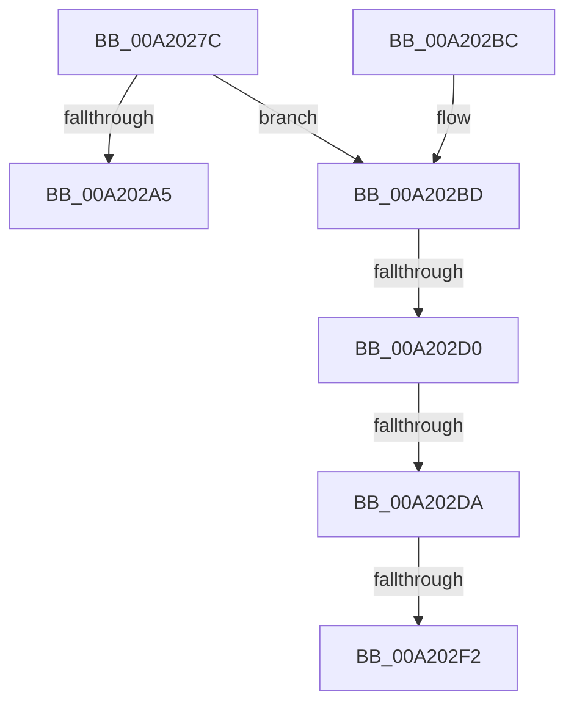

# IopRetrieveTransactionParametersFromOpenPacket

- RVA: `0x00A2027C`–`0x00A202F7` (길이 `123` bytes)
- VA: `0x0000000140A2027C`
- 실행 섹션: `PAGE`
- PDB 이름 있음: `예`; PDB Function 태그: `예`
- unwind 정보 RVA: `0x000AACC8`
- 디코드: `33`개 명령, `123/123` bytes 표시
- 미해석 바이트: `0` (있으면 어셈블리에 `.byte`로 보존)

> 이 문서는 커널 이미지의 기계어와 PDB 기호를 분석해 생성했습니다. 4번과 5번은 함수 원형과 자료형을 바이너리 사용 방식에서 추정한 C 해석이며 원본 소스 복구 결과는 아닙니다.

## 1. Dependencies

- 직접 호출 지점: **1**; 고유 호출 대상: **1**
- 직접 호출자로 확인된 함수: **2**
- RIP 상대 이미지 참조: **0**

### Outgoing calls
- `0x00A202C2` → [IopCheckStackForTransactionSupport](../../text/4B/IopCheckStackForTransactionSupport_function_004BD59C.md) (function, `0x004BD59C`)

### Direct callers
- [IopAllocRealFileObject](../89/IopAllocRealFileObject_function_00899720.md) at `0x00899BF6`
- [IopParseDevice](../89/IopParseDevice_function_0089E510.md) at `0x0089F698`

### Static image references
- 디코드된 RIP-relative 메모리 참조가 없습니다.

## 2. Other-region calls and transfers

- 다른 실행 섹션으로 향하는 call: **1**
  - `0x00A202C2` → [IopCheckStackForTransactionSupport](../../text/4B/IopCheckStackForTransactionSupport_function_004BD59C.md) (`PAGE` → `.text`)
- call이 아닌 외부 분기/꼬리 이동: **4**
  - `0x00A202CA` → [sub_00B374D0 + 0x13](../B3/Unknown_function_00B374D0.md) (`tail-transfer`)
  - `0x00A202D4` → [sub_00B374D0](../B3/Unknown_function_00B374D0.md) (`tail-transfer`)
  - `0x00A202EC` → [sub_00B374D0](../B3/Unknown_function_00B374D0.md) (`tail-transfer`)
  - `0x00A202F2` → [sub_00B374D0 + 0x13](../B3/Unknown_function_00B374D0.md) (`tail-transfer`)

## 3. Assembly (complete function range)

```asm
00A2027C  48 89 5C 24 08                  mov qword ptr [rsp + 8], rbx
00A20281  48 89 6C 24 18                  mov qword ptr [rsp + 0x18], rbp
00A20286  48 89 74 24 20                  mov qword ptr [rsp + 0x20], rsi
00A2028B  57                              push rdi
00A2028C  48 83 EC 30                     sub rsp, 0x30
00A20290  8B 82 98 00 00 00               mov eax, dword ptr [rdx + 0x98]
00A20296  33 FF                           xor edi, edi
00A20298  49 8B E9                        mov rbp, r9
00A2029B  41 8B F0                        mov esi, r8d
00A2029E  48 8B DA                        mov rbx, rdx
00A202A1  A8 04                           test al, 4
00A202A3  75 18                           jne 0x140a202bd
00A202A5  8B C7                           mov eax, edi
00A202A7  48 8B 5C 24 40                  mov rbx, qword ptr [rsp + 0x40]
00A202AC  48 8B 6C 24 50                  mov rbp, qword ptr [rsp + 0x50]
00A202B1  48 8B 74 24 58                  mov rsi, qword ptr [rsp + 0x58]
00A202B6  48 83 C4 30                     add rsp, 0x30
00A202BA  5F                              pop rdi
00A202BB  C3                              ret
00A202BC  CC                              int3
00A202BD  48 21 7C 24 48                  and qword ptr [rsp + 0x48], rdi
00A202C2  E8 D5 D2 A9 FF                  call 0x1404bd59c
00A202C7  48 85 C0                        test rax, rax
00A202CA  0F 85 13 72 11 00               jne 0x140b374e3
00A202D0  83 7B 58 01                     cmp dword ptr [rbx + 0x58], 1
00A202D4  0F 85 F6 71 11 00               jne 0x140b374d0
00A202DA  F6 43 46 06                     test byte ptr [rbx + 0x46], 6
00A202DE  0F 94 C1                        sete cl
00A202E1  F7 C6 56 FF ED FE               test esi, 0xfeedff56
00A202E7  0F 94 C0                        sete al
00A202EA  84 C8                           test al, cl
00A202EC  0F 84 DE 71 11 00               je 0x140b374d0
00A202F2  E9 EC 71 11 00                  jmp 0x140b374e3
```

## 4. C-style interpretation (structured pseudocode)

```c
__int64 __fastcall IopRetrieveTransactionParametersFromOpenPacket(__int64 a1, __int64 a2, int a3, __int64 a4)
{
    __int64 result;
    __int64 v_rdi;
    __int64 v_rsp;
    unsigned __int64 v_stack_p18;
    unsigned __int64 v_stack_p20;
    unsigned __int64 v_stack_p48;
    unsigned __int64 v_stack_p8;

    v_stack_p8 = v_rbx;
    v_stack_p18 = v_rbp;
    v_stack_p20 = v_rsi;
    v_rsp = (v_rsp) - (48);
    v_rdi = 0;
    if ((((unsigned __int8)((unsigned int)(*(unsigned int *)(a2 + 152)))) & (4)) != 0) goto loc_00A202BD;
    v_rsp = (v_rsp) + (48);
    return 0;
loc_00A202BD:
    result = IopCheckStackForTransactionSupport(a1, a2, a3, a4);
    a1 = (((*(unsigned __int8 *)(v_stack_p8 + 70)) & (6)) == 0) ? 1 : 0;
    result = ((((unsigned int)(v_stack_p20)) & (0xFEEDFF56ULL)) == 0) ? 1 : 0;
}
```

## 5. (Beta) C Style

```c
int64_t IopRetrieveTransactionParametersFromOpenPacket(int64_t Arg1, void *Arg2, int32_t Arg3, int64_t Arg4)
{
    uint8_t *arg2 = (uint8_t *)Arg2;

    int64_t result;
    int64_t local_rdi;
    int64_t local_rsp;
    uint64_t v_stack_p18;
    uint64_t v_stack_p20;
    uint64_t v_stack_p48;
    uint64_t v_stack_p8;

    v_stack_p8 = local_rbx;
    v_stack_p18 = local_rbp;
    v_stack_p20 = local_rsi;
    local_rsp = (local_rsp) - (48);
    local_rdi = 0;
    if ((((uint8_t)((uint32_t)(*(uint32_t *)(arg2 + 0x98)))) & (4)) != 0) goto loc_00A202BD;
    local_rsp = (local_rsp) + (48);
    return 0;
loc_00A202BD:
    result = IopCheckStackForTransactionSupport(Arg1, Arg2, Arg3, Arg4);
    Arg1 = (((*(uint8_t *)(v_stack_p8 + 0x46)) & (6)) == 0) ? 1 : 0;
    result = ((((uint32_t)(v_stack_p20)) & (0xFEEDFF56ULL)) == 0) ? 1 : 0;
}
```

### 관측된 메모리 오프셋

구조체 형식이 확인되지 않은 접근은 인자 기준의 오프셋으로만 기록했습니다.

| 기준 인자 | 오프셋 표현 | 폭 (bit) | 접근 |
|---|---:|---:|---|
| `Arg2` | `+ 0x46` | `8` | `R` |
| `Arg2` | `+ 0x58` | `32` | `R` |
| `Arg2` | `+ 0x98` | `32` | `R` |

## 6. Execution-region graph

[열기: 2D/3D 그래프와 함수 탐색 컨트롤 패널](../../../control-panel.html?section=page&rva=0x00A2027C&view=graph)

- 2D 그래프는 위에서 아래로 흐르고, 3D 그래프는 빈 공간을 드래그해 회전합니다. Shift+드래그는 이동, 휠은 확대·축소, 함수 노드 선택은 대상 보고서 이동입니다.

### Static fallback


