# KeBuildLogicalProcessorSystemInformation

- RVA: `0x00A22B64`–`0x00A22E05` (길이 `673` bytes)
- VA: `0x0000000140A22B64`
- 실행 섹션: `PAGE`
- PDB 이름 있음: `예`; PDB Function 태그: `아니요`
- unwind 정보 RVA: `0x000AB61C`
- 디코드: `167`개 명령, `673/673` bytes 표시
- 미해석 바이트: `0` (있으면 어셈블리에 `.byte`로 보존)

> 이 문서는 커널 이미지의 기계어와 PDB 기호를 분석해 생성했습니다. 4번과 5번은 함수 원형과 자료형을 바이너리 사용 방식에서 추정한 C 해석이며 원본 소스 복구 결과는 아닙니다.

## 1. Dependencies

- 직접 호출 지점: **1**; 고유 호출 대상: **1**
- 직접 호출자로 확인된 함수: **1**
- RIP 상대 이미지 참조: **5**

### Outgoing calls
- `0x00A22CBB` → [KiGetSubNodeForGroup](../../text/45/KiGetSubNodeForGroup_function_0045311C.md) (function, `0x0045311C`)

### Direct callers
- [ExpQuerySystemInformation](../A5/ExpQuerySystemInformation_function_00A57858.md) at `0x00A58DA4`

### Static image references
- `0x00A22B80` → RVA `0x00FC6A80` (`ALMOSTRO`; read)
- `0x00A22BA6` → RVA `0x00FC8C40` (`ALMOSTRO`; read)
- `0x00A22BE1` → RVA `0x00F231B8` (`.data`; read)
- `0x00A22C9C` → RVA `0x00FC5000` (`ALMOSTRO`; read)
- `0x00A22CAE` → RVA `0x00FCF6C0` (`CACHEALI`; read)

## 2. Other-region calls and transfers

- 다른 실행 섹션으로 향하는 call: **1**
  - `0x00A22CBB` → [KiGetSubNodeForGroup](../../text/45/KiGetSubNodeForGroup_function_0045311C.md) (`PAGE` → `.text`)
- 별도 외부 분기/꼬리 이동을 확인하지 못했습니다.

## 3. Assembly (complete function range)

```asm
00A22B64  48 89 5C 24 08                  mov qword ptr [rsp + 8], rbx
00A22B69  48 89 6C 24 18                  mov qword ptr [rsp + 0x18], rbp
00A22B6E  48 89 74 24 20                  mov qword ptr [rsp + 0x20], rsi
00A22B73  57                              push rdi
00A22B74  41 54                           push r12
00A22B76  41 55                           push r13
00A22B78  41 56                           push r14
00A22B7A  41 57                           push r15
00A22B7C  48 83 EC 20                     sub rsp, 0x20
00A22B80  8B 05 FA 3E 5A 00               mov eax, dword ptr [rip + 0x5a3efa]
00A22B86  45 33 ED                        xor r13d, r13d
00A22B89  44 0F B7 F1                     movzx r14d, cx
00A22B8D  4D 8B E1                        mov r12, r9
00A22B90  45 8B F8                        mov r15d, r8d
00A22B93  41 8B FD                        mov edi, r13d
00A22B96  45 8B D5                        mov r10d, r13d
00A22B99  41 8B ED                        mov ebp, r13d
00A22B9C  85 C0                           test eax, eax
00A22B9E  0F 84 F8 00 00 00               je 0x140a22c9c
00A22BA4  8B C5                           mov eax, ebp
00A22BA6  4C 8D 05 93 60 5A 00            lea r8, [rip + 0x5a6093]
00A22BAD  4D 8B 04 C0                     mov r8, qword ptr [r8 + rax*8]
00A22BB1  41 0F B6 88 D0 00 00 00         movzx ecx, byte ptr [r8 + 0xd0]
00A22BB9  66 41 3B CE                     cmp cx, r14w
00A22BBD  0F 85 C9 00 00 00               jne 0x140a22c8c
00A22BC3  4D 8B 9C C8 18 8C 00 00         mov r11, qword ptr [r8 + rcx*8 + 0x8c18]
00A22BCB  8B D9                           mov ebx, ecx
00A22BCD  4D 85 DB                        test r11, r11
00A22BD0  0F 84 1F 02 00 00               je 0x140a22df5
00A22BD6  49 0F BD CB                     bsr rcx, r11
00A22BDA  8B C3                           mov eax, ebx
00A22BDC  C1 E0 06                        shl eax, 6
00A22BDF  03 C8                           add ecx, eax
00A22BE1  48 8B 05 D0 05 50 00            mov rax, qword ptr [rip + 0x5005d0]
00A22BE8  8B 04 88                        mov eax, dword ptr [rax + rcx*4]
00A22BEB  45 8B 48 24                     mov r9d, dword ptr [r8 + 0x24]
00A22BEF  44 3B C8                        cmp r9d, eax
00A22BF2  0F 84 A1 01 00 00               je 0x140a22d99
00A22BF8  4D 8B 98 60 8E 00 00            mov r11, qword ptr [r8 + 0x8e60]
00A22BFF  4D 85 DB                        test r11, r11
00A22C02  0F 84 F5 01 00 00               je 0x140a22dfd
00A22C08  49 0F BD C3                     bsr rax, r11
00A22C0C  C1 E3 06                        shl ebx, 6
00A22C0F  03 D8                           add ebx, eax
00A22C11  48 8B 05 A0 05 50 00            mov rax, qword ptr [rip + 0x5005a0]
00A22C18  8B 04 98                        mov eax, dword ptr [rax + rbx*4]
00A22C1B  44 3B C8                        cmp r9d, eax
00A22C1E  0F 84 3D 01 00 00               je 0x140a22d61
00A22C24  45 8B CD                        mov r9d, r13d
00A22C27  45 39 A8 94 8B 00 00            cmp dword ptr [r8 + 0x8b94], r13d
00A22C2E  76 5C                           jbe 0x140a22c8c
00A22C30  48 8D 5A 10                     lea rbx, [rdx + 0x10]
00A22C34  41 8B F1                        mov esi, r9d
00A22C37  4C 69 DE 08 01 00 00            imul r11, rsi, 0x108
00A22C3E  4D 03 D8                        add r11, r8
00A22C41  66 45 3B B3 00 AF 00 00         cmp r14w, word ptr [r11 + 0xaf00]
00A22C49  0F 83 9B 01 00 00               jae 0x140a22dea
00A22C4F  4F 8B 9C F3 08 AF 00 00         mov r11, qword ptr [r11 + r14*8 + 0xaf08]
00A22C57  4D 85 DB                        test r11, r11
00A22C5A  0F 84 8D 01 00 00               je 0x140a22ded
00A22C60  49 0F BD CB                     bsr rcx, r11
00A22C64  41 8B C6                        mov eax, r14d
00A22C67  C1 E0 06                        shl eax, 6
00A22C6A  03 C8                           add ecx, eax
00A22C6C  48 8B 05 45 05 50 00            mov rax, qword ptr [rip + 0x500545]
00A22C73  8B 04 88                        mov eax, dword ptr [rax + rcx*4]
00A22C76  41 39 40 24                     cmp dword ptr [r8 + 0x24], eax
00A22C7A  0F 84 93 00 00 00               je 0x140a22d13
00A22C80  41 FF C1                        inc r9d
00A22C83  45 3B 88 94 8B 00 00            cmp r9d, dword ptr [r8 + 0x8b94]
00A22C8A  72 A8                           jb 0x140a22c34
00A22C8C  8B 05 EE 3D 5A 00               mov eax, dword ptr [rip + 0x5a3dee]
00A22C92  FF C5                           inc ebp
00A22C94  3B E8                           cmp ebp, eax
00A22C96  0F 82 08 FF FF FF               jb 0x140a22ba4
00A22C9C  0F B7 1D 5D 23 5A 00            movzx ebx, word ptr [rip + 0x5a235d]
00A22CA3  45 8B CD                        mov r9d, r13d
00A22CA6  85 DB                           test ebx, ebx
00A22CA8  74 45                           je 0x140a22cef
00A22CAA  4C 8D 42 10                     lea r8, [rdx + 0x10]
00A22CAE  4C 8D 1D 0B CA 5A 00            lea r11, [rip + 0x5aca0b]
00A22CB5  49 8B 0B                        mov rcx, qword ptr [r11]
00A22CB8  41 8B D6                        mov edx, r14d
00A22CBB  E8 5C 04 A3 FF                  call 0x14045311c
00A22CC0  48 85 C0                        test rax, rax
00A22CC3  74 1E                           je 0x140a22ce3
00A22CC5  48 8B 80 80 00 00 00            mov rax, qword ptr [rax + 0x80]
00A22CCC  48 85 C0                        test rax, rax
00A22CCF  74 12                           je 0x140a22ce3
00A22CD1  41 83 C2 20                     add r10d, 0x20
00A22CD5  45 3B D7                        cmp r10d, r15d
00A22CD8  0F 86 ED 00 00 00               jbe 0x140a22dcb
00A22CDE  BF 04 00 00 C0                  mov edi, 0xc0000004
00A22CE3  41 FF C1                        inc r9d
00A22CE6  49 83 C3 08                     add r11, 8
00A22CEA  44 3B CB                        cmp r9d, ebx
00A22CED  72 C6                           jb 0x140a22cb5
00A22CEF  48 8B 5C 24 50                  mov rbx, qword ptr [rsp + 0x50]
00A22CF4  8B C7                           mov eax, edi
00A22CF6  48 8B 6C 24 60                  mov rbp, qword ptr [rsp + 0x60]
00A22CFB  48 8B 74 24 68                  mov rsi, qword ptr [rsp + 0x68]
00A22D00  45 89 14 24                     mov dword ptr [r12], r10d
00A22D04  48 83 C4 20                     add rsp, 0x20
00A22D08  41 5F                           pop r15
00A22D0A  41 5E                           pop r14
00A22D0C  41 5D                           pop r13
00A22D0E  41 5C                           pop r12
00A22D10  5F                              pop rdi
00A22D11  C3                              ret
00A22D12  CC                              int3
00A22D13  41 83 C2 20                     add r10d, 0x20
00A22D17  45 3B D7                        cmp r10d, r15d
00A22D1A  77 3B                           ja 0x140a22d57
00A22D1C  4C 89 6B 08                     mov qword ptr [rbx + 8], r13
00A22D20  48 8D 04 76                     lea rax, [rsi + rsi*2]
00A22D24  4C 89 2B                        mov qword ptr [rbx], r13
00A22D27  4C 89 1A                        mov qword ptr [rdx], r11
00A22D2A  48 83 C2 20                     add rdx, 0x20
00A22D2E  C7 43 F8 02 00 00 00            mov dword ptr [rbx - 8], 2
00A22D35  F2 41 0F 10 84 80 58 8B 00 00   movsd xmm0, qword ptr [r8 + rax*4 + 0x8b58]
00A22D3F  F2 0F 11 03                     movsd qword ptr [rbx], xmm0
00A22D43  41 8B 84 80 60 8B 00 00         mov eax, dword ptr [r8 + rax*4 + 0x8b60]
00A22D4B  89 43 08                        mov dword ptr [rbx + 8], eax
00A22D4E  48 83 C3 20                     add rbx, 0x20
00A22D52  E9 29 FF FF FF                  jmp 0x140a22c80
00A22D57  BF 04 00 00 C0                  mov edi, 0xc0000004
00A22D5C  E9 1F FF FF FF                  jmp 0x140a22c80
00A22D61  4D 39 98 C8 00 00 00            cmp qword ptr [r8 + 0xc8], r11
00A22D68  0F 95 C0                        setne al
00A22D6B  41 83 C2 20                     add r10d, 0x20
00A22D6F  45 3B D7                        cmp r10d, r15d
00A22D72  77 1B                           ja 0x140a22d8f
00A22D74  4C 89 6A 10                     mov qword ptr [rdx + 0x10], r13
00A22D78  88 42 10                        mov byte ptr [rdx + 0x10], al
00A22D7B  4C 89 1A                        mov qword ptr [rdx], r11
00A22D7E  44 89 6A 08                     mov dword ptr [rdx + 8], r13d
00A22D82  4C 89 6A 18                     mov qword ptr [rdx + 0x18], r13
00A22D86  48 83 C2 20                     add rdx, 0x20
00A22D8A  E9 95 FE FF FF                  jmp 0x140a22c24
00A22D8F  BF 04 00 00 C0                  mov edi, 0xc0000004
00A22D94  E9 8B FE FF FF                  jmp 0x140a22c24
00A22D99  41 83 C2 20                     add r10d, 0x20
00A22D9D  45 3B D7                        cmp r10d, r15d
00A22DA0  76 0A                           jbe 0x140a22dac
00A22DA2  BF 04 00 00 C0                  mov edi, 0xc0000004
00A22DA7  E9 4C FE FF FF                  jmp 0x140a22bf8
00A22DAC  4C 89 1A                        mov qword ptr [rdx], r11
00A22DAF  C7 42 08 03 00 00 00            mov dword ptr [rdx + 8], 3
00A22DB6  4C 89 6A 18                     mov qword ptr [rdx + 0x18], r13
00A22DBA  4C 89 6A 10                     mov qword ptr [rdx + 0x10], r13
00A22DBE  48 83 C2 20                     add rdx, 0x20
00A22DC2  45 8B 48 24                     mov r9d, dword ptr [r8 + 0x24]
00A22DC6  E9 2D FE FF FF                  jmp 0x140a22bf8
00A22DCB  4D 89 28                        mov qword ptr [r8], r13
00A22DCE  45 89 08                        mov dword ptr [r8], r9d
00A22DD1  49 89 40 F0                     mov qword ptr [r8 - 0x10], rax
00A22DD5  41 C7 40 F8 01 00 00 00         mov dword ptr [r8 - 8], 1
00A22DDD  4D 89 68 08                     mov qword ptr [r8 + 8], r13
00A22DE1  49 83 C0 20                     add r8, 0x20
00A22DE5  E9 F9 FE FF FF                  jmp 0x140a22ce3
00A22DEA  4D 8B DD                        mov r11, r13
00A22DED  83 C8 FF                        or eax, 0xffffffff
00A22DF0  E9 81 FE FF FF                  jmp 0x140a22c76
00A22DF5  83 C8 FF                        or eax, 0xffffffff
00A22DF8  E9 EE FD FF FF                  jmp 0x140a22beb
00A22DFD  83 C8 FF                        or eax, 0xffffffff
00A22E00  E9 16 FE FF FF                  jmp 0x140a22c1b
```

## 4. C-style interpretation (structured pseudocode)

```c
__int64 __fastcall KeBuildLogicalProcessorSystemInformation(unsigned __int16 a1, __int64 a2, int a3, __int64 a4)
{
    __int64 result;
    __int64 v_r10;
    __int64 v_r11;
    __int64 v_r13;
    __int64 v_rbp;
    __int64 v_rbx;
    __int64 v_rsp;
    unsigned __int64 v_stack_p18;
    unsigned __int64 v_stack_p20;
    unsigned __int64 v_stack_p8;

    v_stack_p8 = v_rbx;
    v_stack_p18 = v_rbp;
    v_stack_p20 = v_rsi;
    v_rsp = (v_rsp) - (32);
    v_r13 = 0;
    if ((unsigned int)((unsigned int)(*(unsigned int *)(v_rip + 5914362))) == 0) goto loc_00A22C9C;
loc_00A22BA4:
    if (((unsigned __int16)(*(unsigned __int8 *)(*(unsigned __int64 *)(v_rip + 5922963 + 0 * 8) + 208))) != a1) goto loc_00A22C8C;
    if (*(unsigned __int64 *)(*(unsigned __int64 *)(v_rip + 5922963 + 0 * 8) + *(unsigned __int8 *)(*(unsigned __int64 *)(v_rip + 5922963 + 0 * 8) + 208) * 8 + 35864) == 0) goto loc_00A22DF5;
    result = (unsigned int)(((unsigned int)((unsigned int)((unsigned int)((unsigned int)(*(unsigned __int8 *)(*(unsigned __int64 *)(v_rip + 5922963 + 0 * 8) + 208)))))) << (6));
    a1 = (unsigned int)((*(unsigned __int8 *)(*(unsigned __int64 *)(v_rip + 5922963 + 0 * 8) + 208)) + ((unsigned int)(result)));
loc_00A22BEB:
    if (((unsigned int)((unsigned int)(*(unsigned int *)(*(unsigned __int64 *)(v_rip + 5922963 + 0 * 8) + 36)))) == ((unsigned int)((unsigned int)(*(unsigned int *)(*(unsigned __int64 *)(v_rip + 5244368) + a1 * 4))))) goto loc_00A22D99;
loc_00A22BF8:
    if (*(unsigned __int64 *)(*(unsigned __int64 *)(v_rip + 5922963 + 0 * 8) + 36448) == 0) goto loc_00A22DFD;
    v_rbx = (unsigned int)(((unsigned int)((unsigned int)(*(unsigned __int8 *)(*(unsigned __int64 *)(v_rip + 5922963 + 0 * 8) + 208)))) << (6));
    v_rbx = (unsigned int)((v_rbx) + ((unsigned int)((unsigned int)(*(unsigned int *)(*(unsigned __int64 *)(v_rip + 5244368) + a1 * 4)))));
loc_00A22C1B:
    if (((unsigned int)((unsigned int)(*(unsigned int *)(*(unsigned __int64 *)(v_rip + 5922963 + 0 * 8) + 36)))) == ((unsigned int)((unsigned int)(*(unsigned int *)(*(unsigned __int64 *)(v_rip + 5244320) + v_rbx * 4))))) goto loc_00A22D61;
loc_00A22C24:
    if ((*(unsigned int *)(*(unsigned __int64 *)(v_rip + 5922963 + 0 * 8) + 35732)) <= 0) goto loc_00A22C8C;
loc_00A22C34:
    v_r11 = (*(unsigned __int64 *)(*(unsigned __int64 *)(v_rip + 5922963 + 0 * 8) + 36448)) * (0);
    v_r11 = (v_r11) + (*(unsigned __int64 *)(v_rip + 5922963 + 0 * 8));
    if (a1 >= (*(unsigned __int16 *)(v_r11 + 44800))) goto loc_00A22DEA;
    if (*(unsigned __int64 *)(v_r11 + a1 * 8 + 44808) == 0) goto loc_00A22DED;
    result = (unsigned int)(((unsigned int)(a1)) << (6));
    a1 = (unsigned int)((a1) + ((unsigned int)(result)));
loc_00A22C76:
    if ((*(unsigned int *)(*(unsigned __int64 *)(v_rip + 5922963 + 0 * 8) + 36)) == ((unsigned int)((unsigned int)(*(unsigned int *)(*(unsigned __int64 *)(v_rip + 5244229) + a1 * 4))))) goto loc_00A22D13;
loc_00A22C80:
    a4 = (unsigned int)((0) + 1);
    if (((unsigned int)(a4)) < (*(unsigned int *)(*(unsigned __int64 *)(v_rip + 5922963 + 0 * 8) + 35732))) goto loc_00A22C34;
loc_00A22C8C:
    v_rbp = (unsigned int)((0) + 1);
    if (((unsigned int)(v_rbp)) < ((unsigned int)((unsigned int)(*(unsigned int *)(v_rip + 5914094))))) goto loc_00A22BA4;
loc_00A22C9C:
    if ((unsigned int)(*(unsigned __int16 *)(v_rip + 5907293)) == 0) goto loc_00A22CEF;
loc_00A22CB5:
    result = KiGetSubNodeForGroup(*(unsigned __int64 *)(v_rip + 5949963), (unsigned int)(a1), a2 + 16, 0);
    if (result == 0) goto loc_00A22CE3;
    if (*(unsigned __int64 *)(result + 128) == 0) goto loc_00A22CE3;
    v_r10 = (unsigned int)((0) + (32));
    if (((unsigned int)(v_r10)) <= ((unsigned int)((unsigned int)(a3)))) goto loc_00A22DCB;
loc_00A22CE3:
    a4 = (unsigned int)((0) + 1);
    v_r11 = (v_rip + 5949963) + (8);
    if (((unsigned int)(a4)) < ((unsigned int)(*(unsigned __int16 *)(v_rip + 5907293)))) goto loc_00A22CB5;
loc_00A22CEF:
    *(unsigned int *)(a4) = (unsigned int)(v_r10);
    v_rsp = (v_rsp) + (32);
    return (unsigned int)((unsigned int)((unsigned int)(0xC0000004ULL)));
loc_00A22D13:
    v_r10 = (unsigned int)((v_r10) + (32));
    if (((unsigned int)(v_r10)) > ((unsigned int)((unsigned int)(a3)))) goto loc_00A22D57;
    *(unsigned __int64 *)(v_stack_p8 + 8) = 0;
    *(unsigned __int64 *)(v_stack_p8) = 0;
    *(unsigned __int64 *)((unsigned int)(a1)) = v_r11;
    a2 = ((unsigned int)(a1)) + (32);
    *(unsigned int *)(v_stack_p8 - 8) = 2;
    *(unsigned __int64 *)(v_stack_p8) = v_xmm0;
    *(unsigned int *)(v_stack_p8 + 8) = (unsigned int)((unsigned int)(*(unsigned int *)(a2 + 16 + v_stack_p20 + v_stack_p20 * 2 * 4 + 35680)));
    v_rbx = (v_stack_p8) + (32);
    goto loc_00A22C80;
loc_00A22D57:
    goto loc_00A22C80;
loc_00A22D61:
    result = ((*(unsigned __int64 *)(a2 + 16 + 200)) != v_r11) ? 1 : 0;
    v_r10 = (unsigned int)((v_r10) + (32));
    if (((unsigned int)(v_r10)) > ((unsigned int)((unsigned int)(a3)))) goto loc_00A22D8F;
    *(unsigned __int64 *)(a2 + 16) = 0;
    *(unsigned __int8 *)(a2 + 16) = (unsigned __int8)(result);
    *(unsigned __int64 *)(a2) = v_r11;
    *(unsigned int *)(a2 + 8) = 0;
    *(unsigned __int64 *)(a2 + 24) = 0;
    a2 = (a2) + (32);
    goto loc_00A22C24;
loc_00A22D8F:
    goto loc_00A22C24;
loc_00A22D99:
    v_r10 = (unsigned int)((v_r10) + (32));
    if (((unsigned int)(v_r10)) <= ((unsigned int)((unsigned int)(a3)))) goto loc_00A22DAC;
    goto loc_00A22BF8;
loc_00A22DAC:
    *(unsigned __int64 *)(a2) = v_r11;
    *(unsigned int *)(a2 + 8) = 3;
    *(unsigned __int64 *)(a2 + 24) = 0;
    *(unsigned __int64 *)(a2 + 16) = 0;
    a2 = (a2) + (32);
    goto loc_00A22BF8;
loc_00A22DCB:
    *(unsigned __int64 *)(a2 + 16) = 0;
    *(unsigned int *)(a2 + 16) = (unsigned int)((unsigned int)(*(unsigned int *)(a2 + 16 + 36)));
    *(unsigned __int64 *)(a2 + 16 - 16) = result;
    *(unsigned int *)(a2 + 16 - 8) = 1;
    *(unsigned __int64 *)(a2 + 16 + 8) = 0;
    a3 = (a2 + 16) + (32);
    goto loc_00A22CE3;
loc_00A22DEA:
loc_00A22DED:
    result = (unsigned int)((result) | (0xFFFFFFFFULL));
    goto loc_00A22C76;
loc_00A22DF5:
    result = (unsigned int)((result) | (0xFFFFFFFFULL));
    goto loc_00A22BEB;
loc_00A22DFD:
    result = (unsigned int)((result) | (0xFFFFFFFFULL));
    goto loc_00A22C1B;
}
```

## 5. (Beta) C Style

```c
int64_t KeBuildLogicalProcessorSystemInformation(uint16_t Arg1, void *Arg2, int32_t Arg3, void *Arg4)
{
    uint8_t *arg2 = (uint8_t *)Arg2;
    uint8_t *arg4 = (uint8_t *)Arg4;

    int64_t result;
    int64_t local_r10;
    int64_t local_r11;
    int64_t local_r13;
    int64_t local_rbp;
    int64_t local_rbx;
    int64_t local_rsp;
    uint64_t v_stack_p18;
    uint64_t v_stack_p20;
    uint64_t v_stack_p8;

    v_stack_p8 = local_rbx;
    v_stack_p18 = local_rbp;
    v_stack_p20 = local_rsi;
    local_rsp = (local_rsp) - (32);
    local_r13 = 0;
    if ((uint32_t)((uint32_t)(*(uint32_t *)(v_rip + 0x5A3EFA))) == 0) goto loc_00A22C9C;
loc_00A22BA4:
    if (((uint16_t)(*(uint8_t *)(*(uint64_t *)(v_rip + 0x5A6093 + 0x0 * 8) + 0xD0))) != Arg1) goto loc_00A22C8C;
    if (*(uint64_t *)(*(uint64_t *)(v_rip + 0x5A6093 + 0x0 * 8) + *(uint8_t *)(*(uint64_t *)(v_rip + 0x5A6093 + 0x0 * 8) + 0xD0) * 8 + 0x8C18) == 0) goto loc_00A22DF5;
    result = (uint32_t)(((uint32_t)((uint32_t)((uint32_t)((uint32_t)(*(uint8_t *)(*(uint64_t *)(v_rip + 0x5A6093 + 0x0 * 8) + 0xD0)))))) << (6));
    Arg1 = (uint32_t)((*(uint8_t *)(*(uint64_t *)(v_rip + 0x5A6093 + 0x0 * 8) + 0xD0)) + ((uint32_t)(result)));
loc_00A22BEB:
    if (((uint32_t)((uint32_t)(*(uint32_t *)(*(uint64_t *)(v_rip + 0x5A6093 + 0x0 * 8) + 0x24)))) == ((uint32_t)((uint32_t)(*(uint32_t *)(*(uint64_t *)(v_rip + 0x5005D0) + Arg1 * 4))))) goto loc_00A22D99;
loc_00A22BF8:
    if (*(uint64_t *)(*(uint64_t *)(v_rip + 0x5A6093 + 0x0 * 8) + 0x8E60) == 0) goto loc_00A22DFD;
    local_rbx = (uint32_t)(((uint32_t)((uint32_t)(*(uint8_t *)(*(uint64_t *)(v_rip + 0x5A6093 + 0x0 * 8) + 0xD0)))) << (6));
    local_rbx = (uint32_t)((local_rbx) + ((uint32_t)((uint32_t)(*(uint32_t *)(*(uint64_t *)(v_rip + 0x5005D0) + Arg1 * 4)))));
loc_00A22C1B:
    if (((uint32_t)((uint32_t)(*(uint32_t *)(*(uint64_t *)(v_rip + 0x5A6093 + 0x0 * 8) + 0x24)))) == ((uint32_t)((uint32_t)(*(uint32_t *)(*(uint64_t *)(v_rip + 0x5005A0) + local_rbx * 4))))) goto loc_00A22D61;
loc_00A22C24:
    if ((*(uint32_t *)(*(uint64_t *)(v_rip + 0x5A6093 + 0x0 * 8) + 0x8B94)) <= 0) goto loc_00A22C8C;
loc_00A22C34:
    local_r11 = (*(uint64_t *)(*(uint64_t *)(v_rip + 0x5A6093 + 0x0 * 8) + 0x8E60)) * (0);
    local_r11 = (local_r11) + (*(uint64_t *)(v_rip + 0x5A6093 + 0x0 * 8));
    if (Arg1 >= (*(uint16_t *)(local_r11 + 0xAF00))) goto loc_00A22DEA;
    if (*(uint64_t *)(local_r11 + Arg1 * 8 + 0xAF08) == 0) goto loc_00A22DED;
    result = (uint32_t)(((uint32_t)(Arg1)) << (6));
    Arg1 = (uint32_t)((Arg1) + ((uint32_t)(result)));
loc_00A22C76:
    if ((*(uint32_t *)(*(uint64_t *)(v_rip + 0x5A6093 + 0x0 * 8) + 0x24)) == ((uint32_t)((uint32_t)(*(uint32_t *)(*(uint64_t *)(v_rip + 0x500545) + Arg1 * 4))))) goto loc_00A22D13;
loc_00A22C80:
    Arg4 = (uint32_t)((0) + 1);
    if (((uint32_t)(Arg4)) < (*(uint32_t *)(*(uint64_t *)(v_rip + 0x5A6093 + 0x0 * 8) + 0x8B94))) goto loc_00A22C34;
loc_00A22C8C:
    local_rbp = (uint32_t)((0) + 1);
    if (((uint32_t)(local_rbp)) < ((uint32_t)((uint32_t)(*(uint32_t *)(v_rip + 0x5A3DEE))))) goto loc_00A22BA4;
loc_00A22C9C:
    if ((uint32_t)(*(uint16_t *)(v_rip + 0x5A235D)) == 0) goto loc_00A22CEF;
loc_00A22CB5:
    result = KiGetSubNodeForGroup(*(uint64_t *)(v_rip + 0x5ACA0B), (uint32_t)(Arg1), Arg2 + 16, 0);
    if (result == 0) goto loc_00A22CE3;
    if (*(uint64_t *)(result + 0x80) == 0) goto loc_00A22CE3;
    local_r10 = (uint32_t)((0) + (32));
    if (((uint32_t)(local_r10)) <= ((uint32_t)((uint32_t)(Arg3)))) goto loc_00A22DCB;
loc_00A22CE3:
    Arg4 = (uint32_t)((0) + 1);
    local_r11 = (v_rip + 5949963) + (8);
    if (((uint32_t)(Arg4)) < ((uint32_t)(*(uint16_t *)(v_rip + 0x5A235D)))) goto loc_00A22CB5;
loc_00A22CEF:
    *(uint32_t *)(arg4) = (uint32_t)(local_r10);
    local_rsp = (local_rsp) + (32);
    return (uint32_t)((uint32_t)((uint32_t)(0xC0000004ULL)));
loc_00A22D13:
    local_r10 = (uint32_t)((local_r10) + (32));
    if (((uint32_t)(local_r10)) > ((uint32_t)((uint32_t)(Arg3)))) goto loc_00A22D57;
    *(uint64_t *)(v_stack_p8 + 0x8) = 0;
    *(uint64_t *)(v_stack_p8) = 0;
    *(uint64_t *)((uint32_t)(Arg1)) = local_r11;
    Arg2 = ((uint32_t)(Arg1)) + (32);
    *(uint32_t *)(v_stack_p8 - 0x8) = 2;
    *(uint64_t *)(v_stack_p8) = v_xmm0;
    *(uint32_t *)(v_stack_p8 + 0x8) = (uint32_t)((uint32_t)(*(uint32_t *)(arg2 + 0x10 + v_stack_p20 + v_stack_p20 * 2 * 4 + 0x8B60)));
    local_rbx = (v_stack_p8) + (32);
    goto loc_00A22C80;
loc_00A22D57:
    goto loc_00A22C80;
loc_00A22D61:
    result = ((*(uint64_t *)(arg2 + 0x10 + 0xC8)) != local_r11) ? 1 : 0;
    local_r10 = (uint32_t)((local_r10) + (32));
    if (((uint32_t)(local_r10)) > ((uint32_t)((uint32_t)(Arg3)))) goto loc_00A22D8F;
    *(uint64_t *)(arg2 + 0x10) = 0;
    *(uint8_t *)(arg2 + 0x10) = (uint8_t)(result);
    *(uint64_t *)(arg2) = local_r11;
    *(uint32_t *)(arg2 + 0x8) = 0;
    *(uint64_t *)(arg2 + 0x18) = 0;
    Arg2 = (Arg2) + (32);
    goto loc_00A22C24;
loc_00A22D8F:
    goto loc_00A22C24;
loc_00A22D99:
    local_r10 = (uint32_t)((local_r10) + (32));
    if (((uint32_t)(local_r10)) <= ((uint32_t)((uint32_t)(Arg3)))) goto loc_00A22DAC;
    goto loc_00A22BF8;
loc_00A22DAC:
    *(uint64_t *)(arg2) = local_r11;
    *(uint32_t *)(arg2 + 0x8) = 3;
    *(uint64_t *)(arg2 + 0x18) = 0;
    *(uint64_t *)(arg2 + 0x10) = 0;
    Arg2 = (Arg2) + (32);
    goto loc_00A22BF8;
loc_00A22DCB:
    *(uint64_t *)(arg2 + 0x10) = 0;
    *(uint32_t *)(arg2 + 0x10) = (uint32_t)((uint32_t)(*(uint32_t *)(arg2 + 0x10 + 0x24)));
    *(uint64_t *)(arg2 + 0x10 - 0x10) = result;
    *(uint32_t *)(arg2 + 0x10 - 0x8) = 1;
    *(uint64_t *)(arg2 + 0x10 + 0x8) = 0;
    Arg3 = (Arg2 + 16) + (32);
    goto loc_00A22CE3;
loc_00A22DEA:
loc_00A22DED:
    result = (uint32_t)((result) | (0xFFFFFFFFULL));
    goto loc_00A22C76;
loc_00A22DF5:
    result = (uint32_t)((result) | (0xFFFFFFFFULL));
    goto loc_00A22BEB;
loc_00A22DFD:
    result = (uint32_t)((result) | (0xFFFFFFFFULL));
    goto loc_00A22C1B;
}
```

### 관측된 메모리 오프셋

구조체 형식이 확인되지 않은 접근은 인자 기준의 오프셋으로만 기록했습니다.

| 기준 인자 | 오프셋 표현 | 폭 (bit) | 접근 |
|---|---:|---:|---|
| `Arg2` | `- 0x8` | `32` | `W` |
| `Arg2` | `+ 0x0` | `64` | `W` |
| `Arg2` | `+ 0x8` | `32` | `W` |
| `Arg2` | `+ 0x8` | `64` | `W` |
| `Arg2` | `+ 0x10` | `8` | `W` |
| `Arg2` | `+ 0x10` | `64` | `R` |
| `Arg2` | `+ 0x10` | `64` | `W` |
| `Arg2` | `+ 0x18` | `64` | `W` |
| `Arg4` | `+ 0x0` | `32` | `W` |

## 6. Execution-region graph

[열기: 2D/3D 그래프와 함수 탐색 컨트롤 패널](../../../control-panel.html?section=page&rva=0x00A22B64&view=graph)

- 2D 그래프는 위에서 아래로 흐르고, 3D 그래프는 빈 공간을 드래그해 회전합니다. Shift+드래그는 이동, 휠은 확대·축소, 함수 노드 선택은 대상 보고서 이동입니다.

### Static fallback

```mermaid
flowchart TD
  bb_00A22B64[BB_00A22B64]
  bb_00A22BA4[BB_00A22BA4]
  bb_00A22BC3[BB_00A22BC3]
  bb_00A22BD6[BB_00A22BD6]
  bb_00A22BEB[BB_00A22BEB]
  bb_00A22BF8[BB_00A22BF8]
  bb_00A22C08[BB_00A22C08]
  bb_00A22C1B[BB_00A22C1B]
  bb_00A22C24[BB_00A22C24]
  bb_00A22C30[BB_00A22C30]
  bb_00A22C34[BB_00A22C34]
  bb_00A22C4F[BB_00A22C4F]
  bb_00A22C60[BB_00A22C60]
  bb_00A22C76[BB_00A22C76]
  bb_00A22C80[BB_00A22C80]
  bb_00A22C8C[BB_00A22C8C]
  bb_00A22C9C[BB_00A22C9C]
  bb_00A22CAA[BB_00A22CAA]
  bb_00A22CB5[BB_00A22CB5]
  bb_00A22CC5[BB_00A22CC5]
  bb_00A22CD1[BB_00A22CD1]
  bb_00A22CDE[BB_00A22CDE]
  bb_00A22CE3[BB_00A22CE3]
  bb_00A22CEF[BB_00A22CEF]
  bb_00A22D12[BB_00A22D12]
  bb_00A22D13[BB_00A22D13]
  bb_00A22D1C[BB_00A22D1C]
  bb_00A22D57[BB_00A22D57]
  bb_00A22D61[BB_00A22D61]
  bb_00A22D74[BB_00A22D74]
  bb_00A22D8F[BB_00A22D8F]
  bb_00A22D99[BB_00A22D99]
  bb_00A22DA2[BB_00A22DA2]
  bb_00A22DAC[BB_00A22DAC]
  bb_00A22DCB[BB_00A22DCB]
  bb_00A22DEA[BB_00A22DEA]
  bb_00A22DED[BB_00A22DED]
  bb_00A22DF5[BB_00A22DF5]
  bb_00A22DFD[BB_00A22DFD]
  bb_00A22B64 -->|branch| bb_00A22C9C
  bb_00A22B64 -->|fallthrough| bb_00A22BA4
  bb_00A22BA4 -->|branch| bb_00A22C8C
  bb_00A22BA4 -->|fallthrough| bb_00A22BC3
  bb_00A22BC3 -->|branch| bb_00A22DF5
  bb_00A22BC3 -->|fallthrough| bb_00A22BD6
  bb_00A22BD6 -->|flow| bb_00A22BEB
  bb_00A22BEB -->|branch| bb_00A22D99
  bb_00A22BEB -->|fallthrough| bb_00A22BF8
  bb_00A22BF8 -->|branch| bb_00A22DFD
  bb_00A22BF8 -->|fallthrough| bb_00A22C08
  bb_00A22C08 -->|flow| bb_00A22C1B
  bb_00A22C1B -->|branch| bb_00A22D61
  bb_00A22C1B -->|fallthrough| bb_00A22C24
  bb_00A22C24 -->|branch| bb_00A22C8C
  bb_00A22C24 -->|fallthrough| bb_00A22C30
  bb_00A22C30 -->|flow| bb_00A22C34
  bb_00A22C34 -->|branch| bb_00A22DEA
  bb_00A22C34 -->|fallthrough| bb_00A22C4F
  bb_00A22C4F -->|branch| bb_00A22DED
  bb_00A22C4F -->|fallthrough| bb_00A22C60
  bb_00A22C60 -->|flow| bb_00A22C76
  bb_00A22C76 -->|branch| bb_00A22D13
  bb_00A22C76 -->|fallthrough| bb_00A22C80
  bb_00A22C80 -->|branch| bb_00A22C34
  bb_00A22C80 -->|fallthrough| bb_00A22C8C
  bb_00A22C8C -->|branch| bb_00A22BA4
  bb_00A22C8C -->|fallthrough| bb_00A22C9C
  bb_00A22C9C -->|branch| bb_00A22CEF
  bb_00A22C9C -->|fallthrough| bb_00A22CAA
  bb_00A22CAA -->|flow| bb_00A22CB5
  bb_00A22CB5 -->|branch| bb_00A22CE3
  bb_00A22CB5 -->|fallthrough| bb_00A22CC5
  bb_00A22CC5 -->|branch| bb_00A22CE3
  bb_00A22CC5 -->|fallthrough| bb_00A22CD1
  bb_00A22CD1 -->|branch| bb_00A22DCB
  bb_00A22CD1 -->|fallthrough| bb_00A22CDE
  bb_00A22CDE -->|flow| bb_00A22CE3
  bb_00A22CE3 -->|branch| bb_00A22CB5
  bb_00A22CE3 -->|fallthrough| bb_00A22CEF
  bb_00A22D12 -->|flow| bb_00A22D13
  bb_00A22D13 -->|branch| bb_00A22D57
  bb_00A22D13 -->|fallthrough| bb_00A22D1C
  bb_00A22D1C -->|branch| bb_00A22C80
  bb_00A22D57 -->|branch| bb_00A22C80
  bb_00A22D61 -->|branch| bb_00A22D8F
  bb_00A22D61 -->|fallthrough| bb_00A22D74
  bb_00A22D74 -->|branch| bb_00A22C24
  bb_00A22D8F -->|branch| bb_00A22C24
  bb_00A22D99 -->|branch| bb_00A22DAC
  bb_00A22D99 -->|fallthrough| bb_00A22DA2
  bb_00A22DA2 -->|branch| bb_00A22BF8
  bb_00A22DAC -->|branch| bb_00A22BF8
  bb_00A22DCB -->|branch| bb_00A22CE3
  bb_00A22DEA -->|flow| bb_00A22DED
  bb_00A22DED -->|branch| bb_00A22C76
  bb_00A22DF5 -->|branch| bb_00A22BEB
  bb_00A22DFD -->|branch| bb_00A22C1B
```


