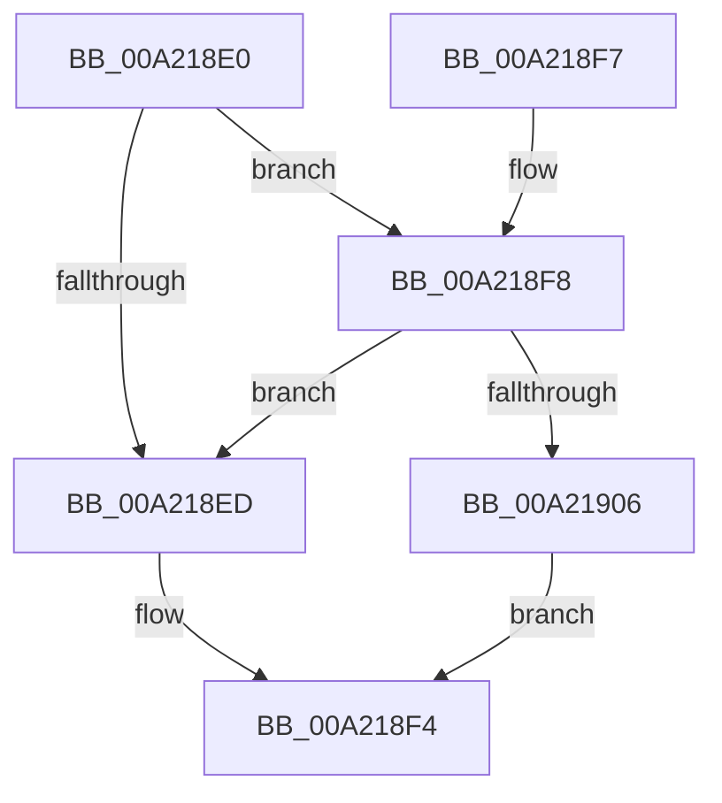

# KeGetExecuteOptions

- RVA: `0x00A218E0`–`0x00A21961` (길이 `129` bytes)
- VA: `0x0000000140A218E0`
- 실행 섹션: `PAGE`
- PDB 이름 있음: `예`; PDB Function 태그: `아니요`
- unwind 정보 RVA: `0x000DB714`
- 디코드: `39`개 명령, `129/129` bytes 표시
- 미해석 바이트: `0` (있으면 어셈블리에 `.byte`로 보존)

> 이 문서는 커널 이미지의 기계어와 PDB 기호를 분석해 생성했습니다. 4번과 5번은 함수 원형과 자료형을 바이너리 사용 방식에서 추정한 C 해석이며 원본 소스 복구 결과는 아닙니다.

## 1. Dependencies

- 직접 호출 지점: **0**; 고유 호출 대상: **0**
- 직접 호출자로 확인된 함수: **1**
- RIP 상대 이미지 참조: **0**

### Outgoing calls
- 직접 디코드된 call 명령이 없습니다.

### Direct callers
- [NtQueryInformationProcess](../9A/NtQueryInformationProcess_function_009AA250.md) at `0x009ABCAA`

### Static image references
- 디코드된 RIP-relative 메모리 참조가 없습니다.

## 2. Other-region calls and transfers

- 다른 실행 섹션으로 향하는 call: **0**
- 별도 외부 분기/꼬리 이동을 확인하지 못했습니다.

## 3. Assembly (complete function range)

```asm
00A218E0  48 83 B9 10 03 00 00 00         cmp qword ptr [rcx + 0x310], 0
00A218E8  4C 8B CA                        mov r9, rdx
00A218EB  75 0B                           jne 0x140a218f8
00A218ED  41 C7 01 0D 00 00 00            mov dword ptr [r9], 0xd
00A218F4  33 C0                           xor eax, eax
00A218F6  C3                              ret
00A218F7  CC                              int3
00A218F8  BA 4C 01 00 00                  mov edx, 0x14c
00A218FD  66 39 91 EC 06 00 00            cmp word ptr [rcx + 0x6ec], dx
00A21904  75 E7                           jne 0x140a218ed
00A21906  0F B6 81 93 00 00 00            movzx eax, byte ptr [rcx + 0x93]
00A2190D  44 8B C0                        mov r8d, eax
00A21910  41 83 E0 01                     and r8d, 1
00A21914  41 8B D0                        mov edx, r8d
00A21917  83 CA 02                        or edx, 2
00A2191A  A8 02                           test al, 2
00A2191C  41 0F 44 D0                     cmove edx, r8d
00A21920  44 8B C2                        mov r8d, edx
00A21923  41 83 C8 04                     or r8d, 4
00A21927  A8 04                           test al, 4
00A21929  44 0F 44 C2                     cmove r8d, edx
00A2192D  41 8B D0                        mov edx, r8d
00A21930  83 CA 08                        or edx, 8
00A21933  A8 08                           test al, 8
00A21935  41 0F 44 D0                     cmove edx, r8d
00A21939  44 8B C2                        mov r8d, edx
00A2193C  41 83 C8 10                     or r8d, 0x10
00A21940  A8 10                           test al, 0x10
00A21942  44 0F 44 C2                     cmove r8d, edx
00A21946  41 8B D0                        mov edx, r8d
00A21949  83 CA 20                        or edx, 0x20
00A2194C  A8 20                           test al, 0x20
00A2194E  41 0F 44 D0                     cmove edx, r8d
00A21952  8B CA                           mov ecx, edx
00A21954  83 C9 40                        or ecx, 0x40
00A21957  A8 40                           test al, 0x40
00A21959  0F 44 CA                        cmove ecx, edx
00A2195C  41 89 09                        mov dword ptr [r9], ecx
00A2195F  EB 93                           jmp 0x140a218f4
```

## 4. C-style interpretation (structured pseudocode)

```c
__int64 __fastcall KeGetExecuteOptions(__int64 a1, __int64 a2)
{
    __int64 result;

    if ((*(unsigned __int64 *)(a1 + 784)) != 0) goto loc_00A218F8;
loc_00A218ED:
    *(unsigned int *)(a2) = 13;
loc_00A218F4:
    result = 0;
    return result;
loc_00A218F8:
    if ((*(unsigned __int16 *)(a1 + 1772)) != 332) goto loc_00A218ED;
    a3 = (unsigned int)(((unsigned int)((unsigned int)(*(unsigned __int8 *)(a1 + 147)))) & (1));
    a2 = (unsigned int)(((unsigned int)((unsigned int)(a3))) | (2));
    if ((((unsigned __int8)(*(unsigned __int8 *)(a1 + 147))) & (2)) == 0) { a2 = (unsigned int)(a3); }
    a3 = (unsigned int)(((unsigned int)((unsigned int)(a2))) | (4));
    if ((((unsigned __int8)(*(unsigned __int8 *)(a1 + 147))) & (4)) == 0) { a3 = (unsigned int)(a2); }
    a2 = (unsigned int)(((unsigned int)((unsigned int)(a3))) | (8));
    if ((((unsigned __int8)(*(unsigned __int8 *)(a1 + 147))) & (8)) == 0) { a2 = (unsigned int)(a3); }
    a3 = (unsigned int)(((unsigned int)((unsigned int)(a2))) | (16));
    if ((((unsigned __int8)(*(unsigned __int8 *)(a1 + 147))) & (16)) == 0) { a3 = (unsigned int)(a2); }
    a2 = (unsigned int)(((unsigned int)((unsigned int)(a3))) | (32));
    if ((((unsigned __int8)(*(unsigned __int8 *)(a1 + 147))) & (32)) == 0) { a2 = (unsigned int)(a3); }
    a1 = (unsigned int)(((unsigned int)((unsigned int)(a2))) | (64));
    if ((((unsigned __int8)(*(unsigned __int8 *)(a1 + 147))) & (64)) == 0) { a1 = (unsigned int)(a2); }
    *(unsigned int *)(a2) = (unsigned int)(a1);
    goto loc_00A218F4;
}
```

## 5. (Beta) C Style

```c
int64_t KeGetExecuteOptions(void *Arg1, void *Arg2)
{
    uint8_t *arg1 = (uint8_t *)Arg1;
    uint8_t *arg2 = (uint8_t *)Arg2;

    int64_t result;

    if ((*(uint64_t *)(arg1 + 0x310)) != 0) goto loc_00A218F8;
loc_00A218ED:
    *(uint32_t *)(arg2) = 13;
loc_00A218F4:
    result = 0;
    return result;
loc_00A218F8:
    if ((*(uint16_t *)(arg1 + 0x6EC)) != 332) goto loc_00A218ED;
    a3 = (uint32_t)(((uint32_t)((uint32_t)(*(uint8_t *)(arg1 + 0x93)))) & (1));
    Arg2 = (uint32_t)(((uint32_t)((uint32_t)(a3))) | (2));
    if ((((uint8_t)(*(uint8_t *)(arg1 + 0x93))) & (2)) == 0) { Arg2 = (uint32_t)(a3); }
    a3 = (uint32_t)(((uint32_t)((uint32_t)(Arg2))) | (4));
    if ((((uint8_t)(*(uint8_t *)(arg1 + 0x93))) & (4)) == 0) { a3 = (uint32_t)(Arg2); }
    Arg2 = (uint32_t)(((uint32_t)((uint32_t)(a3))) | (8));
    if ((((uint8_t)(*(uint8_t *)(arg1 + 0x93))) & (8)) == 0) { Arg2 = (uint32_t)(a3); }
    a3 = (uint32_t)(((uint32_t)((uint32_t)(Arg2))) | (16));
    if ((((uint8_t)(*(uint8_t *)(arg1 + 0x93))) & (16)) == 0) { a3 = (uint32_t)(Arg2); }
    Arg2 = (uint32_t)(((uint32_t)((uint32_t)(a3))) | (32));
    if ((((uint8_t)(*(uint8_t *)(arg1 + 0x93))) & (32)) == 0) { Arg2 = (uint32_t)(a3); }
    Arg1 = (uint32_t)(((uint32_t)((uint32_t)(Arg2))) | (64));
    if ((((uint8_t)(*(uint8_t *)(arg1 + 0x93))) & (64)) == 0) { Arg1 = (uint32_t)(Arg2); }
    *(uint32_t *)(arg2) = (uint32_t)(Arg1);
    goto loc_00A218F4;
}
```

### 관측된 메모리 오프셋

구조체 형식이 확인되지 않은 접근은 인자 기준의 오프셋으로만 기록했습니다.

| 기준 인자 | 오프셋 표현 | 폭 (bit) | 접근 |
|---|---:|---:|---|
| `Arg1` | `+ 0x93` | `8` | `R` |
| `Arg1` | `+ 0x310` | `64` | `R` |
| `Arg1` | `+ 0x6EC` | `16` | `R` |
| `Arg2` | `+ 0x0` | `32` | `W` |

## 6. Execution-region graph

[열기: 2D/3D 그래프와 함수 탐색 컨트롤 패널](../../../control-panel.html?section=page&rva=0x00A218E0&view=graph)

- 2D 그래프는 위에서 아래로 흐르고, 3D 그래프는 빈 공간을 드래그해 회전합니다. Shift+드래그는 이동, 휠은 확대·축소, 함수 노드 선택은 대상 보고서 이동입니다.

### Static fallback


