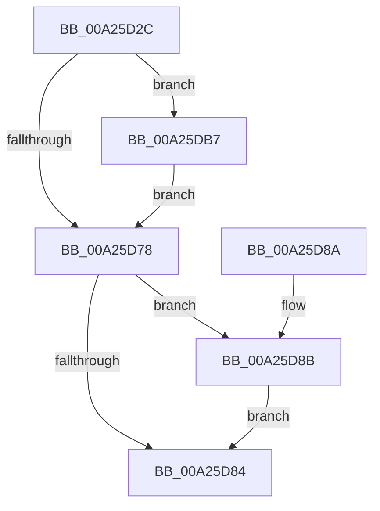

# KeUninitThread

- RVA: `0x00A25D2C`–`0x00A25DC1` (길이 `149` bytes)
- VA: `0x0000000140A25D2C`
- 실행 섹션: `PAGE`
- PDB 이름 있음: `예`; PDB Function 태그: `아니요`
- unwind 정보 RVA: `0x000ABCAC`
- 디코드: `36`개 명령, `149/149` bytes 표시
- 미해석 바이트: `0` (있으면 어셈블리에 `.byte`로 보존)

> 이 문서는 커널 이미지의 기계어와 PDB 기호를 분석해 생성했습니다. 4번과 5번은 함수 원형과 자료형을 바이너리 사용 방식에서 추정한 C 해석이며 원본 소스 복구 결과는 아닙니다.

## 1. Dependencies

- 직접 호출 지점: **3**; 고유 호출 대상: **3**
- 직접 호출자로 확인된 함수: **2**
- RIP 상대 이미지 참조: **0**

### Outgoing calls
- `0x00A25D65` → [MmDeleteKernelStack](../../text/33/MmDeleteKernelStack_function_0033A960.md) (function, `0x0033A960`)
- `0x00A25DA8` → [KiDeleteKernelShadowStack](KiDeleteKernelShadowStack_function_00A25DC8.md) (function, `0x00A25DC8`)
- `0x00A25DBA` → [KiDeleteXStateStack](../../text/5B/KiDeleteXStateStack_function_005B93C4.md) (function, `0x005B93C4`)

### Direct callers
- [KiFreeProcessorStateInitializationParameters](../../text/5B/KiFreeProcessorStateInitializationParameters_function_005B80A8.md) at `0x005B80C8`
- [PspInsertThread](../9F/PspInsertThread_function_009F0314.md) at `0x009F05F3`

### Static image references
- 디코드된 RIP-relative 메모리 참조가 없습니다.

## 2. Other-region calls and transfers

- 다른 실행 섹션으로 향하는 call: **2**
  - `0x00A25D65` → [MmDeleteKernelStack](../../text/33/MmDeleteKernelStack_function_0033A960.md) (`PAGE` → `.text`)
  - `0x00A25DBA` → [KiDeleteXStateStack](../../text/5B/KiDeleteXStateStack_function_005B93C4.md) (`PAGE` → `.text`)
- 별도 외부 분기/꼬리 이동을 확인하지 못했습니다.

## 3. Assembly (complete function range)

```asm
00A25D2C  48 8B C4                        mov rax, rsp
00A25D2F  53                              push rbx
00A25D30  48 83 EC 60                     sub rsp, 0x60
00A25D34  48 83 60 D0 00                  and qword ptr [rax - 0x30], 0
00A25D39  0F 57 C0                        xorps xmm0, xmm0
00A25D3C  F3 0F 7F 40 E8                  movdqu xmmword ptr [rax - 0x18], xmm0
00A25D41  C7 40 C8 02 00 00 00            mov dword ptr [rax - 0x38], 2
00A25D48  48 8B D9                        mov rbx, rcx
00A25D4B  C7 40 CC 05 00 00 00            mov dword ptr [rax - 0x34], 5
00A25D52  48 8B 41 38                     mov rax, qword ptr [rcx + 0x38]
00A25D56  48 89 4C 24 40                  mov qword ptr [rsp + 0x40], rcx
00A25D5B  48 8D 4C 24 30                  lea rcx, [rsp + 0x30]
00A25D60  48 89 44 24 48                  mov qword ptr [rsp + 0x48], rax
00A25D65  E8 F6 4B 91 FF                  call 0x14033a960
00A25D6A  48 83 63 28 00                  and qword ptr [rbx + 0x28], 0
00A25D6F  F7 43 74 00 00 80 00            test dword ptr [rbx + 0x74], 0x800000
00A25D76  75 3F                           jne 0x140a25db7
00A25D78  48 8B 83 08 04 00 00            mov rax, qword ptr [rbx + 0x408]
00A25D7F  48 85 C0                        test rax, rax
00A25D82  75 07                           jne 0x140a25d8b
00A25D84  48 83 C4 60                     add rsp, 0x60
00A25D88  5B                              pop rbx
00A25D89  C3                              ret
00A25D8A  CC                              int3
00A25D8B  44 8B 83 20 04 00 00            mov r8d, dword ptr [rbx + 0x420]
00A25D92  45 33 C9                        xor r9d, r9d
00A25D95  48 8B 93 18 04 00 00            mov rdx, qword ptr [rbx + 0x418]
00A25D9C  41 83 E0 07                     and r8d, 7
00A25DA0  48 8B CB                        mov rcx, rbx
00A25DA3  48 89 44 24 20                  mov qword ptr [rsp + 0x20], rax
00A25DA8  E8 1B 00 00 00                  call 0x140a25dc8
00A25DAD  48 83 A3 08 04 00 00 00         and qword ptr [rbx + 0x408], 0
00A25DB5  EB CD                           jmp 0x140a25d84
00A25DB7  48 8B CB                        mov rcx, rbx
00A25DBA  E8 05 36 B9 FF                  call 0x1405b93c4
00A25DBF  EB B7                           jmp 0x140a25d78
```

## 4. C-style interpretation (structured pseudocode)

```c
__int64 __fastcall KeUninitThread(__int64 a1, __int64 a2, __int64 a3, int a4)
{
    __int64 result;
    __int64 v_rsp;
    unsigned __int64 v_stack_m20;
    unsigned __int64 v_stack_m28;
    unsigned __int64 v_stack_m38;
    unsigned __int64 v_stack_p20;

    v_rsp = (v_rsp) - (96);
    *(unsigned __int64 *)(v_rsp - 24) = v_xmm0;
    *(unsigned int *)(v_rsp - 56) = 2;
    *(unsigned int *)(v_rsp - 52) = 5;
    v_stack_m28 = a1;
    v_stack_m20 = *(unsigned __int64 *)(a1 + 56);
    result = MmDeleteKernelStack(v_stack_m38, a2, a3, a4);
    if (((*(unsigned int *)(a1 + 116)) & (0x800000ULL)) != 0) goto loc_00A25DB7;
loc_00A25D78:
    if (*(unsigned __int64 *)(a1 + 1032) != 0) goto loc_00A25D8B;
loc_00A25D84:
    v_rsp = (v_rsp) + (96);
    return *(unsigned __int64 *)(a1 + 1032);
loc_00A25D8B:
    a4 = 0;
    a3 = (unsigned int)(((unsigned int)(*(unsigned int *)(a1 + 1056))) & (7));
    v_stack_p20 = *(unsigned __int64 *)(a1 + 1032);
    result = KiDeleteKernelShadowStack(a1, *(unsigned __int64 *)(a1 + 1048), a3, a4);
    goto loc_00A25D84;
loc_00A25DB7:
    result = KiDeleteXStateStack(a1, *(unsigned __int64 *)(a1 + 1048), a3, a4);
    goto loc_00A25D78;
}
```

## 5. (Beta) C Style

```c
int64_t KeUninitThread(void *Arg1, int64_t Arg2, int64_t Arg3, int32_t Arg4)
{
    uint8_t *arg1 = (uint8_t *)Arg1;

    int64_t result;
    int64_t local_rsp;
    uint64_t v_stack_m20;
    uint64_t v_stack_m28;
    uint64_t v_stack_m38;
    uint64_t v_stack_p20;

    local_rsp = (local_rsp) - (96);
    *(uint64_t *)(local_rsp - 0x18) = v_xmm0;
    *(uint32_t *)(local_rsp - 0x38) = 2;
    *(uint32_t *)(local_rsp - 0x34) = 5;
    v_stack_m28 = Arg1;
    v_stack_m20 = *(uint64_t *)(arg1 + 0x38);
    result = MmDeleteKernelStack(v_stack_m38, Arg2, Arg3, Arg4);
    if (((*(uint32_t *)(arg1 + 0x74)) & (0x800000ULL)) != 0) goto loc_00A25DB7;
loc_00A25D78:
    if (*(uint64_t *)(arg1 + 0x408) != 0) goto loc_00A25D8B;
loc_00A25D84:
    local_rsp = (local_rsp) + (96);
    return *(uint64_t *)(arg1 + 0x408);
loc_00A25D8B:
    Arg4 = 0;
    Arg3 = (uint32_t)(((uint32_t)(*(uint32_t *)(arg1 + 0x420))) & (7));
    v_stack_p20 = *(uint64_t *)(arg1 + 0x408);
    result = KiDeleteKernelShadowStack(Arg1, *(uint64_t *)(arg1 + 0x418), Arg3, Arg4);
    goto loc_00A25D84;
loc_00A25DB7:
    result = KiDeleteXStateStack(Arg1, *(uint64_t *)(arg1 + 0x418), Arg3, Arg4);
    goto loc_00A25D78;
}
```

### 관측된 메모리 오프셋

구조체 형식이 확인되지 않은 접근은 인자 기준의 오프셋으로만 기록했습니다.

| 기준 인자 | 오프셋 표현 | 폭 (bit) | 접근 |
|---|---:|---:|---|
| `Arg1` | `+ 0x28` | `64` | `R/W` |
| `Arg1` | `+ 0x38` | `64` | `R` |
| `Arg1` | `+ 0x74` | `32` | `R` |
| `Arg1` | `+ 0x408` | `64` | `R` |
| `Arg1` | `+ 0x408` | `64` | `R/W` |
| `Arg1` | `+ 0x418` | `64` | `R` |
| `Arg1` | `+ 0x420` | `32` | `R` |

## 6. Execution-region graph

[열기: 2D/3D 그래프와 함수 탐색 컨트롤 패널](../../../control-panel.html?section=page&rva=0x00A25D2C&view=graph)

- 2D 그래프는 위에서 아래로 흐르고, 3D 그래프는 빈 공간을 드래그해 회전합니다. Shift+드래그는 이동, 휠은 확대·축소, 함수 노드 선택은 대상 보고서 이동입니다.

### Static fallback


