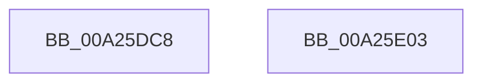

# KiDeleteKernelShadowStack

- RVA: `0x00A25DC8`–`0x00A25E04` (길이 `60` bytes)
- VA: `0x0000000140A25DC8`
- 실행 섹션: `PAGE`
- PDB 이름 있음: `예`; PDB Function 태그: `아니요`
- unwind 정보 RVA: `0x0005CC98`
- 디코드: `15`개 명령, `60/60` bytes 표시
- 미해석 바이트: `0` (있으면 어셈블리에 `.byte`로 보존)

> 이 문서는 커널 이미지의 기계어와 PDB 기호를 분석해 생성했습니다. 4번과 5번은 함수 원형과 자료형을 바이너리 사용 방식에서 추정한 C 해석이며 원본 소스 복구 결과는 아닙니다.

## 1. Dependencies

- 직접 호출 지점: **1**; 고유 호출 대상: **1**
- 직접 호출자로 확인된 함수: **5**
- RIP 상대 이미지 참조: **0**

### Outgoing calls
- `0x00A25DF9` → [MmDeleteKernelStack](../../text/33/MmDeleteKernelStack_function_0033A960.md) (function, `0x0033A960`)

### Direct callers
- [PspDeleteKernelStack](../../text/2A/PspDeleteKernelStack_function_002A1550.md) at `0x002A15DA`
- [KiFreeProcessorStacks](../../text/5B/KiFreeProcessorStacks_function_005B7F84.md) at `0x005B802D`
- [KiFreeProcessorStacks](../../text/5B/KiFreeProcessorStacks_function_005B7F84.md) at `0x005B807C`
- [KiAllocateProcessorHiberSwapShadowStacks](../../text/5B/KiAllocateProcessorHiberSwapShadowStacks_function_005BD754.md) at `0x005BD7E6`
- [KeUninitThread](KeUninitThread_function_00A25D2C.md) at `0x00A25DA8`
- [sub_00B80710](../../pagelk/B8/Unknown_function_00B80710.md) at `0x00B8074C`

### Static image references
- 디코드된 RIP-relative 메모리 참조가 없습니다.

## 2. Other-region calls and transfers

- 다른 실행 섹션으로 향하는 call: **1**
  - `0x00A25DF9` → [MmDeleteKernelStack](../../text/33/MmDeleteKernelStack_function_0033A960.md) (`PAGE` → `.text`)
- 별도 외부 분기/꼬리 이동을 확인하지 못했습니다.

## 3. Assembly (complete function range)

```asm
00A25DC8  4C 8B DC                        mov r11, rsp
00A25DCB  48 83 EC 58                     sub rsp, 0x58
00A25DCF  48 8B 84 24 80 00 00 00         mov rax, qword ptr [rsp + 0x80]
00A25DD7  49 83 63 D0 00                  and qword ptr [r11 - 0x30], 0
00A25DDC  49 83 63 E8 00                  and qword ptr [r11 - 0x18], 0
00A25DE1  49 89 4B D8                     mov qword ptr [r11 - 0x28], rcx
00A25DE5  49 8D 4B C8                     lea rcx, [r11 - 0x38]
00A25DE9  49 89 43 F0                     mov qword ptr [r11 - 0x10], rax
00A25DED  45 89 4B C8                     mov dword ptr [r11 - 0x38], r9d
00A25DF1  45 89 43 CC                     mov dword ptr [r11 - 0x34], r8d
00A25DF5  49 89 53 E0                     mov qword ptr [r11 - 0x20], rdx
00A25DF9  E8 62 4B 91 FF                  call 0x14033a960
00A25DFE  48 83 C4 58                     add rsp, 0x58
00A25E02  C3                              ret
00A25E03  CC                              int3
```

## 4. C-style interpretation (structured pseudocode)

```c
__int64 __fastcall KiDeleteKernelShadowStack(__int64 a1, __int64 a2, int a3, int a4, __int64 a5)
{
    __int64 result;
    __int64 v_rsp;

    v_rsp = (v_rsp) - (88);
    *(unsigned __int64 *)(v_rsp - 40) = a1;
    *(unsigned __int64 *)(v_rsp - 16) = a5;
    *(unsigned int *)(v_rsp - 56) = a4;
    *(unsigned int *)(v_rsp - 52) = a3;
    *(unsigned __int64 *)(v_rsp - 32) = a2;
    result = MmDeleteKernelStack(v_rsp - 56, a2, a3, a4);
    v_rsp = (v_rsp) + (88);
    return result;
}
```

## 5. (Beta) C Style

```c
int64_t KiDeleteKernelShadowStack(int64_t Arg1, int64_t Arg2, int32_t Arg3, int32_t Arg4, int64_t Arg5)
{
    int64_t result;
    int64_t local_rsp;

    local_rsp = (local_rsp) - (88);
    *(uint64_t *)(local_rsp - 0x28) = Arg1;
    *(uint64_t *)(local_rsp - 0x10) = Arg5;
    *(uint32_t *)(local_rsp - 0x38) = Arg4;
    *(uint32_t *)(local_rsp - 0x34) = Arg3;
    *(uint64_t *)(local_rsp - 0x20) = Arg2;
    result = MmDeleteKernelStack(local_rsp - 56, Arg2, Arg3, Arg4);
    local_rsp = (local_rsp) + (88);
    return result;
}
```

## 6. Execution-region graph

[열기: 2D/3D 그래프와 함수 탐색 컨트롤 패널](../../../control-panel.html?section=page&rva=0x00A25DC8&view=graph)

- 2D 그래프는 위에서 아래로 흐르고, 3D 그래프는 빈 공간을 드래그해 회전합니다. Shift+드래그는 이동, 휠은 확대·축소, 함수 노드 선택은 대상 보고서 이동입니다.

### Static fallback


