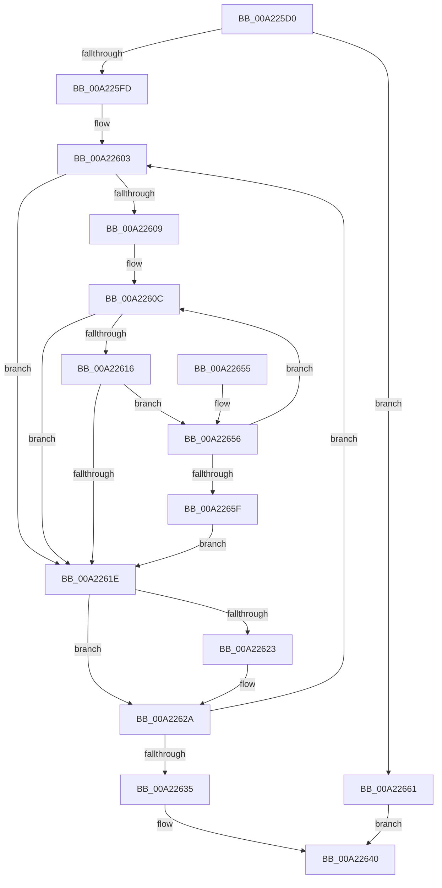

# LZNT1FindMatchMaximum

- RVA: `0x00A225D0`–`0x00A22665` (길이 `149` bytes)
- VA: `0x0000000140A225D0`
- 실행 섹션: `PAGE`
- PDB 이름 있음: `예`; PDB Function 태그: `아니요`
- unwind 정보 RVA: `0x000AB53C`
- 디코드: `51`개 명령, `149/149` bytes 표시
- 미해석 바이트: `0` (있으면 어셈블리에 `.byte`로 보존)

> 이 문서는 커널 이미지의 기계어와 PDB 기호를 분석해 생성했습니다. 4번과 5번은 함수 원형과 자료형을 바이너리 사용 방식에서 추정한 C 해석이며 원본 소스 복구 결과는 아닙니다.

## 1. Dependencies

- 직접 호출 지점: **0**; 고유 호출 대상: **0**
- 직접 호출자로 확인된 함수: **0**
- RIP 상대 이미지 참조: **0**

### Outgoing calls
- 직접 디코드된 call 명령이 없습니다.

### Direct callers
- 이 함수 시작 RVA로 연결되는 직접 call은 확인되지 않았습니다. 간접 호출은 완전히 역산할 수 없습니다.

### Static image references
- 디코드된 RIP-relative 메모리 참조가 없습니다.

## 2. Other-region calls and transfers

- 다른 실행 섹션으로 향하는 call: **0**
- 별도 외부 분기/꼬리 이동을 확인하지 못했습니다.

## 3. Assembly (complete function range)

```asm
00A225D0  48 8B C4                        mov rax, rsp
00A225D3  48 89 58 08                     mov qword ptr [rax + 8], rbx
00A225D7  48 89 68 10                     mov qword ptr [rax + 0x10], rbp
00A225DB  48 89 70 18                     mov qword ptr [rax + 0x18], rsi
00A225DF  48 89 78 20                     mov qword ptr [rax + 0x20], rdi
00A225E3  4C 8B 0A                        mov r9, qword ptr [rdx]
00A225E6  33 ED                           xor ebp, ebp
00A225E8  48 8B 72 08                     mov rsi, qword ptr [rdx + 8]
00A225EC  48 8B DA                        mov rbx, rdx
00A225EF  8B 7A 10                        mov edi, dword ptr [rdx + 0x10]
00A225F2  4C 8B D1                        mov r10, rcx
00A225F5  44 8B C5                        mov r8d, ebp
00A225F8  4C 3B C9                        cmp r9, rcx
00A225FB  73 64                           jae 0x140a22661
00A225FD  4D 8B D9                        mov r11, r9
00A22600  4C 2B D9                        sub r11, rcx
00A22603  8B CD                           mov ecx, ebp
00A22605  85 FF                           test edi, edi
00A22607  74 15                           je 0x140a2261e
00A22609  49 8B D2                        mov rdx, r10
00A2260C  8B C1                           mov eax, ecx
00A2260E  49 03 C2                        add rax, r10
00A22611  48 3B C6                        cmp rax, rsi
00A22614  73 08                           jae 0x140a2261e
00A22616  41 8A 04 13                     mov al, byte ptr [r11 + rdx]
00A2261A  38 02                           cmp byte ptr [rdx], al
00A2261C  74 38                           je 0x140a22656
00A2261E  41 3B C8                        cmp ecx, r8d
00A22621  72 07                           jb 0x140a2262a
00A22623  44 8B C1                        mov r8d, ecx
00A22626  4C 89 4B 18                     mov qword ptr [rbx + 0x18], r9
00A2262A  49 FF C1                        inc r9
00A2262D  49 FF C3                        inc r11
00A22630  4D 3B CA                        cmp r9, r10
00A22633  72 CE                           jb 0x140a22603
00A22635  41 83 F8 03                     cmp r8d, 3
00A22639  44 0F 42 C5                     cmovb r8d, ebp
00A2263D  41 8B C0                        mov eax, r8d
00A22640  48 8B 5C 24 08                  mov rbx, qword ptr [rsp + 8]
00A22645  48 8B 6C 24 10                  mov rbp, qword ptr [rsp + 0x10]
00A2264A  48 8B 74 24 18                  mov rsi, qword ptr [rsp + 0x18]
00A2264F  48 8B 7C 24 20                  mov rdi, qword ptr [rsp + 0x20]
00A22654  C3                              ret
00A22655  CC                              int3
00A22656  FF C1                           inc ecx
00A22658  48 FF C2                        inc rdx
00A2265B  3B CF                           cmp ecx, edi
00A2265D  72 AD                           jb 0x140a2260c
00A2265F  EB BD                           jmp 0x140a2261e
00A22661  33 C0                           xor eax, eax
00A22663  EB DB                           jmp 0x140a22640
```

## 4. C-style interpretation (structured pseudocode)

```c
__int64 __fastcall LZNT1FindMatchMaximum(__int64 a1, __int64 a2)
{
    __int64 result;
    __int64 v_r11;
    __int64 v_rbp;
    unsigned __int64 v_stack_p10;
    unsigned __int64 v_stack_p18;
    unsigned __int64 v_stack_p20;
    unsigned __int64 v_stack_p8;

    *(unsigned __int64 *)(v_rsp + 8) = v_rbx;
    *(unsigned __int64 *)(v_rsp + 16) = v_rbp;
    *(unsigned __int64 *)(v_rsp + 24) = v_rsi;
    *(unsigned __int64 *)(v_rsp + 32) = v_rdi;
    v_rbp = 0;
    if ((*(unsigned __int64 *)(a2)) >= a1) goto loc_00A22661;
    v_r11 = (*(unsigned __int64 *)(a2)) - (a1);
loc_00A22603:
    if ((unsigned int)((unsigned int)(*(unsigned int *)(a2 + 16))) == 0) goto loc_00A2261E;
loc_00A2260C:
    result = (0) + (a1);
    if (result >= (*(unsigned __int64 *)(a2 + 8))) goto loc_00A2261E;
    if ((*(unsigned __int8 *)(a1)) == ((unsigned __int8)(*(unsigned __int8 *)(v_r11 + a1 * 1)))) goto loc_00A22656;
loc_00A2261E:
    if (0 >= 0) {
        a3 = 0;
        *(unsigned __int64 *)(a2 + 24) = *(unsigned __int64 *)(a2);
    }
    a4 = (*(unsigned __int64 *)(a2)) + 1;
    v_r11 = (v_r11) + 1;
    if (a4 < a1) goto loc_00A22603;
    if (((unsigned int)(a3)) < 3) { a3 = 0; }
loc_00A22640:
    return (unsigned int)((unsigned int)(a3));
loc_00A22656:
    a1 = (unsigned int)((0) + 1);
    a2 = (a1) + 1;
    if (((unsigned int)(a1)) < ((unsigned int)(v_stack_p20))) goto loc_00A2260C;
    goto loc_00A2261E;
loc_00A22661:
    result = 0;
    goto loc_00A22640;
}
```

## 5. (Beta) C Style

```c
int64_t LZNT1FindMatchMaximum(int64_t Arg1, void *Arg2)
{
    uint8_t *arg2 = (uint8_t *)Arg2;

    int64_t result;
    int64_t local_r11;
    int64_t local_rbp;
    uint64_t v_stack_p10;
    uint64_t v_stack_p18;
    uint64_t v_stack_p20;
    uint64_t v_stack_p8;

    *(uint64_t *)(local_rsp + 0x8) = local_rbx;
    *(uint64_t *)(local_rsp + 0x10) = local_rbp;
    *(uint64_t *)(local_rsp + 0x18) = local_rsi;
    *(uint64_t *)(local_rsp + 0x20) = local_rdi;
    local_rbp = 0;
    if ((*(uint64_t *)(arg2)) >= Arg1) goto loc_00A22661;
    local_r11 = (*(uint64_t *)(arg2)) - (Arg1);
loc_00A22603:
    if ((uint32_t)((uint32_t)(*(uint32_t *)(arg2 + 0x10))) == 0) goto loc_00A2261E;
loc_00A2260C:
    result = (0) + (Arg1);
    if (result >= (*(uint64_t *)(arg2 + 0x8))) goto loc_00A2261E;
    if ((*(uint8_t *)(Arg1)) == ((uint8_t)(*(uint8_t *)(local_r11 + Arg1 * 1)))) goto loc_00A22656;
loc_00A2261E:
    if (0 >= 0) {
        a3 = 0;
        *(uint64_t *)(arg2 + 0x18) = *(uint64_t *)(arg2);
    }
    a4 = (*(uint64_t *)(arg2)) + 1;
    local_r11 = (local_r11) + 1;
    if (a4 < Arg1) goto loc_00A22603;
    if (((uint32_t)(a3)) < 3) { a3 = 0; }
loc_00A22640:
    return (uint32_t)((uint32_t)(a3));
loc_00A22656:
    Arg1 = (uint32_t)((0) + 1);
    Arg2 = (Arg1) + 1;
    if (((uint32_t)(Arg1)) < ((uint32_t)(v_stack_p20))) goto loc_00A2260C;
    goto loc_00A2261E;
loc_00A22661:
    result = 0;
    goto loc_00A22640;
}
```

### 관측된 메모리 오프셋

구조체 형식이 확인되지 않은 접근은 인자 기준의 오프셋으로만 기록했습니다.

| 기준 인자 | 오프셋 표현 | 폭 (bit) | 접근 |
|---|---:|---:|---|
| `Arg2` | `+ 0x0` | `64` | `R` |
| `Arg2` | `+ 0x8` | `64` | `R` |
| `Arg2` | `+ 0x10` | `32` | `R` |
| `Arg2` | `+ 0x18` | `64` | `W` |

## 6. Execution-region graph

[열기: 2D/3D 그래프와 함수 탐색 컨트롤 패널](../../../control-panel.html?section=page&rva=0x00A225D0&view=graph)

- 2D 그래프는 위에서 아래로 흐르고, 3D 그래프는 빈 공간을 드래그해 회전합니다. Shift+드래그는 이동, 휠은 확대·축소, 함수 노드 선택은 대상 보고서 이동입니다.

### Static fallback


