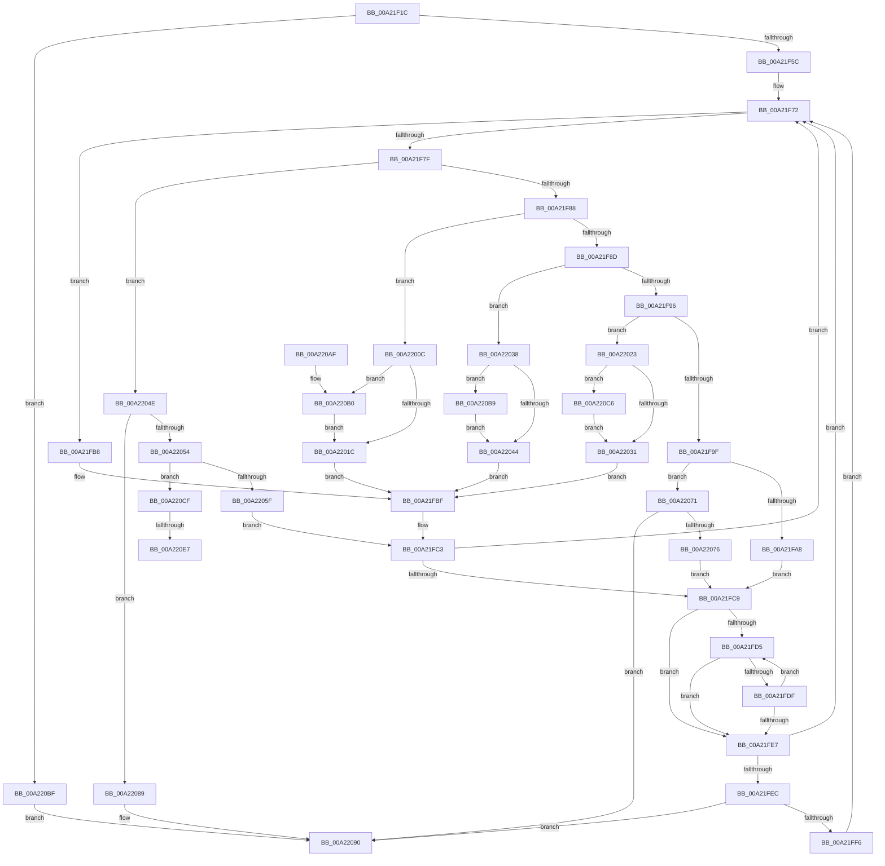

# LdrResFallbackLangList

- RVA: `0x00A21F1C`–`0x00A220F3` (길이 `471` bytes)
- VA: `0x0000000140A21F1C`
- 실행 섹션: `PAGE`
- PDB 이름 있음: `예`; PDB Function 태그: `예`
- unwind 정보 RVA: `0x000AB470`
- 디코드: `127`개 명령, `471/471` bytes 표시
- 미해석 바이트: `0` (있으면 어셈블리에 `.byte`로 보존)

> 이 문서는 커널 이미지의 기계어와 PDB 기호를 분석해 생성했습니다. 4번과 5번은 함수 원형과 자료형을 바이너리 사용 방식에서 추정한 C 해석이며 원본 소스 복구 결과는 아닙니다.

## 1. Dependencies

- 직접 호출 지점: **1**; 고유 호출 대상: **1**
- 직접 호출자로 확인된 함수: **1**
- RIP 상대 이미지 참조: **3**

### Outgoing calls
- `0x00A220DA` → [LdrpGetParentLangId](../../text/4B/LdrpGetParentLangId_function_004BDAC0.md) (function, `0x004BDAC0`)

### Direct callers
- [LdrpResSearchResourceMappedFile](../../text/45/LdrpResSearchResourceMappedFile_function_00454C98.md) at `0x00454E85`

### Static image references
- `0x00A2200C` → RVA `0x00FD9A70` (`PAGEDATA`; read)
- `0x00A22023` → RVA `0x00FD9A98` (`PAGEDATA`; read)
- `0x00A22038` → RVA `0x00FD9A60` (`PAGEDATA`; read)

## 2. Other-region calls and transfers

- 다른 실행 섹션으로 향하는 call: **1**
  - `0x00A220DA` → [LdrpGetParentLangId](../../text/4B/LdrpGetParentLangId_function_004BDAC0.md) (`PAGE` → `.text`)
- call이 아닌 외부 분기/꼬리 이동: **2**
  - `0x00A220E1` → [sub_00B37A62](../B3/Unknown_function_00B37A62.md) (`tail-transfer`)
  - `0x00A220EE` → [sub_00B37A62 + 0x4](../B3/Unknown_function_00B37A62.md) (`tail-transfer`)

## 3. Assembly (complete function range)

```asm
00A21F1C  48 8B C4                        mov rax, rsp
00A21F1F  48 89 58 08                     mov qword ptr [rax + 8], rbx
00A21F23  48 89 70 18                     mov qword ptr [rax + 0x18], rsi
00A21F27  48 89 78 20                     mov qword ptr [rax + 0x20], rdi
00A21F2B  48 89 50 10                     mov qword ptr [rax + 0x10], rdx
00A21F2F  55                              push rbp
00A21F30  41 54                           push r12
00A21F32  41 55                           push r13
00A21F34  41 56                           push r14
00A21F36  41 57                           push r15
00A21F38  48 8B EC                        mov rbp, rsp
00A21F3B  48 83 EC 20                     sub rsp, 0x20
00A21F3F  48 8B 7D 50                     mov rdi, qword ptr [rbp + 0x50]
00A21F43  33 DB                           xor ebx, ebx
00A21F45  66 89 5D 38                     mov word ptr [rbp + 0x38], bx
00A21F49  45 8B F9                        mov r15d, r9d
00A21F4C  45 0F B7 F0                     movzx r14d, r8w
00A21F50  0F B7 CB                        movzx ecx, bx
00A21F53  48 85 FF                        test rdi, rdi
00A21F56  0F 84 63 01 00 00               je 0x140a220bf
00A21F5C  66 89 1F                        mov word ptr [rdi], bx
00A21F5F  44 8D 63 01                     lea r12d, [rbx + 1]
00A21F63  88 9F 04 02 00 00               mov byte ptr [rdi + 0x204], bl
00A21F69  44 8B D3                        mov r10d, ebx
00A21F6C  41 BD EE EE 00 00               mov r13d, 0xeeee
00A21F72  41 8B D2                        mov edx, r10d
00A21F75  41 8B F2                        mov esi, r10d
00A21F78  45 03 D4                        add r10d, r12d
00A21F7B  85 D2                           test edx, edx
00A21F7D  74 39                           je 0x140a21fb8
00A21F7F  41 2B D4                        sub edx, r12d
00A21F82  0F 84 C6 00 00 00               je 0x140a2204e
00A21F88  41 2B D4                        sub edx, r12d
00A21F8B  74 7F                           je 0x140a2200c
00A21F8D  41 2B D4                        sub edx, r12d
00A21F90  0F 84 A2 00 00 00               je 0x140a22038
00A21F96  41 2B D4                        sub edx, r12d
00A21F99  0F 84 84 00 00 00               je 0x140a22023
00A21F9F  41 2B D4                        sub edx, r12d
00A21FA2  0F 85 C9 00 00 00               jne 0x140a22071
00A21FA8  B9 09 04 00 00                  mov ecx, 0x409
00A21FAD  BA 08 00 00 00                  mov edx, 8
00A21FB2  66 89 4D 38                     mov word ptr [rbp + 0x38], cx
00A21FB6  EB 11                           jmp 0x140a21fc9
00A21FB8  41 0F B7 CE                     movzx ecx, r14w
00A21FBC  41 8B D4                        mov edx, r12d
00A21FBF  66 89 4D 38                     mov word ptr [rbp + 0x38], cx
00A21FC3  66 41 3B CD                     cmp cx, r13w
00A21FC7  74 A9                           je 0x140a21f72
00A21FC9  44 0F B7 07                     movzx r8d, word ptr [rdi]
00A21FCD  44 8B CB                        mov r9d, ebx
00A21FD0  45 85 C0                        test r8d, r8d
00A21FD3  74 12                           je 0x140a21fe7
00A21FD5  41 8B C1                        mov eax, r9d
00A21FD8  66 39 4C C7 04                  cmp word ptr [rdi + rax*8 + 4], cx
00A21FDD  74 08                           je 0x140a21fe7
00A21FDF  45 03 CC                        add r9d, r12d
00A21FE2  45 3B C8                        cmp r9d, r8d
00A21FE5  72 EE                           jb 0x140a21fd5
00A21FE7  45 3B C8                        cmp r9d, r8d
00A21FEA  72 86                           jb 0x140a21f72
00A21FEC  41 83 F8 40                     cmp r8d, 0x40
00A21FF0  0F 83 9A 00 00 00               jae 0x140a22090
00A21FF6  66 42 89 4C C7 04               mov word ptr [rdi + r8*8 + 4], cx
00A21FFC  0F B7 07                        movzx eax, word ptr [rdi]
00A21FFF  89 54 C7 08                     mov dword ptr [rdi + rax*8 + 8], edx
00A22003  66 44 01 27                     add word ptr [rdi], r12w
00A22007  E9 66 FF FF FF                  jmp 0x140a21f72
00A2200C  0F B7 0D 5D 7A 5B 00            movzx ecx, word ptr [rip + 0x5b7a5d]
00A22013  66 85 C9                        test cx, cx
00A22016  0F 84 94 00 00 00               je 0x140a220b0
00A2201C  BA 05 00 00 00                  mov edx, 5
00A22021  EB 9C                           jmp 0x140a21fbf
00A22023  8B 0D 6F 7A 5B 00               mov ecx, dword ptr [rip + 0x5b7a6f]
00A22029  85 C9                           test ecx, ecx
00A2202B  0F 84 95 00 00 00               je 0x140a220c6
00A22031  BA 07 00 00 00                  mov edx, 7
00A22036  EB 87                           jmp 0x140a21fbf
00A22038  0F B7 0D 21 7A 5B 00            movzx ecx, word ptr [rip + 0x5b7a21]
00A2203F  66 85 C9                        test cx, cx
00A22042  74 75                           je 0x140a220b9
00A22044  BA 06 00 00 00                  mov edx, 6
00A22049  E9 71 FF FF FF                  jmp 0x140a21fbf
00A2204E  41 F6 C7 04                     test r15b, 4
00A22052  75 35                           jne 0x140a22089
00A22054  B8 FF 03 00 00                  mov eax, 0x3ff
00A22059  66 44 85 F0                     test ax, r14w
00A2205D  75 70                           jne 0x140a220cf
00A2205F  41 0F B7 CD                     movzx ecx, r13w
00A22063  66 89 4D 38                     mov word ptr [rbp + 0x38], cx
00A22067  BA 02 00 00 00                  mov edx, 2
00A2206C  E9 52 FF FF FF                  jmp 0x140a21fc3
00A22071  41 3B D4                        cmp edx, r12d
00A22074  75 1A                           jne 0x140a22090
00A22076  B9 34 12 00 00                  mov ecx, 0x1234
00A2207B  BA 09 00 00 00                  mov edx, 9
00A22080  66 89 4D 38                     mov word ptr [rbp + 0x38], cx
00A22084  E9 40 FF FF FF                  jmp 0x140a21fc9
00A22089  44 88 A7 04 02 00 00            mov byte ptr [rdi + 0x204], r12b
00A22090  48 8B 74 24 60                  mov rsi, qword ptr [rsp + 0x60]
00A22095  8B C3                           mov eax, ebx
00A22097  48 8B 5C 24 50                  mov rbx, qword ptr [rsp + 0x50]
00A2209C  48 8B 7C 24 68                  mov rdi, qword ptr [rsp + 0x68]
00A220A1  48 83 C4 20                     add rsp, 0x20
00A220A5  41 5F                           pop r15
00A220A7  41 5E                           pop r14
00A220A9  41 5D                           pop r13
00A220AB  41 5C                           pop r12
00A220AD  5D                              pop rbp
00A220AE  C3                              ret
00A220AF  CC                              int3
00A220B0  41 0F B7 CD                     movzx ecx, r13w
00A220B4  E9 63 FF FF FF                  jmp 0x140a2201c
00A220B9  41 0F B7 CD                     movzx ecx, r13w
00A220BD  EB 85                           jmp 0x140a22044
00A220BF  BB 0D 00 00 C0                  mov ebx, 0xc000000d
00A220C4  EB CA                           jmp 0x140a22090
00A220C6  41 0F B7 CD                     movzx ecx, r13w
00A220CA  E9 62 FF FF FF                  jmp 0x140a22031
00A220CF  48 8D 55 38                     lea rdx, [rbp + 0x38]
00A220D3  44 88 A7 04 02 00 00            mov byte ptr [rdi + 0x204], r12b
00A220DA  E8 E1 B9 A9 FF                  call 0x1404bdac0
00A220DF  85 C0                           test eax, eax
00A220E1  0F 89 7B 59 11 00               jns 0x140b37a62
00A220E7  0F B7 CB                        movzx ecx, bx
00A220EA  66 89 5D 38                     mov word ptr [rbp + 0x38], bx
00A220EE  E9 73 59 11 00                  jmp 0x140b37a66
```

## 4. C-style interpretation (structured pseudocode)

```c
__int64 __fastcall LdrResFallbackLangList(__int64 a1, __int64 a2, unsigned __int16 a3, int a4, __int64 a5)
{
    __int64 result;
    __int64 v_r10;
    __int64 v_rbx;
    __int64 v_rsp;
    unsigned __int16 v_stack_p10;
    unsigned __int64 v_stack_p18;
    unsigned __int64 v_stack_p20;
    unsigned __int64 v_stack_p8;

    *(unsigned __int64 *)(v_rsp + 8) = v_rbx;
    *(unsigned __int64 *)(v_rsp + 24) = v_rsi;
    *(unsigned __int64 *)(v_rsp + 32) = v_rdi;
    *(unsigned __int64 *)(v_rsp + 16) = a2;
    v_rsp = (v_rsp) - (32);
    v_rbx = 0;
    v_stack_p10 = 0;
    if (a5 == 0) goto loc_00A220BF;
    *(unsigned __int16 *)(a5) = 0;
    *(unsigned __int8 *)(a5 + 516) = 0;
loc_00A21F72:
    v_r10 = (unsigned int)((0) + ((unsigned int)(v_rbx + 1)));
    if (0 == 0) goto loc_00A21FB8;
    a2 = (unsigned int)((0) - ((unsigned int)(v_rbx + 1)));
    if (condition_is_equal) goto loc_00A2204E;
    a2 = (unsigned int)((a2) - ((unsigned int)(v_rbx + 1)));
    if (condition_is_equal) goto loc_00A2200C;
    a2 = (unsigned int)((a2) - ((unsigned int)(v_rbx + 1)));
    if (condition_is_equal) goto loc_00A22038;
    a2 = (unsigned int)((a2) - ((unsigned int)(v_rbx + 1)));
    if (condition_is_equal) goto loc_00A22023;
    a2 = (unsigned int)((a2) - ((unsigned int)(v_rbx + 1)));
    if (condition_is_not_equal) goto loc_00A22071;
    v_stack_p10 = (unsigned __int16)((unsigned int)(0x409ULL));
    goto loc_00A21FC9;
loc_00A21FB8:
loc_00A21FBF:
    v_stack_p10 = a3;
loc_00A21FC3:
    if (a3 == ((unsigned __int16)((unsigned int)(0xEEEEULL)))) goto loc_00A21F72;
loc_00A21FC9:
    if ((unsigned int)(*(unsigned __int16 *)(a5)) == 0) goto loc_00A21FE7;
loc_00A21FD5:
    if ((*(unsigned __int16 *)(a5 + 0 * 8 + 4)) == a3) goto loc_00A21FE7;
    a4 = (unsigned int)((0) + ((unsigned int)(v_rbx + 1)));
    if (a4 < ((unsigned int)(*(unsigned __int16 *)(a5)))) goto loc_00A21FD5;
loc_00A21FE7:
    if (a4 < ((unsigned int)(*(unsigned __int16 *)(a5)))) goto loc_00A21F72;
    if (((unsigned int)(*(unsigned __int16 *)(a5))) >= 64) goto loc_00A22090;
    *(unsigned __int16 *)(a5 + *(unsigned __int16 *)(a5) * 8 + 4) = a3;
    *(unsigned int *)(a5 + *(unsigned __int16 *)(a5) * 8 + 8) = (unsigned int)((unsigned int)((unsigned int)(v_rbx + 1)));
    goto loc_00A21F72;
loc_00A2200C:
    if ((unsigned __int16)(*(unsigned __int16 *)(v_rip + 5995101)) == 0) goto loc_00A220B0;
loc_00A2201C:
    goto loc_00A21FBF;
loc_00A22023:
    if ((unsigned int)((unsigned int)(*(unsigned int *)(v_rip + 5995119))) == 0) goto loc_00A220C6;
loc_00A22031:
    goto loc_00A21FBF;
loc_00A22038:
    if ((unsigned __int16)(*(unsigned __int16 *)(v_rip + 5995041)) == 0) goto loc_00A220B9;
loc_00A22044:
    goto loc_00A21FBF;
loc_00A2204E:
    if ((((unsigned __int8)((unsigned int)(a4))) & (4)) != 0) goto loc_00A22089;
    if ((((unsigned __int16)((unsigned int)(0x3FFULL))) & (a3)) != 0) goto loc_00A220CF;
    v_stack_p10 = (unsigned __int16)((unsigned __int16)((unsigned int)(0xEEEEULL)));
    goto loc_00A21FC3;
loc_00A22071:
    if (2 != ((unsigned int)(v_rbx + 1))) goto loc_00A22090;
    v_stack_p10 = (unsigned __int16)((unsigned int)(0x1234ULL));
    goto loc_00A21FC9;
loc_00A22089:
    *(unsigned __int8 *)(a5 + 516) = (unsigned __int8)(v_rbx + 1);
loc_00A22090:
    v_rsp = (v_rsp) + (32);
    return 0;
loc_00A220B0:
    goto loc_00A2201C;
loc_00A220B9:
    goto loc_00A22044;
loc_00A220BF:
    goto loc_00A22090;
loc_00A220C6:
    goto loc_00A22031;
loc_00A220CF:
    *(unsigned __int8 *)(v_stack_p20 + 516) = (unsigned __int8)(v_rbx + 1);
    result = LdrpGetParentLangId((unsigned __int16)((unsigned int)(0xEEEEULL)), v_stack_p10, *(unsigned __int16 *)(a5), a4);
    v_stack_p10 = (unsigned __int16)((unsigned int)(0xC000000DULL));
}
```

## 5. (Beta) C Style

```c
int64_t LdrResFallbackLangList(int64_t Arg1, int64_t Arg2, uint16_t Arg3, int32_t Arg4, int64_t Arg5)
{
    int64_t result;
    int64_t local_r10;
    int64_t local_rbx;
    int64_t local_rsp;
    uint16_t v_stack_p10;
    uint64_t v_stack_p18;
    uint64_t v_stack_p20;
    uint64_t v_stack_p8;

    *(uint64_t *)(local_rsp + 0x8) = local_rbx;
    *(uint64_t *)(local_rsp + 0x18) = local_rsi;
    *(uint64_t *)(local_rsp + 0x20) = local_rdi;
    *(uint64_t *)(local_rsp + 0x10) = Arg2;
    local_rsp = (local_rsp) - (32);
    local_rbx = 0;
    v_stack_p10 = 0;
    if (Arg5 == 0) goto loc_00A220BF;
    *(uint16_t *)(Arg5) = 0;
    *(uint8_t *)(Arg5 + 0x204) = 0;
loc_00A21F72:
    local_r10 = (uint32_t)((0) + ((uint32_t)(local_rbx + 1)));
    if (0 == 0) goto loc_00A21FB8;
    Arg2 = (uint32_t)((0) - ((uint32_t)(local_rbx + 1)));
    if (condition_is_equal) goto loc_00A2204E;
    Arg2 = (uint32_t)((Arg2) - ((uint32_t)(local_rbx + 1)));
    if (condition_is_equal) goto loc_00A2200C;
    Arg2 = (uint32_t)((Arg2) - ((uint32_t)(local_rbx + 1)));
    if (condition_is_equal) goto loc_00A22038;
    Arg2 = (uint32_t)((Arg2) - ((uint32_t)(local_rbx + 1)));
    if (condition_is_equal) goto loc_00A22023;
    Arg2 = (uint32_t)((Arg2) - ((uint32_t)(local_rbx + 1)));
    if (condition_is_not_equal) goto loc_00A22071;
    v_stack_p10 = (uint16_t)((uint32_t)(0x409ULL));
    goto loc_00A21FC9;
loc_00A21FB8:
loc_00A21FBF:
    v_stack_p10 = Arg3;
loc_00A21FC3:
    if (Arg3 == ((uint16_t)((uint32_t)(0xEEEEULL)))) goto loc_00A21F72;
loc_00A21FC9:
    if ((uint32_t)(*(uint16_t *)(Arg5)) == 0) goto loc_00A21FE7;
loc_00A21FD5:
    if ((*(uint16_t *)(Arg5 + 0x0 * 8 + 0x4)) == Arg3) goto loc_00A21FE7;
    Arg4 = (uint32_t)((0) + ((uint32_t)(local_rbx + 1)));
    if (Arg4 < ((uint32_t)(*(uint16_t *)(Arg5)))) goto loc_00A21FD5;
loc_00A21FE7:
    if (Arg4 < ((uint32_t)(*(uint16_t *)(Arg5)))) goto loc_00A21F72;
    if (((uint32_t)(*(uint16_t *)(Arg5))) >= 64) goto loc_00A22090;
    *(uint16_t *)(Arg5 + *(uint16_t *)(Arg5) * 8 + 0x4) = Arg3;
    *(uint32_t *)(Arg5 + *(uint16_t *)(Arg5) * 8 + 0x8) = (uint32_t)((uint32_t)((uint32_t)(local_rbx + 1)));
    goto loc_00A21F72;
loc_00A2200C:
    if ((uint16_t)(*(uint16_t *)(v_rip + 0x5B7A5D)) == 0) goto loc_00A220B0;
loc_00A2201C:
    goto loc_00A21FBF;
loc_00A22023:
    if ((uint32_t)((uint32_t)(*(uint32_t *)(v_rip + 0x5B7A6F))) == 0) goto loc_00A220C6;
loc_00A22031:
    goto loc_00A21FBF;
loc_00A22038:
    if ((uint16_t)(*(uint16_t *)(v_rip + 0x5B7A21)) == 0) goto loc_00A220B9;
loc_00A22044:
    goto loc_00A21FBF;
loc_00A2204E:
    if ((((uint8_t)((uint32_t)(Arg4))) & (4)) != 0) goto loc_00A22089;
    if ((((uint16_t)((uint32_t)(0x3FFULL))) & (Arg3)) != 0) goto loc_00A220CF;
    v_stack_p10 = (uint16_t)((uint16_t)((uint32_t)(0xEEEEULL)));
    goto loc_00A21FC3;
loc_00A22071:
    if (2 != ((uint32_t)(local_rbx + 1))) goto loc_00A22090;
    v_stack_p10 = (uint16_t)((uint32_t)(0x1234ULL));
    goto loc_00A21FC9;
loc_00A22089:
    *(uint8_t *)(Arg5 + 0x204) = (uint8_t)(local_rbx + 1);
loc_00A22090:
    local_rsp = (local_rsp) + (32);
    return 0;
loc_00A220B0:
    goto loc_00A2201C;
loc_00A220B9:
    goto loc_00A22044;
loc_00A220BF:
    goto loc_00A22090;
loc_00A220C6:
    goto loc_00A22031;
loc_00A220CF:
    *(uint8_t *)(v_stack_p20 + 0x204) = (uint8_t)(local_rbx + 1);
    result = LdrpGetParentLangId((uint16_t)((uint32_t)(0xEEEEULL)), v_stack_p10, *(uint16_t *)(Arg5), Arg4);
    v_stack_p10 = (uint16_t)((uint32_t)(0xC000000DULL));
}
```

## 6. Execution-region graph

[열기: 2D/3D 그래프와 함수 탐색 컨트롤 패널](../../../control-panel.html?section=page&rva=0x00A21F1C&view=graph)

- 2D 그래프는 위에서 아래로 흐르고, 3D 그래프는 빈 공간을 드래그해 회전합니다. Shift+드래그는 이동, 휠은 확대·축소, 함수 노드 선택은 대상 보고서 이동입니다.

### Static fallback


