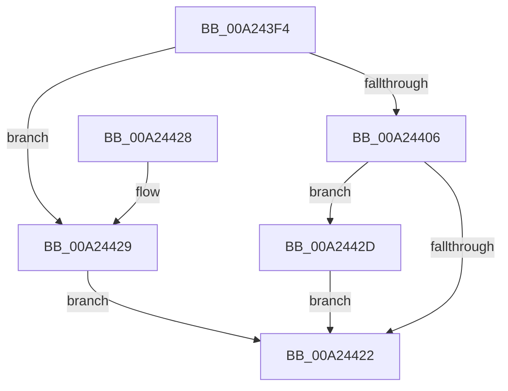

# MiAllocateImportList

- RVA: `0x00A243F4`–`0x00A24432` (길이 `62` bytes)
- VA: `0x0000000140A243F4`
- 실행 섹션: `PAGE`
- PDB 이름 있음: `예`; PDB Function 태그: `아니요`
- unwind 정보 RVA: `0x00060BD8`
- 디코드: `19`개 명령, `62/62` bytes 표시
- 미해석 바이트: `0` (있으면 어셈블리에 `.byte`로 보존)

> 이 문서는 커널 이미지의 기계어와 PDB 기호를 분석해 생성했습니다. 4번과 5번은 함수 원형과 자료형을 바이너리 사용 방식에서 추정한 C 해석이며 원본 소스 복구 결과는 아닙니다.

## 1. Dependencies

- 직접 호출 지점: **1**; 고유 호출 대상: **1**
- 직접 호출자로 확인된 함수: **3**
- RIP 상대 이미지 참조: **0**

### Outgoing calls
- `0x00A24418` → [MiAllocatePool](../../text/35/MiAllocatePool_function_0035B540.md) (function, `0x0035B540`)

### Direct callers
- [MiAddEntryToImportList](../7F/MiAddEntryToImportList_function_007F7D20.md) at `0x007F7D55`
- [MiResolveImageReferences](MiResolveImageReferences_function_00A23BE4.md) at `0x00A23CC9`
- [MiCompressImportList](MiCompressImportList_function_00A24344.md) at `0x00A243C7`

### Static image references
- 디코드된 RIP-relative 메모리 참조가 없습니다.

## 2. Other-region calls and transfers

- 다른 실행 섹션으로 향하는 call: **1**
  - `0x00A24418` → [MiAllocatePool](../../text/35/MiAllocatePool_function_0035B540.md) (`PAGE` → `.text`)
- 별도 외부 분기/꼬리 이동을 확인하지 못했습니다.

## 3. Assembly (complete function range)

```asm
00A243F4  40 53                           push rbx
00A243F6  48 83 EC 20                     sub rsp, 0x20
00A243FA  48 8B D9                        mov rbx, rcx
00A243FD  48 81 F9 FE FF FF 1F            cmp rcx, 0x1ffffffe
00A24404  77 23                           ja 0x140a24429
00A24406  8D 14 CD 08 00 00 00            lea edx, [rcx*8 + 8]
00A2440D  41 B8 4D 6D 44 54               mov r8d, 0x54446d4d
00A24413  B9 00 01 00 00                  mov ecx, 0x100
00A24418  E8 23 71 93 FF                  call 0x14035b540
00A2441D  48 85 C0                        test rax, rax
00A24420  75 0B                           jne 0x140a2442d
00A24422  48 83 C4 20                     add rsp, 0x20
00A24426  5B                              pop rbx
00A24427  C3                              ret
00A24428  CC                              int3
00A24429  33 C0                           xor eax, eax
00A2442B  EB F5                           jmp 0x140a24422
00A2442D  48 89 18                        mov qword ptr [rax], rbx
00A24430  EB F0                           jmp 0x140a24422
```

## 4. C-style interpretation (structured pseudocode)

```c
__int64 __fastcall MiAllocateImportList(__int64 a1)
{
    __int64 result;
    __int64 v_rsp;

    v_rsp = (v_rsp) - (32);
    if (a1 > 0x1FFFFFFEULL) goto loc_00A24429;
    result = MiAllocatePool(256, a1 * 8 + 8, (unsigned int)(0x54446D4DULL), a4);
    if (result != 0) goto loc_00A2442D;
loc_00A24422:
    v_rsp = (v_rsp) + (32);
    return result;
loc_00A24429:
    result = 0;
    goto loc_00A24422;
loc_00A2442D:
    *(unsigned __int64 *)(result) = a1;
    goto loc_00A24422;
}
```

## 5. (Beta) C Style

```c
int64_t MiAllocateImportList(int64_t Arg1)
{
    int64_t result;
    int64_t local_rsp;

    local_rsp = (local_rsp) - (32);
    if (Arg1 > 0x1FFFFFFEULL) goto loc_00A24429;
    result = MiAllocatePool(256, Arg1 * 8 + 8, (uint32_t)(0x54446D4DULL), a4);
    if (result != 0) goto loc_00A2442D;
loc_00A24422:
    local_rsp = (local_rsp) + (32);
    return result;
loc_00A24429:
    result = 0;
    goto loc_00A24422;
loc_00A2442D:
    *(uint64_t *)(result) = Arg1;
    goto loc_00A24422;
}
```

## 6. Execution-region graph

[열기: 2D/3D 그래프와 함수 탐색 컨트롤 패널](../../../control-panel.html?section=page&rva=0x00A243F4&view=graph)

- 2D 그래프는 위에서 아래로 흐르고, 3D 그래프는 빈 공간을 드래그해 회전합니다. Shift+드래그는 이동, 휠은 확대·축소, 함수 노드 선택은 대상 보고서 이동입니다.

### Static fallback


