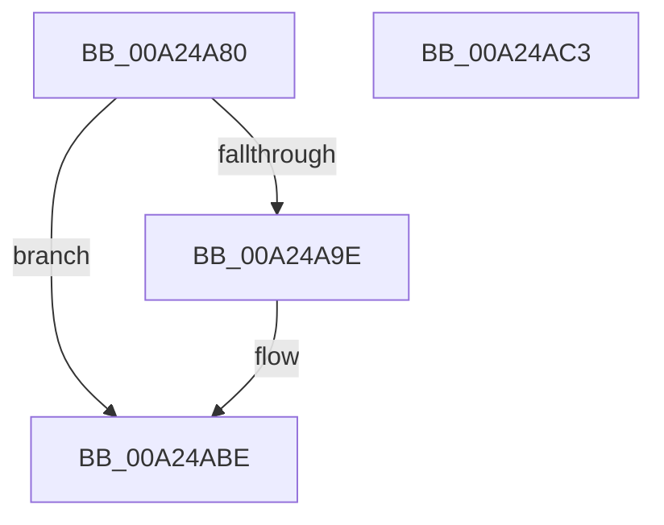

# MiAllocateTempLoaderEntry

- RVA: `0x00A24A80`–`0x00A24AC4` (길이 `68` bytes)
- VA: `0x0000000140A24A80`
- 실행 섹션: `PAGE`
- PDB 이름 있음: `예`; PDB Function 태그: `아니요`
- unwind 정보 RVA: `0x0005C788`
- 디코드: `14`개 명령, `68/68` bytes 표시
- 미해석 바이트: `0` (있으면 어셈블리에 `.byte`로 보존)

> 이 문서는 커널 이미지의 기계어와 PDB 기호를 분석해 생성했습니다. 4번과 5번은 함수 원형과 자료형을 바이너리 사용 방식에서 추정한 C 해석이며 원본 소스 복구 결과는 아닙니다.

## 1. Dependencies

- 직접 호출 지점: **1**; 고유 호출 대상: **1**
- 직접 호출자로 확인된 함수: **1**
- RIP 상대 이미지 참조: **0**

### Outgoing calls
- `0x00A24A94` → [MiAllocatePool](../../text/35/MiAllocatePool_function_0035B540.md) (function, `0x0035B540`)

### Direct callers
- [MiObtainSectionForDriver](MiObtainSectionForDriver_function_00A24494.md) at `0x00A24697`

### Static image references
- 디코드된 RIP-relative 메모리 참조가 없습니다.

## 2. Other-region calls and transfers

- 다른 실행 섹션으로 향하는 call: **1**
  - `0x00A24A94` → [MiAllocatePool](../../text/35/MiAllocatePool_function_0035B540.md) (`PAGE` → `.text`)
- 별도 외부 분기/꼬리 이동을 확인하지 못했습니다.

## 3. Assembly (complete function range)

```asm
00A24A80  48 83 EC 28                     sub rsp, 0x28
00A24A84  BA 30 01 00 00                  mov edx, 0x130
00A24A89  41 B8 4D 6D 4C 64               mov r8d, 0x644c6d4d
00A24A8F  B9 40 00 00 00                  mov ecx, 0x40
00A24A94  E8 A7 6A 93 FF                  call 0x14035b540
00A24A99  48 85 C0                        test rax, rax
00A24A9C  74 20                           je 0x140a24abe
00A24A9E  0F BA A8 B8 00 00 00 08         bts dword ptr [rax + 0xb8], 8
00A24AA6  C7 40 68 00 00 00 01            mov dword ptr [rax + 0x68], 0x1000000
00A24AAD  66 C7 40 6C 01 00               mov word ptr [rax + 0x6c], 1
00A24AB3  48 C7 80 88 00 00 00 FE FF FF FF  mov qword ptr [rax + 0x88], 0xfffffffffffffffe
00A24ABE  48 83 C4 28                     add rsp, 0x28
00A24AC2  C3                              ret
00A24AC3  CC                              int3
```

## 4. C-style interpretation (structured pseudocode)

```c
__int64 __fastcall MiAllocateTempLoaderEntry(void)
{
    __int64 result;
    __int64 v_rsp;

    v_rsp = (v_rsp) - (40);
    result = MiAllocatePool(64, 304, (unsigned int)(0x644C6D4DULL), a4);
    if (result != 0) {
        *(unsigned int *)(result + 104) = 0x1000000ULL;
        *(unsigned __int16 *)(result + 108) = 1;
        *(unsigned __int64 *)(result + 136) = -2;
    }
    v_rsp = (v_rsp) + (40);
    return result;
}
```

## 5. (Beta) C Style

```c
void MiAllocateTempLoaderEntry(void)
{
    int64_t result;
    int64_t local_rsp;

    local_rsp = (local_rsp) - (40);
    result = MiAllocatePool(64, 304, (uint32_t)(0x644C6D4DULL), a4);
    if (result != 0) {
        *(uint32_t *)(result + 0x68) = 0x1000000ULL;
        *(uint16_t *)(result + 0x6C) = 1;
        *(uint64_t *)(result + 0x88) = -2;
    }
    local_rsp = (local_rsp) + (40);
    return result;
}
```

## 6. Execution-region graph

[열기: 2D/3D 그래프와 함수 탐색 컨트롤 패널](../../../control-panel.html?section=page&rva=0x00A24A80&view=graph)

- 2D 그래프는 위에서 아래로 흐르고, 3D 그래프는 빈 공간을 드래그해 회전합니다. Shift+드래그는 이동, 휠은 확대·축소, 함수 노드 선택은 대상 보고서 이동입니다.

### Static fallback


