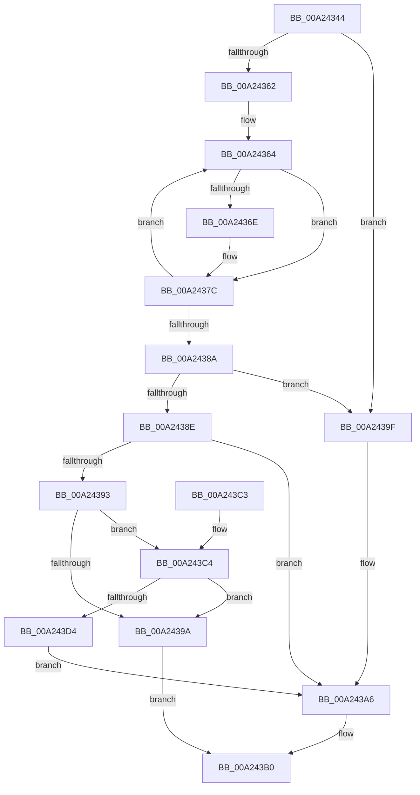

# MiCompressImportList

- RVA: `0x00A24344`–`0x00A243EB` (길이 `167` bytes)
- VA: `0x0000000140A24344`
- 실행 섹션: `PAGE`
- PDB 이름 있음: `예`; PDB Function 태그: `아니요`
- unwind 정보 RVA: `0x0009A534`
- 디코드: `53`개 명령, `167/167` bytes 표시
- 미해석 바이트: `0` (있으면 어셈블리에 `.byte`로 보존)

> 이 문서는 커널 이미지의 기계어와 PDB 기호를 분석해 생성했습니다. 4번과 5번은 함수 원형과 자료형을 바이너리 사용 방식에서 추정한 C 해석이며 원본 소스 복구 결과는 아닙니다.

## 1. Dependencies

- 직접 호출 지점: **3**; 고유 호출 대상: **3**
- 직접 호출자로 확인된 함수: **2**
- RIP 상대 이미지 참조: **0**

### Outgoing calls
- `0x00A243AB` → [ExFreePoolWithTag](../../poolcode/B8/ExFreePoolWithTag_function_00B82870.md) (function, `0x00B82870`)
- `0x00A243C7` → [MiAllocateImportList](MiAllocateImportList_function_00A243F4.md) (function, `0x00A243F4`)
- `0x00A243E4` → [memcpy](../../text/6C/memcpy_function_006C6840.md) (function, `0x006C6840`)

### Direct callers
- [MiAddEntryToImportList](../7F/MiAddEntryToImportList_function_007F7D20.md) at `0x007F7D92`
- [MiResolveImageReferences](MiResolveImageReferences_function_00A23BE4.md) at `0x00A23E98`

### Static image references
- 디코드된 RIP-relative 메모리 참조가 없습니다.

## 2. Other-region calls and transfers

- 다른 실행 섹션으로 향하는 call: **2**
  - `0x00A243AB` → [ExFreePoolWithTag](../../poolcode/B8/ExFreePoolWithTag_function_00B82870.md) (`PAGE` → `POOLCODE`)
  - `0x00A243E4` → [memcpy](../../text/6C/memcpy_function_006C6840.md) (`PAGE` → `.text`)
- 별도 외부 분기/꼬리 이동을 확인하지 못했습니다.

## 3. Assembly (complete function range)

```asm
00A24344  48 89 5C 24 08                  mov qword ptr [rsp + 8], rbx
00A24349  48 89 74 24 10                  mov qword ptr [rsp + 0x10], rsi
00A2434E  57                              push rdi
00A2434F  48 83 EC 20                     sub rsp, 0x20
00A24353  48 8B F9                        mov rdi, rcx
00A24356  33 DB                           xor ebx, ebx
00A24358  33 C9                           xor ecx, ecx
00A2435A  45 33 C0                        xor r8d, r8d
00A2435D  48 39 0F                        cmp qword ptr [rdi], rcx
00A24360  76 3D                           jbe 0x140a2439f
00A24362  33 C0                           xor eax, eax
00A24364  48 8B 54 C7 08                  mov rdx, qword ptr [rdi + rax*8 + 8]
00A24369  48 85 D2                        test rdx, rdx
00A2436C  74 0E                           je 0x140a2437c
00A2436E  48 8B DA                        mov rbx, rdx
00A24371  48 89 54 CF 08                  mov qword ptr [rdi + rcx*8 + 8], rdx
00A24376  48 83 CB 01                     or rbx, 1
00A2437A  FF C1                           inc ecx
00A2437C  48 8B 17                        mov rdx, qword ptr [rdi]
00A2437F  41 FF C0                        inc r8d
00A24382  41 8B C0                        mov eax, r8d
00A24385  48 3B C2                        cmp rax, rdx
00A24388  72 DA                           jb 0x140a24364
00A2438A  85 C9                           test ecx, ecx
00A2438C  74 11                           je 0x140a2439f
00A2438E  83 F9 01                        cmp ecx, 1
00A24391  74 13                           je 0x140a243a6
00A24393  8B F1                           mov esi, ecx
00A24395  48 3B F2                        cmp rsi, rdx
00A24398  75 2A                           jne 0x140a243c4
00A2439A  48 8B DF                        mov rbx, rdi
00A2439D  EB 11                           jmp 0x140a243b0
00A2439F  48 C7 C3 FE FF FF FF            mov rbx, 0xfffffffffffffffe
00A243A6  33 D2                           xor edx, edx
00A243A8  48 8B CF                        mov rcx, rdi
00A243AB  E8 C0 E4 15 00                  call 0x140b82870
00A243B0  48 8B 74 24 38                  mov rsi, qword ptr [rsp + 0x38]
00A243B5  48 8B C3                        mov rax, rbx
00A243B8  48 8B 5C 24 30                  mov rbx, qword ptr [rsp + 0x30]
00A243BD  48 83 C4 20                     add rsp, 0x20
00A243C1  5F                              pop rdi
00A243C2  C3                              ret
00A243C3  CC                              int3
00A243C4  48 8B CE                        mov rcx, rsi
00A243C7  E8 28 00 00 00                  call 0x140a243f4
00A243CC  48 8B D8                        mov rbx, rax
00A243CF  48 85 C0                        test rax, rax
00A243D2  74 C6                           je 0x140a2439a
00A243D4  4C 8D 04 F5 00 00 00 00         lea r8, [rsi*8]
00A243DC  48 8D 57 08                     lea rdx, [rdi + 8]
00A243E0  48 8D 48 08                     lea rcx, [rax + 8]
00A243E4  E8 57 24 CA FF                  call 0x1406c6840
00A243E9  EB BB                           jmp 0x140a243a6
```

## 4. C-style interpretation (structured pseudocode)

```c
__int64 __fastcall MiCompressImportList(__int64 a1, __int64 a2, int a3)
{
    __int64 result;
    __int64 v_rbx;
    __int64 v_rsp;
    unsigned __int64 v_stack_p10;
    unsigned __int64 v_stack_p8;

    v_stack_p8 = v_rbx;
    v_stack_p10 = v_rsi;
    v_rsp = (v_rsp) - (32);
    v_rbx = 0;
    a1 = 0;
    a3 = 0;
    if ((*(unsigned __int64 *)(a1)) <= 0) goto loc_00A2439F;
    result = 0;
loc_00A24364:
    if (*(unsigned __int64 *)(a1 + result * 8 + 8) != 0) {
        v_rbx = *(unsigned __int64 *)(a1 + result * 8 + 8);
        *(unsigned __int64 *)(a1 + a1 * 8 + 8) = *(unsigned __int64 *)(a1 + result * 8 + 8);
        v_rbx = (v_rbx) | (1);
        a1 = (unsigned int)((a1) + 1);
    }
    a3 = (unsigned int)((a3) + 1);
    if (((unsigned int)(a3)) < (*(unsigned __int64 *)(a1))) goto loc_00A24364;
    if ((unsigned int)(a1) == 0) goto loc_00A2439F;
    if (((unsigned int)(a1)) == 1) goto loc_00A243A6;
    if (((unsigned int)((unsigned int)(a1))) != (*(unsigned __int64 *)(a1))) goto loc_00A243C4;
loc_00A2439A:
    goto loc_00A243B0;
loc_00A2439F:
loc_00A243A6:
    a2 = 0;
    result = ExFreePoolWithTag(a1, a2, a3, a4);
loc_00A243B0:
    v_rsp = (v_rsp) + (32);
    return -2;
loc_00A243C4:
    result = MiAllocateImportList(v_stack_p10, a2, a3, a4);
    if (result == 0) goto loc_00A2439A;
    result = memcpy(result + 8, a1 + 8, v_stack_p10 * 8, a4);
    goto loc_00A243A6;
}
```

## 5. (Beta) C Style

```c
int64_t MiCompressImportList(void *Arg1, int64_t Arg2, int32_t Arg3)
{
    uint8_t *arg1 = (uint8_t *)Arg1;

    int64_t result;
    int64_t local_rbx;
    int64_t local_rsp;
    uint64_t v_stack_p10;
    uint64_t v_stack_p8;

    v_stack_p8 = local_rbx;
    v_stack_p10 = local_rsi;
    local_rsp = (local_rsp) - (32);
    local_rbx = 0;
    Arg1 = 0;
    Arg3 = 0;
    if ((*(uint64_t *)(arg1)) <= 0) goto loc_00A2439F;
    result = 0;
loc_00A24364:
    if (*(uint64_t *)(arg1 + result * 8 + 0x8) != 0) {
        local_rbx = *(uint64_t *)(arg1 + result * 8 + 0x8);
        *(uint64_t *)(arg1 + arg1 * 8 + 0x8) = *(uint64_t *)(arg1 + result * 8 + 0x8);
        local_rbx = (local_rbx) | (1);
        Arg1 = (uint32_t)((Arg1) + 1);
    }
    Arg3 = (uint32_t)((Arg3) + 1);
    if (((uint32_t)(Arg3)) < (*(uint64_t *)(arg1))) goto loc_00A24364;
    if ((uint32_t)(Arg1) == 0) goto loc_00A2439F;
    if (((uint32_t)(Arg1)) == 1) goto loc_00A243A6;
    if (((uint32_t)((uint32_t)(Arg1))) != (*(uint64_t *)(arg1))) goto loc_00A243C4;
loc_00A2439A:
    goto loc_00A243B0;
loc_00A2439F:
loc_00A243A6:
    Arg2 = 0;
    result = ExFreePoolWithTag(Arg1, Arg2, Arg3, a4);
loc_00A243B0:
    local_rsp = (local_rsp) + (32);
    return -2;
loc_00A243C4:
    result = MiAllocateImportList(v_stack_p10, Arg2, Arg3, a4);
    if (result == 0) goto loc_00A2439A;
    result = memcpy(result + 8, Arg1 + 8, v_stack_p10 * 8, a4);
    goto loc_00A243A6;
}
```

### 관측된 메모리 오프셋

구조체 형식이 확인되지 않은 접근은 인자 기준의 오프셋으로만 기록했습니다.

| 기준 인자 | 오프셋 표현 | 폭 (bit) | 접근 |
|---|---:|---:|---|
| `Arg1` | `+ 0x0` | `64` | `R` |
| `Arg1` | `+ 0x8` | `64` | `R` |
| `Arg1` | `+ 0x8 + rax*8` | `64` | `R` |
| `Arg1` | `+ 0x8 + rcx*8` | `64` | `W` |

## 6. Execution-region graph

[열기: 2D/3D 그래프와 함수 탐색 컨트롤 패널](../../../control-panel.html?section=page&rva=0x00A24344&view=graph)

- 2D 그래프는 위에서 아래로 흐르고, 3D 그래프는 빈 공간을 드래그해 회전합니다. Shift+드래그는 이동, 휠은 확대·축소, 함수 노드 선택은 대상 보고서 이동입니다.

### Static fallback


