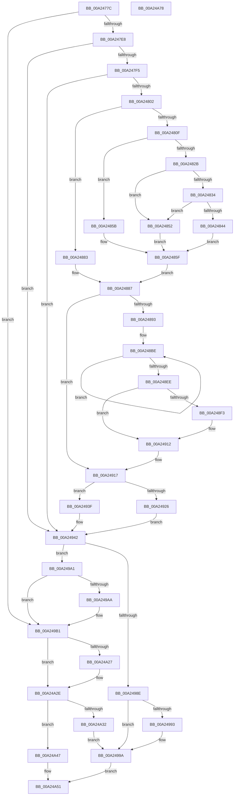

# MiCreateSectionForDriver

- RVA: `0x00A2477C`–`0x00A24A79` (길이 `765` bytes)
- VA: `0x0000000140A2477C`
- 실행 섹션: `PAGE`
- PDB 이름 있음: `예`; PDB Function 태그: `아니요`
- unwind 정보 RVA: `0x000AB7AC`
- 디코드: `194`개 명령, `765/765` bytes 표시
- 미해석 바이트: `0` (있으면 어셈블리에 `.byte`로 보존)

> 이 문서는 커널 이미지의 기계어와 PDB 기호를 분석해 생성했습니다. 4번과 5번은 함수 원형과 자료형을 바이너리 사용 방식에서 추정한 C 해석이며 원본 소스 복구 결과는 아닙니다.

## 1. Dependencies

- 직접 호출 지점: **17**; 고유 호출 대상: **15**
- 직접 호출자로 확인된 함수: **1**
- RIP 상대 이미지 참조: **9**

### Outgoing calls
- `0x00A24822` → [MiGetBaseNameFromImageFileName](../../text/4D/MiGetBaseNameFromImageFileName_function_004D75E8.md) (function, `0x004D75E8`)
- `0x00A24874` → [ExAllocatePool2](../../poolcode/B8/ExAllocatePool2_function_00B820F0.md) (function, `0x00B820F0`)
- `0x00A2489E` → [KeComputeSha256](../../text/4A/KeComputeSha256_function_004A7370.md) (function, `0x004A7370`)
- `0x00A248AF` → [RtlCopyUnicodeString](../../text/3F/RtlCopyUnicodeString_function_003FEF30.md) (function, `0x003FEF30`)
- `0x00A248D2` → [RtlStringCbPrintfW](../../text/40/RtlStringCbPrintfW_function_0040FB40.md) (function, `0x0040FB40`)
- `0x00A248E0` → [RtlAppendUnicodeToString](../../text/40/RtlAppendUnicodeToString_function_0040F990.md) (function, `0x0040F990`)
- `0x00A248FF` → [RtlAppendUnicodeToString](../../text/40/RtlAppendUnicodeToString_function_0040F990.md) (function, `0x0040F990`)
- `0x00A2490D` → [RtlAppendUnicodeStringToString](../../text/40/RtlAppendUnicodeStringToString_function_0040FA50.md) (function, `0x0040FA50`)
- `0x00A2491D` → [KdPullRemoteFile](../../pagekd/B8/KdPullRemoteFile_function_00B86618.md) (function, `0x00B86618`)
- `0x00A24938` → [DbgPrintEx](../../text/35/DbgPrintEx_function_00359290.md) (function, `0x00359290`)
- `0x00A2497E` → [ZwOpenFile](../../text/6A/ZwOpenFile_function_006AD730.md) (function, `0x006AD730`)
- `0x00A24995` → [ExFreePoolWithTag](../../poolcode/B8/ExFreePoolWithTag_function_00B82870.md) (function, `0x00B82870`)
- `0x00A249AC` → [ExFreePoolWithTag](../../poolcode/B8/ExFreePoolWithTag_function_00B82870.md) (function, `0x00B82870`)
- `0x00A24A17` → [MiCreateSystemSection](../../text/45/MiCreateSystemSection_function_00453158.md) (function, `0x00453158`)
- `0x00A24A29` → [ObCloseHandle](../8A/ObCloseHandle_function_008A1870.md) (function, `0x008A1870`)
- `0x00A24A3D` → [MiLogFailedDriverLoad](MiLogFailedDriverLoad_function_00A24ACC.md) (function, `0x00A24ACC`)
- `0x00A24A58` → [_security_check_cookie](../../text/6A/_security_check_cookie_function_006AC640.md) (function, `0x006AC640`)

### Direct callers
- [MiObtainSectionForDriver](MiObtainSectionForDriver_function_00A24494.md) at `0x00A2466A`

### Static image references
- `0x00A24798` → RVA `0x00E0A740` (`.data`; read)
- `0x00A247B2` → RVA `0x00E2D92C` (`.data`; write)
- `0x00A247E8` → RVA `0x00F475F8` (`.data`; read)
- `0x00A247F5` → RVA `0x00F475DC` (`.data`; read)
- `0x00A24802` → RVA `0x00FC43C0` (`.data`; read)
- `0x00A248A3` → RVA `0x0000BED0` (`.rdata`; read)
- `0x00A248C2` → RVA `0x00B09F10` (` ?? ::NNGAKEGL::`string'`; read)
- `0x00A248F3` → RVA `0x00B06E30` (` ?? ::NNGAKEGL::`string'`; read)
- `0x00A2492B` → RVA `0x00B09EE0` (` ?? ::NNGAKEGL::`string'`; read)

## 2. Other-region calls and transfers

- 다른 실행 섹션으로 향하는 call: **15**
  - `0x00A24822` → [MiGetBaseNameFromImageFileName](../../text/4D/MiGetBaseNameFromImageFileName_function_004D75E8.md) (`PAGE` → `.text`)
  - `0x00A24874` → [ExAllocatePool2](../../poolcode/B8/ExAllocatePool2_function_00B820F0.md) (`PAGE` → `POOLCODE`)
  - `0x00A2489E` → [KeComputeSha256](../../text/4A/KeComputeSha256_function_004A7370.md) (`PAGE` → `.text`)
  - `0x00A248AF` → [RtlCopyUnicodeString](../../text/3F/RtlCopyUnicodeString_function_003FEF30.md) (`PAGE` → `.text`)
  - `0x00A248D2` → [RtlStringCbPrintfW](../../text/40/RtlStringCbPrintfW_function_0040FB40.md) (`PAGE` → `.text`)
  - `0x00A248E0` → [RtlAppendUnicodeToString](../../text/40/RtlAppendUnicodeToString_function_0040F990.md) (`PAGE` → `.text`)
  - `0x00A248FF` → [RtlAppendUnicodeToString](../../text/40/RtlAppendUnicodeToString_function_0040F990.md) (`PAGE` → `.text`)
  - `0x00A2490D` → [RtlAppendUnicodeStringToString](../../text/40/RtlAppendUnicodeStringToString_function_0040FA50.md) (`PAGE` → `.text`)
  - `0x00A2491D` → [KdPullRemoteFile](../../pagekd/B8/KdPullRemoteFile_function_00B86618.md) (`PAGE` → `PAGEKD`)
  - `0x00A24938` → [DbgPrintEx](../../text/35/DbgPrintEx_function_00359290.md) (`PAGE` → `.text`)
  - `0x00A2497E` → [ZwOpenFile](../../text/6A/ZwOpenFile_function_006AD730.md) (`PAGE` → `.text`)
  - `0x00A24995` → [ExFreePoolWithTag](../../poolcode/B8/ExFreePoolWithTag_function_00B82870.md) (`PAGE` → `POOLCODE`)
  - `0x00A249AC` → [ExFreePoolWithTag](../../poolcode/B8/ExFreePoolWithTag_function_00B82870.md) (`PAGE` → `POOLCODE`)
  - `0x00A24A17` → [MiCreateSystemSection](../../text/45/MiCreateSystemSection_function_00453158.md) (`PAGE` → `.text`)
  - `0x00A24A58` → [_security_check_cookie](../../text/6A/_security_check_cookie_function_006AC640.md) (`PAGE` → `.text`)
- 별도 외부 분기/꼬리 이동을 확인하지 못했습니다.

## 3. Assembly (complete function range)

```asm
00A2477C  48 89 5C 24 18                  mov qword ptr [rsp + 0x18], rbx
00A24781  55                              push rbp
00A24782  56                              push rsi
00A24783  57                              push rdi
00A24784  41 54                           push r12
00A24786  41 55                           push r13
00A24788  41 56                           push r14
00A2478A  41 57                           push r15
00A2478C  48 8D 6C 24 F0                  lea rbp, [rsp - 0x10]
00A24791  48 81 EC 10 01 00 00            sub rsp, 0x110
00A24798  48 8B 05 A1 5F 3E 00            mov rax, qword ptr [rip + 0x3e5fa1]
00A2479F  48 33 C4                        xor rax, rsp
00A247A2  48 89 45 08                     mov qword ptr [rbp + 8], rax
00A247A6  45 33 ED                        xor r13d, r13d
00A247A9  0F 57 C0                        xorps xmm0, xmm0
00A247AC  4D 89 29                        mov qword ptr [r9], r13
00A247AF  4D 8B E1                        mov r12, r9
00A247B2  C6 05 73 91 40 00 01            mov byte ptr [rip + 0x409173], 1
00A247B9  45 8B F8                        mov r15d, r8d
00A247BC  4C 89 6D 98                     mov qword ptr [rbp - 0x68], r13
00A247C0  48 8B DA                        mov rbx, rdx
00A247C3  44 89 6D A4                     mov dword ptr [rbp - 0x5c], r13d
00A247C7  48 8B F9                        mov rdi, rcx
00A247CA  44 89 6D BC                     mov dword ptr [rbp - 0x44], r13d
00A247CE  4C 89 6D 80                     mov qword ptr [rbp - 0x80], r13
00A247D2  0F 11 45 88                     movups xmmword ptr [rbp - 0x78], xmm0
00A247D6  0F 11 45 D0                     movups xmmword ptr [rbp - 0x30], xmm0
00A247DA  0F 11 44 24 70                  movups xmmword ptr [rsp + 0x70], xmm0
00A247DF  48 85 D2                        test rdx, rdx
00A247E2  0F 85 C9 01 00 00               jne 0x140a249b1
00A247E8  44 38 2D 09 2E 52 00            cmp byte ptr [rip + 0x522e09], r13b
00A247EF  0F 84 4D 01 00 00               je 0x140a24942
00A247F5  44 38 2D E0 2D 52 00            cmp byte ptr [rip + 0x522de0], r13b
00A247FC  0F 85 40 01 00 00               jne 0x140a24942
00A24802  8B 05 B8 FB 59 00               mov eax, dword ptr [rip + 0x59fbb8]
00A24808  41 8B CD                        mov ecx, r13d
00A2480B  A8 08                           test al, 8
00A2480D  74 74                           je 0x140a24883
00A2480F  41 BA B0 00 00 00               mov r10d, 0xb0
00A24815  48 8D 55 88                     lea rdx, [rbp - 0x78]
00A24819  48 8B CF                        mov rcx, rdi
00A2481C  66 44 89 54 24 70               mov word ptr [rsp + 0x70], r10w
00A24822  E8 C1 2D AB FF                  call 0x1404d75e8
00A24827  85 C0                           test eax, eax
00A24829  78 30                           js 0x140a2485b
00A2482B  0F B7 5D 88                     movzx ebx, word ptr [rbp - 0x78]
00A2482F  66 85 DB                        test bx, bx
00A24832  74 1E                           je 0x140a24852
00A24834  41 8D 4A 02                     lea ecx, [r10 + 2]
00A24838  48 8D 04 19                     lea rax, [rcx + rbx]
00A2483C  48 3D FF FF 00 00               cmp rax, 0xffff
00A24842  77 0E                           ja 0x140a24852
00A24844  8D 04 19                        lea eax, [rcx + rbx]
00A24847  44 0F B7 D0                     movzx r10d, ax
00A2484B  66 89 44 24 70                  mov word ptr [rsp + 0x70], ax
00A24850  EB 0D                           jmp 0x140a2485f
00A24852  41 8B DD                        mov ebx, r13d
00A24855  66 89 5D 88                     mov word ptr [rbp - 0x78], bx
00A24859  EB 04                           jmp 0x140a2485f
00A2485B  0F B7 5D 88                     movzx ebx, word ptr [rbp - 0x78]
00A2485F  41 0F B7 D2                     movzx edx, r10w
00A24863  B9 40 00 00 00                  mov ecx, 0x40
00A24868  41 B8 4D 6D 4B 64               mov r8d, 0x644b6d4d
00A2486E  66 44 89 54 24 72               mov word ptr [rsp + 0x72], r10w
00A24874  E8 77 D8 15 00                  call 0x140b820f0
00A24879  48 8B C8                        mov rcx, rax
00A2487C  48 89 44 24 78                  mov qword ptr [rsp + 0x78], rax
00A24881  EB 04                           jmp 0x140a24887
00A24883  0F B7 5D 88                     movzx ebx, word ptr [rbp - 0x78]
00A24887  48 8B F7                        mov rsi, rdi
00A2488A  48 85 C9                        test rcx, rcx
00A2488D  0F 84 84 00 00 00               je 0x140a24917
00A24893  0F B7 17                        movzx edx, word ptr [rdi]
00A24896  4C 8D 45 E8                     lea r8, [rbp - 0x18]
00A2489A  48 8B 4F 08                     mov rcx, qword ptr [rdi + 8]
00A2489E  E8 CD 2A A8 FF                  call 0x1404a7370
00A248A3  48 8D 15 26 76 5E FF            lea rdx, [rip - 0xa189da]
00A248AA  48 8D 4C 24 70                  lea rcx, [rsp + 0x70]
00A248AF  E8 7C A6 9D FF                  call 0x1403fef30
00A248B4  48 8D 7D E8                     lea rdi, [rbp - 0x18]
00A248B8  41 BE 20 00 00 00               mov r14d, 0x20
00A248BE  44 0F B6 0F                     movzx r9d, byte ptr [rdi]
00A248C2  4C 8D 05 47 56 0E 00            lea r8, [rip + 0xe5647]
00A248C9  BA 06 00 00 00                  mov edx, 6
00A248CE  48 8D 4D E0                     lea rcx, [rbp - 0x20]
00A248D2  E8 69 B2 9E FF                  call 0x14040fb40
00A248D7  48 8D 55 E0                     lea rdx, [rbp - 0x20]
00A248DB  48 8D 4C 24 70                  lea rcx, [rsp + 0x70]
00A248E0  E8 AB B0 9E FF                  call 0x14040f990
00A248E5  48 FF C7                        inc rdi
00A248E8  49 83 EE 01                     sub r14, 1
00A248EC  75 D0                           jne 0x140a248be
00A248EE  66 85 DB                        test bx, bx
00A248F1  74 1F                           je 0x140a24912
00A248F3  48 8D 15 36 25 0E 00            lea rdx, [rip + 0xe2536]
00A248FA  48 8D 4C 24 70                  lea rcx, [rsp + 0x70]
00A248FF  E8 8C B0 9E FF                  call 0x14040f990
00A24904  48 8D 55 88                     lea rdx, [rbp - 0x78]
00A24908  48 8D 4C 24 70                  lea rcx, [rsp + 0x70]
00A2490D  E8 3E B1 9E FF                  call 0x14040fa50
00A24912  48 8D 7C 24 70                  lea rdi, [rsp + 0x70]
00A24917  48 8B D7                        mov rdx, rdi
00A2491A  48 8B CE                        mov rcx, rsi
00A2491D  E8 F6 1C 16 00                  call 0x140b86618
00A24922  85 C0                           test eax, eax
00A24924  78 19                           js 0x140a2493f
00A24926  BA 02 00 00 00                  mov edx, 2
00A2492B  4C 8D 05 AE 55 0E 00            lea r8, [rip + 0xe55ae]
00A24932  4C 8B CE                        mov r9, rsi
00A24935  8D 4A 64                        lea ecx, [rdx + 0x64]
00A24938  E8 53 49 93 FF                  call 0x140359290
00A2493D  EB 03                           jmp 0x140a24942
00A2493F  48 8B FE                        mov rdi, rsi
00A24942  0F 57 C0                        xorps xmm0, xmm0
00A24945  44 89 6C 24 28                  mov dword ptr [rsp + 0x28], r13d
00A2494A  4C 8D 4D D0                     lea r9, [rbp - 0x30]
00A2494E  C7 45 A0 30 00 00 00            mov dword ptr [rbp - 0x60], 0x30
00A24955  4C 8D 45 A0                     lea r8, [rbp - 0x60]
00A24959  4C 89 6D A8                     mov qword ptr [rbp - 0x58], r13
00A2495D  BA 20 00 00 00                  mov edx, 0x20
00A24962  C7 45 B8 40 02 00 00            mov dword ptr [rbp - 0x48], 0x240
00A24969  48 8D 4D 80                     lea rcx, [rbp - 0x80]
00A2496D  48 89 7D B0                     mov qword ptr [rbp - 0x50], rdi
00A24971  F3 0F 7F 45 C0                  movdqu xmmword ptr [rbp - 0x40], xmm0
00A24976  C7 44 24 20 05 00 00 00         mov dword ptr [rsp + 0x20], 5
00A2497E  E8 AD 8D C8 FF                  call 0x1406ad730
00A24983  48 8B 4C 24 78                  mov rcx, qword ptr [rsp + 0x78]
00A24988  8B D8                           mov ebx, eax
00A2498A  85 C0                           test eax, eax
00A2498C  79 13                           jns 0x140a249a1
00A2498E  48 85 C9                        test rcx, rcx
00A24991  74 07                           je 0x140a2499a
00A24993  33 D2                           xor edx, edx
00A24995  E8 D6 DE 15 00                  call 0x140b82870
00A2499A  8B C3                           mov eax, ebx
00A2499C  E9 B0 00 00 00                  jmp 0x140a24a51
00A249A1  48 8B 5D 80                     mov rbx, qword ptr [rbp - 0x80]
00A249A5  48 85 C9                        test rcx, rcx
00A249A8  74 07                           je 0x140a249b1
00A249AA  33 D2                           xor edx, edx
00A249AC  E8 BF DE 15 00                  call 0x140b82870
00A249B1  44 88 6C 24 60                  mov byte ptr [rsp + 0x60], r13b
00A249B6  4C 8D 45 A0                     lea r8, [rbp - 0x60]
00A249BA  41 8B C7                        mov eax, r15d
00A249BD  44 89 6C 24 58                  mov dword ptr [rsp + 0x58], r13d
00A249C2  83 4C 24 50 FF                  or dword ptr [rsp + 0x50], 0xffffffff
00A249C7  48 8D 4D 98                     lea rcx, [rbp - 0x68]
00A249CB  48 89 5C 24 38                  mov qword ptr [rsp + 0x38], rbx
00A249D0  0F 57 C0                        xorps xmm0, xmm0
00A249D3  41 C1 FF 1F                     sar r15d, 0x1f
00A249D7  C1 E8 1B                        shr eax, 0x1b
00A249DA  41 81 E7 00 00 40 00            and r15d, 0x400000
00A249E1  83 E0 08                        and eax, 8
00A249E4  C7 45 A0 30 00 00 00            mov dword ptr [rbp - 0x60], 0x30
00A249EB  89 44 24 30                     mov dword ptr [rsp + 0x30], eax
00A249EF  41 81 C7 00 00 10 00            add r15d, 0x100000
00A249F6  44 89 7C 24 28                  mov dword ptr [rsp + 0x28], r15d
00A249FB  C7 44 24 20 10 00 00 00         mov dword ptr [rsp + 0x20], 0x10
00A24A03  4C 89 6D A8                     mov qword ptr [rbp - 0x58], r13
00A24A07  C7 45 B8 40 02 00 00            mov dword ptr [rbp - 0x48], 0x240
00A24A0E  4C 89 6D B0                     mov qword ptr [rbp - 0x50], r13
00A24A12  F3 0F 7F 45 C0                  movdqu xmmword ptr [rbp - 0x40], xmm0
00A24A17  E8 3C E7 A2 FF                  call 0x140453158
00A24A1C  48 8B 4D 80                     mov rcx, qword ptr [rbp - 0x80]
00A24A20  8B D8                           mov ebx, eax
00A24A22  48 85 C9                        test rcx, rcx
00A24A25  74 07                           je 0x140a24a2e
00A24A27  33 D2                           xor edx, edx
00A24A29  E8 42 CE E7 FF                  call 0x1408a1870
00A24A2E  85 DB                           test ebx, ebx
00A24A30  79 15                           jns 0x140a24a47
00A24A32  44 8B CB                        mov r9d, ebx
00A24A35  45 33 C0                        xor r8d, r8d
00A24A38  33 D2                           xor edx, edx
00A24A3A  48 8B CF                        mov rcx, rdi
00A24A3D  E8 8A 00 00 00                  call 0x140a24acc
00A24A42  E9 53 FF FF FF                  jmp 0x140a2499a
00A24A47  48 8B 45 98                     mov rax, qword ptr [rbp - 0x68]
00A24A4B  49 89 04 24                     mov qword ptr [r12], rax
00A24A4F  33 C0                           xor eax, eax
00A24A51  48 8B 4D 08                     mov rcx, qword ptr [rbp + 8]
00A24A55  48 33 CC                        xor rcx, rsp
00A24A58  E8 E3 7B C8 FF                  call 0x1406ac640
00A24A5D  48 8B 9C 24 60 01 00 00         mov rbx, qword ptr [rsp + 0x160]
00A24A65  48 81 C4 10 01 00 00            add rsp, 0x110
00A24A6C  41 5F                           pop r15
00A24A6E  41 5E                           pop r14
00A24A70  41 5D                           pop r13
00A24A72  41 5C                           pop r12
00A24A74  5F                              pop rdi
00A24A75  5E                              pop rsi
00A24A76  5D                              pop rbp
00A24A77  C3                              ret
00A24A78  CC                              int3
```

## 4. C-style interpretation (structured pseudocode)

```c
__int64 __fastcall MiCreateSectionForDriver(__int64 a1, __int64 a2, int a3, __int64 a4)
{
    __int64 result;
    __int64 v_r13;
    __int64 v_r14;
    __int64 v_r15;
    __int64 v_rdi;
    __int64 v_rsp;
    unsigned __int64 v_stack_m110;
    unsigned int v_stack_m118;
    unsigned int v_stack_m120;
    unsigned int v_stack_m128;
    unsigned __int64 v_stack_m40;
    unsigned __int64 v_stack_m48;
    unsigned __int64 v_stack_m60;
    unsigned __int64 v_stack_m68;
    unsigned __int64 v_stack_m78;
    unsigned __int64 v_stack_m88;
    unsigned int v_stack_m8C;
    unsigned int v_stack_m90;
    unsigned __int64 v_stack_m98;
    unsigned __int64 v_stack_mA0;
    unsigned int v_stack_mA4;
    unsigned int v_stack_mA8;
    unsigned __int64 v_stack_mB0;
    unsigned __int64 v_stack_mC0;
    unsigned __int64 v_stack_mC8;
    unsigned __int64 v_stack_mD0;
    unsigned __int16 v_stack_mD6;
    unsigned __int64 v_stack_mD8;
    unsigned __int8 v_stack_mE8;
    unsigned int v_stack_mF0;
    unsigned int v_stack_mF8;
    unsigned __int64 v_stack_p18;

    v_stack_p18 = v_rbx;
    v_rsp = (v_rsp) - (272);
    result = (*(unsigned __int64 *)(v_rip + 4087713)) ^ (v_rsp);
    v_stack_m40 = result;
    v_r13 = 0;
    *(unsigned __int64 *)(a4) = 0;
    *(unsigned __int8 *)(v_rip + 4231539) = 1;
    v_stack_mB0 = 0;
    v_stack_mA4 = 0;
    v_stack_m8C = 0;
    v_stack_mC8 = 0;
    v_stack_mC0 = v_xmm0;
    v_stack_m78 = v_xmm0;
    v_stack_mD8 = v_xmm0;
    if (a2 != 0) goto loc_00A249B1;
    if ((*(unsigned __int8 *)(v_rip + 5385737)) == 0) goto loc_00A24942;
    if ((*(unsigned __int8 *)(v_rip + 5385696)) != 0) goto loc_00A24942;
    if ((((unsigned __int8)((unsigned int)(*(unsigned int *)(v_rip + 5897144)))) & (8)) == 0) goto loc_00A24883;
    v_stack_mD8 = 176;
    result = MiGetBaseNameFromImageFileName(a1, v_stack_mC0, a3, a4);
    if (sign_flag) goto loc_00A2485B;
    if ((unsigned __int16)(v_stack_mC0) == 0) goto loc_00A24852;
    if ((176 + 2 + v_stack_mC0 * 1) > 0xFFFFULL) goto loc_00A24852;
    v_stack_mD8 = (unsigned __int16)(176 + 2 + v_stack_mC0 * 1);
    goto loc_00A2485F;
loc_00A24852:
    v_stack_mC0 = 0;
    goto loc_00A2485F;
loc_00A2485B:
loc_00A2485F:
    v_stack_mD6 = (unsigned __int16)((unsigned __int16)(176 + 2 + v_stack_mC0 * 1));
    result = ExAllocatePool2(64, (unsigned __int16)((unsigned __int16)(176 + 2 + v_stack_mC0 * 1)), (unsigned int)(0x644B6D4DULL), a4);
    v_stack_mD0 = result;
    goto loc_00A24887;
loc_00A24883:
loc_00A24887:
    if (result == 0) goto loc_00A24917;
    result = KeComputeSha256(*(unsigned __int64 *)(a1 + 8), *(unsigned __int16 *)(a1), v_stack_m60, a4);
    result = RtlCopyUnicodeString(v_stack_mD8, v_rip - 10586586, v_stack_m60, a4);
loc_00A248BE:
    result = RtlStringCbPrintfW(v_stack_m68, 6, v_rip + 939591, *(unsigned __int8 *)(v_stack_m60));
    result = RtlAppendUnicodeToString(v_stack_mD8, v_stack_m68, v_rip + 939591, *(unsigned __int8 *)(v_stack_m60));
    v_rdi = (v_stack_m60) + 1;
    v_r14 = (32) - (1);
    if (condition_is_not_equal) goto loc_00A248BE;
    if ((unsigned __int16)(v_stack_mC0) != 0) {
        a2 = v_rip + 927030;
        a1 = v_stack_mD8;
        result = RtlAppendUnicodeToString(a1, a2, v_rip + 939591, *(unsigned __int8 *)(v_stack_m60));
        a2 = v_stack_mC0;
        a1 = v_stack_mD8;
        result = RtlAppendUnicodeStringToString(a1, a2, v_rip + 939591, *(unsigned __int8 *)(v_stack_m60));
    }
loc_00A24917:
    result = KdPullRemoteFile(a1, v_stack_mD8, v_rip + 939591, *(unsigned __int8 *)(v_stack_m60));
    if (sign_flag) goto loc_00A2493F;
    result = DbgPrintEx(2 + 100, 2, v_rip + 939438, a1);
    goto loc_00A24942;
loc_00A2493F:
loc_00A24942:
    v_stack_m120 = 0;
    v_stack_mA8 = 48;
    v_stack_mA0 = 0;
    v_stack_m90 = 576;
    v_stack_m98 = a1;
    v_stack_m88 = v_xmm0;
    v_stack_m128 = 5;
    result = ZwOpenFile(v_stack_mC8, 32, v_stack_mA8, v_stack_m78);
    if (!sign_flag) goto loc_00A249A1;
    if (v_stack_mD0 != 0) {
        a2 = 0;
        result = ExFreePoolWithTag(v_stack_mD0, a2, v_stack_mA8, v_stack_m78);
    }
    goto loc_00A24A51;
loc_00A249A1:
    result = (unsigned int)((unsigned int)((unsigned int)((unsigned int)(result))));
    if (v_stack_mD0 != 0) {
        a2 = 0;
        result = ExFreePoolWithTag(v_stack_mD0, a2, v_stack_mA8, v_stack_m78);
    }
    v_stack_mE8 = 0;
    v_stack_mF0 = 0;
    v_stack_m110 = v_stack_mC8;
    v_r15 = (unsigned int)(((unsigned int)(a3)) >> (31));
    result = (unsigned int)(((unsigned int)((unsigned int)((unsigned int)(a3)))) >> (27));
    v_r15 = (unsigned int)((v_r15) & (0x400000ULL));
    result = (unsigned int)((result) & (8));
    v_stack_mA8 = 48;
    v_stack_m118 = (unsigned int)(result);
    v_r15 = (unsigned int)((v_r15) + (0x100000ULL));
    v_stack_m120 = (unsigned int)(v_r15);
    v_stack_m128 = 16;
    v_stack_mA0 = 0;
    v_stack_m90 = 576;
    v_stack_m98 = 0;
    v_stack_m88 = v_xmm0;
    result = MiCreateSystemSection(v_stack_mB0, a2, v_stack_mA8, v_stack_m78);
    if (v_stack_mC8 != 0) {
        a2 = 0;
        result = ObCloseHandle(v_stack_mC8, a2, v_stack_mA8, v_stack_m78);
    }
    if (!sign_flag) goto loc_00A24A47;
    a3 = 0;
    a2 = 0;
    result = MiLogFailedDriverLoad(a1, a2, a3, (unsigned int)((unsigned int)((unsigned int)((unsigned int)(result)))));
    goto loc_00A2499A;
loc_00A24A47:
    *(unsigned __int64 *)(a4) = v_stack_mB0;
    result = 0;
loc_00A24A51:
    a1 = (v_stack_m40) ^ (v_rsp);
    result = _security_check_cookie(a1, a2, a3, (unsigned int)((unsigned int)((unsigned int)((unsigned int)(result)))));
    v_rsp = (v_rsp) + (272);
    return result;
}
```

## 5. (Beta) C Style

```c
int64_t MiCreateSectionForDriver(void *Arg1, int64_t Arg2, int32_t Arg3, void *Arg4)
{
    uint8_t *arg1 = (uint8_t *)Arg1;
    uint8_t *arg4 = (uint8_t *)Arg4;

    int64_t result;
    int64_t local_r13;
    int64_t local_r14;
    int64_t local_r15;
    int64_t local_rdi;
    int64_t local_rsp;
    uint64_t v_stack_m110;
    uint32_t v_stack_m118;
    uint32_t v_stack_m120;
    uint32_t v_stack_m128;
    uint64_t v_stack_m40;
    uint64_t v_stack_m48;
    uint64_t v_stack_m60;
    uint64_t v_stack_m68;
    uint64_t v_stack_m78;
    uint64_t v_stack_m88;
    uint32_t v_stack_m8C;
    uint32_t v_stack_m90;
    uint64_t v_stack_m98;
    uint64_t v_stack_mA0;
    uint32_t v_stack_mA4;
    uint32_t v_stack_mA8;
    uint64_t v_stack_mB0;
    uint64_t v_stack_mC0;
    uint64_t v_stack_mC8;
    uint64_t v_stack_mD0;
    uint16_t v_stack_mD6;
    uint64_t v_stack_mD8;
    uint8_t v_stack_mE8;
    uint32_t v_stack_mF0;
    uint32_t v_stack_mF8;
    uint64_t v_stack_p18;

    v_stack_p18 = local_rbx;
    local_rsp = (local_rsp) - (272);
    result = (*(uint64_t *)(v_rip + 0x3E5FA1)) ^ (local_rsp);
    v_stack_m40 = result;
    local_r13 = 0;
    *(uint64_t *)(arg4) = 0;
    *(uint8_t *)(v_rip + 0x409173) = 1;
    v_stack_mB0 = 0;
    v_stack_mA4 = 0;
    v_stack_m8C = 0;
    v_stack_mC8 = 0;
    v_stack_mC0 = v_xmm0;
    v_stack_m78 = v_xmm0;
    v_stack_mD8 = v_xmm0;
    if (Arg2 != 0) goto loc_00A249B1;
    if ((*(uint8_t *)(v_rip + 0x522E09)) == 0) goto loc_00A24942;
    if ((*(uint8_t *)(v_rip + 0x522DE0)) != 0) goto loc_00A24942;
    if ((((uint8_t)((uint32_t)(*(uint32_t *)(v_rip + 0x59FBB8)))) & (8)) == 0) goto loc_00A24883;
    v_stack_mD8 = 176;
    result = MiGetBaseNameFromImageFileName(Arg1, v_stack_mC0, Arg3, Arg4);
    if (sign_flag) goto loc_00A2485B;
    if ((uint16_t)(v_stack_mC0) == 0) goto loc_00A24852;
    if ((176 + 2 + v_stack_mC0 * 1) > 0xFFFFULL) goto loc_00A24852;
    v_stack_mD8 = (uint16_t)(176 + 2 + v_stack_mC0 * 1);
    goto loc_00A2485F;
loc_00A24852:
    v_stack_mC0 = 0;
    goto loc_00A2485F;
loc_00A2485B:
loc_00A2485F:
    v_stack_mD6 = (uint16_t)((uint16_t)(176 + 2 + v_stack_mC0 * 1));
    result = ExAllocatePool2(64, (uint16_t)((uint16_t)(176 + 2 + v_stack_mC0 * 1)), (uint32_t)(0x644B6D4DULL), Arg4);
    v_stack_mD0 = result;
    goto loc_00A24887;
loc_00A24883:
loc_00A24887:
    if (result == 0) goto loc_00A24917;
    result = KeComputeSha256(*(uint64_t *)(arg1 + 0x8), *(uint16_t *)(arg1), v_stack_m60, Arg4);
    result = RtlCopyUnicodeString(v_stack_mD8, v_rip - 10586586, v_stack_m60, Arg4);
loc_00A248BE:
    result = RtlStringCbPrintfW(v_stack_m68, 6, v_rip + 939591, *(uint8_t *)(v_stack_m60));
    result = RtlAppendUnicodeToString(v_stack_mD8, v_stack_m68, v_rip + 939591, *(uint8_t *)(v_stack_m60));
    local_rdi = (v_stack_m60) + 1;
    local_r14 = (32) - (1);
    if (condition_is_not_equal) goto loc_00A248BE;
    if ((uint16_t)(v_stack_mC0) != 0) {
        Arg2 = v_rip + 927030;
        Arg1 = v_stack_mD8;
        result = RtlAppendUnicodeToString(Arg1, Arg2, v_rip + 939591, *(uint8_t *)(v_stack_m60));
        Arg2 = v_stack_mC0;
        Arg1 = v_stack_mD8;
        result = RtlAppendUnicodeStringToString(Arg1, Arg2, v_rip + 939591, *(uint8_t *)(v_stack_m60));
    }
loc_00A24917:
    result = KdPullRemoteFile(Arg1, v_stack_mD8, v_rip + 939591, *(uint8_t *)(v_stack_m60));
    if (sign_flag) goto loc_00A2493F;
    result = DbgPrintEx(2 + 100, 2, v_rip + 939438, Arg1);
    goto loc_00A24942;
loc_00A2493F:
loc_00A24942:
    v_stack_m120 = 0;
    v_stack_mA8 = 48;
    v_stack_mA0 = 0;
    v_stack_m90 = 576;
    v_stack_m98 = Arg1;
    v_stack_m88 = v_xmm0;
    v_stack_m128 = 5;
    result = ZwOpenFile(v_stack_mC8, 32, v_stack_mA8, v_stack_m78);
    if (!sign_flag) goto loc_00A249A1;
    if (v_stack_mD0 != 0) {
        Arg2 = 0;
        result = ExFreePoolWithTag(v_stack_mD0, Arg2, v_stack_mA8, v_stack_m78);
    }
    goto loc_00A24A51;
loc_00A249A1:
    result = (uint32_t)((uint32_t)((uint32_t)((uint32_t)(result))));
    if (v_stack_mD0 != 0) {
        Arg2 = 0;
        result = ExFreePoolWithTag(v_stack_mD0, Arg2, v_stack_mA8, v_stack_m78);
    }
    v_stack_mE8 = 0;
    v_stack_mF0 = 0;
    v_stack_m110 = v_stack_mC8;
    local_r15 = (uint32_t)(((uint32_t)(Arg3)) >> (31));
    result = (uint32_t)(((uint32_t)((uint32_t)((uint32_t)(Arg3)))) >> (27));
    local_r15 = (uint32_t)((local_r15) & (0x400000ULL));
    result = (uint32_t)((result) & (8));
    v_stack_mA8 = 48;
    v_stack_m118 = (uint32_t)(result);
    local_r15 = (uint32_t)((local_r15) + (0x100000ULL));
    v_stack_m120 = (uint32_t)(local_r15);
    v_stack_m128 = 16;
    v_stack_mA0 = 0;
    v_stack_m90 = 576;
    v_stack_m98 = 0;
    v_stack_m88 = v_xmm0;
    result = MiCreateSystemSection(v_stack_mB0, Arg2, v_stack_mA8, v_stack_m78);
    if (v_stack_mC8 != 0) {
        Arg2 = 0;
        result = ObCloseHandle(v_stack_mC8, Arg2, v_stack_mA8, v_stack_m78);
    }
    if (!sign_flag) goto loc_00A24A47;
    Arg3 = 0;
    Arg2 = 0;
    result = MiLogFailedDriverLoad(Arg1, Arg2, Arg3, (uint32_t)((uint32_t)((uint32_t)((uint32_t)(result)))));
    goto loc_00A2499A;
loc_00A24A47:
    *(uint64_t *)(arg4) = v_stack_mB0;
    result = 0;
loc_00A24A51:
    Arg1 = (v_stack_m40) ^ (local_rsp);
    result = _security_check_cookie(Arg1, Arg2, Arg3, (uint32_t)((uint32_t)((uint32_t)((uint32_t)(result)))));
    local_rsp = (local_rsp) + (272);
    return result;
}
```

### 관측된 메모리 오프셋

구조체 형식이 확인되지 않은 접근은 인자 기준의 오프셋으로만 기록했습니다.

| 기준 인자 | 오프셋 표현 | 폭 (bit) | 접근 |
|---|---:|---:|---|
| `Arg1` | `+ 0x0` | `16` | `R` |
| `Arg1` | `+ 0x8` | `64` | `R` |
| `Arg4` | `+ 0x0` | `64` | `W` |

## 6. Execution-region graph

[열기: 2D/3D 그래프와 함수 탐색 컨트롤 패널](../../../control-panel.html?section=page&rva=0x00A2477C&view=graph)

- 2D 그래프는 위에서 아래로 흐르고, 3D 그래프는 빈 공간을 드래그해 회전합니다. Shift+드래그는 이동, 휠은 확대·축소, 함수 노드 선택은 대상 보고서 이동입니다.

### Static fallback


