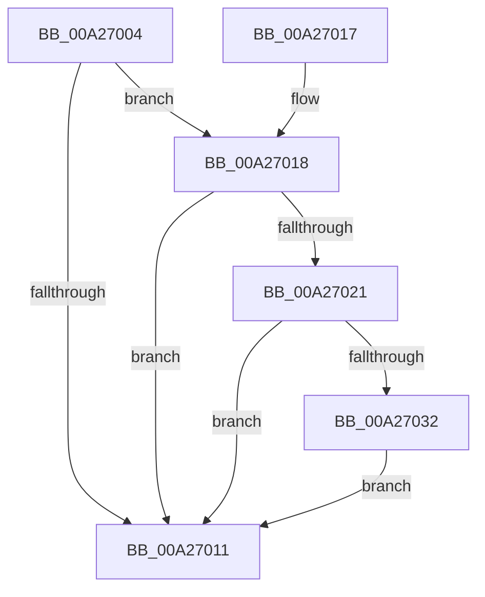

# MiDeleteFileExtents

- RVA: `0x00A27004`–`0x00A2703E` (길이 `58` bytes)
- VA: `0x0000000140A27004`
- 실행 섹션: `PAGE`
- PDB 이름 있음: `예`; PDB Function 태그: `아니요`
- unwind 정보 RVA: `0x000ABEFC`
- 디코드: `21`개 명령, `58/58` bytes 표시
- 미해석 바이트: `0` (있으면 어셈블리에 `.byte`로 보존)

> 이 문서는 커널 이미지의 기계어와 PDB 기호를 분석해 생성했습니다. 4번과 5번은 함수 원형과 자료형을 바이너리 사용 방식에서 추정한 C 해석이며 원본 소스 복구 결과는 아닙니다.

## 1. Dependencies

- 직접 호출 지점: **1**; 고유 호출 대상: **1**
- 직접 호출자로 확인된 함수: **2**
- RIP 상대 이미지 참조: **0**

### Outgoing calls
- `0x00A27032` → [MiDeleteFileExtentList](../80/MiDeleteFileExtentList_function_00800F6C.md) (function, `0x00800F6C`)

### Direct callers
- [MiDeleteControlArea](../../text/36/MiDeleteControlArea_function_003691F4.md) at `0x00369275`
- [MiSetPagesModified](../../text/49/MiSetPagesModified_function_0049DC2C.md) at `0x0049E0B1`

### Static image references
- 디코드된 RIP-relative 메모리 참조가 없습니다.

## 2. Other-region calls and transfers

- 다른 실행 섹션으로 향하는 call: **0**
- 별도 외부 분기/꼬리 이동을 확인하지 못했습니다.

## 3. Assembly (complete function range)

```asm
00A27004  40 53                           push rbx
00A27006  48 83 EC 20                     sub rsp, 0x20
00A2700A  8B 41 38                        mov eax, dword ptr [rcx + 0x38]
00A2700D  A8 20                           test al, 0x20
00A2700F  75 07                           jne 0x140a27018
00A27011  48 83 C4 20                     add rsp, 0x20
00A27015  5B                              pop rbx
00A27016  C3                              ret
00A27017  CC                              int3
00A27018  8A 41 3E                        mov al, byte ptr [rcx + 0x3e]
00A2701B  24 0C                           and al, 0xc
00A2701D  3C 08                           cmp al, 8
00A2701F  75 F0                           jne 0x140a27011
00A27021  48 8B 59 60                     mov rbx, qword ptr [rcx + 0x60]
00A27025  48 83 E3 F8                     and rbx, 0xfffffffffffffff8
00A27029  48 8B 4B 30                     mov rcx, qword ptr [rbx + 0x30]
00A2702D  48 85 C9                        test rcx, rcx
00A27030  74 DF                           je 0x140a27011
00A27032  E8 35 9F DD FF                  call 0x140800f6c
00A27037  48 83 63 30 00                  and qword ptr [rbx + 0x30], 0
00A2703C  EB D3                           jmp 0x140a27011
```

## 4. C-style interpretation (structured pseudocode)

```c
__int64 __fastcall MiDeleteFileExtents(__int64 a1)
{
    __int64 result;
    __int64 v_rbx;
    __int64 v_rsp;

    v_rsp = (v_rsp) - (32);
    if ((((unsigned __int8)((unsigned int)(*(unsigned int *)(a1 + 56)))) & (32)) != 0) goto loc_00A27018;
loc_00A27011:
    v_rsp = (v_rsp) + (32);
    return (unsigned int)(*(unsigned int *)(a1 + 56));
loc_00A27018:
    result = (unsigned __int8)((*(unsigned __int8 *)(a1 + 62)) & (12));
    if (((unsigned __int8)(result)) != 8) goto loc_00A27011;
    v_rbx = (*(unsigned __int64 *)(a1 + 96)) & (-8);
    if (*(unsigned __int64 *)(v_rbx + 48) == 0) goto loc_00A27011;
    result = MiDeleteFileExtentList(*(unsigned __int64 *)(v_rbx + 48), a2, a3, a4);
    goto loc_00A27011;
}
```

## 5. (Beta) C Style

```c
int64_t MiDeleteFileExtents(void *Arg1)
{
    uint8_t *arg1 = (uint8_t *)Arg1;

    int64_t result;
    int64_t local_rbx;
    int64_t local_rsp;

    local_rsp = (local_rsp) - (32);
    if ((((uint8_t)((uint32_t)(*(uint32_t *)(arg1 + 0x38)))) & (32)) != 0) goto loc_00A27018;
loc_00A27011:
    local_rsp = (local_rsp) + (32);
    return (uint32_t)(*(uint32_t *)(arg1 + 0x38));
loc_00A27018:
    result = (uint8_t)((*(uint8_t *)(arg1 + 0x3E)) & (12));
    if (((uint8_t)(result)) != 8) goto loc_00A27011;
    local_rbx = (*(uint64_t *)(arg1 + 0x60)) & (-8);
    if (*(uint64_t *)(local_rbx + 0x30) == 0) goto loc_00A27011;
    result = MiDeleteFileExtentList(*(uint64_t *)(local_rbx + 0x30), a2, a3, a4);
    goto loc_00A27011;
}
```

### 관측된 메모리 오프셋

구조체 형식이 확인되지 않은 접근은 인자 기준의 오프셋으로만 기록했습니다.

| 기준 인자 | 오프셋 표현 | 폭 (bit) | 접근 |
|---|---:|---:|---|
| `Arg1` | `+ 0x38` | `32` | `R` |
| `Arg1` | `+ 0x3E` | `8` | `R` |
| `Arg1` | `+ 0x60` | `64` | `R` |

## 6. Execution-region graph

[열기: 2D/3D 그래프와 함수 탐색 컨트롤 패널](../../../control-panel.html?section=page&rva=0x00A27004&view=graph)

- 2D 그래프는 위에서 아래로 흐르고, 3D 그래프는 빈 공간을 드래그해 회전합니다. Shift+드래그는 이동, 휠은 확대·축소, 함수 노드 선택은 대상 보고서 이동입니다.

### Static fallback


