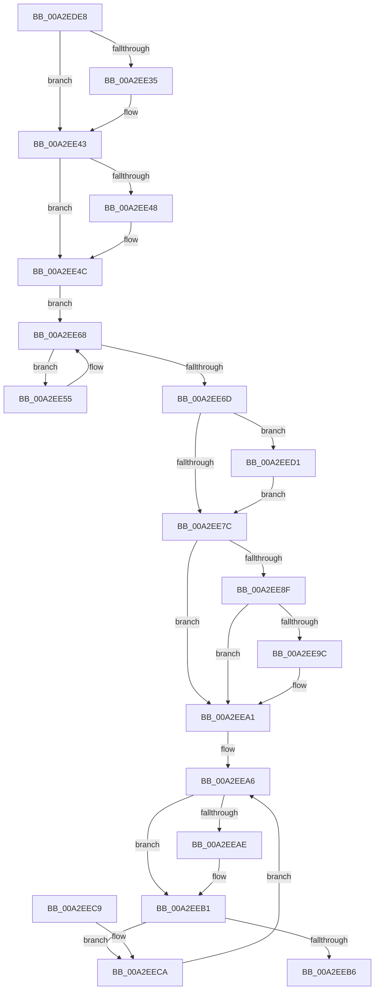

# MiDereferencePerSessionProtos

- RVA: `0x00A2EDE8`–`0x00A2EEDB` (길이 `243` bytes)
- VA: `0x0000000140A2EDE8`
- 실행 섹션: `PAGE`
- PDB 이름 있음: `예`; PDB Function 태그: `아니요`
- unwind 정보 RVA: `0x000ACA30`
- 디코드: `72`개 명령, `243/243` bytes 표시
- 미해석 바이트: `0` (있으면 어셈블리에 `.byte`로 보존)

> 이 문서는 커널 이미지의 기계어와 PDB 기호를 분석해 생성했습니다. 4번과 5번은 함수 원형과 자료형을 바이너리 사용 방식에서 추정한 C 해석이며 원본 소스 복구 결과는 아닙니다.

## 1. Dependencies

- 직접 호출 지점: **7**; 고유 호출 대상: **7**
- 직접 호출자로 확인된 함수: **9**
- RIP 상대 이미지 참조: **0**

### Outgoing calls
- `0x00A2EE25` → [KeAbPreAcquire](../../text/21/KeAbPreAcquire_function_00210230.md) (function, `0x00210230`)
- `0x00A2EE3E` → [ExfAcquirePushLockExclusiveEx](../../text/20/ExfAcquirePushLockExclusiveEx_function_0020FC90.md) (function, `0x0020FC90`)
- `0x00A2EE5F` → [MiDereferenceSubsectionProtos](MiDereferenceSubsectionProtos_function_00A2EEE4.md) (function, `0x00A2EEE4`)
- `0x00A2EE7F` → [KeAbPostRelease](../../text/2E/KeAbPostRelease_function_002E1600.md) (function, `0x002E1600`)
- `0x00A2EE9C` → [KiCheckForKernelApcDelivery](../../text/2E/KiCheckForKernelApcDelivery_function_002E2C80.md) (function, `0x002E2C80`)
- `0x00A2EECA` → [MiDeletePerSessionProtos](../../text/4A/MiDeletePerSessionProtos_function_004A0840.md) (function, `0x004A0840`)
- `0x00A2EED4` → [ExfTryToWakePushLock](../../text/26/ExfTryToWakePushLock_function_00265DD0.md) (function, `0x00265DD0`)

### Direct callers
- [MiRemoveFromSystemSpace](../../text/29/MiRemoveFromSystemSpace_function_002962FC.md) at `0x00296639`
- [MiInsertInSystemSpace](../../text/3B/MiInsertInSystemSpace_function_003B2F5C.md) at `0x003B360B`
- [MiInitializeImageExtents](../80/MiInitializeImageExtents_function_00800FE8.md) at `0x00801082`
- [MiDeletePartialCloneVads](../81/MiDeletePartialCloneVads_function_008116E4.md) at `0x0081180E`
- [MiDeleteVad](../88/MiDeleteVad_function_00888C80.md) at `0x00889202`
- [MiValidateSectionCreate](../94/MiValidateSectionCreate_function_00940190.md) at `0x00940B7E`
- [MiValidateSectionCreate](../94/MiValidateSectionCreate_function_00940190.md) at `0x00940C14`
- [MiMapViewOfImageSection](../97/MiMapViewOfImageSection_function_0097E92C.md) at `0x0097F840`
- [MiSectionDelete](MiSectionDelete_function_00A2ECA0.md) at `0x00A2ED74`
- [sub_00B2AB7A](../B2/Unknown_function_00B2AB7A.md) at `0x00B2AB96`

### Static image references
- 디코드된 RIP-relative 메모리 참조가 없습니다.

## 2. Other-region calls and transfers

- 다른 실행 섹션으로 향하는 call: **6**
  - `0x00A2EE25` → [KeAbPreAcquire](../../text/21/KeAbPreAcquire_function_00210230.md) (`PAGE` → `.text`)
  - `0x00A2EE3E` → [ExfAcquirePushLockExclusiveEx](../../text/20/ExfAcquirePushLockExclusiveEx_function_0020FC90.md) (`PAGE` → `.text`)
  - `0x00A2EE7F` → [KeAbPostRelease](../../text/2E/KeAbPostRelease_function_002E1600.md) (`PAGE` → `.text`)
  - `0x00A2EE9C` → [KiCheckForKernelApcDelivery](../../text/2E/KiCheckForKernelApcDelivery_function_002E2C80.md) (`PAGE` → `.text`)
  - `0x00A2EECA` → [MiDeletePerSessionProtos](../../text/4A/MiDeletePerSessionProtos_function_004A0840.md) (`PAGE` → `.text`)
  - `0x00A2EED4` → [ExfTryToWakePushLock](../../text/26/ExfTryToWakePushLock_function_00265DD0.md) (`PAGE` → `.text`)
- 별도 외부 분기/꼬리 이동을 확인하지 못했습니다.

## 3. Assembly (complete function range)

```asm
00A2EDE8  48 89 5C 24 10                  mov qword ptr [rsp + 0x10], rbx
00A2EDED  48 89 6C 24 18                  mov qword ptr [rsp + 0x18], rbp
00A2EDF2  56                              push rsi
00A2EDF3  57                              push rdi
00A2EDF4  41 56                           push r14
00A2EDF6  48 83 EC 20                     sub rsp, 0x20
00A2EDFA  65 48 8B 34 25 88 01 00 00      mov rsi, qword ptr gs:[0x188]
00A2EE03  8B EA                           mov ebp, edx
00A2EE05  48 8B 19                        mov rbx, qword ptr [rcx]
00A2EE08  4C 8B F1                        mov r14, rcx
00A2EE0B  48 83 64 24 40 00               and qword ptr [rsp + 0x40], 0
00A2EE11  48 83 C3 28                     add rbx, 0x28
00A2EE15  48 8B CB                        mov rcx, rbx
00A2EE18  45 33 C0                        xor r8d, r8d
00A2EE1B  66 FF 8E E6 01 00 00            dec word ptr [rsi + 0x1e6]
00A2EE22  33 D2                           xor edx, edx
00A2EE24  90                              nop
00A2EE25  E8 06 14 7E FF                  call 0x140210230
00A2EE2A  F0 48 0F BA 2B 00               lock bts qword ptr [rbx], 0
00A2EE30  48 8B F8                        mov rdi, rax
00A2EE33  73 0E                           jae 0x140a2ee43
00A2EE35  4C 8B C3                        mov r8, rbx
00A2EE38  48 8B D0                        mov rdx, rax
00A2EE3B  48 8B CB                        mov rcx, rbx
00A2EE3E  E8 4D 0E 7E FF                  call 0x14020fc90
00A2EE43  48 85 FF                        test rdi, rdi
00A2EE46  74 04                           je 0x140a2ee4c
00A2EE48  C6 47 0A 01                     mov byte ptr [rdi + 0xa], 1
00A2EE4C  49 8D BE 80 00 00 00            lea rdi, [r14 + 0x80]
00A2EE53  EB 13                           jmp 0x140a2ee68
00A2EE55  4C 8D 44 24 40                  lea r8, [rsp + 0x40]
00A2EE5A  8B D5                           mov edx, ebp
00A2EE5C  48 8B CF                        mov rcx, rdi
00A2EE5F  E8 80 00 00 00                  call 0x140a2eee4
00A2EE64  48 8B 7F 10                     mov rdi, qword ptr [rdi + 0x10]
00A2EE68  48 85 FF                        test rdi, rdi
00A2EE6B  75 E8                           jne 0x140a2ee55
00A2EE6D  48 83 C8 FF                     or rax, 0xffffffffffffffff
00A2EE71  F0 48 0F C1 03                  lock xadd qword ptr [rbx], rax
00A2EE76  24 06                           and al, 6
00A2EE78  3C 02                           cmp al, 2
00A2EE7A  74 55                           je 0x140a2eed1
00A2EE7C  48 8B CB                        mov rcx, rbx
00A2EE7F  E8 7C 27 8B FF                  call 0x1402e1600
00A2EE84  90                              nop
00A2EE85  66 83 86 E6 01 00 00 01         add word ptr [rsi + 0x1e6], 1
00A2EE8D  75 12                           jne 0x140a2eea1
00A2EE8F  48 8D 86 98 00 00 00            lea rax, [rsi + 0x98]
00A2EE96  90                              nop
00A2EE97  48 39 00                        cmp qword ptr [rax], rax
00A2EE9A  74 05                           je 0x140a2eea1
00A2EE9C  E8 DF 3D 8B FF                  call 0x1402e2c80
00A2EEA1  48 8B 5C 24 40                  mov rbx, qword ptr [rsp + 0x40]
00A2EEA6  48 8B CB                        mov rcx, rbx
00A2EEA9  48 85 DB                        test rbx, rbx
00A2EEAC  74 03                           je 0x140a2eeb1
00A2EEAE  48 8B 1B                        mov rbx, qword ptr [rbx]
00A2EEB1  48 85 C9                        test rcx, rcx
00A2EEB4  75 14                           jne 0x140a2eeca
00A2EEB6  48 8B 5C 24 48                  mov rbx, qword ptr [rsp + 0x48]
00A2EEBB  48 8B 6C 24 50                  mov rbp, qword ptr [rsp + 0x50]
00A2EEC0  48 83 C4 20                     add rsp, 0x20
00A2EEC4  41 5E                           pop r14
00A2EEC6  5F                              pop rdi
00A2EEC7  5E                              pop rsi
00A2EEC8  C3                              ret
00A2EEC9  CC                              int3
00A2EECA  E8 71 19 A7 FF                  call 0x1404a0840
00A2EECF  EB D5                           jmp 0x140a2eea6
00A2EED1  48 8B CB                        mov rcx, rbx
00A2EED4  E8 F7 6E 83 FF                  call 0x140265dd0
00A2EED9  EB A1                           jmp 0x140a2ee7c
```

## 4. C-style interpretation (structured pseudocode)

```c
__int64 __fastcall MiDereferencePerSessionProtos(__int64 a1, int a2, int a3)
{
    __int64 result;
    __int64 v_rbx;
    __int64 v_rsp;
    unsigned __int64 v_stack_p10;
    unsigned __int64 v_stack_p18;
    unsigned __int64 v_stack_p8;

    v_stack_p10 = v_rbx;
    v_stack_p18 = v_rbp;
    v_rsp = (v_rsp) - (32);
    v_rbx = (*(unsigned __int64 *)(a1)) + (40);
    a3 = 0;
    a2 = 0;
    result = KeAbPreAcquire(v_rbx, a2, a3, a4);
    if (!(condition_is_above_or_equal)) {
        a3 = v_rbx;
        a2 = result;
        a1 = v_rbx;
        result = ExfAcquirePushLockExclusiveEx(a1, a2, a3, a4);
    }
    if (result != 0) {
        *(unsigned __int8 *)(result + 10) = 1;
    }
    goto loc_00A2EE68;
loc_00A2EE55:
    result = MiDereferenceSubsectionProtos(a1 + 128, (unsigned int)((unsigned int)((unsigned int)(a2))), v_stack_p8, a4);
loc_00A2EE68:
    if (*(unsigned __int64 *)(a1 + 128 + 16) != 0) goto loc_00A2EE55;
    result = (result) | (-1);
    result = (unsigned __int8)((result) & (6));
    if (((unsigned __int8)(result)) == 2) goto loc_00A2EED1;
loc_00A2EE7C:
    result = KeAbPostRelease(v_rbx, (unsigned int)((unsigned int)((unsigned int)(a2))), v_stack_p8, a4);
    if (((unsigned __int8)(result)) != 2) goto loc_00A2EEA1;
    result = *(unsigned __int64 *)(gs_base + (0 + 392)) + 152;
    if ((*(unsigned __int64 *)(*(unsigned __int64 *)(gs_base + (0 + 392)) + 152)) != (*(unsigned __int64 *)(gs_base + (0 + 392)) + 152)) {
        result = KiCheckForKernelApcDelivery(v_rbx, (unsigned int)((unsigned int)((unsigned int)(a2))), v_stack_p8, a4);
    }
loc_00A2EEA6:
    v_rbx = v_stack_p8;
    if (v_stack_p8 != 0) {
        v_rbx = *(unsigned __int64 *)(v_stack_p8);
    }
    if (v_stack_p8 != 0) goto loc_00A2EECA;
    v_rsp = (v_rsp) + (32);
    return result;
loc_00A2EECA:
    result = MiDeletePerSessionProtos(v_stack_p8, (unsigned int)((unsigned int)((unsigned int)(a2))), v_stack_p8, a4);
    goto loc_00A2EEA6;
loc_00A2EED1:
    result = ExfTryToWakePushLock(v_stack_p10, (unsigned int)((unsigned int)((unsigned int)(a2))), v_stack_p8, a4);
    goto loc_00A2EE7C;
}
```

## 5. (Beta) C Style

```c
int64_t MiDereferencePerSessionProtos(void *Arg1, int32_t Arg2, int32_t Arg3)
{
    uint8_t *arg1 = (uint8_t *)Arg1;

    int64_t result;
    int64_t local_rbx;
    int64_t local_rsp;
    uint64_t v_stack_p10;
    uint64_t v_stack_p18;
    uint64_t v_stack_p8;

    v_stack_p10 = local_rbx;
    v_stack_p18 = local_rbp;
    local_rsp = (local_rsp) - (32);
    local_rbx = (*(uint64_t *)(arg1)) + (40);
    Arg3 = 0;
    Arg2 = 0;
    result = KeAbPreAcquire(local_rbx, Arg2, Arg3, a4);
    if (!(condition_is_above_or_equal)) {
        Arg3 = local_rbx;
        Arg2 = result;
        Arg1 = local_rbx;
        result = ExfAcquirePushLockExclusiveEx(Arg1, Arg2, Arg3, a4);
    }
    if (result != 0) {
        *(uint8_t *)(result + 0xA) = 1;
    }
    goto loc_00A2EE68;
loc_00A2EE55:
    result = MiDereferenceSubsectionProtos(Arg1 + 128, (uint32_t)((uint32_t)((uint32_t)(Arg2))), v_stack_p8, a4);
loc_00A2EE68:
    if (*(uint64_t *)(arg1 + 0x80 + 0x10) != 0) goto loc_00A2EE55;
    result = (result) | (-1);
    result = (uint8_t)((result) & (6));
    if (((uint8_t)(result)) == 2) goto loc_00A2EED1;
loc_00A2EE7C:
    result = KeAbPostRelease(local_rbx, (uint32_t)((uint32_t)((uint32_t)(Arg2))), v_stack_p8, a4);
    if (((uint8_t)(result)) != 2) goto loc_00A2EEA1;
    result = *(uint64_t *)(gs_base + (0 + 0x188)) + 152;
    if ((*(uint64_t *)(*(uint64_t *)(gs_base + (0 + 0x188)) + 0x98)) != (*(uint64_t *)(gs_base + (0 + 0x188)) + 152)) {
        result = KiCheckForKernelApcDelivery(local_rbx, (uint32_t)((uint32_t)((uint32_t)(Arg2))), v_stack_p8, a4);
    }
loc_00A2EEA6:
    local_rbx = v_stack_p8;
    if (v_stack_p8 != 0) {
        local_rbx = *(uint64_t *)(v_stack_p8);
    }
    if (v_stack_p8 != 0) goto loc_00A2EECA;
    local_rsp = (local_rsp) + (32);
    return result;
loc_00A2EECA:
    result = MiDeletePerSessionProtos(v_stack_p8, (uint32_t)((uint32_t)((uint32_t)(Arg2))), v_stack_p8, a4);
    goto loc_00A2EEA6;
loc_00A2EED1:
    result = ExfTryToWakePushLock(v_stack_p10, (uint32_t)((uint32_t)((uint32_t)(Arg2))), v_stack_p8, a4);
    goto loc_00A2EE7C;
}
```

### 관측된 메모리 오프셋

구조체 형식이 확인되지 않은 접근은 인자 기준의 오프셋으로만 기록했습니다.

| 기준 인자 | 오프셋 표현 | 폭 (bit) | 접근 |
|---|---:|---:|---|
| `Arg1` | `+ 0x0` | `64` | `R` |
| `Arg1` | `+ 0x80` | `64` | `R` |

## 6. Execution-region graph

[열기: 2D/3D 그래프와 함수 탐색 컨트롤 패널](../../../control-panel.html?section=page&rva=0x00A2EDE8&view=graph)

- 2D 그래프는 위에서 아래로 흐르고, 3D 그래프는 빈 공간을 드래그해 회전합니다. Shift+드래그는 이동, 휠은 확대·축소, 함수 노드 선택은 대상 보고서 이동입니다.

### Static fallback


