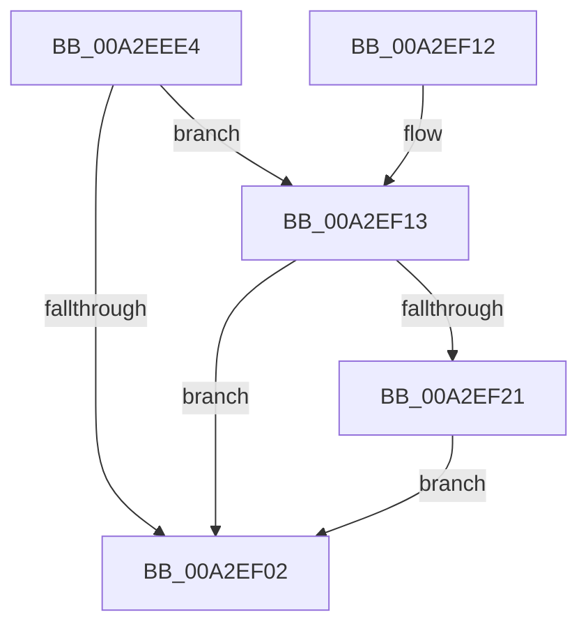

# MiDereferenceSubsectionProtos

- RVA: `0x00A2EEE4`–`0x00A2EF47` (길이 `99` bytes)
- VA: `0x0000000140A2EEE4`
- 실행 섹션: `PAGE`
- PDB 이름 있음: `예`; PDB Function 태그: `아니요`
- unwind 정보 RVA: `0x00081628`
- 디코드: `31`개 명령, `99/99` bytes 표시
- 미해석 바이트: `0` (있으면 어셈블리에 `.byte`로 보존)

> 이 문서는 커널 이미지의 기계어와 PDB 기호를 분석해 생성했습니다. 4번과 5번은 함수 원형과 자료형을 바이너리 사용 방식에서 추정한 C 해석이며 원본 소스 복구 결과는 아닙니다.

## 1. Dependencies

- 직접 호출 지점: **2**; 고유 호출 대상: **2**
- 직접 호출자로 확인된 함수: **3**
- RIP 상대 이미지 참조: **0**

### Outgoing calls
- `0x00A2EF13` → [MiLocateSessionProtosInSubsection](../../text/24/MiLocateSessionProtosInSubsection_function_0024A5D0.md) (function, `0x0024A5D0`)
- `0x00A2EF2D` → [MiUpdatePerSessionProto](../../text/4A/MiUpdatePerSessionProto_function_004AD938.md) (function, `0x004AD938`)

### Direct callers
- [sub_006E3418](../../text/6E/Unknown_function_006E3418.md) at `0x006E34EE`
- [MiDereferencePerSessionProtos](MiDereferencePerSessionProtos_function_00A2EDE8.md) at `0x00A2EE5F`
- [sub_00B3E706](../B3/Unknown_function_00B3E706.md) at `0x00B3E711`

### Static image references
- 디코드된 RIP-relative 메모리 참조가 없습니다.

## 2. Other-region calls and transfers

- 다른 실행 섹션으로 향하는 call: **2**
  - `0x00A2EF13` → [MiLocateSessionProtosInSubsection](../../text/24/MiLocateSessionProtosInSubsection_function_0024A5D0.md) (`PAGE` → `.text`)
  - `0x00A2EF2D` → [MiUpdatePerSessionProto](../../text/4A/MiUpdatePerSessionProto_function_004AD938.md) (`PAGE` → `.text`)
- 별도 외부 분기/꼬리 이동을 확인하지 못했습니다.

## 3. Assembly (complete function range)

```asm
00A2EEE4  48 89 5C 24 08                  mov qword ptr [rsp + 8], rbx
00A2EEE9  48 89 74 24 10                  mov qword ptr [rsp + 0x10], rsi
00A2EEEE  57                              push rdi
00A2EEEF  48 83 EC 20                     sub rsp, 0x20
00A2EEF3  8B 41 20                        mov eax, dword ptr [rcx + 0x20]
00A2EEF6  49 8B F0                        mov rsi, r8
00A2EEF9  48 8B F9                        mov rdi, rcx
00A2EEFC  0F BA E0 11                     bt eax, 0x11
00A2EF00  72 11                           jb 0x140a2ef13
00A2EF02  48 8B 5C 24 30                  mov rbx, qword ptr [rsp + 0x30]
00A2EF07  48 8B 74 24 38                  mov rsi, qword ptr [rsp + 0x38]
00A2EF0C  48 83 C4 20                     add rsp, 0x20
00A2EF10  5F                              pop rdi
00A2EF11  C3                              ret
00A2EF12  CC                              int3
00A2EF13  E8 B8 B6 81 FF                  call 0x14024a5d0
00A2EF18  48 8B D8                        mov rbx, rax
00A2EF1B  83 68 50 01                     sub dword ptr [rax + 0x50], 1
00A2EF1F  75 E1                           jne 0x140a2ef02
00A2EF21  48 8B 09                        mov rcx, qword ptr [rcx]
00A2EF24  45 33 C9                        xor r9d, r9d
00A2EF27  4C 8B C0                        mov r8, rax
00A2EF2A  48 8B D7                        mov rdx, rdi
00A2EF2D  E8 06 EA A7 FF                  call 0x1404ad938
00A2EF32  8B 4F 2C                        mov ecx, dword ptr [rdi + 0x2c]
00A2EF35  48 8B 06                        mov rax, qword ptr [rsi]
00A2EF38  89 4B 50                        mov dword ptr [rbx + 0x50], ecx
00A2EF3B  48 89 7B 40                     mov qword ptr [rbx + 0x40], rdi
00A2EF3F  48 89 03                        mov qword ptr [rbx], rax
00A2EF42  48 89 1E                        mov qword ptr [rsi], rbx
00A2EF45  EB BB                           jmp 0x140a2ef02
```

## 4. C-style interpretation (structured pseudocode)

```c
__int64 __fastcall MiDereferenceSubsectionProtos(__int64 a1, __int64 a2, __int64 a3, int a4)
{
    __int64 result;
    __int64 v_rsp;
    unsigned __int64 v_stack_p10;
    unsigned __int64 v_stack_p8;

    v_stack_p8 = v_rbx;
    v_stack_p10 = v_rsi;
    v_rsp = (v_rsp) - (32);
    if (condition_is_below) goto loc_00A2EF13;
loc_00A2EF02:
    v_rsp = (v_rsp) + (32);
    return (unsigned int)(*(unsigned int *)(a1 + 32));
loc_00A2EF13:
    result = MiLocateSessionProtosInSubsection(a1, a2, a3, a4);
    if (condition_is_not_equal) goto loc_00A2EF02;
    a4 = 0;
    result = MiUpdatePerSessionProto(*(unsigned __int64 *)(a1), a1, result, a4);
    *(unsigned int *)(result + 80) = (unsigned int)((unsigned int)(*(unsigned int *)(a1 + 44)));
    *(unsigned __int64 *)(result + 64) = a1;
    *(unsigned __int64 *)(result) = *(unsigned __int64 *)(v_stack_p10);
    *(unsigned __int64 *)(v_stack_p10) = result;
    goto loc_00A2EF02;
}
```

## 5. (Beta) C Style

```c
int64_t MiDereferenceSubsectionProtos(void *Arg1, int64_t Arg2, void *Arg3, int32_t Arg4)
{
    uint8_t *arg1 = (uint8_t *)Arg1;
    uint8_t *arg3 = (uint8_t *)Arg3;

    int64_t result;
    int64_t local_rsp;
    uint64_t v_stack_p10;
    uint64_t v_stack_p8;

    v_stack_p8 = local_rbx;
    v_stack_p10 = local_rsi;
    local_rsp = (local_rsp) - (32);
    if (condition_is_below) goto loc_00A2EF13;
loc_00A2EF02:
    local_rsp = (local_rsp) + (32);
    return (uint32_t)(*(uint32_t *)(arg1 + 0x20));
loc_00A2EF13:
    result = MiLocateSessionProtosInSubsection(Arg1, Arg2, Arg3, Arg4);
    if (condition_is_not_equal) goto loc_00A2EF02;
    Arg4 = 0;
    result = MiUpdatePerSessionProto(*(uint64_t *)(arg1), Arg1, result, Arg4);
    *(uint32_t *)(result + 0x50) = (uint32_t)((uint32_t)(*(uint32_t *)(arg1 + 0x2C)));
    *(void **)(result + 0x40) = Arg1;
    *(uint64_t *)(result) = *(uint64_t *)(v_stack_p10);
    *(uint64_t *)(v_stack_p10) = result;
    goto loc_00A2EF02;
}
```

### 관측된 메모리 오프셋

구조체 형식이 확인되지 않은 접근은 인자 기준의 오프셋으로만 기록했습니다.

| 기준 인자 | 오프셋 표현 | 폭 (bit) | 접근 |
|---|---:|---:|---|
| `Arg1` | `+ 0x20` | `32` | `R` |
| `Arg1` | `+ 0x2C` | `32` | `R` |
| `Arg3` | `+ 0x0` | `64` | `R` |
| `Arg3` | `+ 0x0` | `64` | `W` |

## 6. Execution-region graph

[열기: 2D/3D 그래프와 함수 탐색 컨트롤 패널](../../../control-panel.html?section=page&rva=0x00A2EEE4&view=graph)

- 2D 그래프는 위에서 아래로 흐르고, 3D 그래프는 빈 공간을 드래그해 회전합니다. Shift+드래그는 이동, 휠은 확대·축소, 함수 노드 선택은 대상 보고서 이동입니다.

### Static fallback


