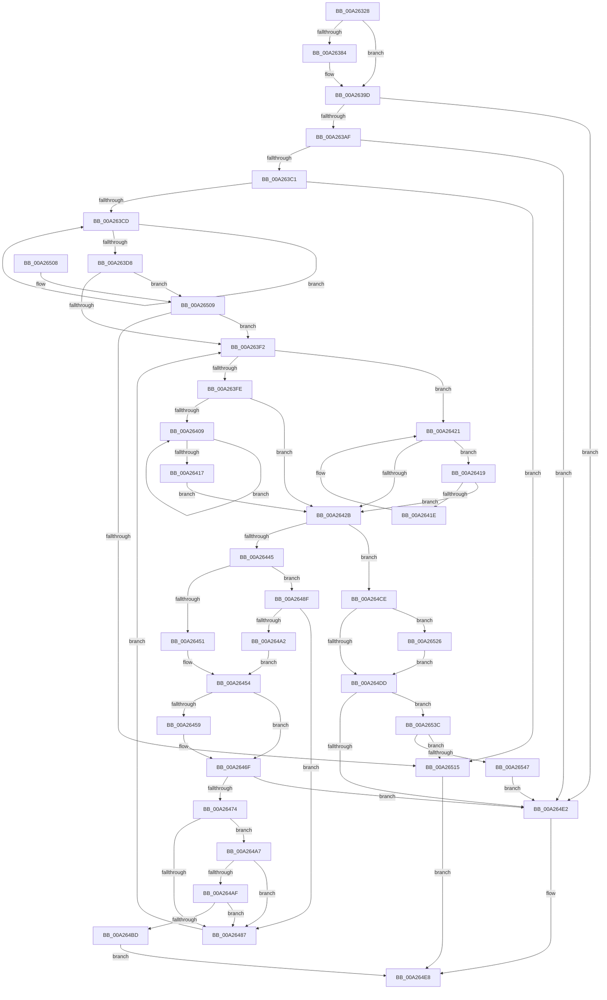

# MiFindEmptyAddressRangeInTree

- RVA: `0x00A26328`–`0x00A26549` (길이 `545` bytes)
- VA: `0x0000000140A26328`
- 실행 섹션: `PAGE`
- PDB 이름 있음: `예`; PDB Function 태그: `아니요`
- unwind 정보 RVA: `0x000ABDFC`
- 디코드: `165`개 명령, `545/545` bytes 표시
- 미해석 바이트: `0` (있으면 어셈블리에 `.byte`로 보존)

> 이 문서는 커널 이미지의 기계어와 PDB 기호를 분석해 생성했습니다. 4번과 5번은 함수 원형과 자료형을 바이너리 사용 방식에서 추정한 C 해석이며 원본 소스 복구 결과는 아닙니다.

## 1. Dependencies

- 직접 호출 지점: **3**; 고유 호출 대상: **1**
- 직접 호출자로 확인된 함수: **1**
- RIP 상대 이미지 참조: **0**

### Outgoing calls
- `0x00A26390` → [MiHonorRangeStraddleRequirement](../../text/46/MiHonorRangeStraddleRequirement_function_00462818.md) (function, `0x00462818`)
- `0x00A26462` → [MiHonorRangeStraddleRequirement](../../text/46/MiHonorRangeStraddleRequirement_function_00462818.md) (function, `0x00462818`)
- `0x00A26532` → [MiHonorRangeStraddleRequirement](../../text/46/MiHonorRangeStraddleRequirement_function_00462818.md) (function, `0x00462818`)

### Direct callers
- [MiFindEmptyAddressRange](../88/MiFindEmptyAddressRange_function_00886050.md) at `0x008863C7`
- [MiFindEmptyAddressRange](../88/MiFindEmptyAddressRange_function_00886050.md) at `0x00886420`

### Static image references
- 디코드된 RIP-relative 메모리 참조가 없습니다.

## 2. Other-region calls and transfers

- 다른 실행 섹션으로 향하는 call: **3**
  - `0x00A26390` → [MiHonorRangeStraddleRequirement](../../text/46/MiHonorRangeStraddleRequirement_function_00462818.md) (`PAGE` → `.text`)
  - `0x00A26462` → [MiHonorRangeStraddleRequirement](../../text/46/MiHonorRangeStraddleRequirement_function_00462818.md) (`PAGE` → `.text`)
  - `0x00A26532` → [MiHonorRangeStraddleRequirement](../../text/46/MiHonorRangeStraddleRequirement_function_00462818.md) (`PAGE` → `.text`)
- 별도 외부 분기/꼬리 이동을 확인하지 못했습니다.

## 3. Assembly (complete function range)

```asm
00A26328  48 89 5C 24 08                  mov qword ptr [rsp + 8], rbx
00A2632D  48 89 6C 24 10                  mov qword ptr [rsp + 0x10], rbp
00A26332  48 89 74 24 20                  mov qword ptr [rsp + 0x20], rsi
00A26337  57                              push rdi
00A26338  41 54                           push r12
00A2633A  41 55                           push r13
00A2633C  41 56                           push r14
00A2633E  41 57                           push r15
00A26340  48 83 EC 20                     sub rsp, 0x20
00A26344  48 8B 44 24 70                  mov rax, qword ptr [rsp + 0x70]
00A26349  48 8D AA FF 0F 00 00            lea rbp, [rdx + 0xfff]
00A26350  49 C1 E8 0C                     shr r8, 0xc
00A26354  4D 8B E1                        mov r12, r9
00A26357  48 C1 E8 0C                     shr rax, 0xc
00A2635B  45 33 DB                        xor r11d, r11d
00A2635E  49 C1 EC 0C                     shr r12, 0xc
00A26362  48 8B F9                        mov rdi, rcx
00A26365  48 C1 ED 0C                     shr rbp, 0xc
00A26369  4D 8D 68 FF                     lea r13, [r8 - 1]
00A2636D  4C 89 44 24 60                  mov qword ptr [rsp + 0x60], r8
00A26372  49 8D 58 FF                     lea rbx, [r8 - 1]
00A26376  49 F7 D5                        not r13
00A26379  48 03 D8                        add rbx, rax
00A2637C  49 23 DD                        and rbx, r13
00A2637F  4D 85 E4                        test r12, r12
00A26382  74 19                           je 0x140a2639d
00A26384  45 33 C9                        xor r9d, r9d
00A26387  4D 8B C4                        mov r8, r12
00A2638A  48 8B D5                        mov rdx, rbp
00A2638D  48 8B CB                        mov rcx, rbx
00A26390  E8 83 C4 A3 FF                  call 0x140462818
00A26395  4C 8B 44 24 60                  mov r8, qword ptr [rsp + 0x60]
00A2639A  48 8B D8                        mov rbx, rax
00A2639D  48 8B 74 24 78                  mov rsi, qword ptr [rsp + 0x78]
00A263A2  48 C1 EE 0C                     shr rsi, 0xc
00A263A6  48 3B DE                        cmp rbx, rsi
00A263A9  0F 87 33 01 00 00               ja 0x140a264e2
00A263AF  48 8B C6                        mov rax, rsi
00A263B2  48 2B C3                        sub rax, rbx
00A263B5  48 FF C0                        inc rax
00A263B8  48 3B E8                        cmp rbp, rax
00A263BB  0F 87 21 01 00 00               ja 0x140a264e2
00A263C1  48 8B 07                        mov rax, qword ptr [rdi]
00A263C4  48 85 C0                        test rax, rax
00A263C7  0F 84 48 01 00 00               je 0x140a26515
00A263CD  48 8B F8                        mov rdi, rax
00A263D0  48 8B 00                        mov rax, qword ptr [rax]
00A263D3  48 85 C0                        test rax, rax
00A263D6  75 F5                           jne 0x140a263cd
00A263D8  0F B6 4F 20                     movzx ecx, byte ptr [rdi + 0x20]
00A263DC  48 8B D7                        mov rdx, rdi
00A263DF  8B 47 18                        mov eax, dword ptr [rdi + 0x18]
00A263E2  48 C1 E1 20                     shl rcx, 0x20
00A263E6  48 0B C8                        or rcx, rax
00A263E9  48 3B CB                        cmp rcx, rbx
00A263EC  0F 87 17 01 00 00               ja 0x140a26509
00A263F2  48 8B 47 08                     mov rax, qword ptr [rdi + 8]
00A263F6  48 8B CF                        mov rcx, rdi
00A263F9  48 85 C0                        test rax, rax
00A263FC  74 23                           je 0x140a26421
00A263FE  48 8B 08                        mov rcx, qword ptr [rax]
00A26401  48 8B F8                        mov rdi, rax
00A26404  48 85 C9                        test rcx, rcx
00A26407  74 22                           je 0x140a2642b
00A26409  48 8B 01                        mov rax, qword ptr [rcx]
00A2640C  48 8B F9                        mov rdi, rcx
00A2640F  48 8B C8                        mov rcx, rax
00A26412  48 85 C0                        test rax, rax
00A26415  75 F2                           jne 0x140a26409
00A26417  EB 12                           jmp 0x140a2642b
00A26419  48 39 0F                        cmp qword ptr [rdi], rcx
00A2641C  74 0D                           je 0x140a2642b
00A2641E  48 8B CF                        mov rcx, rdi
00A26421  48 8B 7F 10                     mov rdi, qword ptr [rdi + 0x10]
00A26425  48 83 E7 FC                     and rdi, 0xfffffffffffffffc
00A26429  75 EE                           jne 0x140a26419
00A2642B  0F B6 4A 21                     movzx ecx, byte ptr [rdx + 0x21]
00A2642F  8B 42 1C                        mov eax, dword ptr [rdx + 0x1c]
00A26432  48 C1 E1 20                     shl rcx, 0x20
00A26436  48 0B C8                        or rcx, rax
00A26439  49 03 C8                        add rcx, r8
00A2643C  48 85 FF                        test rdi, rdi
00A2643F  0F 84 89 00 00 00               je 0x140a264ce
00A26445  48 8D 41 FF                     lea rax, [rcx - 1]
00A26449  49 23 C5                        and rax, r13
00A2644C  48 3B C3                        cmp rax, rbx
00A2644F  72 3E                           jb 0x140a2648f
00A26451  49 23 CD                        and rcx, r13
00A26454  4D 85 E4                        test r12, r12
00A26457  74 16                           je 0x140a2646f
00A26459  45 33 C9                        xor r9d, r9d
00A2645C  4D 8B C4                        mov r8, r12
00A2645F  48 8B D5                        mov rdx, rbp
00A26462  E8 B1 C3 A3 FF                  call 0x140462818
00A26467  4C 8B 44 24 60                  mov r8, qword ptr [rsp + 0x60]
00A2646C  48 8B C8                        mov rcx, rax
00A2646F  48 3B CE                        cmp rcx, rsi
00A26472  77 6E                           ja 0x140a264e2
00A26474  0F B6 57 20                     movzx edx, byte ptr [rdi + 0x20]
00A26478  8B 47 18                        mov eax, dword ptr [rdi + 0x18]
00A2647B  48 C1 E2 20                     shl rdx, 0x20
00A2647F  48 0B D0                        or rdx, rax
00A26482  48 3B D1                        cmp rdx, rcx
00A26485  77 20                           ja 0x140a264a7
00A26487  48 8B D7                        mov rdx, rdi
00A2648A  E9 63 FF FF FF                  jmp 0x140a263f2
00A2648F  0F B6 4F 20                     movzx ecx, byte ptr [rdi + 0x20]
00A26493  8B 47 18                        mov eax, dword ptr [rdi + 0x18]
00A26496  48 C1 E1 20                     shl rcx, 0x20
00A2649A  48 0B C8                        or rcx, rax
00A2649D  48 3B CB                        cmp rcx, rbx
00A264A0  76 E5                           jbe 0x140a26487
00A264A2  48 8B CB                        mov rcx, rbx
00A264A5  EB AD                           jmp 0x140a26454
00A264A7  48 2B D1                        sub rdx, rcx
00A264AA  48 3B EA                        cmp rbp, rdx
00A264AD  77 D8                           ja 0x140a26487
00A264AF  48 8B C6                        mov rax, rsi
00A264B2  48 2B C1                        sub rax, rcx
00A264B5  48 FF C0                        inc rax
00A264B8  48 3B E8                        cmp rbp, rax
00A264BB  77 CA                           ja 0x140a26487
00A264BD  48 8B 84 24 80 00 00 00         mov rax, qword ptr [rsp + 0x80]
00A264C5  48 C1 E1 0C                     shl rcx, 0xc
00A264C9  48 89 08                        mov qword ptr [rax], rcx
00A264CC  EB 1A                           jmp 0x140a264e8
00A264CE  49 23 CD                        and rcx, r13
00A264D1  48 3B CB                        cmp rcx, rbx
00A264D4  48 0F 43 D9                     cmovae rbx, rcx
00A264D8  4D 85 E4                        test r12, r12
00A264DB  75 49                           jne 0x140a26526
00A264DD  48 3B F3                        cmp rsi, rbx
00A264E0  73 5A                           jae 0x140a2653c
00A264E2  41 BB 17 00 00 C0               mov r11d, 0xc0000017
00A264E8  48 8B 5C 24 50                  mov rbx, qword ptr [rsp + 0x50]
00A264ED  41 8B C3                        mov eax, r11d
00A264F0  48 8B 6C 24 58                  mov rbp, qword ptr [rsp + 0x58]
00A264F5  48 8B 74 24 68                  mov rsi, qword ptr [rsp + 0x68]
00A264FA  48 83 C4 20                     add rsp, 0x20
00A264FE  41 5F                           pop r15
00A26500  41 5E                           pop r14
00A26502  41 5D                           pop r13
00A26504  41 5C                           pop r12
00A26506  5F                              pop rdi
00A26507  C3                              ret
00A26508  CC                              int3
00A26509  48 2B CB                        sub rcx, rbx
00A2650C  48 3B E9                        cmp rbp, rcx
00A2650F  0F 87 DD FE FF FF               ja 0x140a263f2
00A26515  48 8B 84 24 80 00 00 00         mov rax, qword ptr [rsp + 0x80]
00A2651D  48 C1 E3 0C                     shl rbx, 0xc
00A26521  48 89 18                        mov qword ptr [rax], rbx
00A26524  EB C2                           jmp 0x140a264e8
00A26526  45 33 C9                        xor r9d, r9d
00A26529  4D 8B C4                        mov r8, r12
00A2652C  48 8B D5                        mov rdx, rbp
00A2652F  48 8B CB                        mov rcx, rbx
00A26532  E8 E1 C2 A3 FF                  call 0x140462818
00A26537  48 8B D8                        mov rbx, rax
00A2653A  EB A1                           jmp 0x140a264dd
00A2653C  48 2B F3                        sub rsi, rbx
00A2653F  48 FF C6                        inc rsi
00A26542  48 3B EE                        cmp rbp, rsi
00A26545  76 CE                           jbe 0x140a26515
00A26547  EB 99                           jmp 0x140a264e2
```

## 4. C-style interpretation (structured pseudocode)

```c
__int64 __fastcall MiFindEmptyAddressRangeInTree(__int64 a1, __int64 a2, __int64 a3, __int64 a4, __int64 a5, __int64 a6, __int64 a7)
{
    __int64 result;
    __int64 v_r11;
    __int64 v_r12;
    __int64 v_r13;
    __int64 v_rbp;
    __int64 v_rbx;
    __int64 v_rdi;
    __int64 v_rsi;
    __int64 v_rsp;
    unsigned __int64 v_stack_p10;
    unsigned __int64 v_stack_p18;
    unsigned __int64 v_stack_p20;
    unsigned __int64 v_stack_p8;

    v_stack_p8 = v_rbx;
    v_stack_p10 = v_rbp;
    v_stack_p20 = v_rsi;
    v_rsp = (v_rsp) - (32);
    a3 = (a3) >> (12);
    result = (a5) >> (12);
    v_r11 = 0;
    v_r12 = (a4) >> (12);
    v_rbp = (a2 + 4095) >> (12);
    v_stack_p18 = a3;
    v_r13 = ~(a3 - 1);
    v_rbx = (a3 - 1) + (result);
    v_rbx = (v_rbx) & (v_r13);
    if (v_r12 != 0) {
        a4 = 0;
        a3 = v_r12;
        a2 = v_rbp;
        a1 = v_rbx;
        result = MiHonorRangeStraddleRequirement(a1, a2, a3, a4);
        a3 = v_stack_p18;
        v_rbx = result;
    }
    v_rsi = (a6) >> (12);
    if (v_rbx > v_rsi) goto loc_00A264E2;
    result = (v_rsi) - (v_rbx);
    result = (result) + 1;
    if (v_rbp > result) goto loc_00A264E2;
    if (*(unsigned __int64 *)(a1) == 0) goto loc_00A26515;
loc_00A263CD:
    if (*(unsigned __int64 *)(*(unsigned __int64 *)(a1)) != 0) goto loc_00A263CD;
    a1 = (*(unsigned __int8 *)(*(unsigned __int64 *)(a1) + 32)) << (32);
    a1 = (a1) | ((unsigned int)(*(unsigned int *)(*(unsigned __int64 *)(a1) + 24)));
    if (a1 > v_rbx) goto loc_00A26509;
loc_00A263F2:
    if (*(unsigned __int64 *)(*(unsigned __int64 *)(a1) + 8) == 0) goto loc_00A26421;
    if (*(unsigned __int64 *)(*(unsigned __int64 *)(*(unsigned __int64 *)(a1) + 8)) == 0) goto loc_00A2642B;
loc_00A26409:
    if (*(unsigned __int64 *)(*(unsigned __int64 *)(*(unsigned __int64 *)(*(unsigned __int64 *)(a1) + 8))) != 0) goto loc_00A26409;
    goto loc_00A2642B;
loc_00A26419:
    if ((*(unsigned __int64 *)(*(unsigned __int64 *)(*(unsigned __int64 *)(*(unsigned __int64 *)(a1) + 8)))) == (*(unsigned __int64 *)(*(unsigned __int64 *)(*(unsigned __int64 *)(*(unsigned __int64 *)(a1) + 8))))) goto loc_00A2642B;
loc_00A26421:
    v_rdi = (*(unsigned __int64 *)(*(unsigned __int64 *)(*(unsigned __int64 *)(*(unsigned __int64 *)(a1) + 8)) + 16)) & (-4);
    if (condition_is_not_equal) goto loc_00A26419;
loc_00A2642B:
    a1 = (*(unsigned __int8 *)(*(unsigned __int64 *)(a1) + 33)) << (32);
    a1 = (a1) | ((unsigned int)(*(unsigned int *)(*(unsigned __int64 *)(a1) + 28)));
    a1 = (a1) + (a3);
    if (v_rdi == 0) goto loc_00A264CE;
    result = (a1 - 1) & (v_r13);
    if (result < v_rbx) goto loc_00A2648F;
    a1 = (a1) & (v_r13);
loc_00A26454:
    if (v_r12 != 0) {
        a4 = 0;
        a3 = v_r12;
        a2 = v_rbp;
        result = MiHonorRangeStraddleRequirement(a1, a2, a3, a4);
        a3 = v_stack_p18;
        a1 = result;
    }
    if (a1 > v_rsi) goto loc_00A264E2;
    a2 = (*(unsigned __int8 *)(v_rdi + 32)) << (32);
    a2 = (a2) | ((unsigned int)(*(unsigned int *)(v_rdi + 24)));
    if (a2 > a1) goto loc_00A264A7;
loc_00A26487:
    goto loc_00A263F2;
loc_00A2648F:
    a1 = (*(unsigned __int8 *)(v_rdi + 32)) << (32);
    a1 = (a1) | ((unsigned int)(*(unsigned int *)(v_rdi + 24)));
    if (a1 <= v_rbx) goto loc_00A26487;
    goto loc_00A26454;
loc_00A264A7:
    a2 = (v_rdi) - (v_rbx);
    if (v_rbp > a2) goto loc_00A26487;
    result = (v_rsi) - (v_rbx);
    result = (result) + 1;
    if (v_rbp > result) goto loc_00A26487;
    a1 = (v_rbx) << (12);
    *(unsigned __int64 *)(a7) = a1;
    goto loc_00A264E8;
loc_00A264CE:
    a1 = (a1) & (v_r13);
    if (a1 >= v_rbx) { v_rbx = a1; }
    if (v_r12 != 0) goto loc_00A26526;
loc_00A264DD:
    if (v_rsi >= v_rbx) goto loc_00A2653C;
loc_00A264E2:
loc_00A264E8:
    v_rsp = (v_rsp) + (32);
    return (unsigned int)((unsigned int)((unsigned int)(0xC0000017ULL)));
loc_00A26509:
    a1 = (a1) - (v_stack_p8);
    if (v_stack_p10 > a1) goto loc_00A263F2;
loc_00A26515:
    v_rbx = (v_stack_p8) << (12);
    *(unsigned __int64 *)(a7) = v_rbx;
    goto loc_00A264E8;
loc_00A26526:
    a4 = 0;
    result = MiHonorRangeStraddleRequirement(v_rbx, v_stack_p10, v_r12, a4);
    goto loc_00A264DD;
loc_00A2653C:
    v_rsi = (v_stack_p20) - (result);
    v_rsi = (v_rsi) + 1;
    if (v_stack_p10 <= v_rsi) goto loc_00A26515;
    goto loc_00A264E2;
}
```

## 5. (Beta) C Style

```c
int64_t MiFindEmptyAddressRangeInTree(void *Arg1, void *Arg2, int64_t Arg3, int64_t Arg4, int64_t Arg5, int64_t Arg6, void *Arg7)
{
    uint8_t *arg1 = (uint8_t *)Arg1;
    uint8_t *arg2 = (uint8_t *)Arg2;
    uint8_t *arg7 = (uint8_t *)Arg7;

    int64_t result;
    int64_t local_r11;
    int64_t local_r12;
    int64_t local_r13;
    int64_t local_rbp;
    int64_t local_rbx;
    int64_t local_rdi;
    int64_t local_rsi;
    int64_t local_rsp;
    uint64_t v_stack_p10;
    uint64_t v_stack_p18;
    uint64_t v_stack_p20;
    uint64_t v_stack_p8;

    v_stack_p8 = local_rbx;
    v_stack_p10 = local_rbp;
    v_stack_p20 = local_rsi;
    local_rsp = (local_rsp) - (32);
    Arg3 = (Arg3) >> (12);
    result = (Arg5) >> (12);
    local_r11 = 0;
    local_r12 = (Arg4) >> (12);
    local_rbp = (Arg2 + 4095) >> (12);
    v_stack_p18 = Arg3;
    local_r13 = ~(Arg3 - 1);
    local_rbx = (Arg3 - 1) + (result);
    local_rbx = (local_rbx) & (local_r13);
    if (local_r12 != 0) {
        Arg4 = 0;
        Arg3 = local_r12;
        Arg2 = local_rbp;
        Arg1 = local_rbx;
        result = MiHonorRangeStraddleRequirement(Arg1, Arg2, Arg3, Arg4);
        Arg3 = v_stack_p18;
        local_rbx = result;
    }
    local_rsi = (Arg6) >> (12);
    if (local_rbx > local_rsi) goto loc_00A264E2;
    result = (local_rsi) - (local_rbx);
    result = (result) + 1;
    if (local_rbp > result) goto loc_00A264E2;
    if (*(uint64_t *)(arg1) == 0) goto loc_00A26515;
loc_00A263CD:
    if (*(uint64_t *)(*(uint64_t *)(arg1)) != 0) goto loc_00A263CD;
    Arg1 = (*(uint8_t *)(*(uint64_t *)(arg1) + 0x20)) << (32);
    Arg1 = (Arg1) | ((uint32_t)(*(uint32_t *)(*(uint64_t *)(arg1) + 0x18)));
    if (Arg1 > local_rbx) goto loc_00A26509;
loc_00A263F2:
    if (*(uint64_t *)(*(uint64_t *)(arg1) + 0x8) == 0) goto loc_00A26421;
    if (*(uint64_t *)(*(uint64_t *)(*(uint64_t *)(arg1) + 0x8)) == 0) goto loc_00A2642B;
loc_00A26409:
    if (*(uint64_t *)(*(uint64_t *)(*(uint64_t *)(*(uint64_t *)(arg1) + 0x8))) != 0) goto loc_00A26409;
    goto loc_00A2642B;
loc_00A26419:
    if ((*(uint64_t *)(*(uint64_t *)(*(uint64_t *)(*(uint64_t *)(arg1) + 0x8)))) == (*(uint64_t *)(*(uint64_t *)(*(uint64_t *)(*(uint64_t *)(arg1) + 0x8))))) goto loc_00A2642B;
loc_00A26421:
    local_rdi = (*(uint64_t *)(*(uint64_t *)(*(uint64_t *)(*(uint64_t *)(arg1) + 0x8)) + 0x10)) & (-4);
    if (condition_is_not_equal) goto loc_00A26419;
loc_00A2642B:
    Arg1 = (*(uint8_t *)(*(uint64_t *)(arg1) + 0x21)) << (32);
    Arg1 = (Arg1) | ((uint32_t)(*(uint32_t *)(*(uint64_t *)(arg1) + 0x1C)));
    Arg1 = (Arg1) + (Arg3);
    if (local_rdi == 0) goto loc_00A264CE;
    result = (Arg1 - 1) & (local_r13);
    if (result < local_rbx) goto loc_00A2648F;
    Arg1 = (Arg1) & (local_r13);
loc_00A26454:
    if (local_r12 != 0) {
        Arg4 = 0;
        Arg3 = local_r12;
        Arg2 = local_rbp;
        result = MiHonorRangeStraddleRequirement(Arg1, Arg2, Arg3, Arg4);
        Arg3 = v_stack_p18;
        Arg1 = result;
    }
    if (Arg1 > local_rsi) goto loc_00A264E2;
    Arg2 = (*(uint8_t *)(local_rdi + 0x20)) << (32);
    Arg2 = (Arg2) | ((uint32_t)(*(uint32_t *)(local_rdi + 0x18)));
    if (Arg2 > Arg1) goto loc_00A264A7;
loc_00A26487:
    goto loc_00A263F2;
loc_00A2648F:
    Arg1 = (*(uint8_t *)(local_rdi + 0x20)) << (32);
    Arg1 = (Arg1) | ((uint32_t)(*(uint32_t *)(local_rdi + 0x18)));
    if (Arg1 <= local_rbx) goto loc_00A26487;
    goto loc_00A26454;
loc_00A264A7:
    Arg2 = (local_rdi) - (local_rbx);
    if (local_rbp > Arg2) goto loc_00A26487;
    result = (local_rsi) - (local_rbx);
    result = (result) + 1;
    if (local_rbp > result) goto loc_00A26487;
    Arg1 = (local_rbx) << (12);
    *(void **)(arg7) = Arg1;
    goto loc_00A264E8;
loc_00A264CE:
    Arg1 = (Arg1) & (local_r13);
    if (Arg1 >= local_rbx) { local_rbx = Arg1; }
    if (local_r12 != 0) goto loc_00A26526;
loc_00A264DD:
    if (local_rsi >= local_rbx) goto loc_00A2653C;
loc_00A264E2:
loc_00A264E8:
    local_rsp = (local_rsp) + (32);
    return (uint32_t)((uint32_t)((uint32_t)(0xC0000017ULL)));
loc_00A26509:
    Arg1 = (Arg1) - (v_stack_p8);
    if (v_stack_p10 > Arg1) goto loc_00A263F2;
loc_00A26515:
    local_rbx = (v_stack_p8) << (12);
    *(uint64_t *)(arg7) = local_rbx;
    goto loc_00A264E8;
loc_00A26526:
    Arg4 = 0;
    result = MiHonorRangeStraddleRequirement(local_rbx, v_stack_p10, local_r12, Arg4);
    goto loc_00A264DD;
loc_00A2653C:
    local_rsi = (v_stack_p20) - (result);
    local_rsi = (local_rsi) + 1;
    if (v_stack_p10 <= local_rsi) goto loc_00A26515;
    goto loc_00A264E2;
}
```

### 관측된 메모리 오프셋

구조체 형식이 확인되지 않은 접근은 인자 기준의 오프셋으로만 기록했습니다.

| 기준 인자 | 오프셋 표현 | 폭 (bit) | 접근 |
|---|---:|---:|---|
| `Arg1` | `+ 0x0` | `64` | `R` |
| `Arg2` | `+ 0xFFF` | `64` | `R` |
| `Arg7` | `+ 0x0` | `64` | `W` |

## 6. Execution-region graph

[열기: 2D/3D 그래프와 함수 탐색 컨트롤 패널](../../../control-panel.html?section=page&rva=0x00A26328&view=graph)

- 2D 그래프는 위에서 아래로 흐르고, 3D 그래프는 빈 공간을 드래그해 회전합니다. Shift+드래그는 이동, 휠은 확대·축소, 함수 노드 선택은 대상 보고서 이동입니다.

### Static fallback


