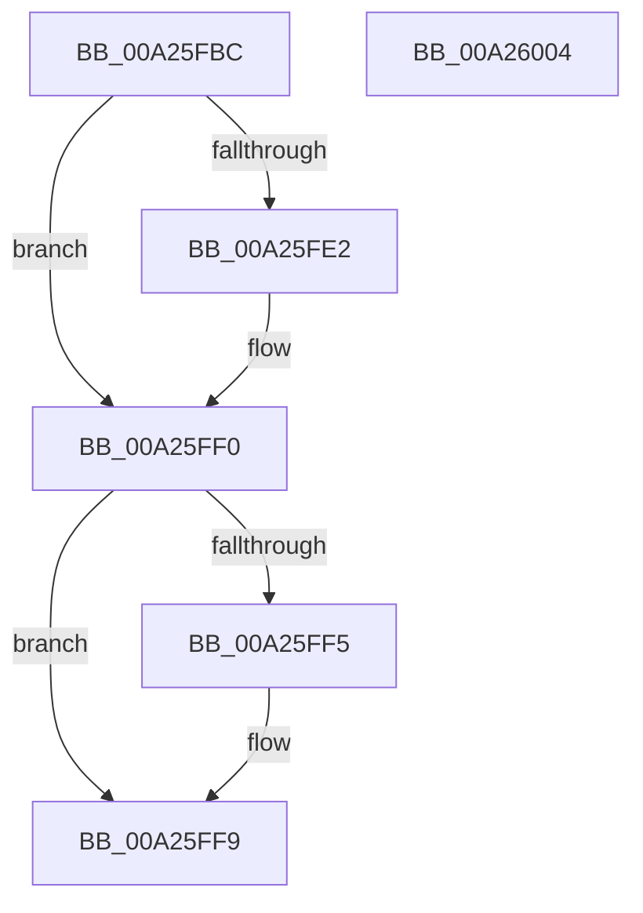

# MiLockNestedVad

- RVA: `0x00A25FBC`–`0x00A26005` (길이 `73` bytes)
- VA: `0x0000000140A25FBC`
- 실행 섹션: `PAGE`
- PDB 이름 있음: `예`; PDB Function 태그: `아니요`
- unwind 정보 RVA: `0x0005CAAC`
- 디코드: `23`개 명령, `73/73` bytes 표시
- 미해석 바이트: `0` (있으면 어셈블리에 `.byte`로 보존)

> 이 문서는 커널 이미지의 기계어와 PDB 기호를 분석해 생성했습니다. 4번과 5번은 함수 원형과 자료형을 바이너리 사용 방식에서 추정한 C 해석이며 원본 소스 복구 결과는 아닙니다.

## 1. Dependencies

- 직접 호출 지점: **2**; 고유 호출 대상: **2**
- 직접 호출자로 확인된 함수: **3**
- RIP 상대 이미지 참조: **0**

### Outgoing calls
- `0x00A25FD2` → [KeAbPreAcquire](../../text/21/KeAbPreAcquire_function_00210230.md) (function, `0x00210230`)
- `0x00A25FEB` → [ExfAcquirePushLockExclusiveEx](../../text/20/ExfAcquirePushLockExclusiveEx_function_0020FC90.md) (function, `0x0020FC90`)

### Direct callers
- [MiPerformVadSplitting](../../text/2A/MiPerformVadSplitting_function_002A5A80.md) at `0x002A5FDC`
- [MiFreeVadRange](../../text/2A/MiFreeVadRange_function_002A77AC.md) at `0x002A78A6`
- [MiFreeVadRange](../../text/2A/MiFreeVadRange_function_002A77AC.md) at `0x002A7981`
- [MiUpControlAreaRefs](../../text/3B/MiUpControlAreaRefs_function_003B2BF0.md) at `0x003B2CBD`

### Static image references
- 디코드된 RIP-relative 메모리 참조가 없습니다.

## 2. Other-region calls and transfers

- 다른 실행 섹션으로 향하는 call: **2**
  - `0x00A25FD2` → [KeAbPreAcquire](../../text/21/KeAbPreAcquire_function_00210230.md) (`PAGE` → `.text`)
  - `0x00A25FEB` → [ExfAcquirePushLockExclusiveEx](../../text/20/ExfAcquirePushLockExclusiveEx_function_0020FC90.md) (`PAGE` → `.text`)
- 별도 외부 분기/꼬리 이동을 확인하지 못했습니다.

## 3. Assembly (complete function range)

```asm
00A25FBC  48 89 5C 24 08                  mov qword ptr [rsp + 8], rbx
00A25FC1  57                              push rdi
00A25FC2  48 83 EC 20                     sub rsp, 0x20
00A25FC6  48 8D 79 28                     lea rdi, [rcx + 0x28]
00A25FCA  45 33 C0                        xor r8d, r8d
00A25FCD  48 8B CF                        mov rcx, rdi
00A25FD0  33 D2                           xor edx, edx
00A25FD2  E8 59 A2 7E FF                  call 0x140210230
00A25FD7  F0 48 0F BA 2F 00               lock bts qword ptr [rdi], 0
00A25FDD  48 8B D8                        mov rbx, rax
00A25FE0  73 0E                           jae 0x140a25ff0
00A25FE2  4C 8B C7                        mov r8, rdi
00A25FE5  48 8B D0                        mov rdx, rax
00A25FE8  48 8B CF                        mov rcx, rdi
00A25FEB  E8 A0 9C 7E FF                  call 0x14020fc90
00A25FF0  48 85 DB                        test rbx, rbx
00A25FF3  74 04                           je 0x140a25ff9
00A25FF5  C6 43 0A 01                     mov byte ptr [rbx + 0xa], 1
00A25FF9  48 8B 5C 24 30                  mov rbx, qword ptr [rsp + 0x30]
00A25FFE  48 83 C4 20                     add rsp, 0x20
00A26002  5F                              pop rdi
00A26003  C3                              ret
00A26004  CC                              int3
```

## 4. C-style interpretation (structured pseudocode)

```c
__int64 __fastcall MiLockNestedVad(__int64 a1, int a2, int a3)
{
    __int64 result;
    __int64 v_rsp;
    unsigned __int64 v_stack_p8;

    v_stack_p8 = v_rbx;
    v_rsp = (v_rsp) - (32);
    a3 = 0;
    a2 = 0;
    result = KeAbPreAcquire(a1 + 40, a2, a3, a4);
    if (!(condition_is_above_or_equal)) {
        a3 = a1 + 40;
        a2 = result;
        a1 = a1 + 40;
        result = ExfAcquirePushLockExclusiveEx(a1, a2, a3, a4);
    }
    if (result != 0) {
        *(unsigned __int8 *)(result + 10) = 1;
    }
    v_rsp = (v_rsp) + (32);
    return result;
}
```

## 5. (Beta) C Style

```c
int64_t MiLockNestedVad(void *Arg1, int32_t Arg2, int32_t Arg3)
{
    uint8_t *arg1 = (uint8_t *)Arg1;

    int64_t result;
    int64_t local_rsp;
    uint64_t v_stack_p8;

    v_stack_p8 = local_rbx;
    local_rsp = (local_rsp) - (32);
    Arg3 = 0;
    Arg2 = 0;
    result = KeAbPreAcquire(Arg1 + 40, Arg2, Arg3, a4);
    if (!(condition_is_above_or_equal)) {
        Arg3 = Arg1 + 40;
        Arg2 = result;
        Arg1 = Arg1 + 40;
        result = ExfAcquirePushLockExclusiveEx(Arg1, Arg2, Arg3, a4);
    }
    if (result != 0) {
        *(uint8_t *)(result + 0xA) = 1;
    }
    local_rsp = (local_rsp) + (32);
    return result;
}
```

### 관측된 메모리 오프셋

구조체 형식이 확인되지 않은 접근은 인자 기준의 오프셋으로만 기록했습니다.

| 기준 인자 | 오프셋 표현 | 폭 (bit) | 접근 |
|---|---:|---:|---|
| `Arg1` | `+ 0x0` | `64` | `R/W` |
| `Arg1` | `+ 0x28` | `64` | `R` |

## 6. Execution-region graph

[열기: 2D/3D 그래프와 함수 탐색 컨트롤 패널](../../../control-panel.html?section=page&rva=0x00A25FBC&view=graph)

- 2D 그래프는 위에서 아래로 흐르고, 3D 그래프는 빈 공간을 드래그해 회전합니다. Shift+드래그는 이동, 휠은 확대·축소, 함수 노드 선택은 대상 보고서 이동입니다.

### Static fallback


