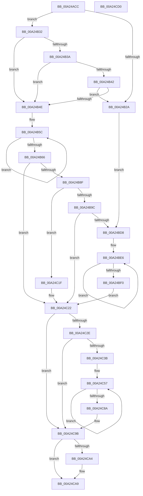

# MiLogFailedDriverLoad

- RVA: `0x00A24ACC`–`0x00A24CD1` (길이 `517` bytes)
- VA: `0x0000000140A24ACC`
- 실행 섹션: `PAGE`
- PDB 이름 있음: `예`; PDB Function 태그: `아니요`
- unwind 정보 RVA: `0x000AB7D4`
- 디코드: `140`개 명령, `517/517` bytes 표시
- 미해석 바이트: `0` (있으면 어셈블리에 `.byte`로 보존)

> 이 문서는 커널 이미지의 기계어와 PDB 기호를 분석해 생성했습니다. 4번과 5번은 함수 원형과 자료형을 바이너리 사용 방식에서 추정한 C 해석이며 원본 소스 복구 결과는 아닙니다.

## 1. Dependencies

- 직접 호출 지점: **8**; 고유 호출 대상: **8**
- 직접 호출자로 확인된 함수: **3**
- RIP 상대 이미지 참조: **3**

### Outgoing calls
- `0x00A24BA3` → [RtlInitAnsiString](../../text/47/RtlInitAnsiString_function_00470F40.md) (function, `0x00470F40`)
- `0x00A24BB3` → [RtlAnsiStringToUnicodeString](../90/RtlAnsiStringToUnicodeString_function_0090BEA0.md) (function, `0x0090BEA0`)
- `0x00A24C05` → [MiIsRetryIoStatus](../../text/40/MiIsRetryIoStatus_function_00408640.md) (function, `0x00408640`)
- `0x00A24C2E` → [IoAllocateGenericErrorLogEntry](../../text/59/IoAllocateGenericErrorLogEntry_function_00597908.md) (function, `0x00597908`)
- `0x00A24C67` → [memcpy](../../text/6C/memcpy_function_006C6840.md) (function, `0x006C6840`)
- `0x00A24C96` → [IoWriteErrorLogEntry](../../text/4B/IoWriteErrorLogEntry_function_004B5B30.md) (function, `0x004B5B30`)
- `0x00A24CA4` → [ExFreePool](../../poolcode/B8/ExFreePool_function_00B82850.md) (function, `0x00B82850`)
- `0x00A24CB0` → [_security_check_cookie](../../text/6A/_security_check_cookie_function_006AC640.md) (function, `0x006AC640`)

### Direct callers
- [MmLoadSystemImageEx](../99/MmLoadSystemImageEx_function_00999B8C.md) at `0x00999D2E`
- [MiResolveImageReferences](MiResolveImageReferences_function_00A23BE4.md) at `0x00A23F32`
- [MiCreateSectionForDriver](MiCreateSectionForDriver_function_00A2477C.md) at `0x00A24A3D`

### Static image references
- `0x00A24AE8` → RVA `0x00E0A740` (`.data`; read)
- `0x00A24B4E` → RVA `0x00B09E60` (` ?? ::NNGAKEGL::`string'`; read)
- `0x00A24BD8` → RVA `0x00B09E40` (` ?? ::NNGAKEGL::`string'`; read)

## 2. Other-region calls and transfers

- 다른 실행 섹션으로 향하는 call: **7**
  - `0x00A24BA3` → [RtlInitAnsiString](../../text/47/RtlInitAnsiString_function_00470F40.md) (`PAGE` → `.text`)
  - `0x00A24C05` → [MiIsRetryIoStatus](../../text/40/MiIsRetryIoStatus_function_00408640.md) (`PAGE` → `.text`)
  - `0x00A24C2E` → [IoAllocateGenericErrorLogEntry](../../text/59/IoAllocateGenericErrorLogEntry_function_00597908.md) (`PAGE` → `.text`)
  - `0x00A24C67` → [memcpy](../../text/6C/memcpy_function_006C6840.md) (`PAGE` → `.text`)
  - `0x00A24C96` → [IoWriteErrorLogEntry](../../text/4B/IoWriteErrorLogEntry_function_004B5B30.md) (`PAGE` → `.text`)
  - `0x00A24CA4` → [ExFreePool](../../poolcode/B8/ExFreePool_function_00B82850.md) (`PAGE` → `POOLCODE`)
  - `0x00A24CB0` → [_security_check_cookie](../../text/6A/_security_check_cookie_function_006AC640.md) (`PAGE` → `.text`)
- 별도 외부 분기/꼬리 이동을 확인하지 못했습니다.

## 3. Assembly (complete function range)

```asm
00A24ACC  48 89 5C 24 20                  mov qword ptr [rsp + 0x20], rbx
00A24AD1  55                              push rbp
00A24AD2  56                              push rsi
00A24AD3  57                              push rdi
00A24AD4  41 54                           push r12
00A24AD6  41 55                           push r13
00A24AD8  41 56                           push r14
00A24ADA  41 57                           push r15
00A24ADC  48 8D 6C 24 D9                  lea rbp, [rsp - 0x27]
00A24AE1  48 81 EC A0 00 00 00            sub rsp, 0xa0
00A24AE8  48 8B 05 51 5C 3E 00            mov rax, qword ptr [rip + 0x3e5c51]
00A24AEF  48 33 C4                        xor rax, rsp
00A24AF2  48 89 45 17                     mov qword ptr [rbp + 0x17], rax
00A24AF6  44 0F B7 39                     movzx r15d, word ptr [rcx]
00A24AFA  45 33 ED                        xor r13d, r13d
00A24AFD  0F 57 C0                        xorps xmm0, xmm0
00A24B00  41 83 C7 02                     add r15d, 2
00A24B04  0F 11 45 BF                     movups xmmword ptr [rbp - 0x41], xmm0
00A24B08  48 83 CF FF                     or rdi, 0xffffffffffffffff
00A24B0C  41 8B D9                        mov ebx, r9d
00A24B0F  45 8D 75 01                     lea r14d, [r13 + 1]
00A24B13  0F 57 C9                        xorps xmm1, xmm1
00A24B16  45 8B E5                        mov r12d, r13d
00A24B19  0F 10 01                        movups xmm0, xmmword ptr [rcx]
00A24B1C  0F 11 4D A7                     movups xmmword ptr [rbp - 0x59], xmm1
00A24B20  F3 0F 7F 45 D7                  movdqu xmmword ptr [rbp - 0x29], xmm0
00A24B25  48 85 D2                        test rdx, rdx
00A24B28  75 08                           jne 0x140a24b32
00A24B2A  49 8B F6                        mov rsi, r14
00A24B2D  E9 A6 00 00 00                  jmp 0x140a24bd8
00A24B32  81 FB 7A 00 00 C0               cmp ebx, 0xc000007a
00A24B38  74 14                           je 0x140a24b4e
00A24B3A  81 FB 34 00 00 C0               cmp ebx, 0xc0000034
00A24B40  74 0C                           je 0x140a24b4e
00A24B42  41 8D 81 9E FD FF 3F            lea eax, [r9 + 0x3ffffd9e]
00A24B49  41 3B C6                        cmp eax, r14d
00A24B4C  77 DC                           ja 0x140a24b2a
00A24B4E  48 8D 05 0B 53 0E 00            lea rax, [rip + 0xe530b]
00A24B55  48 8B CF                        mov rcx, rdi
00A24B58  48 89 45 EF                     mov qword ptr [rbp - 0x11], rax
00A24B5C  48 FF C1                        inc rcx
00A24B5F  66 44 39 2C 48                  cmp word ptr [rax + rcx*2], r13w
00A24B64  75 F6                           jne 0x140a24b5c
00A24B66  0F B7 02                        movzx eax, word ptr [rdx]
00A24B69  48 03 C9                        add rcx, rcx
00A24B6C  0F 10 02                        movups xmm0, xmmword ptr [rdx]
00A24B6F  03 C1                           add eax, ecx
00A24B71  66 89 4D E7                     mov word ptr [rbp - 0x19], cx
00A24B75  41 83 C7 04                     add r15d, 4
00A24B79  BE 03 00 00 00                  mov esi, 3
00A24B7E  44 03 F8                        add r15d, eax
00A24B81  F3 0F 7F 45 F7                  movdqu xmmword ptr [rbp - 9], xmm0
00A24B86  4D 85 C0                        test r8, r8
00A24B89  0F 84 93 00 00 00               je 0x140a24c22
00A24B8F  49 F7 C0 00 00 FF FF            test r8, -0x10000
00A24B96  0F 84 83 00 00 00               je 0x140a24c1f
00A24B9C  49 8B D0                        mov rdx, r8
00A24B9F  48 8D 4D BF                     lea rcx, [rbp - 0x41]
00A24BA3  E8 98 C3 A4 FF                  call 0x140470f40
00A24BA8  45 8A C6                        mov r8b, r14b
00A24BAB  48 8D 55 BF                     lea rdx, [rbp - 0x41]
00A24BAF  48 8D 4D A7                     lea rcx, [rbp - 0x59]
00A24BB3  E8 E8 72 EE FF                  call 0x14090bea0
00A24BB8  0F B7 4D A7                     movzx ecx, word ptr [rbp - 0x59]
00A24BBC  BE 04 00 00 00                  mov esi, 4
00A24BC1  0F 10 45 A7                     movups xmm0, xmmword ptr [rbp - 0x59]
00A24BC5  83 C1 02                        add ecx, 2
00A24BC8  C1 E8 1F                        shr eax, 0x1f
00A24BCB  44 03 F9                        add r15d, ecx
00A24BCE  F3 0F 7F 45 07                  movdqu xmmword ptr [rbp + 7], xmm0
00A24BD3  41 3B C6                        cmp eax, r14d
00A24BD6  75 4A                           jne 0x140a24c22
00A24BD8  48 8D 05 61 52 0E 00            lea rax, [rip + 0xe5261]
00A24BDF  44 8B E3                        mov r12d, ebx
00A24BE2  48 89 45 EF                     mov qword ptr [rbp - 0x11], rax
00A24BE6  48 FF C7                        inc rdi
00A24BE9  66 44 39 2C 78                  cmp word ptr [rax + rdi*2], r13w
00A24BEE  75 F6                           jne 0x140a24be6
00A24BF0  48 03 FF                        add rdi, rdi
00A24BF3  41 83 C7 02                     add r15d, 2
00A24BF7  BA 00 10 00 00                  mov edx, 0x1000
00A24BFC  66 89 7D E7                     mov word ptr [rbp - 0x19], di
00A24C00  8B CB                           mov ecx, ebx
00A24C02  44 03 FF                        add r15d, edi
00A24C05  E8 36 3A 9E FF                  call 0x140408640
00A24C0A  F7 D8                           neg eax
00A24C0C  1B DB                           sbb ebx, ebx
00A24C0E  81 E3 2E FE FF FF               and ebx, 0xfffffe2e
00A24C14  81 C3 6C 02 00 C0               add ebx, 0xc000026c
00A24C1A  48 FF C6                        inc rsi
00A24C1D  EB 03                           jmp 0x140a24c22
00A24C1F  45 8B E0                        mov r12d, r8d
00A24C22  41 8D 4F 30                     lea ecx, [r15 + 0x30]
00A24C26  81 F9 FF 00 00 00               cmp ecx, 0xff
00A24C2C  73 6D                           jae 0x140a24c9b
00A24C2E  E8 D5 2C B7 FF                  call 0x140597908
00A24C33  48 8B F8                        mov rdi, rax
00A24C36  48 85 C0                        test rax, rax
00A24C39  74 60                           je 0x140a24c9b
00A24C3B  44 89 60 10                     mov dword ptr [rax + 0x10], r12d
00A24C3F  4C 8D 78 30                     lea r15, [rax + 0x30]
00A24C43  4C 8D 65 DF                     lea r12, [rbp - 0x21]
00A24C47  C7 40 0C 1A 00 00 40            mov dword ptr [rax + 0xc], 0x4000001a
00A24C4E  89 58 14                        mov dword ptr [rax + 0x14], ebx
00A24C51  66 C7 40 06 30 00               mov word ptr [rax + 6], 0x30
00A24C57  41 0F B7 5C 24 F8               movzx ebx, word ptr [r12 - 8]
00A24C5D  49 8B CF                        mov rcx, r15
00A24C60  49 8B 14 24                     mov rdx, qword ptr [r12]
00A24C64  44 8B C3                        mov r8d, ebx
00A24C67  E8 D4 1B CA FF                  call 0x1406c6840
00A24C6C  48 D1 EB                        shr rbx, 1
00A24C6F  4D 8D 64 24 10                  lea r12, [r12 + 0x10]
00A24C74  4D 8D 3C 5F                     lea r15, [r15 + rbx*2]
00A24C78  49 8B C7                        mov rax, r15
00A24C7B  66 41 C7 07 20 00               mov word ptr [r15], 0x20
00A24C81  49 83 C7 02                     add r15, 2
00A24C85  49 2B F6                        sub rsi, r14
00A24C88  75 CD                           jne 0x140a24c57
00A24C8A  66 44 89 28                     mov word ptr [rax], r13w
00A24C8E  48 8B CF                        mov rcx, rdi
00A24C91  66 44 89 77 04                  mov word ptr [rdi + 4], r14w
00A24C96  E8 95 0E A9 FF                  call 0x1404b5b30
00A24C9B  48 8B 4D AF                     mov rcx, qword ptr [rbp - 0x51]
00A24C9F  48 85 C9                        test rcx, rcx
00A24CA2  74 05                           je 0x140a24ca9
00A24CA4  E8 A7 DB 15 00                  call 0x140b82850
00A24CA9  48 8B 4D 17                     mov rcx, qword ptr [rbp + 0x17]
00A24CAD  48 33 CC                        xor rcx, rsp
00A24CB0  E8 8B 79 C8 FF                  call 0x1406ac640
00A24CB5  48 8B 9C 24 F8 00 00 00         mov rbx, qword ptr [rsp + 0xf8]
00A24CBD  48 81 C4 A0 00 00 00            add rsp, 0xa0
00A24CC4  41 5F                           pop r15
00A24CC6  41 5E                           pop r14
00A24CC8  41 5D                           pop r13
00A24CCA  41 5C                           pop r12
00A24CCC  5F                              pop rdi
00A24CCD  5E                              pop rsi
00A24CCE  5D                              pop rbp
00A24CCF  C3                              ret
00A24CD0  CC                              int3
```

## 4. C-style interpretation (structured pseudocode)

```c
__int64 __fastcall MiLogFailedDriverLoad(__int64 a1, __int64 a2, __int64 a3, __int64 a4)
{
    __int64 result;
    __int64 v_r13;
    __int64 v_r15;
    __int64 v_rbx;
    __int64 v_rdi;
    __int64 v_rsi;
    __int64 v_rsp;
    unsigned __int64 v_stack_m48;
    unsigned __int64 v_stack_m58;
    unsigned __int64 v_stack_m5F;
    unsigned __int64 v_stack_m68;
    unsigned __int64 v_stack_m70;
    unsigned __int16 v_stack_m78;
    unsigned __int64 v_stack_m80;
    unsigned __int64 v_stack_m88;
    unsigned __int64 v_stack_mA0;
    unsigned __int64 v_stack_mB0;
    unsigned __int64 v_stack_mB8;
    unsigned __int64 v_stack_p20;

    v_stack_p20 = v_rbx;
    v_rsp = (v_rsp) - (160);
    result = (*(unsigned __int64 *)(v_rip + 4086865)) ^ (v_rsp);
    v_stack_m48 = result;
    v_r13 = 0;
    v_r15 = (unsigned int)((*(unsigned __int16 *)(a1)) + (2));
    v_stack_mA0 = v_xmm0;
    v_rdi = (v_rdi) | (-1);
    v_stack_mB8 = v_xmm1;
    v_stack_m88 = v_xmm0;
    if (a2 != 0) goto loc_00A24B32;
loc_00A24B2A:
    goto loc_00A24BD8;
loc_00A24B32:
    if (((unsigned int)((unsigned int)((unsigned int)(a4)))) == 0xC000007AULL) goto loc_00A24B4E;
    if (((unsigned int)((unsigned int)((unsigned int)(a4)))) == 0xC0000034ULL) goto loc_00A24B4E;
    if (((unsigned int)(a4 + 1073741214)) > ((unsigned int)(v_r13 + 1))) goto loc_00A24B2A;
loc_00A24B4E:
    v_stack_m70 = v_rip + 938763;
loc_00A24B5C:
    a1 = (v_rdi) + 1;
    if ((*(unsigned __int16 *)(v_rip + 938763 + a1 * 2)) != 0) goto loc_00A24B5C;
    a1 = (a1) + (a1);
    result = (unsigned int)((*(unsigned __int16 *)(a2)) + ((unsigned int)(a1)));
    v_stack_m78 = (unsigned __int16)(a1);
    v_r15 = (unsigned int)((v_r15) + (4));
    v_r15 = (unsigned int)((v_r15) + ((unsigned int)(result)));
    v_stack_m68 = v_xmm0;
    if (a3 == 0) goto loc_00A24C22;
    if (((a3) & (0xFFFFFFFFFFFF0000ULL)) == 0) goto loc_00A24C1F;
    result = RtlInitAnsiString(v_stack_mA0, a3, a3, a4);
    result = RtlAnsiStringToUnicodeString(v_stack_mB8, v_stack_mA0, (unsigned __int8)(v_r13 + 1), a4);
    a1 = (unsigned int)((v_stack_mB8) + (2));
    result = (unsigned int)((result) >> (31));
    v_r15 = (unsigned int)((v_r15) + ((unsigned int)(a1)));
    v_stack_m58 = v_xmm0;
    if (((unsigned int)(result)) != ((unsigned int)(v_r13 + 1))) goto loc_00A24C22;
loc_00A24BD8:
    v_stack_m70 = v_rip + 938593;
loc_00A24BE6:
    v_rdi = (v_rdi) + 1;
    if ((*(unsigned __int16 *)(v_rip + 938593 + v_rdi * 2)) != 0) goto loc_00A24BE6;
    v_rdi = (v_rdi) + (v_rdi);
    v_r15 = (unsigned int)((v_r15) + (2));
    v_stack_m78 = (unsigned __int16)(v_rdi);
    v_r15 = (unsigned int)((v_r15) + ((unsigned int)(v_rdi)));
    result = MiIsRetryIoStatus((unsigned int)((unsigned int)((unsigned int)((unsigned int)(a4)))), (unsigned int)(0x1000ULL), (unsigned __int8)(v_r13 + 1), a4);
    result = (unsigned int)(-(result));
    v_rbx = (unsigned int)(((unsigned int)((unsigned int)(a4))) & (0xFFFFFE2EULL));
    v_rbx = (unsigned int)((v_rbx) + (0xC000026CULL));
    v_rsi = (4) + 1;
    goto loc_00A24C22;
loc_00A24C1F:
loc_00A24C22:
    if (((unsigned int)(v_r15 + 48)) >= 255) goto loc_00A24C9B;
    result = IoAllocateGenericErrorLogEntry(v_r15 + 48, (unsigned int)(0x1000ULL), (unsigned __int8)(v_r13 + 1), a4);
    if (result == 0) goto loc_00A24C9B;
    *(unsigned int *)(result + 16) = (unsigned int)((unsigned int)((unsigned int)((unsigned __int8)(v_r13 + 1))));
    *(unsigned int *)(result + 12) = 0x4000001AULL;
    *(unsigned int *)(result + 20) = (unsigned int)(v_rbx);
    *(unsigned __int16 *)(result + 6) = 48;
loc_00A24C57:
    result = memcpy(result + 48, *(unsigned __int64 *)(v_stack_m80), (unsigned int)((unsigned int)(*(unsigned __int16 *)(v_stack_m80 - 8))), a4);
    v_rbx = (*(unsigned __int16 *)(v_stack_m80 - 8)) >> (1);
    *(unsigned __int16 *)(result + 48 + v_rbx * 2) = 32;
    v_r15 = (result + 48 + v_rbx * 2) + (2);
    v_rsi = (v_rsi) - (v_r13 + 1);
    if (condition_is_not_equal) goto loc_00A24C57;
    *(unsigned __int16 *)(result + 48 + v_rbx * 2) = 0;
    *(unsigned __int16 *)(result + 4) = (unsigned __int16)(v_r13 + 1);
    result = IoWriteErrorLogEntry(result, *(unsigned __int64 *)(v_stack_m80), (unsigned int)((unsigned int)(*(unsigned __int16 *)(v_stack_m80 - 8))), a4);
loc_00A24C9B:
    if (v_stack_mB0 != 0) {
        result = ExFreePool(v_stack_mB0, *(unsigned __int64 *)(v_stack_m80), (unsigned int)((unsigned int)(*(unsigned __int16 *)(v_stack_m80 - 8))), a4);
    }
    a1 = (v_stack_m48) ^ (v_rsp);
    result = _security_check_cookie(a1, *(unsigned __int64 *)(v_stack_m80), (unsigned int)((unsigned int)(*(unsigned __int16 *)(v_stack_m80 - 8))), a4);
    v_rsp = (v_rsp) + (160);
    return result;
}
```

## 5. (Beta) C Style

```c
int64_t MiLogFailedDriverLoad(void *Arg1, int64_t Arg2, int64_t Arg3, void *Arg4)
{
    uint8_t *arg1 = (uint8_t *)Arg1;
    uint8_t *arg4 = (uint8_t *)Arg4;

    int64_t result;
    int64_t local_r13;
    int64_t local_r15;
    int64_t local_rbx;
    int64_t local_rdi;
    int64_t local_rsi;
    int64_t local_rsp;
    uint64_t v_stack_m48;
    uint64_t v_stack_m58;
    uint64_t v_stack_m5F;
    uint64_t v_stack_m68;
    uint64_t v_stack_m70;
    uint16_t v_stack_m78;
    uint64_t v_stack_m80;
    uint64_t v_stack_m88;
    uint64_t v_stack_mA0;
    uint64_t v_stack_mB0;
    uint64_t v_stack_mB8;
    uint64_t v_stack_p20;

    v_stack_p20 = local_rbx;
    local_rsp = (local_rsp) - (160);
    result = (*(uint64_t *)(v_rip + 0x3E5C51)) ^ (local_rsp);
    v_stack_m48 = result;
    local_r13 = 0;
    local_r15 = (uint32_t)((*(uint16_t *)(arg1)) + (2));
    v_stack_mA0 = v_xmm0;
    local_rdi = (local_rdi) | (-1);
    v_stack_mB8 = v_xmm1;
    v_stack_m88 = v_xmm0;
    if (Arg2 != 0) goto loc_00A24B32;
loc_00A24B2A:
    goto loc_00A24BD8;
loc_00A24B32:
    if (((uint32_t)((uint32_t)((uint32_t)(Arg4)))) == 0xC000007AULL) goto loc_00A24B4E;
    if (((uint32_t)((uint32_t)((uint32_t)(Arg4)))) == 0xC0000034ULL) goto loc_00A24B4E;
    if (((uint32_t)(Arg4 + 1073741214)) > ((uint32_t)(local_r13 + 1))) goto loc_00A24B2A;
loc_00A24B4E:
    v_stack_m70 = v_rip + 938763;
loc_00A24B5C:
    Arg1 = (local_rdi) + 1;
    if ((*(uint16_t *)(v_rip + 0xE530B + arg1 * 2)) != 0) goto loc_00A24B5C;
    Arg1 = (Arg1) + (Arg1);
    result = (uint32_t)((*(uint16_t *)(Arg2)) + ((uint32_t)(Arg1)));
    v_stack_m78 = (uint16_t)(Arg1);
    local_r15 = (uint32_t)((local_r15) + (4));
    local_r15 = (uint32_t)((local_r15) + ((uint32_t)(result)));
    v_stack_m68 = v_xmm0;
    if (Arg3 == 0) goto loc_00A24C22;
    if (((Arg3) & (0xFFFFFFFFFFFF0000ULL)) == 0) goto loc_00A24C1F;
    result = RtlInitAnsiString(v_stack_mA0, Arg3, Arg3, Arg4);
    result = RtlAnsiStringToUnicodeString(v_stack_mB8, v_stack_mA0, (uint8_t)(local_r13 + 1), Arg4);
    Arg1 = (uint32_t)((v_stack_mB8) + (2));
    result = (uint32_t)((result) >> (31));
    local_r15 = (uint32_t)((local_r15) + ((uint32_t)(Arg1)));
    v_stack_m58 = v_xmm0;
    if (((uint32_t)(result)) != ((uint32_t)(local_r13 + 1))) goto loc_00A24C22;
loc_00A24BD8:
    v_stack_m70 = v_rip + 938593;
loc_00A24BE6:
    local_rdi = (local_rdi) + 1;
    if ((*(uint16_t *)(v_rip + 0xE5261 + local_rdi * 2)) != 0) goto loc_00A24BE6;
    local_rdi = (local_rdi) + (local_rdi);
    local_r15 = (uint32_t)((local_r15) + (2));
    v_stack_m78 = (uint16_t)(local_rdi);
    local_r15 = (uint32_t)((local_r15) + ((uint32_t)(local_rdi)));
    result = MiIsRetryIoStatus((uint32_t)((uint32_t)((uint32_t)((uint32_t)(Arg4)))), (uint32_t)(0x1000ULL), (uint8_t)(local_r13 + 1), Arg4);
    result = (uint32_t)(-(result));
    local_rbx = (uint32_t)(((uint32_t)((uint32_t)(Arg4))) & (0xFFFFFE2EULL));
    local_rbx = (uint32_t)((local_rbx) + (0xC000026CULL));
    local_rsi = (4) + 1;
    goto loc_00A24C22;
loc_00A24C1F:
loc_00A24C22:
    if (((uint32_t)(local_r15 + 48)) >= 255) goto loc_00A24C9B;
    result = IoAllocateGenericErrorLogEntry(local_r15 + 48, (uint32_t)(0x1000ULL), (uint8_t)(local_r13 + 1), Arg4);
    if (result == 0) goto loc_00A24C9B;
    *(uint32_t *)(result + 0x10) = (uint32_t)((uint32_t)((uint32_t)((uint8_t)(local_r13 + 1))));
    *(uint32_t *)(result + 0xC) = 0x4000001AULL;
    *(uint32_t *)(result + 0x14) = (uint32_t)(local_rbx);
    *(uint16_t *)(result + 0x6) = 48;
loc_00A24C57:
    result = memcpy(result + 48, *(uint64_t *)(v_stack_m80), (uint32_t)((uint32_t)(*(uint16_t *)(v_stack_m80 - 0x8))), Arg4);
    local_rbx = (*(uint16_t *)(v_stack_m80 - 0x8)) >> (1);
    *(uint16_t *)(result + 0x30 + local_rbx * 2) = 32;
    local_r15 = (result + 48 + local_rbx * 2) + (2);
    local_rsi = (local_rsi) - (local_r13 + 1);
    if (condition_is_not_equal) goto loc_00A24C57;
    *(uint16_t *)(result + 0x30 + local_rbx * 2) = 0;
    *(uint16_t *)(result + 0x4) = (uint16_t)(local_r13 + 1);
    result = IoWriteErrorLogEntry(result, *(uint64_t *)(v_stack_m80), (uint32_t)((uint32_t)(*(uint16_t *)(v_stack_m80 - 0x8))), Arg4);
loc_00A24C9B:
    if (v_stack_mB0 != 0) {
        result = ExFreePool(v_stack_mB0, *(uint64_t *)(v_stack_m80), (uint32_t)((uint32_t)(*(uint16_t *)(v_stack_m80 - 0x8))), Arg4);
    }
    Arg1 = (v_stack_m48) ^ (local_rsp);
    result = _security_check_cookie(Arg1, *(uint64_t *)(v_stack_m80), (uint32_t)((uint32_t)(*(uint16_t *)(v_stack_m80 - 0x8))), Arg4);
    local_rsp = (local_rsp) + (160);
    return result;
}
```

### 관측된 메모리 오프셋

구조체 형식이 확인되지 않은 접근은 인자 기준의 오프셋으로만 기록했습니다.

| 기준 인자 | 오프셋 표현 | 폭 (bit) | 접근 |
|---|---:|---:|---|
| `Arg1` | `+ 0x0` | `16` | `R` |
| `Arg1` | `+ 0x0` | `128` | `R` |
| `Arg4` | `+ 0x3FFFFD9E` | `32` | `R` |

## 6. Execution-region graph

[열기: 2D/3D 그래프와 함수 탐색 컨트롤 패널](../../../control-panel.html?section=page&rva=0x00A24ACC&view=graph)

- 2D 그래프는 위에서 아래로 흐르고, 3D 그래프는 빈 공간을 드래그해 회전합니다. Shift+드래그는 이동, 휠은 확대·축소, 함수 노드 선택은 대상 보고서 이동입니다.

### Static fallback


