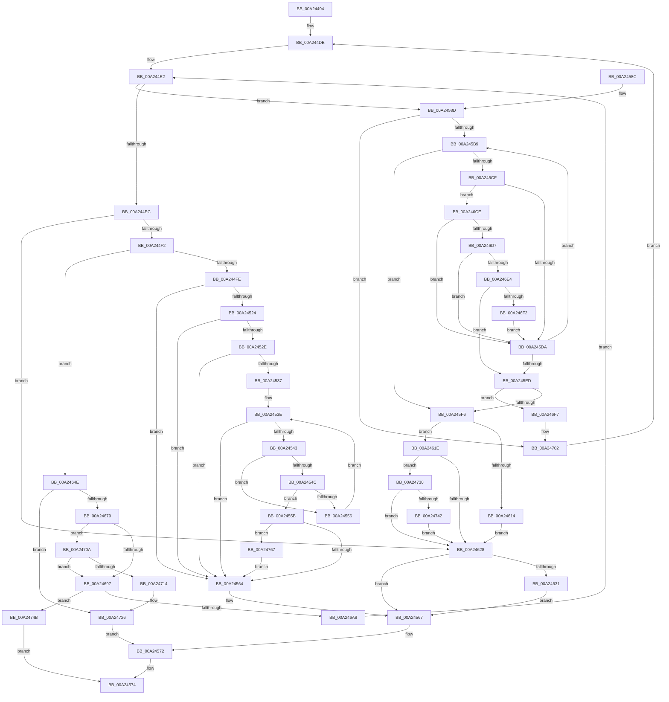

# MiObtainSectionForDriver

- RVA: `0x00A24494`–`0x00A24773` (길이 `735` bytes)
- VA: `0x0000000140A24494`
- 실행 섹션: `PAGE`
- PDB 이름 있음: `예`; PDB Function 태그: `아니요`
- unwind 정보 RVA: `0x000AB790`
- 디코드: `186`개 명령, `735/735` bytes 표시
- 미해석 바이트: `0` (있으면 어셈블리에 `.byte`로 보존)

> 이 문서는 커널 이미지의 기계어와 PDB 기호를 분석해 생성했습니다. 4번과 5번은 함수 원형과 자료형을 바이너리 사용 방식에서 추정한 C 해석이며 원본 소스 복구 결과는 아닙니다.

## 1. Dependencies

- 직접 호출 지점: **17**; 고유 호출 대상: **10**
- 직접 호출자로 확인된 함수: **1**
- RIP 상대 이미지 참조: **2**

### Outgoing calls
- `0x00A24501` → [MiGetBaseLoaderPortion](../../text/4D/MiGetBaseLoaderPortion_function_004D9D34.md) (function, `0x004D9D34`)
- `0x00A24511` → [MiUpdateDriverLoadInProgress](../../text/43/MiUpdateDriverLoadInProgress_function_004318DC.md) (function, `0x004318DC`)
- `0x00A2454C` → [MiSectionControlArea](../../text/29/MiSectionControlArea_function_00294CB0.md) (function, `0x00294CB0`)
- `0x00A245C3` → [RtlEqualUnicodeString](../93/RtlEqualUnicodeString_function_00932A20.md) (function, `0x00932A20`)
- `0x00A245F9` → [MiGetBaseLoaderPortion](../../text/4D/MiGetBaseLoaderPortion_function_004D9D34.md) (function, `0x004D9D34`)
- `0x00A2463A` → [ObDereferenceObjectDeferDeleteWithTag](../../text/26/ObDereferenceObjectDeferDeleteWithTag_function_00263EA0.md) (function, `0x00263EA0`)
- `0x00A24644` → [ExFreePoolWithTag](../../poolcode/B8/ExFreePoolWithTag_function_00B82870.md) (function, `0x00B82870`)
- `0x00A24650` → [MmReleaseLoadLock](../../text/4D/MmReleaseLoadLock_function_004D36D0.md) (function, `0x004D36D0`)
- `0x00A2466A` → [MiCreateSectionForDriver](MiCreateSectionForDriver_function_00A2477C.md) (function, `0x00A2477C`)
- `0x00A24681` → [MiSectionControlArea](../../text/29/MiSectionControlArea_function_00294CB0.md) (function, `0x00294CB0`)
- `0x00A24697` → [MiAllocateTempLoaderEntry](MiAllocateTempLoaderEntry_function_00A24A80.md) (function, `0x00A24A80`)
- `0x00A246B9` → [MmAcquireLoadLock](../../text/4D/MmAcquireLoadLock_function_004DC2A0.md) (function, `0x004DC2A0`)
- `0x00A246E4` → [MiSectionControlArea](../../text/29/MiSectionControlArea_function_00294CB0.md) (function, `0x00294CB0`)
- `0x00A2471C` → [ObDereferenceObjectDeferDeleteWithTag](../../text/26/ObDereferenceObjectDeferDeleteWithTag_function_00263EA0.md) (function, `0x00263EA0`)
- `0x00A24726` → [MmAcquireLoadLock](../../text/4D/MmAcquireLoadLock_function_004DC2A0.md) (function, `0x004DC2A0`)
- `0x00A24753` → [ObDereferenceObjectDeferDeleteWithTag](../../text/26/ObDereferenceObjectDeferDeleteWithTag_function_00263EA0.md) (function, `0x00263EA0`)
- `0x00A24758` → [MmAcquireLoadLock](../../text/4D/MmAcquireLoadLock_function_004DC2A0.md) (function, `0x004DC2A0`)

### Direct callers
- [MmLoadSystemImageEx](../99/MmLoadSystemImageEx_function_00999B8C.md) at `0x00999C97`

### Static image references
- `0x00A244DB` → RVA `0x00EF54C0` (`.data`; read)
- `0x00A2458D` → RVA `0x00E2D988` (`.data`; read)

## 2. Other-region calls and transfers

- 다른 실행 섹션으로 향하는 call: **14**
  - `0x00A24501` → [MiGetBaseLoaderPortion](../../text/4D/MiGetBaseLoaderPortion_function_004D9D34.md) (`PAGE` → `.text`)
  - `0x00A24511` → [MiUpdateDriverLoadInProgress](../../text/43/MiUpdateDriverLoadInProgress_function_004318DC.md) (`PAGE` → `.text`)
  - `0x00A2454C` → [MiSectionControlArea](../../text/29/MiSectionControlArea_function_00294CB0.md) (`PAGE` → `.text`)
  - `0x00A245F9` → [MiGetBaseLoaderPortion](../../text/4D/MiGetBaseLoaderPortion_function_004D9D34.md) (`PAGE` → `.text`)
  - `0x00A2463A` → [ObDereferenceObjectDeferDeleteWithTag](../../text/26/ObDereferenceObjectDeferDeleteWithTag_function_00263EA0.md) (`PAGE` → `.text`)
  - `0x00A24644` → [ExFreePoolWithTag](../../poolcode/B8/ExFreePoolWithTag_function_00B82870.md) (`PAGE` → `POOLCODE`)
  - `0x00A24650` → [MmReleaseLoadLock](../../text/4D/MmReleaseLoadLock_function_004D36D0.md) (`PAGE` → `.text`)
  - `0x00A24681` → [MiSectionControlArea](../../text/29/MiSectionControlArea_function_00294CB0.md) (`PAGE` → `.text`)
  - `0x00A246B9` → [MmAcquireLoadLock](../../text/4D/MmAcquireLoadLock_function_004DC2A0.md) (`PAGE` → `.text`)
  - `0x00A246E4` → [MiSectionControlArea](../../text/29/MiSectionControlArea_function_00294CB0.md) (`PAGE` → `.text`)
  - `0x00A2471C` → [ObDereferenceObjectDeferDeleteWithTag](../../text/26/ObDereferenceObjectDeferDeleteWithTag_function_00263EA0.md) (`PAGE` → `.text`)
  - `0x00A24726` → [MmAcquireLoadLock](../../text/4D/MmAcquireLoadLock_function_004DC2A0.md) (`PAGE` → `.text`)
  - `0x00A24753` → [ObDereferenceObjectDeferDeleteWithTag](../../text/26/ObDereferenceObjectDeferDeleteWithTag_function_00263EA0.md) (`PAGE` → `.text`)
  - `0x00A24758` → [MmAcquireLoadLock](../../text/4D/MmAcquireLoadLock_function_004DC2A0.md) (`PAGE` → `.text`)
- 별도 외부 분기/꼬리 이동을 확인하지 못했습니다.

## 3. Assembly (complete function range)

```asm
00A24494  48 8B C4                        mov rax, rsp
00A24497  48 89 58 20                     mov qword ptr [rax + 0x20], rbx
00A2449B  4C 89 40 18                     mov qword ptr [rax + 0x18], r8
00A2449F  48 89 50 10                     mov qword ptr [rax + 0x10], rdx
00A244A3  48 89 48 08                     mov qword ptr [rax + 8], rcx
00A244A7  55                              push rbp
00A244A8  56                              push rsi
00A244A9  57                              push rdi
00A244AA  41 54                           push r12
00A244AC  41 55                           push r13
00A244AE  41 56                           push r14
00A244B0  41 57                           push r15
00A244B2  48 83 EC 30                     sub rsp, 0x30
00A244B6  48 8B B4 24 90 00 00 00         mov rsi, qword ptr [rsp + 0x90]
00A244BE  45 33 FF                        xor r15d, r15d
00A244C1  45 8B E9                        mov r13d, r9d
00A244C4  4C 89 78 B8                     mov qword ptr [rax - 0x48], r15
00A244C8  41 8B DF                        mov ebx, r15d
00A244CB  41 8B EF                        mov ebp, r15d
00A244CE  41 8B FF                        mov edi, r15d
00A244D1  45 8B F7                        mov r14d, r15d
00A244D4  4C 89 3E                        mov qword ptr [rsi], r15
00A244D7  45 8D 4F 01                     lea r9d, [r15 + 1]
00A244DB  4C 8D 25 DE 0F 4D 00            lea r12, [rip + 0x4d0fde]
00A244E2  41 83 FF 02                     cmp r15d, 2
00A244E6  0F 82 A1 00 00 00               jb 0x140a2458d
00A244EC  0F 85 36 01 00 00               jne 0x140a24628
00A244F2  45 33 FF                        xor r15d, r15d
00A244F5  48 85 FF                        test rdi, rdi
00A244F8  0F 84 50 01 00 00               je 0x140a2464e
00A244FE  48 8B CF                        mov rcx, rdi
00A24501  E8 2E 58 AB FF                  call 0x1404d9d34
00A24506  45 33 C9                        xor r9d, r9d
00A24509  45 33 C0                        xor r8d, r8d
00A2450C  33 D2                           xor edx, edx
00A2450E  48 8B D8                        mov rbx, rax
00A24511  E8 C6 D3 A0 FF                  call 0x1404318dc
00A24516  49 8B 4E 60                     mov rcx, qword ptr [r14 + 0x60]
00A2451A  48 83 E1 F8                     and rcx, 0xfffffffffffffff8
00A2451E  4C 39 79 20                     cmp qword ptr [rcx + 0x20], r15
00A24522  74 40                           je 0x140a24564
00A24524  41 F7 46 38 00 00 00 20         test dword ptr [r14 + 0x38], 0x20000000
00A2452C  74 36                           je 0x140a24564
00A2452E  49 8B 06                        mov rax, qword ptr [r14]
00A24531  4C 39 78 20                     cmp qword ptr [rax + 0x20], r15
00A24535  74 2D                           je 0x140a24564
00A24537  4C 8B 05 82 0F 4D 00            mov r8, qword ptr [rip + 0x4d0f82]
00A2453E  4D 3B C4                        cmp r8, r12
00A24541  74 21                           je 0x140a24564
00A24543  49 8B 48 70                     mov rcx, qword ptr [r8 + 0x70]
00A24547  48 85 C9                        test rcx, rcx
00A2454A  74 0A                           je 0x140a24556
00A2454C  E8 5F 07 87 FF                  call 0x140294cb0
00A24551  4C 3B F0                        cmp r14, rax
00A24554  74 05                           je 0x140a2455b
00A24556  4D 8B 00                        mov r8, qword ptr [r8]
00A24559  EB E3                           jmp 0x140a2453e
00A2455B  4D 85 C0                        test r8, r8
00A2455E  0F 85 03 02 00 00               jne 0x140a24767
00A24564  48 8B DF                        mov rbx, rdi
00A24567  48 8B 84 24 90 00 00 00         mov rax, qword ptr [rsp + 0x90]
00A2456F  48 89 18                        mov qword ptr [rax], rbx
00A24572  8B C5                           mov eax, ebp
00A24574  48 8B 9C 24 88 00 00 00         mov rbx, qword ptr [rsp + 0x88]
00A2457C  48 83 C4 30                     add rsp, 0x30
00A24580  41 5F                           pop r15
00A24582  41 5E                           pop r14
00A24584  41 5D                           pop r13
00A24586  41 5C                           pop r12
00A24588  5F                              pop rdi
00A24589  5E                              pop rsi
00A2458A  5D                              pop rbp
00A2458B  C3                              ret
00A2458C  CC                              int3
00A2458D  48 8B 35 F4 93 40 00            mov rsi, qword ptr [rip + 0x4093f4]
00A24594  48 8D 05 ED 93 40 00            lea rax, [rip + 0x4093ed]
00A2459B  45 33 C0                        xor r8d, r8d
00A2459E  45 85 FF                        test r15d, r15d
00A245A1  41 8B D8                        mov ebx, r8d
00A245A4  48 0F 44 35 14 0F 4D 00         cmove rsi, qword ptr [rip + 0x4d0f14]
00A245AC  4C 0F 45 E0                     cmovne r12, rax
00A245B0  49 3B F4                        cmp rsi, r12
00A245B3  0F 84 49 01 00 00               je 0x140a24702
00A245B9  48 8D 56 48                     lea rdx, [rsi + 0x48]
00A245BD  45 8A C1                        mov r8b, r9b
00A245C0  48 8B DE                        mov rbx, rsi
00A245C3  E8 58 E4 F0 FF                  call 0x140932a20
00A245C8  45 33 C0                        xor r8d, r8d
00A245CB  84 C0                           test al, al
00A245CD  75 27                           jne 0x140a245f6
00A245CF  41 0F BA E5 1E                  bt r13d, 0x1e
00A245D4  0F 82 F4 00 00 00               jb 0x140a246ce
00A245DA  48 8B 36                        mov rsi, qword ptr [rsi]
00A245DD  41 B9 01 00 00 00               mov r9d, 1
00A245E3  48 8B 4C 24 70                  mov rcx, qword ptr [rsp + 0x70]
00A245E8  49 3B F4                        cmp rsi, r12
00A245EB  75 CC                           jne 0x140a245b9
00A245ED  49 3B F4                        cmp rsi, r12
00A245F0  0F 84 01 01 00 00               je 0x140a246f7
00A245F6  48 8B CB                        mov rcx, rbx
00A245F9  E8 36 57 AB FF                  call 0x1404d9d34
00A245FE  F6 80 B8 00 00 00 80            test byte ptr [rax + 0xb8], 0x80
00A24605  0F 95 C1                        setne cl
00A24608  41 0F BA E5 1E                  bt r13d, 0x1e
00A2460D  0F 93 C0                        setae al
00A24610  84 C8                           test al, cl
00A24612  74 0A                           je 0x140a2461e
00A24614  BD C0 04 00 C0                  mov ebp, 0xc00004c0
00A24619  49 8B D8                        mov rbx, r8
00A2461C  EB 0A                           jmp 0x140a24628
00A2461E  41 F6 C5 08                     test r13b, 8
00A24622  0F 85 08 01 00 00               jne 0x140a24730
00A24628  48 85 FF                        test rdi, rdi
00A2462B  0F 84 36 FF FF FF               je 0x140a24567
00A24631  48 8B 4F 70                     mov rcx, qword ptr [rdi + 0x70]
00A24635  BA 4D 6D 53 63                  mov edx, 0x63536d4d
00A2463A  E8 61 F8 83 FF                  call 0x140263ea0
00A2463F  33 D2                           xor edx, edx
00A24641  48 8B CF                        mov rcx, rdi
00A24644  E8 27 E2 15 00                  call 0x140b82870
00A24649  E9 19 FF FF FF                  jmp 0x140a24567
00A2464E  33 C9                           xor ecx, ecx
00A24650  E8 7B F0 AA FF                  call 0x1404d36d0
00A24655  48 8B 94 24 80 00 00 00         mov rdx, qword ptr [rsp + 0x80]
00A2465D  4C 8D 4C 24 20                  lea r9, [rsp + 0x20]
00A24662  48 8B 4C 24 78                  mov rcx, qword ptr [rsp + 0x78]
00A24667  45 8B C5                        mov r8d, r13d
00A2466A  E8 0D 01 00 00                  call 0x140a2477c
00A2466F  8B E8                           mov ebp, eax
00A24671  85 C0                           test eax, eax
00A24673  0F 88 AD 00 00 00               js 0x140a24726
00A24679  48 8B 74 24 20                  mov rsi, qword ptr [rsp + 0x20]
00A2467E  48 8B CE                        mov rcx, rsi
00A24681  E8 2A 06 87 FF                  call 0x140294cb0
00A24686  4C 8B F0                        mov r14, rax
00A24689  48 8B 08                        mov rcx, qword ptr [rax]
00A2468C  48 8B 41 38                     mov rax, qword ptr [rcx + 0x38]
00A24690  66 44 39 78 2E                  cmp word ptr [rax + 0x2e], r15w
00A24695  7C 73                           jl 0x140a2470a
00A24697  E8 E4 03 00 00                  call 0x140a24a80
00A2469C  48 8B F8                        mov rdi, rax
00A2469F  48 85 C0                        test rax, rax
00A246A2  0F 84 A3 00 00 00               je 0x140a2474b
00A246A8  48 8B 44 24 70                  mov rax, qword ptr [rsp + 0x70]
00A246AD  0F 10 00                        movups xmm0, xmmword ptr [rax]
00A246B0  48 89 77 70                     mov qword ptr [rdi + 0x70], rsi
00A246B4  F3 0F 7F 47 48                  movdqu xmmword ptr [rdi + 0x48], xmm0
00A246B9  E8 E2 7B AB FF                  call 0x1404dc2a0
00A246BE  48 8B 4C 24 70                  mov rcx, qword ptr [rsp + 0x70]
00A246C3  41 B9 01 00 00 00               mov r9d, 1
00A246C9  E9 14 FE FF FF                  jmp 0x140a244e2
00A246CE  4D 85 F6                        test r14, r14
00A246D1  0F 84 03 FF FF FF               je 0x140a245da
00A246D7  48 8B 4E 70                     mov rcx, qword ptr [rsi + 0x70]
00A246DB  48 85 C9                        test rcx, rcx
00A246DE  0F 84 F6 FE FF FF               je 0x140a245da
00A246E4  E8 C7 05 87 FF                  call 0x140294cb0
00A246E9  4C 3B F0                        cmp r14, rax
00A246EC  0F 84 FB FE FF FF               je 0x140a245ed
00A246F2  E9 E3 FE FF FF                  jmp 0x140a245da
00A246F7  48 8B 4C 24 70                  mov rcx, qword ptr [rsp + 0x70]
00A246FC  41 B9 01 00 00 00               mov r9d, 1
00A24702  45 03 F9                        add r15d, r9d
00A24705  E9 D1 FD FF FF                  jmp 0x140a244db
00A2470A  B9 01 00 00 00                  mov ecx, 1
00A2470F  39 48 20                        cmp dword ptr [rax + 0x20], ecx
00A24712  75 83                           jne 0x140a24697
00A24714  BA 4D 6D 53 63                  mov edx, 0x63536d4d
00A24719  48 8B CE                        mov rcx, rsi
00A2471C  E8 7F F7 83 FF                  call 0x140263ea0
00A24721  BD 18 00 00 C0                  mov ebp, 0xc0000018
00A24726  E8 75 7B AB FF                  call 0x1404dc2a0
00A2472B  E9 42 FE FF FF                  jmp 0x140a24572
00A24730  B9 01 00 00 00                  mov ecx, 1
00A24735  48 39 8B 88 00 00 00            cmp qword ptr [rbx + 0x88], rcx
00A2473C  0F 84 E6 FE FF FF               je 0x140a24628
00A24742  66 01 4B 6C                     add word ptr [rbx + 0x6c], cx
00A24746  E9 DD FE FF FF                  jmp 0x140a24628
00A2474B  BA 4D 6D 53 63                  mov edx, 0x63536d4d
00A24750  48 8B CE                        mov rcx, rsi
00A24753  E8 48 F7 83 FF                  call 0x140263ea0
00A24758  E8 43 7B AB FF                  call 0x1404dc2a0
00A2475D  B8 9A 00 00 C0                  mov eax, 0xc000009a
00A24762  E9 0D FE FF FF                  jmp 0x140a24574
00A24767  83 8B B8 00 00 00 04            or dword ptr [rbx + 0xb8], 4
00A2476E  E9 F1 FD FF FF                  jmp 0x140a24564
```

## 4. C-style interpretation (structured pseudocode)

```c
__int64 __fastcall MiObtainSectionForDriver(__int64 a1, __int64 a2, __int64 a3, int a4, __int64 a5)
{
    __int64 result;
    __int64 v_r12;
    __int64 v_r15;
    __int64 v_rsi;
    __int64 v_rsp;
    unsigned __int64 v_stack_p20;
    unsigned __int64 v_stack_p70;
    unsigned __int64 v_stack_p78;
    unsigned __int64 v_stack_p80;

    *(unsigned __int64 *)(v_rsp + 32) = v_rbx;
    *(unsigned __int64 *)(v_rsp + 24) = a3;
    *(unsigned __int64 *)(v_rsp + 16) = a2;
    *(unsigned __int64 *)(v_rsp + 8) = a1;
    v_rsp = (v_rsp) - (48);
    v_r15 = 0;
    *(unsigned __int64 *)(v_rsp - 72) = 0;
    *(unsigned __int64 *)(a5) = 0;
loc_00A244DB:
loc_00A244E2:
    if (0 < 2) goto loc_00A2458D;
    if (0 != 2) goto loc_00A24628;
    v_r15 = 0;
    if (0 == 0) goto loc_00A2464E;
    result = MiGetBaseLoaderPortion(0, a2, a3, v_r15 + 1);
    a4 = 0;
    a3 = 0;
    a2 = 0;
    result = MiUpdateDriverLoadInProgress(0, a2, a3, a4);
    a1 = (*(unsigned __int64 *)(0 + 96)) & (-8);
    if ((*(unsigned __int64 *)(a1 + 32)) == 0) goto loc_00A24564;
    if (((*(unsigned int *)(0 + 56)) & (0x20000000ULL)) == 0) goto loc_00A24564;
    if ((*(unsigned __int64 *)(*(unsigned __int64 *)(0) + 32)) == 0) goto loc_00A24564;
loc_00A2453E:
    if ((*(unsigned __int64 *)(v_rip + 5050242)) == (v_rip + 5050334)) goto loc_00A24564;
    if (*(unsigned __int64 *)(*(unsigned __int64 *)(v_rip + 5050242) + 112) == 0) goto loc_00A24556;
    result = MiSectionControlArea(*(unsigned __int64 *)(*(unsigned __int64 *)(v_rip + 5050242) + 112), a2, *(unsigned __int64 *)(v_rip + 5050242), a4);
    if (0 == result) goto loc_00A2455B;
loc_00A24556:
    goto loc_00A2453E;
loc_00A2455B:
    if (*(unsigned __int64 *)(*(unsigned __int64 *)(v_rip + 5050242)) != 0) goto loc_00A24767;
loc_00A24564:
loc_00A24567:
    *(unsigned __int64 *)(a5) = 0;
loc_00A24572:
loc_00A24574:
    v_rsp = (v_rsp) + (48);
    return 0;
loc_00A2458D:
    a3 = 0;
    v_rsi = *(unsigned __int64 *)(v_rip + 4232180);
    if (0 == 0) { v_rsi = *(unsigned __int64 *)(v_rip + 5050132); }
    v_r12 = v_rip + 5050334;
    if (0 != 0) { v_r12 = v_rip + 4232173; }
    if (v_rsi == v_r12) goto loc_00A24702;
loc_00A245B9:
    result = RtlEqualUnicodeString(*(unsigned __int64 *)(*(unsigned __int64 *)(v_rip + 5050242) + 112), v_rsi + 72, 0, a4);
    a3 = 0;
    if ((unsigned __int8)(result) != 0) goto loc_00A245F6;
    if (condition_is_below) goto loc_00A246CE;
loc_00A245DA:
    if ((*(unsigned __int64 *)(v_rsi)) != v_r12) goto loc_00A245B9;
loc_00A245ED:
    if ((*(unsigned __int64 *)(v_rsi)) == v_r12) goto loc_00A246F7;
loc_00A245F6:
    result = MiGetBaseLoaderPortion(v_rsi, v_rsi + 72, a3, 1);
    a1 = (((*(unsigned __int8 *)(result + 184)) & (128)) != 0) ? 1 : 0;
    result = (condition_is_above_or_equal) ? 1 : 0;
    if ((((unsigned __int8)(result)) & ((unsigned __int8)(a1))) == 0) goto loc_00A2461E;
    goto loc_00A24628;
loc_00A2461E:
    if ((((unsigned __int8)((unsigned int)(a4))) & (8)) != 0) goto loc_00A24730;
loc_00A24628:
    if (0 == 0) goto loc_00A24567;
    result = ObDereferenceObjectDeferDeleteWithTag(*(unsigned __int64 *)(0 + 112), (unsigned int)(0x63536D4DULL), a3, 1);
    a2 = 0;
    result = ExFreePoolWithTag(0, a2, a3, 1);
    goto loc_00A24567;
loc_00A2464E:
    a1 = 0;
    result = MmReleaseLoadLock(a1, a2, a3, 1);
    result = MiCreateSectionForDriver(v_stack_p78, v_stack_p80, (unsigned int)((unsigned int)((unsigned int)(a4))), v_stack_p20);
    if (sign_flag) goto loc_00A24726;
    result = MiSectionControlArea(v_stack_p20, v_stack_p80, (unsigned int)((unsigned int)((unsigned int)(a4))), v_stack_p20);
    if ((*(unsigned __int16 *)(*(unsigned __int64 *)(*(unsigned __int64 *)(result) + 56) + 46)) < 0) goto loc_00A2470A;
loc_00A24697:
    result = MiAllocateTempLoaderEntry(*(unsigned __int64 *)(result), v_stack_p80, (unsigned int)((unsigned int)((unsigned int)(a4))), v_stack_p20);
    if (result == 0) goto loc_00A2474B;
    *(unsigned __int64 *)(result + 112) = v_stack_p20;
    *(unsigned __int64 *)(result + 72) = v_xmm0;
    result = MmAcquireLoadLock(*(unsigned __int64 *)(result), v_stack_p80, (unsigned int)((unsigned int)((unsigned int)(a4))), v_stack_p20);
    goto loc_00A244E2;
loc_00A246CE:
    if (result == 0) goto loc_00A245DA;
    if (*(unsigned __int64 *)(v_stack_p20 + 112) == 0) goto loc_00A245DA;
    result = MiSectionControlArea(*(unsigned __int64 *)(v_stack_p20 + 112), v_stack_p80, (unsigned int)((unsigned int)((unsigned int)(a4))), 1);
    if (result == result) goto loc_00A245ED;
    goto loc_00A245DA;
loc_00A246F7:
loc_00A24702:
    v_r15 = (unsigned int)((v_r15) + (1));
    goto loc_00A244DB;
loc_00A2470A:
    if ((*(unsigned int *)(result + 32)) != 1) goto loc_00A24697;
    result = ObDereferenceObjectDeferDeleteWithTag(v_stack_p20, (unsigned int)(0x63536D4DULL), (unsigned int)((unsigned int)((unsigned int)(a4))), 1);
loc_00A24726:
    result = MmAcquireLoadLock(v_stack_p20, (unsigned int)(0x63536D4DULL), (unsigned int)((unsigned int)((unsigned int)(a4))), 1);
    goto loc_00A24572;
loc_00A24730:
    if ((*(unsigned __int64 *)(0 + 136)) == 1) goto loc_00A24628;
    goto loc_00A24628;
loc_00A2474B:
    result = ObDereferenceObjectDeferDeleteWithTag(v_stack_p20, (unsigned int)(0x63536D4DULL), (unsigned int)((unsigned int)((unsigned int)(a4))), 1);
    result = MmAcquireLoadLock(v_stack_p20, (unsigned int)(0x63536D4DULL), (unsigned int)((unsigned int)((unsigned int)(a4))), 1);
    goto loc_00A24574;
loc_00A24767:
    goto loc_00A24564;
}
```

## 5. (Beta) C Style

```c
int64_t MiObtainSectionForDriver(int64_t Arg1, int64_t Arg2, int64_t Arg3, int32_t Arg4, void *Arg5)
{
    uint8_t *arg5 = (uint8_t *)Arg5;

    int64_t result;
    int64_t local_r12;
    int64_t local_r15;
    int64_t local_rsi;
    int64_t local_rsp;
    uint64_t v_stack_p20;
    uint64_t v_stack_p70;
    uint64_t v_stack_p78;
    uint64_t v_stack_p80;

    *(uint64_t *)(local_rsp + 0x20) = local_rbx;
    *(uint64_t *)(local_rsp + 0x18) = Arg3;
    *(uint64_t *)(local_rsp + 0x10) = Arg2;
    *(uint64_t *)(local_rsp + 0x8) = Arg1;
    local_rsp = (local_rsp) - (48);
    local_r15 = 0;
    *(uint64_t *)(local_rsp - 0x48) = 0;
    *(uint64_t *)(arg5) = 0;
loc_00A244DB:
loc_00A244E2:
    if (0 < 2) goto loc_00A2458D;
    if (0 != 2) goto loc_00A24628;
    local_r15 = 0;
    if (0 == 0) goto loc_00A2464E;
    result = MiGetBaseLoaderPortion(0, Arg2, Arg3, local_r15 + 1);
    Arg4 = 0;
    Arg3 = 0;
    Arg2 = 0;
    result = MiUpdateDriverLoadInProgress(0, Arg2, Arg3, Arg4);
    Arg1 = (*(uint64_t *)(0 + 0x60)) & (-8);
    if ((*(uint64_t *)(Arg1 + 0x20)) == 0) goto loc_00A24564;
    if (((*(uint32_t *)(0 + 0x38)) & (0x20000000ULL)) == 0) goto loc_00A24564;
    if ((*(uint64_t *)(*(uint64_t *)(0) + 0x20)) == 0) goto loc_00A24564;
loc_00A2453E:
    if ((*(uint64_t *)(v_rip + 0x4D0F82)) == (v_rip + 5050334)) goto loc_00A24564;
    if (*(uint64_t *)(*(uint64_t *)(v_rip + 0x4D0F82) + 0x70) == 0) goto loc_00A24556;
    result = MiSectionControlArea(*(uint64_t *)(*(uint64_t *)(v_rip + 0x4D0F82) + 0x70), Arg2, *(uint64_t *)(v_rip + 0x4D0F82), Arg4);
    if (0 == result) goto loc_00A2455B;
loc_00A24556:
    goto loc_00A2453E;
loc_00A2455B:
    if (*(uint64_t *)(*(uint64_t *)(v_rip + 0x4D0F82)) != 0) goto loc_00A24767;
loc_00A24564:
loc_00A24567:
    *(uint64_t *)(arg5) = 0;
loc_00A24572:
loc_00A24574:
    local_rsp = (local_rsp) + (48);
    return 0;
loc_00A2458D:
    Arg3 = 0;
    local_rsi = *(uint64_t *)(v_rip + 0x4093F4);
    if (0 == 0) { local_rsi = *(uint64_t *)(v_rip + 0x4D0F14); }
    local_r12 = v_rip + 5050334;
    if (0 != 0) { local_r12 = v_rip + 4232173; }
    if (local_rsi == local_r12) goto loc_00A24702;
loc_00A245B9:
    result = RtlEqualUnicodeString(*(uint64_t *)(*(uint64_t *)(v_rip + 0x4D0F82) + 0x70), local_rsi + 72, 0, Arg4);
    Arg3 = 0;
    if ((uint8_t)(result) != 0) goto loc_00A245F6;
    if (condition_is_below) goto loc_00A246CE;
loc_00A245DA:
    if ((*(uint64_t *)(local_rsi)) != local_r12) goto loc_00A245B9;
loc_00A245ED:
    if ((*(uint64_t *)(local_rsi)) == local_r12) goto loc_00A246F7;
loc_00A245F6:
    result = MiGetBaseLoaderPortion(local_rsi, local_rsi + 72, Arg3, 1);
    Arg1 = (((*(uint8_t *)(result + 0xB8)) & (128)) != 0) ? 1 : 0;
    result = (condition_is_above_or_equal) ? 1 : 0;
    if ((((uint8_t)(result)) & ((uint8_t)(Arg1))) == 0) goto loc_00A2461E;
    goto loc_00A24628;
loc_00A2461E:
    if ((((uint8_t)((uint32_t)(Arg4))) & (8)) != 0) goto loc_00A24730;
loc_00A24628:
    if (0 == 0) goto loc_00A24567;
    result = ObDereferenceObjectDeferDeleteWithTag(*(uint64_t *)(0 + 0x70), (uint32_t)(0x63536D4DULL), Arg3, 1);
    Arg2 = 0;
    result = ExFreePoolWithTag(0, Arg2, Arg3, 1);
    goto loc_00A24567;
loc_00A2464E:
    Arg1 = 0;
    result = MmReleaseLoadLock(Arg1, Arg2, Arg3, 1);
    result = MiCreateSectionForDriver(v_stack_p78, v_stack_p80, (uint32_t)((uint32_t)((uint32_t)(Arg4))), v_stack_p20);
    if (sign_flag) goto loc_00A24726;
    result = MiSectionControlArea(v_stack_p20, v_stack_p80, (uint32_t)((uint32_t)((uint32_t)(Arg4))), v_stack_p20);
    if ((*(uint16_t *)(*(uint64_t *)(*(uint64_t *)(result) + 0x38) + 0x2E)) < 0) goto loc_00A2470A;
loc_00A24697:
    result = MiAllocateTempLoaderEntry(*(uint64_t *)(result), v_stack_p80, (uint32_t)((uint32_t)((uint32_t)(Arg4))), v_stack_p20);
    if (result == 0) goto loc_00A2474B;
    *(uint64_t *)(result + 0x70) = v_stack_p20;
    *(uint64_t *)(result + 0x48) = v_xmm0;
    result = MmAcquireLoadLock(*(uint64_t *)(result), v_stack_p80, (uint32_t)((uint32_t)((uint32_t)(Arg4))), v_stack_p20);
    goto loc_00A244E2;
loc_00A246CE:
    if (result == 0) goto loc_00A245DA;
    if (*(uint64_t *)(v_stack_p20 + 0x70) == 0) goto loc_00A245DA;
    result = MiSectionControlArea(*(uint64_t *)(v_stack_p20 + 0x70), v_stack_p80, (uint32_t)((uint32_t)((uint32_t)(Arg4))), 1);
    if (result == result) goto loc_00A245ED;
    goto loc_00A245DA;
loc_00A246F7:
loc_00A24702:
    local_r15 = (uint32_t)((local_r15) + (1));
    goto loc_00A244DB;
loc_00A2470A:
    if ((*(uint32_t *)(result + 0x20)) != 1) goto loc_00A24697;
    result = ObDereferenceObjectDeferDeleteWithTag(v_stack_p20, (uint32_t)(0x63536D4DULL), (uint32_t)((uint32_t)((uint32_t)(Arg4))), 1);
loc_00A24726:
    result = MmAcquireLoadLock(v_stack_p20, (uint32_t)(0x63536D4DULL), (uint32_t)((uint32_t)((uint32_t)(Arg4))), 1);
    goto loc_00A24572;
loc_00A24730:
    if ((*(uint64_t *)(0 + 0x88)) == 1) goto loc_00A24628;
    goto loc_00A24628;
loc_00A2474B:
    result = ObDereferenceObjectDeferDeleteWithTag(v_stack_p20, (uint32_t)(0x63536D4DULL), (uint32_t)((uint32_t)((uint32_t)(Arg4))), 1);
    result = MmAcquireLoadLock(v_stack_p20, (uint32_t)(0x63536D4DULL), (uint32_t)((uint32_t)((uint32_t)(Arg4))), 1);
    goto loc_00A24574;
loc_00A24767:
    goto loc_00A24564;
}
```

### 관측된 메모리 오프셋

구조체 형식이 확인되지 않은 접근은 인자 기준의 오프셋으로만 기록했습니다.

| 기준 인자 | 오프셋 표현 | 폭 (bit) | 접근 |
|---|---:|---:|---|
| `Arg5` | `+ 0x0` | `64` | `W` |

## 6. Execution-region graph

[열기: 2D/3D 그래프와 함수 탐색 컨트롤 패널](../../../control-panel.html?section=page&rva=0x00A24494&view=graph)

- 2D 그래프는 위에서 아래로 흐르고, 3D 그래프는 빈 공간을 드래그해 회전합니다. Shift+드래그는 이동, 휠은 확대·축소, 함수 노드 선택은 대상 보고서 이동입니다.

### Static fallback


