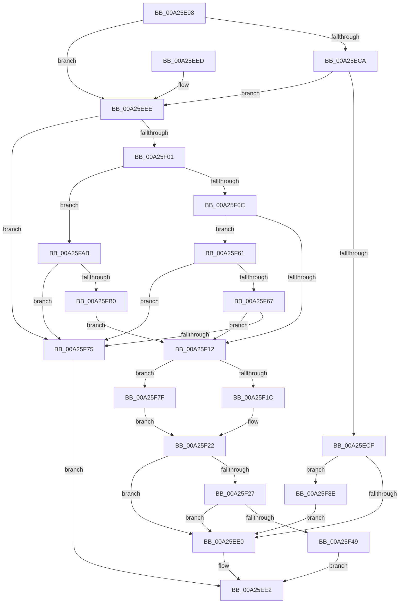

# MiPrepareVadDelete

- RVA: `0x00A25E98`–`0x00A25FB5` (길이 `285` bytes)
- VA: `0x0000000140A25E98`
- 실행 섹션: `PAGE`
- PDB 이름 있음: `예`; PDB Function 태그: `아니요`
- unwind 정보 RVA: `0x000ABCEC`
- 디코드: `80`개 명령, `285/285` bytes 표시
- 미해석 바이트: `0` (있으면 어셈블리에 `.byte`로 보존)

> 이 문서는 커널 이미지의 기계어와 PDB 기호를 분석해 생성했습니다. 4번과 5번은 함수 원형과 자료형을 바이너리 사용 방식에서 추정한 C 해석이며 원본 소스 복구 결과는 아닙니다.

## 1. Dependencies

- 직접 호출 지점: **3**; 고유 호출 대상: **3**
- 직접 호출자로 확인된 함수: **1**
- RIP 상대 이미지 참조: **0**

### Outgoing calls
- `0x00A25F40` → [MiLockAddressSpaceToo](../../text/2A/MiLockAddressSpaceToo_function_002A5670.md) (function, `0x002A5670`)
- `0x00A25F4C` → [MiVadDeleted](../../text/43/MiVadDeleted_function_00431350.md) (function, `0x00431350`)
- `0x00A25F9E` → [UNLOCK_ADDRESS_SPACE](../../text/2A/UNLOCK_ADDRESS_SPACE_function_002A4844.md) (function, `0x002A4844`)

### Direct callers
- [MiFreeVadRange](../../text/2A/MiFreeVadRange_function_002A77AC.md) at `0x002A7828`

### Static image references
- 디코드된 RIP-relative 메모리 참조가 없습니다.

## 2. Other-region calls and transfers

- 다른 실행 섹션으로 향하는 call: **3**
  - `0x00A25F40` → [MiLockAddressSpaceToo](../../text/2A/MiLockAddressSpaceToo_function_002A5670.md) (`PAGE` → `.text`)
  - `0x00A25F4C` → [MiVadDeleted](../../text/43/MiVadDeleted_function_00431350.md) (`PAGE` → `.text`)
  - `0x00A25F9E` → [UNLOCK_ADDRESS_SPACE](../../text/2A/UNLOCK_ADDRESS_SPACE_function_002A4844.md) (`PAGE` → `.text`)
- 별도 외부 분기/꼬리 이동을 확인하지 못했습니다.

## 3. Assembly (complete function range)

```asm
00A25E98  48 89 5C 24 08                  mov qword ptr [rsp + 8], rbx
00A25E9D  57                              push rdi
00A25E9E  48 83 EC 20                     sub rsp, 0x20
00A25EA2  8B 41 18                        mov eax, dword ptr [rcx + 0x18]
00A25EA5  48 8B DA                        mov rbx, rdx
00A25EA8  44 0F B6 51 20                  movzx r10d, byte ptr [rcx + 0x20]
00A25EAD  48 8B F9                        mov rdi, rcx
00A25EB0  0F B6 51 21                     movzx edx, byte ptr [rcx + 0x21]
00A25EB4  49 C1 E2 20                     shl r10, 0x20
00A25EB8  4C 0B D0                        or r10, rax
00A25EBB  48 C1 E2 20                     shl rdx, 0x20
00A25EBF  8B 41 1C                        mov eax, dword ptr [rcx + 0x1c]
00A25EC2  48 0B D0                        or rdx, rax
00A25EC5  4D 3B C2                        cmp r8, r10
00A25EC8  75 24                           jne 0x140a25eee
00A25ECA  4C 3B CA                        cmp r9, rdx
00A25ECD  75 1F                           jne 0x140a25eee
00A25ECF  48 8B 44 24 50                  mov rax, qword ptr [rsp + 0x50]
00A25ED4  83 20 00                        and dword ptr [rax], 0
00A25ED7  80 3B 00                        cmp byte ptr [rbx], 0
00A25EDA  0F 85 AE 00 00 00               jne 0x140a25f8e
00A25EE0  33 C0                           xor eax, eax
00A25EE2  48 8B 5C 24 30                  mov rbx, qword ptr [rsp + 0x30]
00A25EE7  48 83 C4 20                     add rsp, 0x20
00A25EEB  5F                              pop rdi
00A25EEC  C3                              ret
00A25EED  CC                              int3
00A25EEE  8B 49 30                        mov ecx, dword ptr [rcx + 0x30]
00A25EF1  41 BB 00 00 60 00               mov r11d, 0x600000
00A25EF7  8B C1                           mov eax, ecx
00A25EF9  41 23 C3                        and eax, r11d
00A25EFC  41 3B C3                        cmp eax, r11d
00A25EFF  74 74                           je 0x140a25f75
00A25F01  8B C1                           mov eax, ecx
00A25F03  83 E0 70                        and eax, 0x70
00A25F06  0F 85 9F 00 00 00               jne 0x140a25fab
00A25F0C  0F BA E1 15                     bt ecx, 0x15
00A25F10  72 4F                           jb 0x140a25f61
00A25F12  48 8B 44 24 50                  mov rax, qword ptr [rsp + 0x50]
00A25F17  4D 3B C2                        cmp r8, r10
00A25F1A  75 63                           jne 0x140a25f7f
00A25F1C  C7 00 01 00 00 00               mov dword ptr [rax], 1
00A25F22  80 3B 00                        cmp byte ptr [rbx], 0
00A25F25  75 B9                           jne 0x140a25ee0
00A25F27  65 48 8B 04 25 88 01 00 00      mov rax, qword ptr gs:[0x188]
00A25F30  45 33 C0                        xor r8d, r8d
00A25F33  48 8B D7                        mov rdx, rdi
00A25F36  C6 03 01                        mov byte ptr [rbx], 1
00A25F39  48 8B 88 B8 00 00 00            mov rcx, qword ptr [rax + 0xb8]
00A25F40  E8 2B F7 87 FF                  call 0x1402a5670
00A25F45  85 C0                           test eax, eax
00A25F47  75 97                           jne 0x140a25ee0
00A25F49  48 8B CF                        mov rcx, rdi
00A25F4C  E8 FF B3 A0 FF                  call 0x140431350
00A25F51  F7 D8                           neg eax
00A25F53  1B C0                           sbb eax, eax
00A25F55  25 73 FE FF FF                  and eax, 0xfffffe73
00A25F5A  05 2D 02 00 C0                  add eax, 0xc000022d
00A25F5F  EB 81                           jmp 0x140a25ee2
00A25F61  0F BA E1 17                     bt ecx, 0x17
00A25F65  72 0E                           jb 0x140a25f75
00A25F67  81 E1 00 00 18 00               and ecx, 0x180000
00A25F6D  81 F9 00 00 10 00               cmp ecx, 0x100000
00A25F73  72 9D                           jb 0x140a25f12
00A25F75  B8 9F 00 00 C0                  mov eax, 0xc000009f
00A25F7A  E9 63 FF FF FF                  jmp 0x140a25ee2
00A25F7F  33 C9                           xor ecx, ecx
00A25F81  4C 3B CA                        cmp r9, rdx
00A25F84  0F 95 C1                        setne cl
00A25F87  83 C1 02                        add ecx, 2
00A25F8A  89 08                           mov dword ptr [rax], ecx
00A25F8C  EB 94                           jmp 0x140a25f22
00A25F8E  65 48 8B 0C 25 88 01 00 00      mov rcx, qword ptr gs:[0x188]
00A25F97  48 8B 91 B8 00 00 00            mov rdx, qword ptr [rcx + 0xb8]
00A25F9E  E8 A1 E8 87 FF                  call 0x1402a4844
00A25FA3  C6 03 00                        mov byte ptr [rbx], 0
00A25FA6  E9 35 FF FF FF                  jmp 0x140a25ee0
00A25FAB  83 F8 40                        cmp eax, 0x40
00A25FAE  75 C5                           jne 0x140a25f75
00A25FB0  E9 5D FF FF FF                  jmp 0x140a25f12
```

## 4. C-style interpretation (structured pseudocode)

```c
__int64 __fastcall MiPrepareVadDelete(__int64 a1, __int64 a2, __int64 a3, __int64 a4, __int64 a5)
{
    __int64 result;
    __int64 v_r10;
    __int64 v_rsp;
    unsigned __int64 v_stack_p8;

    v_stack_p8 = v_rbx;
    v_rsp = (v_rsp) - (32);
    v_r10 = (*(unsigned __int8 *)(a1 + 32)) << (32);
    v_r10 = (v_r10) | ((unsigned int)(*(unsigned int *)(a1 + 24)));
    a2 = (*(unsigned __int8 *)(a1 + 33)) << (32);
    a2 = (a2) | ((unsigned int)(*(unsigned int *)(a1 + 28)));
    if (a3 != v_r10) goto loc_00A25EEE;
    if (a4 != a2) goto loc_00A25EEE;
    if ((*(unsigned __int8 *)(a2)) != 0) goto loc_00A25F8E;
loc_00A25EE0:
    result = 0;
loc_00A25EE2:
    v_rsp = (v_rsp) + (32);
    return result;
loc_00A25EEE:
    result = (unsigned int)(((unsigned int)((unsigned int)((unsigned int)(*(unsigned int *)(a1 + 48))))) & ((unsigned int)((unsigned int)(0x600000ULL))));
    if (((unsigned int)(result)) == ((unsigned int)((unsigned int)(0x600000ULL)))) goto loc_00A25F75;
    result = (unsigned int)(((unsigned int)((unsigned int)((unsigned int)(*(unsigned int *)(a1 + 48))))) & (112));
    if (condition_is_not_equal) goto loc_00A25FAB;
    if (condition_is_below) goto loc_00A25F61;
loc_00A25F12:
    if (a3 != v_r10) goto loc_00A25F7F;
    *(unsigned int *)(a5) = 1;
loc_00A25F22:
    if ((*(unsigned __int8 *)(v_stack_p8)) != 0) goto loc_00A25EE0;
    a3 = 0;
    *(unsigned __int8 *)(v_stack_p8) = 1;
    result = MiLockAddressSpaceToo(*(unsigned __int64 *)(*(unsigned __int64 *)(gs_base + (0 + 392)) + 184), a1, a3, a4);
    if ((unsigned int)(result) != 0) goto loc_00A25EE0;
    result = MiVadDeleted(a1, a1, a3, a4);
    result = (unsigned int)(-(result));
    result = (unsigned int)((result) & (0xFFFFFE73ULL));
    result = (unsigned int)((result) + (0xC000022DULL));
    goto loc_00A25EE2;
loc_00A25F61:
    if (condition_is_below) goto loc_00A25F75;
    a1 = (unsigned int)((a1) & (0x180000ULL));
    if (((unsigned int)(a1)) < 0x100000ULL) goto loc_00A25F12;
loc_00A25F75:
    goto loc_00A25EE2;
loc_00A25F7F:
    a1 = 0;
    a1 = (a4 != 0) ? 1 : 0;
    a1 = (unsigned int)((a1) + (2));
    *(unsigned int *)((unsigned int)(0xC000009FULL)) = (unsigned int)(a1);
    goto loc_00A25F22;
loc_00A25F8E:
    result = UNLOCK_ADDRESS_SPACE(*(unsigned __int64 *)(gs_base + (0 + 392)), *(unsigned __int64 *)(*(unsigned __int64 *)(gs_base + (0 + 392)) + 184), a3, a4);
    *(unsigned __int8 *)(v_stack_p8) = 0;
    goto loc_00A25EE0;
loc_00A25FAB:
    if (((unsigned int)(result)) != 64) goto loc_00A25F75;
    goto loc_00A25F12;
}
```

## 5. (Beta) C Style

```c
int64_t MiPrepareVadDelete(void *Arg1, void *Arg2, int64_t Arg3, int64_t Arg4, void *Arg5)
{
    uint8_t *arg1 = (uint8_t *)Arg1;
    uint8_t *arg2 = (uint8_t *)Arg2;
    uint8_t *arg5 = (uint8_t *)Arg5;

    int64_t result;
    int64_t local_r10;
    int64_t local_rsp;
    uint64_t v_stack_p8;

    v_stack_p8 = local_rbx;
    local_rsp = (local_rsp) - (32);
    local_r10 = (*(uint8_t *)(arg1 + 0x20)) << (32);
    local_r10 = (local_r10) | ((uint32_t)(*(uint32_t *)(arg1 + 0x18)));
    Arg2 = (*(uint8_t *)(arg1 + 0x21)) << (32);
    Arg2 = (Arg2) | ((uint32_t)(*(uint32_t *)(arg1 + 0x1C)));
    if (Arg3 != local_r10) goto loc_00A25EEE;
    if (Arg4 != Arg2) goto loc_00A25EEE;
    if ((*(uint8_t *)(arg2)) != 0) goto loc_00A25F8E;
loc_00A25EE0:
    result = 0;
loc_00A25EE2:
    local_rsp = (local_rsp) + (32);
    return result;
loc_00A25EEE:
    result = (uint32_t)(((uint32_t)((uint32_t)((uint32_t)(*(uint32_t *)(arg1 + 0x30))))) & ((uint32_t)((uint32_t)(0x600000ULL))));
    if (((uint32_t)(result)) == ((uint32_t)((uint32_t)(0x600000ULL)))) goto loc_00A25F75;
    result = (uint32_t)(((uint32_t)((uint32_t)((uint32_t)(*(uint32_t *)(arg1 + 0x30))))) & (112));
    if (condition_is_not_equal) goto loc_00A25FAB;
    if (condition_is_below) goto loc_00A25F61;
loc_00A25F12:
    if (Arg3 != local_r10) goto loc_00A25F7F;
    *(uint32_t *)(arg5) = 1;
loc_00A25F22:
    if ((*(uint8_t *)(v_stack_p8)) != 0) goto loc_00A25EE0;
    Arg3 = 0;
    *(uint8_t *)(v_stack_p8) = 1;
    result = MiLockAddressSpaceToo(*(uint64_t *)(*(uint64_t *)(gs_base + (0 + 0x188)) + 0xB8), Arg1, Arg3, Arg4);
    if ((uint32_t)(result) != 0) goto loc_00A25EE0;
    result = MiVadDeleted(Arg1, Arg1, Arg3, Arg4);
    result = (uint32_t)(-(result));
    result = (uint32_t)((result) & (0xFFFFFE73ULL));
    result = (uint32_t)((result) + (0xC000022DULL));
    goto loc_00A25EE2;
loc_00A25F61:
    if (condition_is_below) goto loc_00A25F75;
    Arg1 = (uint32_t)((Arg1) & (0x180000ULL));
    if (((uint32_t)(Arg1)) < 0x100000ULL) goto loc_00A25F12;
loc_00A25F75:
    goto loc_00A25EE2;
loc_00A25F7F:
    Arg1 = 0;
    Arg1 = (Arg4 != 0) ? 1 : 0;
    Arg1 = (uint32_t)((Arg1) + (2));
    *(uint32_t *)((uint32_t)(0xC000009FULL)) = (uint32_t)(Arg1);
    goto loc_00A25F22;
loc_00A25F8E:
    result = UNLOCK_ADDRESS_SPACE(*(uint64_t *)(gs_base + (0 + 0x188)), *(uint64_t *)(*(uint64_t *)(gs_base + (0 + 0x188)) + 0xB8), Arg3, Arg4);
    *(uint8_t *)(v_stack_p8) = 0;
    goto loc_00A25EE0;
loc_00A25FAB:
    if (((uint32_t)(result)) != 64) goto loc_00A25F75;
    goto loc_00A25F12;
}
```

### 관측된 메모리 오프셋

구조체 형식이 확인되지 않은 접근은 인자 기준의 오프셋으로만 기록했습니다.

| 기준 인자 | 오프셋 표현 | 폭 (bit) | 접근 |
|---|---:|---:|---|
| `Arg1` | `+ 0x18` | `32` | `R` |
| `Arg1` | `+ 0x1C` | `32` | `R` |
| `Arg1` | `+ 0x20` | `8` | `R` |
| `Arg1` | `+ 0x21` | `8` | `R` |
| `Arg1` | `+ 0x30` | `32` | `R` |
| `Arg2` | `+ 0x0` | `8` | `R` |
| `Arg2` | `+ 0x0` | `8` | `W` |
| `Arg5` | `+ 0x0` | `32` | `R/W` |
| `Arg5` | `+ 0x0` | `32` | `W` |

## 6. Execution-region graph

[열기: 2D/3D 그래프와 함수 탐색 컨트롤 패널](../../../control-panel.html?section=page&rva=0x00A25E98&view=graph)

- 2D 그래프는 위에서 아래로 흐르고, 3D 그래프는 빈 공간을 드래그해 회전합니다. Shift+드래그는 이동, 휠은 확대·축소, 함수 노드 선택은 대상 보고서 이동입니다.

### Static fallback


