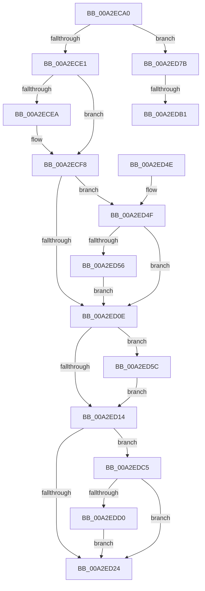

# MiSectionDelete

- RVA: `0x00A2ECA0`–`0x00A2EDDF` (길이 `319` bytes)
- VA: `0x0000000140A2ECA0`
- 실행 섹션: `PAGE`
- PDB 이름 있음: `예`; PDB Function 태그: `예`
- unwind 정보 RVA: `0x000ACA00`
- 디코드: `84`개 명령, `319/319` bytes 표시
- 미해석 바이트: `0` (있으면 어셈블리에 `.byte`로 보존)

> 이 문서는 커널 이미지의 기계어와 PDB 기호를 분석해 생성했습니다. 4번과 5번은 함수 원형과 자료형을 바이너리 사용 방식에서 추정한 C 해석이며 원본 소스 복구 결과는 아닙니다.

## 1. Dependencies

- 직접 호출 지점: **7**; 고유 호출 대상: **7**
- 직접 호출자로 확인된 함수: **0**
- RIP 상대 이미지 참조: **2**

### Outgoing calls
- `0x00A2ECCE` → [MiSectionControlArea](../../text/29/MiSectionControlArea_function_00294CB0.md) (function, `0x00294CB0`)
- `0x00A2ECF3` → [ObfDereferenceObjectWithTag](../../text/2F/ObfDereferenceObjectWithTag_function_002F78E0.md) (function, `0x002F78E0`)
- `0x00A2ED2A` → [MiDereferenceControlAreaBySection](../../text/45/MiDereferenceControlAreaBySection_function_00458348.md) (function, `0x00458348`)
- `0x00A2ED74` → [MiDereferencePerSessionProtos](MiDereferencePerSessionProtos_function_00A2EDE8.md) (function, `0x00A2EDE8`)
- `0x00A2ED9C` → [KeAbPreAcquire](../../text/21/KeAbPreAcquire_function_00210230.md) (function, `0x00210230`)
- `0x00A2EDBA` → [ExfAcquirePushLockExclusiveEx](../../text/20/ExfAcquirePushLockExclusiveEx_function_0020FC90.md) (function, `0x0020FC90`)
- `0x00A2EDD5` → [MiLogSectionObjectEvent](../7F/MiLogSectionObjectEvent_function_007FCF28.md) (function, `0x007FCF28`)

### Direct callers
- 이 함수 시작 RVA로 연결되는 직접 call은 확인되지 않았습니다. 간접 호출은 완전히 역산할 수 없습니다.

### Static image references
- `0x00A2ED14` → RVA `0x00FC6B04` (`ALMOSTRO`; read)
- `0x00A2ED84` → RVA `0x00E2CD10` (`.data`; read)

## 2. Other-region calls and transfers

- 다른 실행 섹션으로 향하는 call: **5**
  - `0x00A2ECCE` → [MiSectionControlArea](../../text/29/MiSectionControlArea_function_00294CB0.md) (`PAGE` → `.text`)
  - `0x00A2ECF3` → [ObfDereferenceObjectWithTag](../../text/2F/ObfDereferenceObjectWithTag_function_002F78E0.md) (`PAGE` → `.text`)
  - `0x00A2ED2A` → [MiDereferenceControlAreaBySection](../../text/45/MiDereferenceControlAreaBySection_function_00458348.md) (`PAGE` → `.text`)
  - `0x00A2ED9C` → [KeAbPreAcquire](../../text/21/KeAbPreAcquire_function_00210230.md) (`PAGE` → `.text`)
  - `0x00A2EDBA` → [ExfAcquirePushLockExclusiveEx](../../text/20/ExfAcquirePushLockExclusiveEx_function_0020FC90.md) (`PAGE` → `.text`)
- call이 아닌 외부 분기/꼬리 이동: **2**
  - `0x00A2EDAB` → [sub_00B3976A](../B3/Unknown_function_00B3976A.md) (`tail-transfer`)
  - `0x00A2EDC0` → [sub_00B3976A](../B3/Unknown_function_00B3976A.md) (`tail-transfer`)

## 3. Assembly (complete function range)

```asm
00A2ECA0  48 8B C4                        mov rax, rsp
00A2ECA3  48 89 58 08                     mov qword ptr [rax + 8], rbx
00A2ECA7  48 89 68 10                     mov qword ptr [rax + 0x10], rbp
00A2ECAB  48 89 70 18                     mov qword ptr [rax + 0x18], rsi
00A2ECAF  48 89 78 20                     mov qword ptr [rax + 0x20], rdi
00A2ECB3  41 54                           push r12
00A2ECB5  41 55                           push r13
00A2ECB7  41 56                           push r14
00A2ECB9  48 83 EC 20                     sub rsp, 0x20
00A2ECBD  44 0F B7 71 3A                  movzx r14d, word ptr [rcx + 0x3a]
00A2ECC2  41 BD 01 00 00 00               mov r13d, 1
00A2ECC8  45 23 F5                        and r14d, r13d
00A2ECCB  48 8B F9                        mov rdi, rcx
00A2ECCE  E8 DD 5F 86 FF                  call 0x140294cb0
00A2ECD3  48 83 79 18 00                  cmp qword ptr [rcx + 0x18], 0
00A2ECD8  48 8B D8                        mov rbx, rax
00A2ECDB  0F 85 9A 00 00 00               jne 0x140a2ed7b
00A2ECE1  48 8B 4F 28                     mov rcx, qword ptr [rdi + 0x28]
00A2ECE5  F6 C1 03                        test cl, 3
00A2ECE8  74 0E                           je 0x140a2ecf8
00A2ECEA  48 83 E1 FC                     and rcx, 0xfffffffffffffffc
00A2ECEE  BA 4D 6D 53 43                  mov edx, 0x43536d4d
00A2ECF3  E8 E8 8B 8C FF                  call 0x1402f78e0
00A2ECF8  8B 43 38                        mov eax, dword ptr [rbx + 0x38]
00A2ECFB  F7 47 38 00 00 00 10            test dword ptr [rdi + 0x38], 0x10000000
00A2ED02  0F 95 C2                        setne dl
00A2ED05  A8 20                           test al, 0x20
00A2ED07  0F 94 C1                        sete cl
00A2ED0A  84 D1                           test cl, dl
00A2ED0C  75 41                           jne 0x140a2ed4f
00A2ED0E  0F BA E0 1B                     bt eax, 0x1b
00A2ED12  72 48                           jb 0x140a2ed5c
00A2ED14  F7 05 E6 7D 59 00 01 00 40 00   test dword ptr [rip + 0x597de6], 0x400001
00A2ED1E  0F 85 A1 00 00 00               jne 0x140a2edc5
00A2ED24  41 8B D6                        mov edx, r14d
00A2ED27  48 8B CB                        mov rcx, rbx
00A2ED2A  E8 19 96 A2 FF                  call 0x140458348
00A2ED2F  48 8B 5C 24 40                  mov rbx, qword ptr [rsp + 0x40]
00A2ED34  48 8B 6C 24 48                  mov rbp, qword ptr [rsp + 0x48]
00A2ED39  48 8B 74 24 50                  mov rsi, qword ptr [rsp + 0x50]
00A2ED3E  48 8B 7C 24 58                  mov rdi, qword ptr [rsp + 0x58]
00A2ED43  48 83 C4 20                     add rsp, 0x20
00A2ED47  41 5E                           pop r14
00A2ED49  41 5D                           pop r13
00A2ED4B  41 5C                           pop r12
00A2ED4D  C3                              ret
00A2ED4E  CC                              int3
00A2ED4F  48 83 7B 40 00                  cmp qword ptr [rbx + 0x40], 0
00A2ED54  74 B8                           je 0x140a2ed0e
00A2ED56  F0 FF 4B 5C                     lock dec dword ptr [rbx + 0x5c]
00A2ED5A  EB B2                           jmp 0x140a2ed0e
00A2ED5C  8B 57 3C                        mov edx, dword ptr [rdi + 0x3c]
00A2ED5F  B9 FF FF 07 00                  mov ecx, 0x7ffff
00A2ED64  C1 EA 0C                        shr edx, 0xc
00A2ED67  83 C8 FF                        or eax, 0xffffffff
00A2ED6A  23 D1                           and edx, ecx
00A2ED6C  3B D1                           cmp edx, ecx
00A2ED6E  48 8B CB                        mov rcx, rbx
00A2ED71  0F 44 D0                        cmove edx, eax
00A2ED74  E8 6F 00 00 00                  call 0x140a2ede8
00A2ED79  EB 99                           jmp 0x140a2ed14
00A2ED7B  65 48 8B 34 25 88 01 00 00      mov rsi, qword ptr gs:[0x188]
00A2ED84  4C 8D 25 85 DF 3F 00            lea r12, [rip + 0x3fdf85]
00A2ED8B  45 33 C0                        xor r8d, r8d
00A2ED8E  33 D2                           xor edx, edx
00A2ED90  49 8B CC                        mov rcx, r12
00A2ED93  66 44 29 AE E6 01 00 00         sub word ptr [rsi + 0x1e6], r13w
00A2ED9B  90                              nop
00A2ED9C  E8 8F 14 7E FF                  call 0x140210230
00A2EDA1  F0 49 0F BA 2C 24 00            lock bts qword ptr [r12], 0
00A2EDA8  48 8B E8                        mov rbp, rax
00A2EDAB  0F 83 B9 A9 10 00               jae 0x140b3976a
00A2EDB1  4D 8B C4                        mov r8, r12
00A2EDB4  48 8B D0                        mov rdx, rax
00A2EDB7  49 8B CC                        mov rcx, r12
00A2EDBA  E8 D1 0E 7E FF                  call 0x14020fc90
00A2EDBF  90                              nop
00A2EDC0  E9 A5 A9 10 00                  jmp 0x140b3976a
00A2EDC5  48 83 7B 40 00                  cmp qword ptr [rbx + 0x40], 0
00A2EDCA  0F 85 54 FF FF FF               jne 0x140a2ed24
00A2EDD0  33 D2                           xor edx, edx
00A2EDD2  48 8B CF                        mov rcx, rdi
00A2EDD5  E8 4E E1 DC FF                  call 0x1407fcf28
00A2EDDA  E9 45 FF FF FF                  jmp 0x140a2ed24
```

## 4. C-style interpretation (structured pseudocode)

```c
__int64 __fastcall MiSectionDelete(__int64 a1, __int64 a2, int a3)
{
    __int64 result;
    __int64 v_r14;
    __int64 v_rsp;
    unsigned __int64 v_stack_p10;
    unsigned __int64 v_stack_p18;
    unsigned __int64 v_stack_p20;
    unsigned __int64 v_stack_p8;

    *(unsigned __int64 *)(v_rsp + 8) = v_rbx;
    *(unsigned __int64 *)(v_rsp + 16) = v_rbp;
    *(unsigned __int64 *)(v_rsp + 24) = v_rsi;
    *(unsigned __int64 *)(v_rsp + 32) = v_rdi;
    v_rsp = (v_rsp) - (32);
    v_r14 = (unsigned int)((*(unsigned __int16 *)(a1 + 58)) & (1));
    result = MiSectionControlArea(a1, a2, a3, a4);
    if ((*(unsigned __int64 *)(a1 + 24)) != 0) goto loc_00A2ED7B;
    if ((((unsigned __int8)(*(unsigned __int64 *)(a1 + 40))) & (3)) != 0) {
        a1 = (*(unsigned __int64 *)(a1 + 40)) & (-4);
        a2 = 0x43536D4DULL;
        result = ObfDereferenceObjectWithTag(a1, a2, a3, a4);
    }
    a2 = (((*(unsigned int *)(a1 + 56)) & (0x10000000ULL)) != 0) ? 1 : 0;
    a1 = ((((unsigned __int8)((unsigned int)(*(unsigned int *)(result + 56)))) & (32)) == 0) ? 1 : 0;
    if ((((unsigned __int8)(a1)) & ((unsigned __int8)(a2))) != 0) goto loc_00A2ED4F;
loc_00A2ED0E:
    if (condition_is_below) goto loc_00A2ED5C;
loc_00A2ED14:
    if (((*(unsigned int *)(v_rip + 5864934)) & (0x400001ULL)) != 0) goto loc_00A2EDC5;
loc_00A2ED24:
    result = MiDereferenceControlAreaBySection(result, (unsigned int)((unsigned int)(v_r14)), a3, a4);
    v_rsp = (v_rsp) + (32);
    return result;
loc_00A2ED4F:
    if ((*(unsigned __int64 *)(v_stack_p8 + 64)) == 0) goto loc_00A2ED0E;
    goto loc_00A2ED0E;
loc_00A2ED5C:
    a2 = (unsigned int)(((unsigned int)(*(unsigned int *)(v_stack_p20 + 60))) >> (12));
    result = (unsigned int)((result) | (0xFFFFFFFFULL));
    a2 = (unsigned int)((a2) & ((unsigned int)((unsigned int)(0x7FFFFULL))));
    if (((unsigned int)(a2)) == ((unsigned int)((unsigned int)(0x7FFFFULL)))) { a2 = (unsigned int)(result); }
    result = MiDereferencePerSessionProtos(v_stack_p8, a2, a3, a4);
    goto loc_00A2ED14;
loc_00A2ED7B:
    a3 = 0;
    a2 = 0;
    result = KeAbPreAcquire(v_rip + 4185989, a2, a3, a4);
    result = ExfAcquirePushLockExclusiveEx(v_rip + 4185989, result, v_rip + 4185989, a4);
loc_00A2EDC5:
    if ((*(unsigned __int64 *)(v_stack_p8 + 64)) != 0) goto loc_00A2ED24;
    a2 = 0;
    result = MiLogSectionObjectEvent(v_stack_p20, a2, v_rip + 4185989, a4);
    goto loc_00A2ED24;
}
```

## 5. (Beta) C Style

```c
int64_t MiSectionDelete(void *Arg1, int64_t Arg2, int32_t Arg3)
{
    uint8_t *arg1 = (uint8_t *)Arg1;

    int64_t result;
    int64_t local_r14;
    int64_t local_rsp;
    uint64_t v_stack_p10;
    uint64_t v_stack_p18;
    uint64_t v_stack_p20;
    uint64_t v_stack_p8;

    *(uint64_t *)(local_rsp + 0x8) = local_rbx;
    *(uint64_t *)(local_rsp + 0x10) = local_rbp;
    *(uint64_t *)(local_rsp + 0x18) = local_rsi;
    *(uint64_t *)(local_rsp + 0x20) = local_rdi;
    local_rsp = (local_rsp) - (32);
    local_r14 = (uint32_t)((*(uint16_t *)(arg1 + 0x3A)) & (1));
    result = MiSectionControlArea(Arg1, Arg2, Arg3, a4);
    if ((*(uint64_t *)(arg1 + 0x18)) != 0) goto loc_00A2ED7B;
    if ((((uint8_t)(*(uint64_t *)(arg1 + 0x28))) & (3)) != 0) {
        Arg1 = (*(uint64_t *)(arg1 + 0x28)) & (-4);
        Arg2 = 0x43536D4DULL;
        result = ObfDereferenceObjectWithTag(Arg1, Arg2, Arg3, a4);
    }
    Arg2 = (((*(uint32_t *)(arg1 + 0x38)) & (0x10000000ULL)) != 0) ? 1 : 0;
    Arg1 = ((((uint8_t)((uint32_t)(*(uint32_t *)(result + 0x38)))) & (32)) == 0) ? 1 : 0;
    if ((((uint8_t)(Arg1)) & ((uint8_t)(Arg2))) != 0) goto loc_00A2ED4F;
loc_00A2ED0E:
    if (condition_is_below) goto loc_00A2ED5C;
loc_00A2ED14:
    if (((*(uint32_t *)(v_rip + 0x597DE6)) & (0x400001ULL)) != 0) goto loc_00A2EDC5;
loc_00A2ED24:
    result = MiDereferenceControlAreaBySection(result, (uint32_t)((uint32_t)(local_r14)), Arg3, a4);
    local_rsp = (local_rsp) + (32);
    return result;
loc_00A2ED4F:
    if ((*(uint64_t *)(v_stack_p8 + 0x40)) == 0) goto loc_00A2ED0E;
    goto loc_00A2ED0E;
loc_00A2ED5C:
    Arg2 = (uint32_t)(((uint32_t)(*(uint32_t *)(v_stack_p20 + 0x3C))) >> (12));
    result = (uint32_t)((result) | (0xFFFFFFFFULL));
    Arg2 = (uint32_t)((Arg2) & ((uint32_t)((uint32_t)(0x7FFFFULL))));
    if (((uint32_t)(Arg2)) == ((uint32_t)((uint32_t)(0x7FFFFULL)))) { Arg2 = (uint32_t)(result); }
    result = MiDereferencePerSessionProtos(v_stack_p8, Arg2, Arg3, a4);
    goto loc_00A2ED14;
loc_00A2ED7B:
    Arg3 = 0;
    Arg2 = 0;
    result = KeAbPreAcquire(v_rip + 4185989, Arg2, Arg3, a4);
    result = ExfAcquirePushLockExclusiveEx(v_rip + 4185989, result, v_rip + 4185989, a4);
loc_00A2EDC5:
    if ((*(uint64_t *)(v_stack_p8 + 0x40)) != 0) goto loc_00A2ED24;
    Arg2 = 0;
    result = MiLogSectionObjectEvent(v_stack_p20, Arg2, v_rip + 4185989, a4);
    goto loc_00A2ED24;
}
```

### 관측된 메모리 오프셋

구조체 형식이 확인되지 않은 접근은 인자 기준의 오프셋으로만 기록했습니다.

| 기준 인자 | 오프셋 표현 | 폭 (bit) | 접근 |
|---|---:|---:|---|
| `Arg1` | `+ 0x28` | `64` | `R` |
| `Arg1` | `+ 0x38` | `32` | `R` |
| `Arg1` | `+ 0x3A` | `16` | `R` |
| `Arg1` | `+ 0x3C` | `32` | `R` |

## 6. Execution-region graph

[열기: 2D/3D 그래프와 함수 탐색 컨트롤 패널](../../../control-panel.html?section=page&rva=0x00A2ECA0&view=graph)

- 2D 그래프는 위에서 아래로 흐르고, 3D 그래프는 빈 공간을 드래그해 회전합니다. Shift+드래그는 이동, 휠은 확대·축소, 함수 노드 선택은 대상 보고서 이동입니다.

### Static fallback


