# MiSnapThunk

- RVA: `0x00A24004`–`0x00A242F3` (길이 `751` bytes)
- VA: `0x0000000140A24004`
- 실행 섹션: `PAGE`
- PDB 이름 있음: `예`; PDB Function 태그: `아니요`
- unwind 정보 RVA: `0x000AB774`
- 디코드: `223`개 명령, `751/751` bytes 표시
- 미해석 바이트: `0` (있으면 어셈블리에 `.byte`로 보존)

> 이 문서는 커널 이미지의 기계어와 PDB 기호를 분석해 생성했습니다. 4번과 5번은 함수 원형과 자료형을 바이너리 사용 방식에서 추정한 C 해석이며 원본 소스 복구 결과는 아닙니다.

## 1. Dependencies

- 직접 호출 지점: **10**; 고유 호출 대상: **9**
- 직접 호출자로 확인된 함수: **2**
- RIP 상대 이미지 참조: **1**

### Outgoing calls
- `0x00A24050` → [RtlImageDirectoryEntryToData](../../text/43/RtlImageDirectoryEntryToData_function_004328D0.md) (function, `0x004328D0`)
- `0x00A24184` → [strchr](../../text/50/strchr_function_005014F0.md) (function, `0x005014F0`)
- `0x00A241AE` → [RtlAnsiStringToUnicodeString](../90/RtlAnsiStringToUnicodeString_function_0090BEA0.md) (function, `0x0090BEA0`)
- `0x00A2423A` → [MiAllocatePool](../../text/35/MiAllocatePool_function_0035B540.md) (function, `0x0035B540`)
- `0x00A24251` → [ExFreePool](../../poolcode/B8/ExFreePool_function_00B82850.md) (function, `0x00B82850`)
- `0x00A2425F` → [RtlUpperChar](../90/RtlUpperChar_function_0090D730.md) (function, `0x0090D730`)
- `0x00A24269` → [RtlUpperChar](../90/RtlUpperChar_function_0090D730.md) (function, `0x0090D730`)
- `0x00A242B0` → [memcpy](../../text/6C/memcpy_function_006C6840.md) (function, `0x006C6840`)
- `0x00A242D2` → [MiSnapThunk](MiSnapThunk_function_00A24004.md) (function, `0x00A24004`)
- `0x00A242DE` → [ExFreePoolWithTag](../../poolcode/B8/ExFreePoolWithTag_function_00B82870.md) (function, `0x00B82870`)

### Direct callers
- [MiResolveImageReferences](MiResolveImageReferences_function_00A23BE4.md) at `0x00A23EF1`
- [MiSnapThunk](MiSnapThunk_function_00A24004.md) at `0x00A242D2`

### Static image references
- `0x00A241BB` → RVA `0x00EF54C0` (`.data`; read)

## 2. Other-region calls and transfers

- 다른 실행 섹션으로 향하는 call: **6**
  - `0x00A24050` → [RtlImageDirectoryEntryToData](../../text/43/RtlImageDirectoryEntryToData_function_004328D0.md) (`PAGE` → `.text`)
  - `0x00A24184` → [strchr](../../text/50/strchr_function_005014F0.md) (`PAGE` → `.text`)
  - `0x00A2423A` → [MiAllocatePool](../../text/35/MiAllocatePool_function_0035B540.md) (`PAGE` → `.text`)
  - `0x00A24251` → [ExFreePool](../../poolcode/B8/ExFreePool_function_00B82850.md) (`PAGE` → `POOLCODE`)
  - `0x00A242B0` → [memcpy](../../text/6C/memcpy_function_006C6840.md) (`PAGE` → `.text`)
  - `0x00A242DE` → [ExFreePoolWithTag](../../poolcode/B8/ExFreePoolWithTag_function_00B82870.md) (`PAGE` → `POOLCODE`)
- 별도 외부 분기/꼬리 이동을 확인하지 못했습니다.

## 3. Assembly (complete function range)

```asm
00A24004  48 8B C4                        mov rax, rsp
00A24007  48 89 58 08                     mov qword ptr [rax + 8], rbx
00A2400B  48 89 70 18                     mov qword ptr [rax + 0x18], rsi
00A2400F  4C 89 48 20                     mov qword ptr [rax + 0x20], r9
00A24013  48 89 50 10                     mov qword ptr [rax + 0x10], rdx
00A24017  55                              push rbp
00A24018  57                              push rdi
00A24019  41 55                           push r13
00A2401B  41 56                           push r14
00A2401D  41 57                           push r15
00A2401F  48 8B EC                        mov rbp, rsp
00A24022  48 83 EC 70                     sub rsp, 0x70
00A24026  4D 8B F1                        mov r14, r9
00A24029  49 8B D8                        mov rbx, r8
00A2402C  48 8B F2                        mov rsi, rdx
00A2402F  4C 8D 4D C8                     lea r9, [rbp - 0x38]
00A24033  0F 57 C0                        xorps xmm0, xmm0
00A24036  0F 57 C9                        xorps xmm1, xmm1
00A24039  45 33 ED                        xor r13d, r13d
00A2403C  45 33 C0                        xor r8d, r8d
00A2403F  B2 01                           mov dl, 1
00A24041  44 89 6D C8                     mov dword ptr [rbp - 0x38], r13d
00A24045  0F 11 45 D8                     movups xmmword ptr [rbp - 0x28], xmm0
00A24049  48 8B F9                        mov rdi, rcx
00A2404C  0F 11 4D E8                     movups xmmword ptr [rbp - 0x18], xmm1
00A24050  E8 7B E8 A0 FF                  call 0x1404328d0
00A24055  4C 8B C0                        mov r8, rax
00A24058  48 85 C0                        test rax, rax
00A2405B  74 66                           je 0x140a240c3
00A2405D  48 8B 03                        mov rax, qword ptr [rbx]
00A24060  48 8B 4D 50                     mov rcx, qword ptr [rbp + 0x50]
00A24064  48 85 C0                        test rax, rax
00A24067  0F 88 1A 02 00 00               js 0x140a24287
00A2406D  48 85 C9                        test rcx, rcx
00A24070  75 04                           jne 0x140a24076
00A24072  48 8D 0C 30                     lea rcx, [rax + rsi]
00A24076  45 8B 70 20                     mov r14d, dword ptr [r8 + 0x20]
00A2407A  41 8B 58 24                     mov ebx, dword ptr [r8 + 0x24]
00A2407E  4C 03 F7                        add r14, rdi
00A24081  0F B7 11                        movzx edx, word ptr [rcx]
00A24084  48 03 DF                        add rbx, rdi
00A24087  45 8B 50 18                     mov r10d, dword ptr [r8 + 0x18]
00A2408B  41 3B D2                        cmp edx, r10d
00A2408E  73 2B                           jae 0x140a240bb
00A24090  8B F2                           mov esi, edx
00A24092  48 8D 41 02                     lea rax, [rcx + 2]
00A24096  41 8B 14 96                     mov edx, dword ptr [r14 + rdx*4]
00A2409A  48 03 D7                        add rdx, rdi
00A2409D  48 2B D0                        sub rdx, rax
00A240A0  44 0F B6 08                     movzx r9d, byte ptr [rax]
00A240A4  44 0F B6 1C 10                  movzx r11d, byte ptr [rax + rdx]
00A240A9  45 2B CB                        sub r9d, r11d
00A240AC  75 08                           jne 0x140a240b6
00A240AE  48 FF C0                        inc rax
00A240B1  45 85 DB                        test r11d, r11d
00A240B4  75 EA                           jne 0x140a240a0
00A240B6  45 85 C9                        test r9d, r9d
00A240B9  74 70                           je 0x140a2412b
00A240BB  41 8B F5                        mov esi, r13d
00A240BE  45 85 D2                        test r10d, r10d
00A240C1  75 1F                           jne 0x140a240e2
00A240C3  B8 63 02 00 C0                  mov eax, 0xc0000263
00A240C8  4C 8D 5C 24 70                  lea r11, [rsp + 0x70]
00A240CD  49 8B 5B 30                     mov rbx, qword ptr [r11 + 0x30]
00A240D1  49 8B 73 40                     mov rsi, qword ptr [r11 + 0x40]
00A240D5  49 8B E3                        mov rsp, r11
00A240D8  41 5F                           pop r15
00A240DA  41 5E                           pop r14
00A240DC  41 5D                           pop r13
00A240DE  5F                              pop rdi
00A240DF  5D                              pop rbp
00A240E0  C3                              ret
00A240E1  CC                              int3
00A240E2  45 8D 5A FF                     lea r11d, [r10 - 1]
00A240E6  44 3B DE                        cmp r11d, esi
00A240E9  7C D8                           jl 0x140a240c3
00A240EB  42 8D 14 1E                     lea edx, [rsi + r11]
00A240EF  D1 FA                           sar edx, 1
00A240F1  48 8D 41 02                     lea rax, [rcx + 2]
00A240F5  4C 63 FA                        movsxd r15, edx
00A240F8  47 8B 14 BE                     mov r10d, dword ptr [r14 + r15*4]
00A240FC  4C 03 D7                        add r10, rdi
00A240FF  4C 2B D0                        sub r10, rax
00A24102  44 8A 08                        mov r9b, byte ptr [rax]
00A24105  46 3A 0C 10                     cmp r9b, byte ptr [rax + r10]
00A24109  75 5F                           jne 0x140a2416a
00A2410B  48 FF C0                        inc rax
00A2410E  45 84 C9                        test r9b, r9b
00A24111  75 EF                           jne 0x140a24102
00A24113  41 8B C5                        mov eax, r13d
00A24116  85 C0                           test eax, eax
00A24118  79 0A                           jns 0x140a24124
00A2411A  85 D2                           test edx, edx
00A2411C  74 A5                           je 0x140a240c3
00A2411E  44 8D 5A FF                     lea r11d, [rdx - 1]
00A24122  EB C2                           jmp 0x140a240e6
00A24124  7E 4B                           jle 0x140a24171
00A24126  8D 72 01                        lea esi, [rdx + 1]
00A24129  EB BB                           jmp 0x140a240e6
00A2412B  0F B7 14 73                     movzx edx, word ptr [rbx + rsi*2]
00A2412F  4C 8B 75 48                     mov r14, qword ptr [rbp + 0x48]
00A24133  0F B7 C2                        movzx eax, dx
00A24136  41 3B 40 14                     cmp eax, dword ptr [r8 + 0x14]
00A2413A  0F 83 38 01 00 00               jae 0x140a24278
00A24140  41 8B 40 1C                     mov eax, dword ptr [r8 + 0x1c]
00A24144  48 03 C7                        add rax, rdi
00A24147  0F B7 CA                        movzx ecx, dx
00A2414A  8B 0C 88                        mov ecx, dword ptr [rax + rcx*4]
00A2414D  48 03 F9                        add rdi, rcx
00A24150  49 89 3E                        mov qword ptr [r14], rdi
00A24153  49 3B F8                        cmp rdi, r8
00A24156  76 0B                           jbe 0x140a24163
00A24158  8B 45 C8                        mov eax, dword ptr [rbp - 0x38]
00A2415B  49 03 C0                        add rax, r8
00A2415E  48 3B F8                        cmp rdi, rax
00A24161  72 15                           jb 0x140a24178
00A24163  33 C0                           xor eax, eax
00A24165  E9 5E FF FF FF                  jmp 0x140a240c8
00A2416A  1B C0                           sbb eax, eax
00A2416C  83 C8 01                        or eax, 1
00A2416F  EB A5                           jmp 0x140a24116
00A24171  42 0F B7 14 7B                  movzx edx, word ptr [rbx + r15*2]
00A24176  EB B7                           jmp 0x140a2412f
00A24178  BA 2E 00 00 00                  mov edx, 0x2e
00A2417D  48 89 7D F0                     mov qword ptr [rbp - 0x10], rdi
00A24181  48 8B CF                        mov rcx, rdi
00A24184  E8 67 D3 AD FF                  call 0x1405014f0
00A24189  48 8B D8                        mov rbx, rax
00A2418C  48 8D 55 E8                     lea rdx, [rbp - 0x18]
00A24190  B9 01 00 00 00                  mov ecx, 1
00A24195  41 B0 01                        mov r8b, 1
00A24198  66 2B CF                        sub cx, di
00A2419B  66 03 D9                        add bx, cx
00A2419E  48 8D 4D D8                     lea rcx, [rbp - 0x28]
00A241A2  48 89 5D D0                     mov qword ptr [rbp - 0x30], rbx
00A241A6  66 89 5D E8                     mov word ptr [rbp - 0x18], bx
00A241AA  66 89 5D EA                     mov word ptr [rbp - 0x16], bx
00A241AE  E8 ED 7C EE FF                  call 0x14090bea0
00A241B3  85 C0                           test eax, eax
00A241B5  0F 88 08 FF FF FF               js 0x140a240c3
00A241BB  4C 8B 3D FE 12 4D 00            mov r15, qword ptr [rip + 0x4d12fe]
00A241C2  BE 63 02 00 C0                  mov esi, 0xc0000263
00A241C7  48 8D 05 F2 12 4D 00            lea rax, [rip + 0x4d12f2]
00A241CE  4C 3B F8                        cmp r15, rax
00A241D1  0F 84 AB 00 00 00               je 0x140a24282
00A241D7  0F B7 4D D8                     movzx ecx, word ptr [rbp - 0x28]
00A241DB  41 0F B7 47 58                  movzx eax, word ptr [r15 + 0x58]
00A241E0  4C 8B 75 E0                     mov r14, qword ptr [rbp - 0x20]
00A241E4  4D 8B 6F 60                     mov r13, qword ptr [r15 + 0x60]
00A241E8  3B C1                           cmp eax, ecx
00A241EA  0F 82 AD 00 00 00               jb 0x140a2429d
00A241F0  49 8D 04 0E                     lea rax, [r14 + rcx]
00A241F4  48 89 45 C8                     mov qword ptr [rbp - 0x38], rax
00A241F8  4C 3B F0                        cmp r14, rax
00A241FB  73 16                           jae 0x140a24213
00A241FD  41 8A 0E                        mov cl, byte ptr [r14]
00A24200  41 8A 55 00                     mov dl, byte ptr [r13]
00A24204  88 4D C0                        mov byte ptr [rbp - 0x40], cl
00A24207  3A CA                           cmp cl, dl
00A24209  75 52                           jne 0x140a2425d
00A2420B  49 FF C6                        inc r14
00A2420E  49 FF C5                        inc r13
00A24211  EB E5                           jmp 0x140a241f8
00A24213  44 0F B7 75 D0                  movzx r14d, word ptr [rbp - 0x30]
00A24218  48 83 CB FF                     or rbx, 0xffffffffffffffff
00A2421C  4C 03 F7                        add r14, rdi
00A2421F  45 33 ED                        xor r13d, r13d
00A24222  48 FF C3                        inc rbx
00A24225  45 38 2C 1E                     cmp byte ptr [r14 + rbx], r13b
00A24229  75 F7                           jne 0x140a24222
00A2422B  48 8D 53 05                     lea rdx, [rbx + 5]
00A2422F  B9 00 01 00 00                  mov ecx, 0x100
00A24234  41 B8 4D 6D 20 20               mov r8d, 0x20206d4d
00A2423A  E8 01 73 93 FF                  call 0x14035b540
00A2423F  48 8B F8                        mov rdi, rax
00A24242  48 85 C0                        test rax, rax
00A24245  75 5E                           jne 0x140a242a5
00A24247  4C 39 6D E0                     cmp qword ptr [rbp - 0x20], r13
00A2424B  74 09                           je 0x140a24256
00A2424D  48 8B 4D E0                     mov rcx, qword ptr [rbp - 0x20]
00A24251  E8 FA E5 15 00                  call 0x140b82850
00A24256  8B C6                           mov eax, esi
00A24258  E9 6B FE FF FF                  jmp 0x140a240c8
00A2425D  8A CA                           mov cl, dl
00A2425F  E8 CC 94 EE FF                  call 0x14090d730
00A24264  8A 4D C0                        mov cl, byte ptr [rbp - 0x40]
00A24267  8A D8                           mov bl, al
00A24269  E8 C2 94 EE FF                  call 0x14090d730
00A2426E  3A C3                           cmp al, bl
00A24270  75 2B                           jne 0x140a2429d
00A24272  48 8B 45 C8                     mov rax, qword ptr [rbp - 0x38]
00A24276  EB 93                           jmp 0x140a2420b
00A24278  B8 62 02 00 C0                  mov eax, 0xc0000262
00A2427D  E9 46 FE FF FF                  jmp 0x140a240c8
00A24282  45 33 ED                        xor r13d, r13d
00A24285  EB C0                           jmp 0x140a24247
00A24287  48 85 C9                        test rcx, rcx
00A2428A  0F 85 E6 FD FF FF               jne 0x140a24076
00A24290  0F B7 13                        movzx edx, word ptr [rbx]
00A24293  66 41 2B 50 10                  sub dx, word ptr [r8 + 0x10]
00A24298  E9 96 FE FF FF                  jmp 0x140a24133
00A2429D  4D 8B 3F                        mov r15, qword ptr [r15]
00A242A0  E9 22 FF FF FF                  jmp 0x140a241c7
00A242A5  48 8D 48 02                     lea rcx, [rax + 2]
00A242A9  49 8B D6                        mov rdx, r14
00A242AC  4C 8D 43 01                     lea r8, [rbx + 1]
00A242B0  E8 8B 25 CA FF                  call 0x1406c6840
00A242B5  48 8B 55 38                     mov rdx, qword ptr [rbp + 0x38]
00A242B9  4C 8D 4D C8                     lea r9, [rbp - 0x38]
00A242BD  66 44 89 2F                     mov word ptr [rdi], r13w
00A242C1  4C 8D 45 C8                     lea r8, [rbp - 0x38]
00A242C5  49 8B 4F 30                     mov rcx, qword ptr [r15 + 0x30]
00A242C9  4C 89 6D C8                     mov qword ptr [rbp - 0x38], r13
00A242CD  48 89 7C 24 20                  mov qword ptr [rsp + 0x20], rdi
00A242D2  E8 2D FD FF FF                  call 0x140a24004
00A242D7  33 D2                           xor edx, edx
00A242D9  48 8B CF                        mov rcx, rdi
00A242DC  8B F0                           mov esi, eax
00A242DE  E8 8D E5 15 00                  call 0x140b82870
00A242E3  48 8B 45 48                     mov rax, qword ptr [rbp + 0x48]
00A242E7  48 8B 55 C8                     mov rdx, qword ptr [rbp - 0x38]
00A242EB  48 89 10                        mov qword ptr [rax], rdx
00A242EE  E9 54 FF FF FF                  jmp 0x140a24247
```

## 4. C-style interpretation (structured pseudocode)

```c
__int64 __fastcall MiSnapThunk(__int64 a1, __int64 a2, __int64 a3, __int64 a4, __int64 a5)
{
    __int64 result;
    __int64 v_r10;
    __int64 v_r13;
    __int64 v_r14;
    __int64 v_rbx;
    __int64 v_rdi;
    __int64 v_rsp;
    unsigned __int64 v_stack_m28;
    unsigned __int64 v_stack_m38;
    unsigned __int16 v_stack_m3E;
    unsigned __int64 v_stack_m40;
    unsigned __int64 v_stack_m48;
    unsigned __int64 v_stack_m50;
    unsigned __int64 v_stack_m58;
    unsigned __int64 v_stack_m60;
    unsigned __int8 v_stack_m68;
    unsigned __int64 v_stack_p10;
    unsigned __int64 v_stack_p20;

    *(unsigned __int64 *)(v_rsp + 8) = v_rbx;
    *(unsigned __int64 *)(v_rsp + 24) = v_rsi;
    *(unsigned __int64 *)(v_rsp + 32) = a4;
    *(unsigned __int64 *)(v_rsp + 16) = a2;
    v_rsp = (v_rsp) - (112);
    v_r13 = 0;
    a3 = 0;
    v_stack_m60 = 0;
    v_stack_m50 = v_xmm0;
    v_stack_m40 = v_xmm1;
    result = RtlImageDirectoryEntryToData(a1, 1, a3, v_stack_m60);
    if (result == 0) goto loc_00A240C3;
    if (sign_flag) goto loc_00A24287;
    if (a5 == 0) {
        a1 = *(unsigned __int64 *)(a3) + a2 * 1;
    }
    v_r14 = ((unsigned int)(*(unsigned int *)(result + 32))) + (a1);
    v_rbx = ((unsigned int)(*(unsigned int *)(result + 36))) + (a1);
    if (((unsigned int)(*(unsigned __int16 *)(a1))) >= ((unsigned int)((unsigned int)(*(unsigned int *)(result + 24))))) goto loc_00A240BB;
    a2 = ((unsigned int)(*(unsigned int *)(v_r14 + *(unsigned __int16 *)(a1) * 4))) + (a1);
    a2 = (a2) - (a1 + 2);
loc_00A240A0:
    a4 = (unsigned int)((*(unsigned __int8 *)(a1 + 2)) - ((unsigned int)(*(unsigned __int8 *)(a1 + 2 + a2 * 1))));
    if (condition_is_not_equal) goto loc_00A240B6;
    result = (a1 + 2) + 1;
    if ((unsigned int)(*(unsigned __int8 *)(a1 + 2 + a2 * 1)) != 0) goto loc_00A240A0;
loc_00A240B6:
    if ((unsigned int)(a4) == 0) goto loc_00A2412B;
loc_00A240BB:
    if ((unsigned int)((unsigned int)(*(unsigned int *)(result + 24))) != 0) goto loc_00A240E2;
loc_00A240C3:
loc_00A240C8:
    return (unsigned int)(0xC0000263ULL);
loc_00A240E2:
loc_00A240E6:
    if (((unsigned int)((unsigned int)(*(unsigned int *)(result + 24)) - 1)) < ((unsigned int)(*(unsigned __int64 *)(v_stack_m28 + 64)))) goto loc_00A240C3;
    a2 = (unsigned int)((*(unsigned __int64 *)(v_stack_m28 + 64) + (unsigned int)(*(unsigned int *)(result + 24)) - 1 * 1) >> (1));
    v_r10 = ((unsigned int)(*(unsigned int *)(v_r14 + (int)((unsigned int)(a2)) * 4))) + (a1);
    v_r10 = (v_r10) - (a1 + 2);
loc_00A24102:
    if (((unsigned __int8)(*(unsigned __int8 *)(a1 + 2))) != (*(unsigned __int8 *)(a1 + 2 + v_r10 * 1))) goto loc_00A2416A;
    result = (a1 + 2) + 1;
    if ((unsigned __int8)(*(unsigned __int8 *)(a1 + 2)) != 0) goto loc_00A24102;
loc_00A24116:
    if (!sign_flag) goto loc_00A24124;
    if ((unsigned int)(a2) == 0) goto loc_00A240C3;
    goto loc_00A240E6;
loc_00A24124:
    if (condition_is_less_or_equal) goto loc_00A24171;
    goto loc_00A240E6;
loc_00A2412B:
loc_00A2412F:
loc_00A24133:
    if (((unsigned int)((unsigned __int16)(*(unsigned __int16 *)(*(unsigned __int64 *)(v_stack_m28 + 48) + a2 + 1 * 2)))) >= (*(unsigned int *)(result + 20))) goto loc_00A24278;
    result = ((unsigned int)(*(unsigned int *)(result + 28))) + (a1);
    v_rdi = (a1) + ((unsigned int)(*(unsigned int *)(result + (unsigned __int16)(*(unsigned __int16 *)(*(unsigned __int64 *)(v_stack_m28 + 48) + a2 + 1 * 2)) * 4)));
    *(unsigned __int64 *)(v_stack_p20) = v_rdi;
    if (v_rdi <= result) goto loc_00A24163;
    result = ((unsigned int)(v_stack_m60)) + (result);
    if (v_rdi < result) goto loc_00A24178;
loc_00A24163:
    result = 0;
    goto loc_00A240C8;
loc_00A2416A:
    result = (unsigned int)((result) | (1));
    goto loc_00A24116;
loc_00A24171:
    goto loc_00A2412F;
loc_00A24178:
    v_stack_m38 = v_rdi;
    result = strchr(v_rdi, 46, result, *(unsigned __int8 *)(a1 + 2));
    a1 = (unsigned __int16)((1) - ((unsigned __int16)(v_rdi)));
    v_rbx = (unsigned __int16)((result) + ((unsigned __int16)(a1)));
    v_stack_m58 = v_rbx;
    v_stack_m40 = (unsigned __int16)(v_rbx);
    v_stack_m3E = (unsigned __int16)(v_rbx);
    result = RtlAnsiStringToUnicodeString(v_stack_m50, v_stack_m40, 1, *(unsigned __int8 *)(a1 + 2));
    if (sign_flag) goto loc_00A240C3;
loc_00A241C7:
    if ((*(unsigned __int64 *)(v_rip + 5051134)) == (v_rip + 5051122)) goto loc_00A24282;
    if (((unsigned int)(*(unsigned __int16 *)(*(unsigned __int64 *)(v_rip + 5051134) + 88))) < ((unsigned int)(v_stack_m50))) goto loc_00A2429D;
    v_stack_m60 = v_stack_m48 + v_stack_m50 * 1;
loc_00A241F8:
    if (v_stack_m48 >= (v_stack_m48 + v_stack_m50 * 1)) goto loc_00A24213;
    v_stack_m68 = (unsigned __int8)(*(unsigned __int8 *)(v_stack_m48));
    if (((unsigned __int8)(*(unsigned __int8 *)(v_stack_m48))) != ((unsigned __int8)(*(unsigned __int8 *)(*(unsigned __int64 *)(*(unsigned __int64 *)(v_rip + 5051134) + 96))))) goto loc_00A2425D;
loc_00A2420B:
    v_r14 = (v_stack_m48) + 1;
    v_r13 = (*(unsigned __int64 *)(*(unsigned __int64 *)(v_rip + 5051134) + 96)) + 1;
    goto loc_00A241F8;
loc_00A24213:
    v_rbx = (v_rbx) | (-1);
    v_r14 = (v_stack_m58) + (v_rdi);
    v_r13 = 0;
loc_00A24222:
    v_rbx = (v_rbx) + 1;
    if ((*(unsigned __int8 *)(v_r14 + v_rbx * 1)) != 0) goto loc_00A24222;
    result = MiAllocatePool(256, v_rbx + 5, (unsigned int)(0x20206D4DULL), *(unsigned __int8 *)(a1 + 2));
    if (result != 0) goto loc_00A242A5;
loc_00A24247:
    if (v_stack_m48 != 0) {
        a1 = v_stack_m48;
        result = ExFreePool(a1, v_rbx + 5, (unsigned int)(0x20206D4DULL), *(unsigned __int8 *)(a1 + 2));
    }
    goto loc_00A240C8;
loc_00A2425D:
    result = RtlUpperChar((unsigned __int8)(v_rbx + 5), v_rbx + 5, (unsigned int)(0x20206D4DULL), *(unsigned __int8 *)(a1 + 2));
    result = RtlUpperChar(v_stack_m68, v_rbx + 5, (unsigned int)(0x20206D4DULL), *(unsigned __int8 *)(a1 + 2));
    if (((unsigned __int8)(result)) != ((unsigned __int8)((unsigned __int8)(result)))) goto loc_00A2429D;
    goto loc_00A2420B;
loc_00A24278:
    goto loc_00A240C8;
loc_00A24282:
    v_r13 = 0;
    goto loc_00A24247;
loc_00A24287:
    if (v_stack_m68 != 0) goto loc_00A24076;
    a2 = (unsigned __int16)((*(unsigned __int16 *)((unsigned __int8)(result))) - (*(unsigned __int16 *)((unsigned int)(0x20206D4DULL) + 16)));
    goto loc_00A24133;
loc_00A2429D:
    goto loc_00A241C7;
loc_00A242A5:
    result = memcpy((unsigned int)(0xC0000262ULL) + 2, v_r14, (unsigned __int8)(result) + 1, *(unsigned __int8 *)(a1 + 2));
    *(unsigned __int16 *)(result) = 0;
    v_stack_m60 = 0;
    v_stack_m50 = result;
    result = MiSnapThunk(*(unsigned __int64 *)(*(unsigned __int64 *)(*(unsigned __int64 *)(v_rip + 5051134)) + 48), v_stack_p10, v_stack_m60, v_stack_m60);
    a2 = 0;
    result = ExFreePoolWithTag(result, a2, v_stack_m60, v_stack_m60);
    *(unsigned __int64 *)(v_stack_p20) = v_stack_m60;
    goto loc_00A24247;
}
```

## 5. (Beta) C Style

```c
int64_t MiSnapThunk(int64_t Arg1, int64_t Arg2, void *Arg3, int64_t Arg4, int64_t Arg5)
{
    uint8_t *arg3 = (uint8_t *)Arg3;

    int64_t result;
    int64_t local_r10;
    int64_t local_r13;
    int64_t local_r14;
    int64_t local_rbx;
    int64_t local_rdi;
    int64_t local_rsp;
    uint64_t v_stack_m28;
    uint64_t v_stack_m38;
    uint16_t v_stack_m3E;
    uint64_t v_stack_m40;
    uint64_t v_stack_m48;
    uint64_t v_stack_m50;
    uint64_t v_stack_m58;
    uint64_t v_stack_m60;
    uint8_t v_stack_m68;
    uint64_t v_stack_p10;
    uint64_t v_stack_p20;

    *(uint64_t *)(local_rsp + 0x8) = local_rbx;
    *(uint64_t *)(local_rsp + 0x18) = local_rsi;
    *(uint64_t *)(local_rsp + 0x20) = Arg4;
    *(uint64_t *)(local_rsp + 0x10) = Arg2;
    local_rsp = (local_rsp) - (112);
    local_r13 = 0;
    Arg3 = 0;
    v_stack_m60 = 0;
    v_stack_m50 = v_xmm0;
    v_stack_m40 = v_xmm1;
    result = RtlImageDirectoryEntryToData(Arg1, 1, Arg3, v_stack_m60);
    if (result == 0) goto loc_00A240C3;
    if (sign_flag) goto loc_00A24287;
    if (Arg5 == 0) {
        Arg1 = *(uint64_t *)(arg3) + Arg2 * 1;
    }
    local_r14 = ((uint32_t)(*(uint32_t *)(result + 0x20))) + (Arg1);
    local_rbx = ((uint32_t)(*(uint32_t *)(result + 0x24))) + (Arg1);
    if (((uint32_t)(*(uint16_t *)(Arg1))) >= ((uint32_t)((uint32_t)(*(uint32_t *)(result + 0x18))))) goto loc_00A240BB;
    Arg2 = ((uint32_t)(*(uint32_t *)(local_r14 + *(uint16_t *)(Arg1) * 4))) + (Arg1);
    Arg2 = (Arg2) - (Arg1 + 2);
loc_00A240A0:
    Arg4 = (uint32_t)((*(uint8_t *)(Arg1 + 0x2)) - ((uint32_t)(*(uint8_t *)(Arg1 + 0x2 + Arg2 * 1))));
    if (condition_is_not_equal) goto loc_00A240B6;
    result = (Arg1 + 2) + 1;
    if ((uint32_t)(*(uint8_t *)(Arg1 + 0x2 + Arg2 * 1)) != 0) goto loc_00A240A0;
loc_00A240B6:
    if ((uint32_t)(Arg4) == 0) goto loc_00A2412B;
loc_00A240BB:
    if ((uint32_t)((uint32_t)(*(uint32_t *)(result + 0x18))) != 0) goto loc_00A240E2;
loc_00A240C3:
loc_00A240C8:
    return (uint32_t)(0xC0000263ULL);
loc_00A240E2:
loc_00A240E6:
    if (((uint32_t)((uint32_t)(*(uint32_t *)(result + 0x18)) - 1)) < ((uint32_t)(*(uint64_t *)(v_stack_m28 + 0x40)))) goto loc_00A240C3;
    Arg2 = (uint32_t)((*(uint64_t *)(v_stack_m28 + 0x40) + (uint32_t)(*(uint32_t *)(result + 0x18)) - 1 * 1) >> (1));
    local_r10 = ((uint32_t)(*(uint32_t *)(local_r14 + (int32_t)((uint32_t)(Arg2)) * 4))) + (Arg1);
    local_r10 = (local_r10) - (Arg1 + 2);
loc_00A24102:
    if (((uint8_t)(*(uint8_t *)(Arg1 + 0x2))) != (*(uint8_t *)(Arg1 + 0x2 + local_r10 * 1))) goto loc_00A2416A;
    result = (Arg1 + 2) + 1;
    if ((uint8_t)(*(uint8_t *)(Arg1 + 0x2)) != 0) goto loc_00A24102;
loc_00A24116:
    if (!sign_flag) goto loc_00A24124;
    if ((uint32_t)(Arg2) == 0) goto loc_00A240C3;
    goto loc_00A240E6;
loc_00A24124:
    if (condition_is_less_or_equal) goto loc_00A24171;
    goto loc_00A240E6;
loc_00A2412B:
loc_00A2412F:
loc_00A24133:
    if (((uint32_t)((uint16_t)(*(uint16_t *)(*(uint64_t *)(v_stack_m28 + 0x30) + Arg2 + 0x1 * 2)))) >= (*(uint32_t *)(result + 0x14))) goto loc_00A24278;
    result = ((uint32_t)(*(uint32_t *)(result + 0x1C))) + (Arg1);
    local_rdi = (Arg1) + ((uint32_t)(*(uint32_t *)(result + (uint16_t)(*(uint16_t *)(*(uint64_t *)(v_stack_m28 + 0x30) + Arg2 + 0x1 * 2)) * 4)));
    *(uint64_t *)(v_stack_p20) = local_rdi;
    if (local_rdi <= result) goto loc_00A24163;
    result = ((uint32_t)(v_stack_m60)) + (result);
    if (local_rdi < result) goto loc_00A24178;
loc_00A24163:
    result = 0;
    goto loc_00A240C8;
loc_00A2416A:
    result = (uint32_t)((result) | (1));
    goto loc_00A24116;
loc_00A24171:
    goto loc_00A2412F;
loc_00A24178:
    v_stack_m38 = local_rdi;
    result = strchr(local_rdi, 46, result, *(uint8_t *)(Arg1 + 0x2));
    Arg1 = (uint16_t)((1) - ((uint16_t)(local_rdi)));
    local_rbx = (uint16_t)((result) + ((uint16_t)(Arg1)));
    v_stack_m58 = local_rbx;
    v_stack_m40 = (uint16_t)(local_rbx);
    v_stack_m3E = (uint16_t)(local_rbx);
    result = RtlAnsiStringToUnicodeString(v_stack_m50, v_stack_m40, 1, *(uint8_t *)(Arg1 + 0x2));
    if (sign_flag) goto loc_00A240C3;
loc_00A241C7:
    if ((*(uint64_t *)(v_rip + 0x4D12FE)) == (v_rip + 5051122)) goto loc_00A24282;
    if (((uint32_t)(*(uint16_t *)(*(uint64_t *)(v_rip + 0x4D12FE) + 0x58))) < ((uint32_t)(v_stack_m50))) goto loc_00A2429D;
    v_stack_m60 = v_stack_m48 + v_stack_m50 * 1;
loc_00A241F8:
    if (v_stack_m48 >= (v_stack_m48 + v_stack_m50 * 1)) goto loc_00A24213;
    v_stack_m68 = (uint8_t)(*(uint8_t *)(v_stack_m48));
    if (((uint8_t)(*(uint8_t *)(v_stack_m48))) != ((uint8_t)(*(uint8_t *)(*(uint64_t *)(*(uint64_t *)(v_rip + 0x4D12FE) + 0x60))))) goto loc_00A2425D;
loc_00A2420B:
    local_r14 = (v_stack_m48) + 1;
    local_r13 = (*(uint64_t *)(*(uint64_t *)(v_rip + 0x4D12FE) + 0x60)) + 1;
    goto loc_00A241F8;
loc_00A24213:
    local_rbx = (local_rbx) | (-1);
    local_r14 = (v_stack_m58) + (local_rdi);
    local_r13 = 0;
loc_00A24222:
    local_rbx = (local_rbx) + 1;
    if ((*(uint8_t *)(local_r14 + local_rbx * 1)) != 0) goto loc_00A24222;
    result = MiAllocatePool(256, local_rbx + 5, (uint32_t)(0x20206D4DULL), *(uint8_t *)(Arg1 + 0x2));
    if (result != 0) goto loc_00A242A5;
loc_00A24247:
    if (v_stack_m48 != 0) {
        Arg1 = v_stack_m48;
        result = ExFreePool(Arg1, local_rbx + 5, (uint32_t)(0x20206D4DULL), *(uint8_t *)(Arg1 + 0x2));
    }
    goto loc_00A240C8;
loc_00A2425D:
    result = RtlUpperChar((uint8_t)(local_rbx + 5), local_rbx + 5, (uint32_t)(0x20206D4DULL), *(uint8_t *)(Arg1 + 0x2));
    result = RtlUpperChar(v_stack_m68, local_rbx + 5, (uint32_t)(0x20206D4DULL), *(uint8_t *)(Arg1 + 0x2));
    if (((uint8_t)(result)) != ((uint8_t)((uint8_t)(result)))) goto loc_00A2429D;
    goto loc_00A2420B;
loc_00A24278:
    goto loc_00A240C8;
loc_00A24282:
    local_r13 = 0;
    goto loc_00A24247;
loc_00A24287:
    if (v_stack_m68 != 0) goto loc_00A24076;
    Arg2 = (uint16_t)((*(uint16_t *)((uint8_t)(result))) - (*(uint16_t *)((uint32_t)(0x20206D4DULL) + 0x10)));
    goto loc_00A24133;
loc_00A2429D:
    goto loc_00A241C7;
loc_00A242A5:
    result = memcpy((uint32_t)(0xC0000262ULL) + 2, local_r14, (uint8_t)(result) + 1, *(uint8_t *)(Arg1 + 0x2));
    *(uint16_t *)(result) = 0;
    v_stack_m60 = 0;
    v_stack_m50 = result;
    result = MiSnapThunk(*(uint64_t *)(*(uint64_t *)(*(uint64_t *)(v_rip + 0x4D12FE)) + 0x30), v_stack_p10, v_stack_m60, v_stack_m60);
    Arg2 = 0;
    result = ExFreePoolWithTag(result, Arg2, v_stack_m60, v_stack_m60);
    *(uint64_t *)(v_stack_p20) = v_stack_m60;
    goto loc_00A24247;
}
```

### 관측된 메모리 오프셋

구조체 형식이 확인되지 않은 접근은 인자 기준의 오프셋으로만 기록했습니다.

| 기준 인자 | 오프셋 표현 | 폭 (bit) | 접근 |
|---|---:|---:|---|
| `Arg3` | `+ 0x0` | `16` | `R` |
| `Arg3` | `+ 0x0` | `64` | `R` |

## 6. Execution-region graph

[열기: 2D/3D 그래프와 함수 탐색 컨트롤 패널](../../../control-panel.html?section=page&rva=0x00A24004&view=graph)

- 2D 그래프는 위에서 아래로 흐르고, 3D 그래프는 빈 공간을 드래그해 회전합니다. Shift+드래그는 이동, 휠은 확대·축소, 함수 노드 선택은 대상 보고서 이동입니다.

### Static fallback

```mermaid
flowchart TD
  bb_00A24004[BB_00A24004]
  bb_00A2405D[BB_00A2405D]
  bb_00A2406D[BB_00A2406D]
  bb_00A24072[BB_00A24072]
  bb_00A24076[BB_00A24076]
  bb_00A24090[BB_00A24090]
  bb_00A240A0[BB_00A240A0]
  bb_00A240AE[BB_00A240AE]
  bb_00A240B6[BB_00A240B6]
  bb_00A240BB[BB_00A240BB]
  bb_00A240C3[BB_00A240C3]
  bb_00A240C8[BB_00A240C8]
  bb_00A240E1[BB_00A240E1]
  bb_00A240E2[BB_00A240E2]
  bb_00A240E6[BB_00A240E6]
  bb_00A240EB[BB_00A240EB]
  bb_00A24102[BB_00A24102]
  bb_00A2410B[BB_00A2410B]
  bb_00A24113[BB_00A24113]
  bb_00A24116[BB_00A24116]
  bb_00A2411A[BB_00A2411A]
  bb_00A2411E[BB_00A2411E]
  bb_00A24124[BB_00A24124]
  bb_00A24126[BB_00A24126]
  bb_00A2412B[BB_00A2412B]
  bb_00A2412F[BB_00A2412F]
  bb_00A24133[BB_00A24133]
  bb_00A24140[BB_00A24140]
  bb_00A24158[BB_00A24158]
  bb_00A24163[BB_00A24163]
  bb_00A2416A[BB_00A2416A]
  bb_00A24171[BB_00A24171]
  bb_00A24178[BB_00A24178]
  bb_00A241BB[BB_00A241BB]
  bb_00A241C7[BB_00A241C7]
  bb_00A241D7[BB_00A241D7]
  bb_00A241F0[BB_00A241F0]
  bb_00A241F8[BB_00A241F8]
  bb_00A241FD[BB_00A241FD]
  bb_00A2420B[BB_00A2420B]
  bb_00A24213[BB_00A24213]
  bb_00A24222[BB_00A24222]
  bb_00A2422B[BB_00A2422B]
  bb_00A24247[BB_00A24247]
  bb_00A2424D[BB_00A2424D]
  bb_00A24256[BB_00A24256]
  bb_00A2425D[BB_00A2425D]
  bb_00A24272[BB_00A24272]
  bb_00A24278[BB_00A24278]
  bb_00A24282[BB_00A24282]
  bb_00A24287[BB_00A24287]
  bb_00A24290[BB_00A24290]
  bb_00A2429D[BB_00A2429D]
  bb_00A242A5[BB_00A242A5]
  bb_00A24004 -->|branch| bb_00A240C3
  bb_00A24004 -->|fallthrough| bb_00A2405D
  bb_00A2405D -->|branch| bb_00A24287
  bb_00A2405D -->|fallthrough| bb_00A2406D
  bb_00A2406D -->|branch| bb_00A24076
  bb_00A2406D -->|fallthrough| bb_00A24072
  bb_00A24072 -->|flow| bb_00A24076
  bb_00A24076 -->|branch| bb_00A240BB
  bb_00A24076 -->|fallthrough| bb_00A24090
  bb_00A24090 -->|flow| bb_00A240A0
  bb_00A240A0 -->|branch| bb_00A240B6
  bb_00A240A0 -->|fallthrough| bb_00A240AE
  bb_00A240AE -->|branch| bb_00A240A0
  bb_00A240AE -->|fallthrough| bb_00A240B6
  bb_00A240B6 -->|branch| bb_00A2412B
  bb_00A240B6 -->|fallthrough| bb_00A240BB
  bb_00A240BB -->|branch| bb_00A240E2
  bb_00A240BB -->|fallthrough| bb_00A240C3
  bb_00A240C3 -->|flow| bb_00A240C8
  bb_00A240E1 -->|flow| bb_00A240E2
  bb_00A240E2 -->|flow| bb_00A240E6
  bb_00A240E6 -->|branch| bb_00A240C3
  bb_00A240E6 -->|fallthrough| bb_00A240EB
  bb_00A240EB -->|flow| bb_00A24102
  bb_00A24102 -->|branch| bb_00A2416A
  bb_00A24102 -->|fallthrough| bb_00A2410B
  bb_00A2410B -->|branch| bb_00A24102
  bb_00A2410B -->|fallthrough| bb_00A24113
  bb_00A24113 -->|flow| bb_00A24116
  bb_00A24116 -->|branch| bb_00A24124
  bb_00A24116 -->|fallthrough| bb_00A2411A
  bb_00A2411A -->|branch| bb_00A240C3
  bb_00A2411A -->|fallthrough| bb_00A2411E
  bb_00A2411E -->|branch| bb_00A240E6
  bb_00A24124 -->|branch| bb_00A24171
  bb_00A24124 -->|fallthrough| bb_00A24126
  bb_00A24126 -->|branch| bb_00A240E6
  bb_00A2412B -->|flow| bb_00A2412F
  bb_00A2412F -->|flow| bb_00A24133
  bb_00A24133 -->|branch| bb_00A24278
  bb_00A24133 -->|fallthrough| bb_00A24140
  bb_00A24140 -->|branch| bb_00A24163
  bb_00A24140 -->|fallthrough| bb_00A24158
  bb_00A24158 -->|branch| bb_00A24178
  bb_00A24158 -->|fallthrough| bb_00A24163
  bb_00A24163 -->|branch| bb_00A240C8
  bb_00A2416A -->|branch| bb_00A24116
  bb_00A24171 -->|branch| bb_00A2412F
  bb_00A24178 -->|branch| bb_00A240C3
  bb_00A24178 -->|fallthrough| bb_00A241BB
  bb_00A241BB -->|flow| bb_00A241C7
  bb_00A241C7 -->|branch| bb_00A24282
  bb_00A241C7 -->|fallthrough| bb_00A241D7
  bb_00A241D7 -->|branch| bb_00A2429D
  bb_00A241D7 -->|fallthrough| bb_00A241F0
  bb_00A241F0 -->|flow| bb_00A241F8
  bb_00A241F8 -->|branch| bb_00A24213
  bb_00A241F8 -->|fallthrough| bb_00A241FD
  bb_00A241FD -->|branch| bb_00A2425D
  bb_00A241FD -->|fallthrough| bb_00A2420B
  bb_00A2420B -->|branch| bb_00A241F8
  bb_00A24213 -->|flow| bb_00A24222
  bb_00A24222 -->|branch| bb_00A24222
  bb_00A24222 -->|fallthrough| bb_00A2422B
  bb_00A2422B -->|branch| bb_00A242A5
  bb_00A2422B -->|fallthrough| bb_00A24247
  bb_00A24247 -->|branch| bb_00A24256
  bb_00A24247 -->|fallthrough| bb_00A2424D
  bb_00A2424D -->|flow| bb_00A24256
  bb_00A24256 -->|branch| bb_00A240C8
  bb_00A2425D -->|branch| bb_00A2429D
  bb_00A2425D -->|fallthrough| bb_00A24272
  bb_00A24272 -->|branch| bb_00A2420B
  bb_00A24278 -->|branch| bb_00A240C8
  bb_00A24282 -->|branch| bb_00A24247
  bb_00A24287 -->|branch| bb_00A24076
  bb_00A24287 -->|fallthrough| bb_00A24290
  bb_00A24290 -->|branch| bb_00A24133
  bb_00A2429D -->|branch| bb_00A241C7
  bb_00A242A5 -->|branch| bb_00A24247
```


