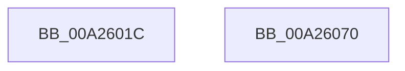

# MiUnsecureVirtualMemoryAgainstWrites

- RVA: `0x00A2601C`–`0x00A26071` (길이 `85` bytes)
- VA: `0x0000000140A2601C`
- 실행 섹션: `PAGE`
- PDB 이름 있음: `예`; PDB Function 태그: `아니요`
- unwind 정보 RVA: `0x00082420`
- 디코드: `21`개 명령, `85/85` bytes 표시
- 미해석 바이트: `0` (있으면 어셈블리에 `.byte`로 보존)

> 이 문서는 커널 이미지의 기계어와 PDB 기호를 분석해 생성했습니다. 4번과 5번은 함수 원형과 자료형을 바이너리 사용 방식에서 추정한 C 해석이며 원본 소스 복구 결과는 아닙니다.

## 1. Dependencies

- 직접 호출 지점: **1**; 고유 호출 대상: **1**
- 직접 호출자로 확인된 함수: **2**
- RIP 상대 이미지 참조: **0**

### Outgoing calls
- `0x00A26066` → [MiSetProtectionOnSection](../../text/2C/MiSetProtectionOnSection_function_002C3770.md) (function, `0x002C3770`)

### Direct callers
- [MiRemoveSecureEntry](../../text/43/MiRemoveSecureEntry_function_00430D5C.md) at `0x00430DD7`
- [MmSecureVirtualMemoryAgainstWrites](../89/MmSecureVirtualMemoryAgainstWrites_function_00890164.md) at `0x008902E4`

### Static image references
- 디코드된 RIP-relative 메모리 참조가 없습니다.

## 2. Other-region calls and transfers

- 다른 실행 섹션으로 향하는 call: **1**
  - `0x00A26066` → [MiSetProtectionOnSection](../../text/2C/MiSetProtectionOnSection_function_002C3770.md) (`PAGE` → `.text`)
- 별도 외부 분기/꼬리 이동을 확인하지 못했습니다.

## 3. Assembly (complete function range)

```asm
00A2601C  4C 8B DC                        mov r11, rsp
00A2601F  48 83 EC 48                     sub rsp, 0x48
00A26023  45 33 D2                        xor r10d, r10d
00A26026  4D 8D 4B 08                     lea r9, [r11 + 8]
00A2602A  4D 89 4B F0                     mov qword ptr [r11 - 0x10], r9
00A2602E  48 8B C1                        mov rax, rcx
00A26031  45 89 53 20                     mov dword ptr [r11 + 0x20], r10d
00A26035  4D 8D 4B 20                     lea r9, [r11 + 0x20]
00A26039  4D 89 4B E8                     mov qword ptr [r11 - 0x18], r9
00A2603D  4D 8B C8                        mov r9, r8
00A26040  45 89 53 08                     mov dword ptr [r11 + 8], r10d
00A26044  4C 8B C2                        mov r8, rdx
00A26047  65 48 8B 0C 25 88 01 00 00      mov rcx, qword ptr gs:[0x188]
00A26050  48 8B D0                        mov rdx, rax
00A26053  45 89 53 E0                     mov dword ptr [r11 - 0x20], r10d
00A26057  C7 44 24 20 04 00 00 00         mov dword ptr [rsp + 0x20], 4
00A2605F  48 8B 89 B8 00 00 00            mov rcx, qword ptr [rcx + 0xb8]
00A26066  E8 05 D7 89 FF                  call 0x1402c3770
00A2606B  48 83 C4 48                     add rsp, 0x48
00A2606F  C3                              ret
00A26070  CC                              int3
```

## 4. C-style interpretation (structured pseudocode)

```c
__int64 __fastcall MiUnsecureVirtualMemoryAgainstWrites(__int64 a1, __int64 a2, __int64 a3)
{
    __int64 result;
    __int64 v_r10;
    __int64 v_rsp;
    unsigned int v_stack_m28;

    v_rsp = (v_rsp) - (72);
    v_r10 = 0;
    *(unsigned __int64 *)(v_rsp - 16) = v_rsp + 8;
    *(unsigned int *)(v_rsp + 32) = 0;
    *(unsigned __int64 *)(v_rsp - 24) = v_rsp + 32;
    *(unsigned int *)(v_rsp + 8) = 0;
    *(unsigned int *)(v_rsp - 32) = 0;
    v_stack_m28 = 4;
    result = MiSetProtectionOnSection(*(unsigned __int64 *)(*(unsigned __int64 *)(gs_base + (0 + 392)) + 184), a1, a2, a3);
    v_rsp = (v_rsp) + (72);
    return result;
}
```

## 5. (Beta) C Style

```c
int64_t MiUnsecureVirtualMemoryAgainstWrites(int64_t Arg1, int64_t Arg2, int64_t Arg3)
{
    int64_t result;
    int64_t local_r10;
    int64_t local_rsp;
    uint32_t v_stack_m28;

    local_rsp = (local_rsp) - (72);
    local_r10 = 0;
    *(uint64_t *)(local_rsp - 0x10) = local_rsp + 8;
    *(uint32_t *)(local_rsp + 0x20) = 0;
    *(uint64_t *)(local_rsp - 0x18) = local_rsp + 32;
    *(uint32_t *)(local_rsp + 0x8) = 0;
    *(uint32_t *)(local_rsp - 0x20) = 0;
    v_stack_m28 = 4;
    result = MiSetProtectionOnSection(*(uint64_t *)(*(uint64_t *)(gs_base + (0 + 0x188)) + 0xB8), Arg1, Arg2, Arg3);
    local_rsp = (local_rsp) + (72);
    return result;
}
```

## 6. Execution-region graph

[열기: 2D/3D 그래프와 함수 탐색 컨트롤 패널](../../../control-panel.html?section=page&rva=0x00A2601C&view=graph)

- 2D 그래프는 위에서 아래로 흐르고, 3D 그래프는 빈 공간을 드래그해 회전합니다. Shift+드래그는 이동, 휠은 확대·축소, 함수 노드 선택은 대상 보고서 이동입니다.

### Static fallback


