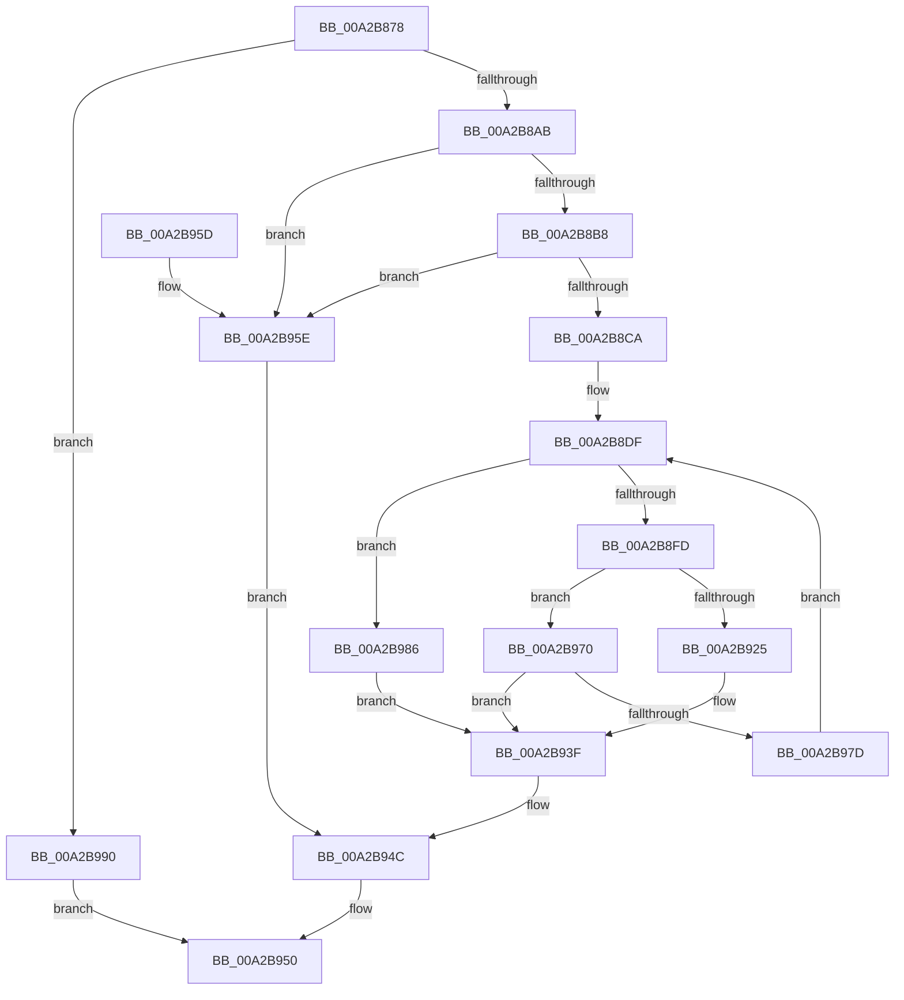

# MmGetFileNameForAddress

- RVA: `0x00A2B878`–`0x00A2B997` (길이 `287` bytes)
- VA: `0x0000000140A2B878`
- 실행 섹션: `PAGE`
- PDB 이름 있음: `예`; PDB Function 태그: `아니요`
- unwind 정보 RVA: `0x000AC34C`
- 디코드: `77`개 명령, `287/287` bytes 표시
- 미해석 바이트: `0` (있으면 어셈블리에 `.byte`로 보존)

> 이 문서는 커널 이미지의 기계어와 PDB 기호를 분석해 생성했습니다. 4번과 5번은 함수 원형과 자료형을 바이너리 사용 방식에서 추정한 C 해석이며 원본 소스 복구 결과는 아닙니다.

## 1. Dependencies

- 직접 호출 지점: **9**; 고유 호출 대상: **8**
- 직접 호출자로 확인된 함수: **2**
- RIP 상대 이미지 참조: **0**

### Outgoing calls
- `0x00A2B89A` → [MiObtainReferencedVadEx](../../text/31/MiObtainReferencedVadEx_function_00316690.md) (function, `0x00316690`)
- `0x00A2B8CA` → [MiReferenceControlAreaFile](../../text/43/MiReferenceControlAreaFile_function_00431554.md) (function, `0x00431554`)
- `0x00A2B8D5` → [MiUnlockAndDereferenceVadShared](../../text/2A/MiUnlockAndDereferenceVadShared_function_002AEF10.md) (function, `0x002AEF10`)
- `0x00A2B8EC` → [MiAllocatePool](../../text/35/MiAllocatePool_function_0035B540.md) (function, `0x0035B540`)
- `0x00A2B915` → [ObQueryNameStringMode](../8A/ObQueryNameStringMode_function_008A7ED0.md) (function, `0x008A7ED0`)
- `0x00A2B93A` → [memcpy](../../text/6C/memcpy_function_006C6840.md) (function, `0x006C6840`)
- `0x00A2B947` → [ObfDereferenceObjectWithTag](../../text/2F/ObfDereferenceObjectWithTag_function_002F78E0.md) (function, `0x002F78E0`)
- `0x00A2B969` → [MiUnlockAndDereferenceVadShared](../../text/2A/MiUnlockAndDereferenceVadShared_function_002AEF10.md) (function, `0x002AEF10`)
- `0x00A2B972` → [ExFreePoolWithTag](../../poolcode/B8/ExFreePoolWithTag_function_00B82870.md) (function, `0x00B82870`)

### Direct callers
- [DbgkPostModuleMessage](../../text/49/DbgkPostModuleMessage_function_004913C4.md) at `0x00491455`
- [EtwpProviderArrivalCallback](../A0/EtwpProviderArrivalCallback_function_00A03F94.md) at `0x00A04029`

### Static image references
- 디코드된 RIP-relative 메모리 참조가 없습니다.

## 2. Other-region calls and transfers

- 다른 실행 섹션으로 향하는 call: **8**
  - `0x00A2B89A` → [MiObtainReferencedVadEx](../../text/31/MiObtainReferencedVadEx_function_00316690.md) (`PAGE` → `.text`)
  - `0x00A2B8CA` → [MiReferenceControlAreaFile](../../text/43/MiReferenceControlAreaFile_function_00431554.md) (`PAGE` → `.text`)
  - `0x00A2B8D5` → [MiUnlockAndDereferenceVadShared](../../text/2A/MiUnlockAndDereferenceVadShared_function_002AEF10.md) (`PAGE` → `.text`)
  - `0x00A2B8EC` → [MiAllocatePool](../../text/35/MiAllocatePool_function_0035B540.md) (`PAGE` → `.text`)
  - `0x00A2B93A` → [memcpy](../../text/6C/memcpy_function_006C6840.md) (`PAGE` → `.text`)
  - `0x00A2B947` → [ObfDereferenceObjectWithTag](../../text/2F/ObfDereferenceObjectWithTag_function_002F78E0.md) (`PAGE` → `.text`)
  - `0x00A2B969` → [MiUnlockAndDereferenceVadShared](../../text/2A/MiUnlockAndDereferenceVadShared_function_002AEF10.md) (`PAGE` → `.text`)
  - `0x00A2B972` → [ExFreePoolWithTag](../../poolcode/B8/ExFreePoolWithTag_function_00B82870.md) (`PAGE` → `POOLCODE`)
- 별도 외부 분기/꼬리 이동을 확인하지 못했습니다.

## 3. Assembly (complete function range)

```asm
00A2B878  48 8B C4                        mov rax, rsp
00A2B87B  48 89 58 08                     mov qword ptr [rax + 8], rbx
00A2B87F  55                              push rbp
00A2B880  56                              push rsi
00A2B881  57                              push rdi
00A2B882  48 83 EC 30                     sub rsp, 0x30
00A2B886  83 60 18 00                     and dword ptr [rax + 0x18], 0
00A2B88A  4C 8D 40 18                     lea r8, [rax + 0x18]
00A2B88E  83 60 20 00                     and dword ptr [rax + 0x20], 0
00A2B892  48 8B F2                        mov rsi, rdx
00A2B895  BA 02 00 00 00                  mov edx, 2
00A2B89A  E8 F1 AD 8E FF                  call 0x140316690
00A2B89F  48 8B D8                        mov rbx, rax
00A2B8A2  48 85 C0                        test rax, rax
00A2B8A5  0F 84 E5 00 00 00               je 0x140a2b990
00A2B8AB  F7 40 30 00 00 20 00            test dword ptr [rax + 0x30], 0x200000
00A2B8B2  0F 85 A6 00 00 00               jne 0x140a2b95e
00A2B8B8  48 8B 40 48                     mov rax, qword ptr [rax + 0x48]
00A2B8BC  48 8B 08                        mov rcx, qword ptr [rax]
00A2B8BF  8B 41 38                        mov eax, dword ptr [rcx + 0x38]
00A2B8C2  A8 20                           test al, 0x20
00A2B8C4  0F 84 94 00 00 00               je 0x140a2b95e
00A2B8CA  E8 85 5C A0 FF                  call 0x140431554
00A2B8CF  48 8B CB                        mov rcx, rbx
00A2B8D2  48 8B E8                        mov rbp, rax
00A2B8D5  E8 36 36 88 FF                  call 0x1402aef10
00A2B8DA  BF 10 04 00 00                  mov edi, 0x410
00A2B8DF  8B D7                           mov edx, edi
00A2B8E1  B9 00 01 00 00                  mov ecx, 0x100
00A2B8E6  41 B8 4D 6D 20 20               mov r8d, 0x20206d4d
00A2B8EC  E8 4F FC 92 FF                  call 0x14035b540
00A2B8F1  48 8B D8                        mov rbx, rax
00A2B8F4  48 85 C0                        test rax, rax
00A2B8F7  0F 84 89 00 00 00               je 0x140a2b986
00A2B8FD  83 64 24 68 00                  and dword ptr [rsp + 0x68], 0
00A2B902  4C 8D 4C 24 68                  lea r9, [rsp + 0x68]
00A2B907  44 8B C7                        mov r8d, edi
00A2B90A  C6 44 24 20 00                  mov byte ptr [rsp + 0x20], 0
00A2B90F  48 8B D0                        mov rdx, rax
00A2B912  48 8B CD                        mov rcx, rbp
00A2B915  E8 B6 C5 E7 FF                  call 0x1408a7ed0
00A2B91A  89 44 24 60                     mov dword ptr [rsp + 0x60], eax
00A2B91E  48 8B CB                        mov rcx, rbx
00A2B921  85 C0                           test eax, eax
00A2B923  78 4B                           js 0x140a2b970
00A2B925  0F B7 03                        movzx eax, word ptr [rbx]
00A2B928  66 89 46 02                     mov word ptr [rsi + 2], ax
00A2B92C  44 8B C0                        mov r8d, eax
00A2B92F  66 89 06                        mov word ptr [rsi], ax
00A2B932  48 89 5E 08                     mov qword ptr [rsi + 8], rbx
00A2B936  48 8B 53 08                     mov rdx, qword ptr [rbx + 8]
00A2B93A  E8 01 AF C9 FF                  call 0x1406c6840
00A2B93F  BA 4D 6D 53 63                  mov edx, 0x63536d4d
00A2B944  48 8B CD                        mov rcx, rbp
00A2B947  E8 94 BF 8C FF                  call 0x1402f78e0
00A2B94C  8B 44 24 60                     mov eax, dword ptr [rsp + 0x60]
00A2B950  48 8B 5C 24 50                  mov rbx, qword ptr [rsp + 0x50]
00A2B955  48 83 C4 30                     add rsp, 0x30
00A2B959  5F                              pop rdi
00A2B95A  5E                              pop rsi
00A2B95B  5D                              pop rbp
00A2B95C  C3                              ret
00A2B95D  CC                              int3
00A2B95E  48 8B CB                        mov rcx, rbx
00A2B961  C7 44 24 60 49 00 00 C0         mov dword ptr [rsp + 0x60], 0xc0000049
00A2B969  E8 A2 35 88 FF                  call 0x1402aef10
00A2B96E  EB DC                           jmp 0x140a2b94c
00A2B970  33 D2                           xor edx, edx
00A2B972  E8 F9 6E 15 00                  call 0x140b82870
00A2B977  39 7C 24 68                     cmp dword ptr [rsp + 0x68], edi
00A2B97B  76 C2                           jbe 0x140a2b93f
00A2B97D  8B 7C 24 68                     mov edi, dword ptr [rsp + 0x68]
00A2B981  E9 59 FF FF FF                  jmp 0x140a2b8df
00A2B986  C7 44 24 60 17 00 00 C0         mov dword ptr [rsp + 0x60], 0xc0000017
00A2B98E  EB AF                           jmp 0x140a2b93f
00A2B990  B8 41 01 00 C0                  mov eax, 0xc0000141
00A2B995  EB B9                           jmp 0x140a2b950
```

## 4. C-style interpretation (structured pseudocode)

```c
__int64 __fastcall MmGetFileNameForAddress(__int64 a1, __int64 a2)
{
    __int64 result;
    __int64 v_rsp;
    unsigned __int8 v_stack_m28;
    unsigned int v_stack_p18;
    unsigned int v_stack_p20;
    unsigned int v_stack_p60;
    unsigned int v_stack_p68;
    unsigned __int64 v_stack_p8;

    *(unsigned __int64 *)(v_rsp + 8) = v_rbx;
    v_rsp = (v_rsp) - (48);
    result = MiObtainReferencedVadEx(a1, 2, v_rsp + 24, a4);
    if (result == 0) goto loc_00A2B990;
    if (((*(unsigned int *)(result + 48)) & (0x200000ULL)) != 0) goto loc_00A2B95E;
    if ((((unsigned __int8)((unsigned int)(*(unsigned int *)(*(unsigned __int64 *)(*(unsigned __int64 *)(result + 72)) + 56)))) & (32)) == 0) goto loc_00A2B95E;
    result = MiReferenceControlAreaFile(*(unsigned __int64 *)(*(unsigned __int64 *)(result + 72)), 2, v_rsp + 24, a4);
    result = MiUnlockAndDereferenceVadShared(result, 2, v_rsp + 24, a4);
loc_00A2B8DF:
    result = MiAllocatePool(256, (unsigned int)((unsigned int)((unsigned int)(0x410ULL))), (unsigned int)(0x20206D4DULL), a4);
    if (result == 0) goto loc_00A2B986;
    v_stack_m28 = 0;
    result = ObQueryNameStringMode(result, result, (unsigned int)((unsigned int)((unsigned int)(0x410ULL))), v_stack_p20);
    v_stack_p18 = (unsigned int)(result);
    if (sign_flag) goto loc_00A2B970;
    *(unsigned __int16 *)(a2 + 2) = (unsigned __int16)(*(unsigned __int16 *)(result));
    *(unsigned __int16 *)(a2) = (unsigned __int16)(*(unsigned __int16 *)(result));
    *(unsigned __int64 *)(a2 + 8) = result;
    result = memcpy(result, *(unsigned __int64 *)(result + 8), (unsigned int)((unsigned int)(*(unsigned __int16 *)(result))), v_stack_p20);
loc_00A2B93F:
    result = ObfDereferenceObjectWithTag(result, (unsigned int)(0x63536D4DULL), (unsigned int)((unsigned int)(*(unsigned __int16 *)(result))), v_stack_p20);
loc_00A2B94C:
loc_00A2B950:
    v_rsp = (v_rsp) + (48);
    return (unsigned int)(v_stack_p18);
loc_00A2B95E:
    v_stack_p60 = 0xC0000049ULL;
    result = MiUnlockAndDereferenceVadShared(v_stack_p8, (unsigned int)(0x63536D4DULL), (unsigned int)((unsigned int)(*(unsigned __int16 *)(result))), v_stack_p20);
    goto loc_00A2B94C;
loc_00A2B970:
    a2 = 0;
    result = ExFreePoolWithTag(v_stack_p8, a2, (unsigned int)((unsigned int)(*(unsigned __int16 *)(result))), v_stack_p20);
    if (v_stack_p68 <= ((unsigned int)((unsigned int)(0x410ULL)))) goto loc_00A2B93F;
    goto loc_00A2B8DF;
loc_00A2B986:
    v_stack_p60 = 0xC0000017ULL;
    goto loc_00A2B93F;
loc_00A2B990:
    goto loc_00A2B950;
}
```

## 5. (Beta) C Style

```c
int64_t MmGetFileNameForAddress(int64_t Arg1, void *Arg2)
{
    uint8_t *arg2 = (uint8_t *)Arg2;

    int64_t result;
    int64_t local_rsp;
    uint8_t v_stack_m28;
    uint32_t v_stack_p18;
    uint32_t v_stack_p20;
    uint32_t v_stack_p60;
    uint32_t v_stack_p68;
    uint64_t v_stack_p8;

    *(uint64_t *)(local_rsp + 0x8) = local_rbx;
    local_rsp = (local_rsp) - (48);
    result = MiObtainReferencedVadEx(Arg1, 2, local_rsp + 24, a4);
    if (result == 0) goto loc_00A2B990;
    if (((*(uint32_t *)(result + 0x30)) & (0x200000ULL)) != 0) goto loc_00A2B95E;
    if ((((uint8_t)((uint32_t)(*(uint32_t *)(*(uint64_t *)(*(uint64_t *)(result + 0x48)) + 0x38)))) & (32)) == 0) goto loc_00A2B95E;
    result = MiReferenceControlAreaFile(*(uint64_t *)(*(uint64_t *)(result + 0x48)), 2, local_rsp + 24, a4);
    result = MiUnlockAndDereferenceVadShared(result, 2, local_rsp + 24, a4);
loc_00A2B8DF:
    result = MiAllocatePool(256, (uint32_t)((uint32_t)((uint32_t)(0x410ULL))), (uint32_t)(0x20206D4DULL), a4);
    if (result == 0) goto loc_00A2B986;
    v_stack_m28 = 0;
    result = ObQueryNameStringMode(result, result, (uint32_t)((uint32_t)((uint32_t)(0x410ULL))), v_stack_p20);
    v_stack_p18 = (uint32_t)(result);
    if (sign_flag) goto loc_00A2B970;
    *(uint16_t *)(arg2 + 0x2) = (uint16_t)(*(uint16_t *)(result));
    *(uint16_t *)(arg2) = (uint16_t)(*(uint16_t *)(result));
    *(uint64_t *)(arg2 + 0x8) = result;
    result = memcpy(result, *(uint64_t *)(result + 0x8), (uint32_t)((uint32_t)(*(uint16_t *)(result))), v_stack_p20);
loc_00A2B93F:
    result = ObfDereferenceObjectWithTag(result, (uint32_t)(0x63536D4DULL), (uint32_t)((uint32_t)(*(uint16_t *)(result))), v_stack_p20);
loc_00A2B94C:
loc_00A2B950:
    local_rsp = (local_rsp) + (48);
    return (uint32_t)(v_stack_p18);
loc_00A2B95E:
    v_stack_p60 = 0xC0000049ULL;
    result = MiUnlockAndDereferenceVadShared(v_stack_p8, (uint32_t)(0x63536D4DULL), (uint32_t)((uint32_t)(*(uint16_t *)(result))), v_stack_p20);
    goto loc_00A2B94C;
loc_00A2B970:
    Arg2 = 0;
    result = ExFreePoolWithTag(v_stack_p8, Arg2, (uint32_t)((uint32_t)(*(uint16_t *)(result))), v_stack_p20);
    if (v_stack_p68 <= ((uint32_t)((uint32_t)(0x410ULL)))) goto loc_00A2B93F;
    goto loc_00A2B8DF;
loc_00A2B986:
    v_stack_p60 = 0xC0000017ULL;
    goto loc_00A2B93F;
loc_00A2B990:
    goto loc_00A2B950;
}
```

### 관측된 메모리 오프셋

구조체 형식이 확인되지 않은 접근은 인자 기준의 오프셋으로만 기록했습니다.

| 기준 인자 | 오프셋 표현 | 폭 (bit) | 접근 |
|---|---:|---:|---|
| `Arg2` | `+ 0x0` | `16` | `W` |
| `Arg2` | `+ 0x2` | `16` | `W` |
| `Arg2` | `+ 0x8` | `64` | `W` |

## 6. Execution-region graph

[열기: 2D/3D 그래프와 함수 탐색 컨트롤 패널](../../../control-panel.html?section=page&rva=0x00A2B878&view=graph)

- 2D 그래프는 위에서 아래로 흐르고, 3D 그래프는 빈 공간을 드래그해 회전합니다. Shift+드래그는 이동, 휠은 확대·축소, 함수 노드 선택은 대상 보고서 이동입니다.

### Static fallback


