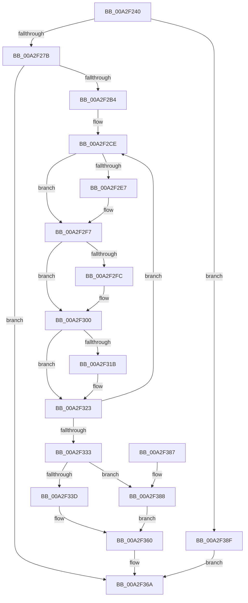

# NtAlpcDeleteSectionView

- RVA: `0x00A2F240`–`0x00A2F396` (길이 `342` bytes)
- VA: `0x0000000140A2F240`
- 실행 섹션: `PAGE`
- PDB 이름 있음: `예`; PDB Function 태그: `아니요`
- unwind 정보 RVA: `0x000ACAA0`
- 디코드: `89`개 명령, `342/342` bytes 표시
- 미해석 바이트: `0` (있으면 어셈블리에 `.byte`로 보존)

> 이 문서는 커널 이미지의 기계어와 PDB 기호를 분석해 생성했습니다. 4번과 5번은 함수 원형과 자료형을 바이너리 사용 방식에서 추정한 C 해석이며 원본 소스 복구 결과는 아닙니다.

## 1. Dependencies

- 직접 호출 지점: **10**; 고유 호출 대상: **10**
- 직접 호출자로 확인된 함수: **0**
- RIP 상대 이미지 참조: **1**

### Outgoing calls
- `0x00A2F2A5` → [ObReferenceObjectByHandle](../86/ObReferenceObjectByHandle_function_00868DB0.md) (function, `0x00868DB0`)
- `0x00A2F2D6` → [KeAbPreAcquire](../../text/21/KeAbPreAcquire_function_00210230.md) (function, `0x00210230`)
- `0x00A2F2F2` → [ExfAcquirePushLockSharedEx](../../text/21/ExfAcquirePushLockSharedEx_function_0021044C.md) (function, `0x0021044C`)
- `0x00A2F30A` → [AlpcpEnumerateResourcesPort](../89/AlpcpEnumerateResourcesPort_function_00890424.md) (function, `0x00890424`)
- `0x00A2F31E` → [ExfReleasePushLockShared](../../text/26/ExfReleasePushLockShared_function_00263440.md) (function, `0x00263440`)
- `0x00A2F326` → [KeAbPostRelease](../../text/2E/KeAbPostRelease_function_002E1600.md) (function, `0x002E1600`)
- `0x00A2F340` → [AlpcpDeleteView](../88/AlpcpDeleteView_function_0088A26C.md) (function, `0x0088A26C`)
- `0x00A2F34F` → [AlpcpDereferenceBlobEx](../88/AlpcpDereferenceBlobEx_function_0088AF00.md) (function, `0x0088AF00`)
- `0x00A2F365` → [ObfDereferenceObject](../../text/2F/ObfDereferenceObject_function_002F9350.md) (function, `0x002F9350`)
- `0x00A2F36A` → [KeLeaveCriticalRegion](../../text/25/KeLeaveCriticalRegion_function_0025D8B0.md) (function, `0x0025D8B0`)

### Direct callers
- 이 함수 시작 RVA로 연결되는 직접 call은 확인되지 않았습니다. 간접 호출은 완전히 역산할 수 없습니다.

### Static image references
- `0x00A2F287` → RVA `0x00FC6C18` (`ALMOSTRO`; read)

## 2. Other-region calls and transfers

- 다른 실행 섹션으로 향하는 call: **6**
  - `0x00A2F2D6` → [KeAbPreAcquire](../../text/21/KeAbPreAcquire_function_00210230.md) (`PAGE` → `.text`)
  - `0x00A2F2F2` → [ExfAcquirePushLockSharedEx](../../text/21/ExfAcquirePushLockSharedEx_function_0021044C.md) (`PAGE` → `.text`)
  - `0x00A2F31E` → [ExfReleasePushLockShared](../../text/26/ExfReleasePushLockShared_function_00263440.md) (`PAGE` → `.text`)
  - `0x00A2F326` → [KeAbPostRelease](../../text/2E/KeAbPostRelease_function_002E1600.md) (`PAGE` → `.text`)
  - `0x00A2F365` → [ObfDereferenceObject](../../text/2F/ObfDereferenceObject_function_002F9350.md) (`PAGE` → `.text`)
  - `0x00A2F36A` → [KeLeaveCriticalRegion](../../text/25/KeLeaveCriticalRegion_function_0025D8B0.md) (`PAGE` → `.text`)
- 별도 외부 분기/꼬리 이동을 확인하지 못했습니다.

## 3. Assembly (complete function range)

```asm
00A2F240  4C 8B DC                        mov r11, rsp
00A2F243  49 89 5B 08                     mov qword ptr [r11 + 8], rbx
00A2F247  49 89 73 10                     mov qword ptr [r11 + 0x10], rsi
00A2F24B  49 89 7B 18                     mov qword ptr [r11 + 0x18], rdi
00A2F24F  41 56                           push r14
00A2F251  48 83 EC 50                     sub rsp, 0x50
00A2F255  0F 57 C0                        xorps xmm0, xmm0
00A2F258  33 F6                           xor esi, esi
00A2F25A  0F 11 44 24 38                  movups xmmword ptr [rsp + 0x38], xmm0
00A2F25F  65 48 8B 04 25 88 01 00 00      mov rax, qword ptr gs:[0x188]
00A2F268  49 8B F8                        mov rdi, r8
00A2F26B  66 FF 88 E4 01 00 00            dec word ptr [rax + 0x1e4]
00A2F272  90                              nop
00A2F273  85 D2                           test edx, edx
00A2F275  0F 85 14 01 00 00               jne 0x140a2f38f
00A2F27B  65 48 8B 04 25 88 01 00 00      mov rax, qword ptr gs:[0x188]
00A2F284  8D 56 01                        lea edx, [rsi + 1]
00A2F287  4C 8B 05 8A 79 59 00            mov r8, qword ptr [rip + 0x59798a]
00A2F28E  49 89 73 D0                     mov qword ptr [r11 - 0x30], rsi
00A2F292  49 89 73 20                     mov qword ptr [r11 + 0x20], rsi
00A2F296  44 8A 88 32 02 00 00            mov r9b, byte ptr [rax + 0x232]
00A2F29D  49 8D 43 20                     lea rax, [r11 + 0x20]
00A2F2A1  49 89 43 C8                     mov qword ptr [r11 - 0x38], rax
00A2F2A5  E8 06 9B E3 FF                  call 0x140868db0
00A2F2AA  8B D8                           mov ebx, eax
00A2F2AC  85 C0                           test eax, eax
00A2F2AE  0F 88 B6 00 00 00               js 0x140a2f36a
00A2F2B4  48 8B 5C 24 78                  mov rbx, qword ptr [rsp + 0x78]
00A2F2B9  44 8D 76 11                     lea r14d, [rsi + 0x11]
00A2F2BD  48 81 C3 60 01 00 00            add rbx, 0x160
00A2F2C4  48 89 74 24 40                  mov qword ptr [rsp + 0x40], rsi
00A2F2C9  48 89 7C 24 38                  mov qword ptr [rsp + 0x38], rdi
00A2F2CE  45 33 C0                        xor r8d, r8d
00A2F2D1  33 D2                           xor edx, edx
00A2F2D3  48 8B CB                        mov rcx, rbx
00A2F2D6  E8 55 0F 7E FF                  call 0x140210230
00A2F2DB  48 8B F8                        mov rdi, rax
00A2F2DE  33 C0                           xor eax, eax
00A2F2E0  F0 4C 0F B1 33                  lock cmpxchg qword ptr [rbx], r14
00A2F2E5  74 10                           je 0x140a2f2f7
00A2F2E7  4C 8B CB                        mov r9, rbx
00A2F2EA  4C 8B C7                        mov r8, rdi
00A2F2ED  33 D2                           xor edx, edx
00A2F2EF  48 8B CB                        mov rcx, rbx
00A2F2F2  E8 55 11 7E FF                  call 0x14021044c
00A2F2F7  48 85 FF                        test rdi, rdi
00A2F2FA  74 04                           je 0x140a2f300
00A2F2FC  C6 47 0A 01                     mov byte ptr [rdi + 0xa], 1
00A2F300  48 8B 4C 24 78                  mov rcx, qword ptr [rsp + 0x78]
00A2F305  4C 8D 4C 24 38                  lea r9, [rsp + 0x38]
00A2F30A  E8 15 11 E6 FF                  call 0x140890424
00A2F30F  8B F8                           mov edi, eax
00A2F311  49 8B C6                        mov rax, r14
00A2F314  F0 48 0F B1 33                  lock cmpxchg qword ptr [rbx], rsi
00A2F319  74 08                           je 0x140a2f323
00A2F31B  48 8B CB                        mov rcx, rbx
00A2F31E  E8 1D 41 83 FF                  call 0x140263440
00A2F323  48 8B CB                        mov rcx, rbx
00A2F326  E8 D5 22 8B FF                  call 0x1402e1600
00A2F32B  81 FF 2D 02 00 C0               cmp edi, 0xc000022d
00A2F331  74 9B                           je 0x140a2f2ce
00A2F333  48 8B 7C 24 40                  mov rdi, qword ptr [rsp + 0x40]
00A2F338  48 85 FF                        test rdi, rdi
00A2F33B  74 4B                           je 0x140a2f388
00A2F33D  48 8B CF                        mov rcx, rdi
00A2F340  E8 27 AF E5 FF                  call 0x14088a26c
00A2F345  BA 01 00 00 00                  mov edx, 1
00A2F34A  48 8B CF                        mov rcx, rdi
00A2F34D  8A D8                           mov bl, al
00A2F34F  E8 AC BB E5 FF                  call 0x14088af00
00A2F354  F6 DB                           neg bl
00A2F356  1B DB                           sbb ebx, ebx
00A2F358  F7 D3                           not ebx
00A2F35A  81 E3 56 00 00 C0               and ebx, 0xc0000056
00A2F360  48 8B 4C 24 78                  mov rcx, qword ptr [rsp + 0x78]
00A2F365  E8 E6 9F 8C FF                  call 0x1402f9350
00A2F36A  E8 41 E5 82 FF                  call 0x14025d8b0
00A2F36F  48 8B 74 24 68                  mov rsi, qword ptr [rsp + 0x68]
00A2F374  8B C3                           mov eax, ebx
00A2F376  48 8B 5C 24 60                  mov rbx, qword ptr [rsp + 0x60]
00A2F37B  48 8B 7C 24 70                  mov rdi, qword ptr [rsp + 0x70]
00A2F380  48 83 C4 50                     add rsp, 0x50
00A2F384  41 5E                           pop r14
00A2F386  C3                              ret
00A2F387  CC                              int3
00A2F388  BB 41 01 00 C0                  mov ebx, 0xc0000141
00A2F38D  EB D1                           jmp 0x140a2f360
00A2F38F  BB 0D 00 00 C0                  mov ebx, 0xc000000d
00A2F394  EB D4                           jmp 0x140a2f36a
```

## 4. C-style interpretation (structured pseudocode)

```c
__int64 __fastcall NtAlpcDeleteSectionView(__int64 a1, int a2, __int64 a3)
{
    __int64 result;
    __int64 v_rbx;
    __int64 v_rsi;
    __int64 v_rsp;
    unsigned __int64 v_stack_m18;
    unsigned __int64 v_stack_m20;
    unsigned __int64 v_stack_p10;
    unsigned __int64 v_stack_p18;
    unsigned __int64 v_stack_p20;
    unsigned __int64 v_stack_p8;

    *(unsigned __int64 *)(v_rsp + 8) = v_rbx;
    *(unsigned __int64 *)(v_rsp + 16) = v_rsi;
    *(unsigned __int64 *)(v_rsp + 24) = v_rdi;
    v_rsp = (v_rsp) - (80);
    v_rsi = 0;
    v_stack_m20 = v_xmm0;
    if (a2 != 0) goto loc_00A2F38F;
    *(unsigned __int64 *)(v_rsp - 48) = 0;
    *(unsigned __int64 *)(v_rsp + 32) = 0;
    *(unsigned __int64 *)(v_rsp - 56) = v_rsp + 32;
    result = ObReferenceObjectByHandle(a1, v_rsi + 1, *(unsigned __int64 *)(v_rip + 5863818), *(unsigned __int8 *)(*(unsigned __int64 *)(gs_base + (0 + 392)) + 562));
    if (sign_flag) goto loc_00A2F36A;
    v_rbx = (v_stack_p20) + (352);
    v_stack_m18 = 0;
    v_stack_m20 = a3;
loc_00A2F2CE:
    a3 = 0;
    a2 = 0;
    result = KeAbPreAcquire(v_rbx, a2, a3, *(unsigned __int8 *)(*(unsigned __int64 *)(gs_base + (0 + 392)) + 562));
    result = 0;
    if (!(condition_is_equal)) {
        a4 = v_rbx;
        a3 = 0;
        a2 = 0;
        a1 = v_rbx;
        result = ExfAcquirePushLockSharedEx(a1, a2, a3, a4);
    }
    if (result != 0) {
        *(unsigned __int8 *)(result + 10) = 1;
    }
    result = AlpcpEnumerateResourcesPort(v_stack_p20, a2, a3, v_stack_m20);
    result = v_rsi + 17;
    if (result != 0) {
        a1 = v_rbx;
        result = ExfReleasePushLockShared(a1, a2, a3, v_stack_m20);
    }
    result = KeAbPostRelease(v_rbx, a2, a3, v_stack_m20);
    if (((unsigned int)((unsigned int)((unsigned int)(result)))) == 0xC000022DULL) goto loc_00A2F2CE;
    if (v_stack_m18 == 0) goto loc_00A2F388;
    result = AlpcpDeleteView(v_stack_m18, a2, a3, v_stack_m20);
    result = AlpcpDereferenceBlobEx(v_stack_m18, 1, a3, v_stack_m20);
    v_rbx = (unsigned __int8)(-((unsigned __int8)(result)));
    v_rbx = (unsigned int)(~(v_rbx));
    v_rbx = (unsigned int)((v_rbx) & (0xC0000056ULL));
loc_00A2F360:
    result = ObfDereferenceObject(v_stack_p20, 1, a3, v_stack_m20);
loc_00A2F36A:
    result = KeLeaveCriticalRegion(v_stack_p20, 1, a3, v_stack_m20);
    v_rsp = (v_rsp) + (80);
    return (unsigned int)((unsigned int)(v_rbx));
loc_00A2F388:
    goto loc_00A2F360;
loc_00A2F38F:
    goto loc_00A2F36A;
}
```

## 5. (Beta) C Style

```c
int64_t NtAlpcDeleteSectionView(int64_t Arg1, int32_t Arg2, int64_t Arg3)
{
    int64_t result;
    int64_t local_rbx;
    int64_t local_rsi;
    int64_t local_rsp;
    uint64_t v_stack_m18;
    uint64_t v_stack_m20;
    uint64_t v_stack_p10;
    uint64_t v_stack_p18;
    uint64_t v_stack_p20;
    uint64_t v_stack_p8;

    *(uint64_t *)(local_rsp + 0x8) = local_rbx;
    *(uint64_t *)(local_rsp + 0x10) = local_rsi;
    *(uint64_t *)(local_rsp + 0x18) = local_rdi;
    local_rsp = (local_rsp) - (80);
    local_rsi = 0;
    v_stack_m20 = v_xmm0;
    if (Arg2 != 0) goto loc_00A2F38F;
    *(uint64_t *)(local_rsp - 0x30) = 0;
    *(uint64_t *)(local_rsp + 0x20) = 0;
    *(uint64_t *)(local_rsp - 0x38) = local_rsp + 32;
    result = ObReferenceObjectByHandle(Arg1, local_rsi + 1, *(uint64_t *)(v_rip + 0x59798A), *(uint8_t *)(*(uint64_t *)(gs_base + (0 + 0x188)) + 0x232));
    if (sign_flag) goto loc_00A2F36A;
    local_rbx = (v_stack_p20) + (352);
    v_stack_m18 = 0;
    v_stack_m20 = Arg3;
loc_00A2F2CE:
    Arg3 = 0;
    Arg2 = 0;
    result = KeAbPreAcquire(local_rbx, Arg2, Arg3, *(uint8_t *)(*(uint64_t *)(gs_base + (0 + 0x188)) + 0x232));
    result = 0;
    if (!(condition_is_equal)) {
        a4 = local_rbx;
        Arg3 = 0;
        Arg2 = 0;
        Arg1 = local_rbx;
        result = ExfAcquirePushLockSharedEx(Arg1, Arg2, Arg3, a4);
    }
    if (result != 0) {
        *(uint8_t *)(result + 0xA) = 1;
    }
    result = AlpcpEnumerateResourcesPort(v_stack_p20, Arg2, Arg3, v_stack_m20);
    result = local_rsi + 17;
    if (result != 0) {
        Arg1 = local_rbx;
        result = ExfReleasePushLockShared(Arg1, Arg2, Arg3, v_stack_m20);
    }
    result = KeAbPostRelease(local_rbx, Arg2, Arg3, v_stack_m20);
    if (((uint32_t)((uint32_t)((uint32_t)(result)))) == 0xC000022DULL) goto loc_00A2F2CE;
    if (v_stack_m18 == 0) goto loc_00A2F388;
    result = AlpcpDeleteView(v_stack_m18, Arg2, Arg3, v_stack_m20);
    result = AlpcpDereferenceBlobEx(v_stack_m18, 1, Arg3, v_stack_m20);
    local_rbx = (uint8_t)(-((uint8_t)(result)));
    local_rbx = (uint32_t)(~(local_rbx));
    local_rbx = (uint32_t)((local_rbx) & (0xC0000056ULL));
loc_00A2F360:
    result = ObfDereferenceObject(v_stack_p20, 1, Arg3, v_stack_m20);
loc_00A2F36A:
    result = KeLeaveCriticalRegion(v_stack_p20, 1, Arg3, v_stack_m20);
    local_rsp = (local_rsp) + (80);
    return (uint32_t)((uint32_t)(local_rbx));
loc_00A2F388:
    goto loc_00A2F360;
loc_00A2F38F:
    goto loc_00A2F36A;
}
```

## 6. Execution-region graph

[열기: 2D/3D 그래프와 함수 탐색 컨트롤 패널](../../../control-panel.html?section=page&rva=0x00A2F240&view=graph)

- 2D 그래프는 위에서 아래로 흐르고, 3D 그래프는 빈 공간을 드래그해 회전합니다. Shift+드래그는 이동, 휠은 확대·축소, 함수 노드 선택은 대상 보고서 이동입니다.

### Static fallback


