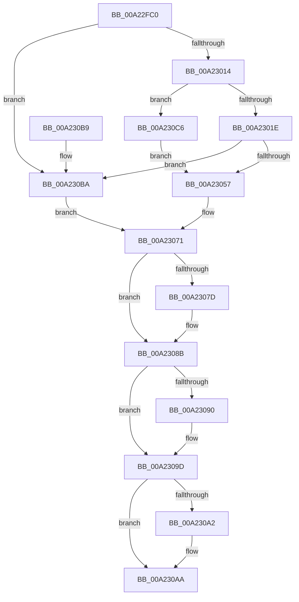

# NtAssignProcessToJobObject

- RVA: `0x00A22FC0`–`0x00A230E2` (길이 `290` bytes)
- VA: `0x0000000140A22FC0`
- 실행 섹션: `PAGE`
- PDB 이름 있음: `예`; PDB Function 태그: `아니요`
- unwind 정보 RVA: `0x000AB65C`
- 디코드: `74`개 명령, `290/290` bytes 표시
- 미해석 바이트: `0` (있으면 어셈블리에 `.byte`로 보존)

> 이 문서는 커널 이미지의 기계어와 PDB 기호를 분석해 생성했습니다. 4번과 5번은 함수 원형과 자료형을 바이너리 사용 방식에서 추정한 C 해석이며 원본 소스 복구 결과는 아닙니다.

## 1. Dependencies

- 직접 호출 지점: **6**; 고유 호출 대상: **6**
- 직접 호출자로 확인된 함수: **0**
- RIP 상대 이미지 참조: **3**

### Outgoing calls
- `0x00A23005` → [ObReferenceObjectByHandle](../86/ObReferenceObjectByHandle_function_00868DB0.md) (function, `0x00868DB0`)
- `0x00A2304C` → [ObpReferenceObjectByHandleWithTag](../86/ObpReferenceObjectByHandleWithTag_function_00869650.md) (function, `0x00869650`)
- `0x00A2306A` → [PsAssignProcessToJobObject](PsAssignProcessToJobObject_function_00A23190.md) (function, `0x00A23190`)
- `0x00A23086` → [EtwTraceJobAssignProcess](EtwTraceJobAssignProcess_function_00A230E8.md) (function, `0x00A230E8`)
- `0x00A23098` → [ObfDereferenceObjectWithTag](../../text/2F/ObfDereferenceObjectWithTag_function_002F78E0.md) (function, `0x002F78E0`)
- `0x00A230A5` → [ObfDereferenceObject](../../text/2F/ObfDereferenceObject_function_002F9350.md) (function, `0x002F9350`)

### Direct callers
- 이 함수 시작 RVA로 연결되는 직접 call은 확인되지 않았습니다. 간접 호출은 완전히 역산할 수 없습니다.

### Static image references
- `0x00A22FE0` → RVA `0x00FC6C58` (`ALMOSTRO`; read)
- `0x00A23030` → RVA `0x00FC6A98` (`ALMOSTRO`; read)
- `0x00A23071` → RVA `0x00FC6B00` (`ALMOSTRO`; read)

## 2. Other-region calls and transfers

- 다른 실행 섹션으로 향하는 call: **2**
  - `0x00A23098` → [ObfDereferenceObjectWithTag](../../text/2F/ObfDereferenceObjectWithTag_function_002F78E0.md) (`PAGE` → `.text`)
  - `0x00A230A5` → [ObfDereferenceObject](../../text/2F/ObfDereferenceObject_function_002F9350.md) (`PAGE` → `.text`)
- 별도 외부 분기/꼬리 이동을 확인하지 못했습니다.

## 3. Assembly (complete function range)

```asm
00A22FC0  4C 8B DC                        mov r11, rsp
00A22FC3  49 89 5B 08                     mov qword ptr [r11 + 8], rbx
00A22FC7  55                              push rbp
00A22FC8  56                              push rsi
00A22FC9  57                              push rdi
00A22FCA  48 83 EC 40                     sub rsp, 0x40
00A22FCE  65 48 8B 04 25 88 01 00 00      mov rax, qword ptr gs:[0x188]
00A22FD7  33 DB                           xor ebx, ebx
00A22FD9  49 21 5B D0                     and qword ptr [r11 - 0x30], rbx
00A22FDD  48 8B FA                        mov rdi, rdx
00A22FE0  4C 8B 05 71 3C 5A 00            mov r8, qword ptr [rip + 0x5a3c71]
00A22FE7  49 83 63 18 00                  and qword ptr [r11 + 0x18], 0
00A22FEC  40 8A A8 32 02 00 00            mov bpl, byte ptr [rax + 0x232]
00A22FF3  8D 53 01                        lea edx, [rbx + 1]
00A22FF6  49 21 5B 20                     and qword ptr [r11 + 0x20], rbx
00A22FFA  49 8D 43 20                     lea rax, [r11 + 0x20]
00A22FFE  44 8A CD                        mov r9b, bpl
00A23001  49 89 43 C8                     mov qword ptr [r11 - 0x38], rax
00A23005  E8 A6 5D E4 FF                  call 0x140868db0
00A2300A  8B F0                           mov esi, eax
00A2300C  85 C0                           test eax, eax
00A2300E  0F 88 A6 00 00 00               js 0x140a230ba
00A23014  48 83 FF F9                     cmp rdi, -7
00A23018  0F 84 A8 00 00 00               je 0x140a230c6
00A2301E  48 21 5C 24 38                  and qword ptr [rsp + 0x38], rbx
00A23023  48 8D 44 24 70                  lea rax, [rsp + 0x70]
00A23028  48 21 5C 24 30                  and qword ptr [rsp + 0x30], rbx
00A2302D  44 8A CD                        mov r9b, bpl
00A23030  4C 8B 05 61 3A 5A 00            mov r8, qword ptr [rip + 0x5a3a61]
00A23037  BA 01 01 00 00                  mov edx, 0x101
00A2303C  48 89 44 24 28                  mov qword ptr [rsp + 0x28], rax
00A23041  48 8B CF                        mov rcx, rdi
00A23044  C7 44 24 20 50 73 4A 62         mov dword ptr [rsp + 0x20], 0x624a7350
00A2304C  E8 FF 65 E4 FF                  call 0x140869650
00A23051  8B F0                           mov esi, eax
00A23053  85 C0                           test eax, eax
00A23055  78 63                           js 0x140a230ba
00A23057  48 8B 7C 24 70                  mov rdi, qword ptr [rsp + 0x70]
00A2305C  4C 8B C3                        mov r8, rbx
00A2305F  48 8B 5C 24 78                  mov rbx, qword ptr [rsp + 0x78]
00A23064  48 8B D7                        mov rdx, rdi
00A23067  48 8B CB                        mov rcx, rbx
00A2306A  E8 21 01 00 00                  call 0x140a23190
00A2306F  8B F0                           mov esi, eax
00A23071  F7 05 85 3A 5A 00 00 00 08 00   test dword ptr [rip + 0x5a3a85], 0x80000
00A2307B  74 0E                           je 0x140a2308b
00A2307D  44 8B C6                        mov r8d, esi
00A23080  48 8B D7                        mov rdx, rdi
00A23083  48 8B CB                        mov rcx, rbx
00A23086  E8 5D 00 00 00                  call 0x140a230e8
00A2308B  48 85 FF                        test rdi, rdi
00A2308E  74 0D                           je 0x140a2309d
00A23090  BA 50 73 4A 62                  mov edx, 0x624a7350
00A23095  48 8B CF                        mov rcx, rdi
00A23098  E8 43 48 8D FF                  call 0x1402f78e0
00A2309D  48 85 DB                        test rbx, rbx
00A230A0  74 08                           je 0x140a230aa
00A230A2  48 8B CB                        mov rcx, rbx
00A230A5  E8 A6 62 8D FF                  call 0x1402f9350
00A230AA  48 8B 5C 24 60                  mov rbx, qword ptr [rsp + 0x60]
00A230AF  8B C6                           mov eax, esi
00A230B1  48 83 C4 40                     add rsp, 0x40
00A230B5  5F                              pop rdi
00A230B6  5E                              pop rsi
00A230B7  5D                              pop rbp
00A230B8  C3                              ret
00A230B9  CC                              int3
00A230BA  48 8B 7C 24 70                  mov rdi, qword ptr [rsp + 0x70]
00A230BF  48 8B 5C 24 78                  mov rbx, qword ptr [rsp + 0x78]
00A230C4  EB AB                           jmp 0x140a23071
00A230C6  65 48 8B 04 25 88 01 00 00      mov rax, qword ptr gs:[0x188]
00A230CF  48 8B 88 B8 00 00 00            mov rcx, qword ptr [rax + 0xb8]
00A230D6  48 8B 99 A0 02 00 00            mov rbx, qword ptr [rcx + 0x2a0]
00A230DD  E9 75 FF FF FF                  jmp 0x140a23057
```

## 4. C-style interpretation (structured pseudocode)

```c
__int64 __fastcall NtAssignProcessToJobObject(__int64 a1, __int64 a2)
{
    __int64 result;
    __int64 v_rbx;
    __int64 v_rsp;
    unsigned __int64 v_stack_m20;
    unsigned __int64 v_stack_m28;
    unsigned __int64 v_stack_m30;
    unsigned int v_stack_m38;
    unsigned __int64 v_stack_p18;
    unsigned __int64 v_stack_p20;
    unsigned __int64 v_stack_p70;
    unsigned __int64 v_stack_p78;
    unsigned __int64 v_stack_p8;

    *(unsigned __int64 *)(v_rsp + 8) = v_rbx;
    v_rsp = (v_rsp) - (64);
    v_rbx = 0;
    *(unsigned __int64 *)(v_rsp - 56) = v_rsp + 32;
    result = ObReferenceObjectByHandle(a1, v_rbx + 1, *(unsigned __int64 *)(v_rip + 5913713), (unsigned __int8)(*(unsigned __int8 *)(*(unsigned __int64 *)(gs_base + (0 + 392)) + 562)));
    if (sign_flag) goto loc_00A230BA;
    if (a2 == -7) goto loc_00A230C6;
    v_stack_m30 = v_stack_p18;
    v_stack_m38 = 0x624A7350ULL;
    result = ObpReferenceObjectByHandleWithTag(a2, 257, *(unsigned __int64 *)(v_rip + 5913185), (unsigned __int8)(*(unsigned __int8 *)(*(unsigned __int64 *)(gs_base + (0 + 392)) + 562)));
    if (sign_flag) goto loc_00A230BA;
loc_00A23057:
    result = PsAssignProcessToJobObject(v_stack_p20, v_stack_p18, 0, (unsigned __int8)(*(unsigned __int8 *)(*(unsigned __int64 *)(gs_base + (0 + 392)) + 562)));
loc_00A23071:
    if (((*(unsigned int *)(v_rip + 5913221)) & (0x80000ULL)) != 0) {
        a3 = (unsigned int)((unsigned int)((unsigned int)(result)));
        a2 = v_stack_p18;
        a1 = v_stack_p20;
        result = EtwTraceJobAssignProcess(a1, a2, a3, (unsigned __int8)(*(unsigned __int8 *)(*(unsigned __int64 *)(gs_base + (0 + 392)) + 562)));
    }
    if (v_stack_p18 != 0) {
        a2 = 0x624A7350ULL;
        a1 = v_stack_p18;
        result = ObfDereferenceObjectWithTag(a1, a2, a3, (unsigned __int8)(*(unsigned __int8 *)(*(unsigned __int64 *)(gs_base + (0 + 392)) + 562)));
    }
    if (v_stack_p20 != 0) {
        a1 = v_stack_p20;
        result = ObfDereferenceObject(a1, a2, a3, (unsigned __int8)(*(unsigned __int8 *)(*(unsigned __int64 *)(gs_base + (0 + 392)) + 562)));
    }
    v_rsp = (v_rsp) + (64);
    return (unsigned int)((unsigned int)((unsigned int)((unsigned int)(result))));
loc_00A230BA:
    goto loc_00A23071;
loc_00A230C6:
    goto loc_00A23057;
}
```

## 5. (Beta) C Style

```c
int64_t NtAssignProcessToJobObject(int64_t Arg1, int64_t Arg2)
{
    int64_t result;
    int64_t local_rbx;
    int64_t local_rsp;
    uint64_t v_stack_m20;
    uint64_t v_stack_m28;
    uint64_t v_stack_m30;
    uint32_t v_stack_m38;
    uint64_t v_stack_p18;
    uint64_t v_stack_p20;
    uint64_t v_stack_p70;
    uint64_t v_stack_p78;
    uint64_t v_stack_p8;

    *(uint64_t *)(local_rsp + 0x8) = local_rbx;
    local_rsp = (local_rsp) - (64);
    local_rbx = 0;
    *(uint64_t *)(local_rsp - 0x38) = local_rsp + 32;
    result = ObReferenceObjectByHandle(Arg1, local_rbx + 1, *(uint64_t *)(v_rip + 0x5A3C71), (uint8_t)(*(uint8_t *)(*(uint64_t *)(gs_base + (0 + 0x188)) + 0x232)));
    if (sign_flag) goto loc_00A230BA;
    if (Arg2 == -7) goto loc_00A230C6;
    v_stack_m30 = v_stack_p18;
    v_stack_m38 = 0x624A7350ULL;
    result = ObpReferenceObjectByHandleWithTag(Arg2, 257, *(uint64_t *)(v_rip + 0x5A3A61), (uint8_t)(*(uint8_t *)(*(uint64_t *)(gs_base + (0 + 0x188)) + 0x232)));
    if (sign_flag) goto loc_00A230BA;
loc_00A23057:
    result = PsAssignProcessToJobObject(v_stack_p20, v_stack_p18, 0, (uint8_t)(*(uint8_t *)(*(uint64_t *)(gs_base + (0 + 0x188)) + 0x232)));
loc_00A23071:
    if (((*(uint32_t *)(v_rip + 0x5A3A85)) & (0x80000ULL)) != 0) {
        a3 = (uint32_t)((uint32_t)((uint32_t)(result)));
        Arg2 = v_stack_p18;
        Arg1 = v_stack_p20;
        result = EtwTraceJobAssignProcess(Arg1, Arg2, a3, (uint8_t)(*(uint8_t *)(*(uint64_t *)(gs_base + (0 + 0x188)) + 0x232)));
    }
    if (v_stack_p18 != 0) {
        Arg2 = 0x624A7350ULL;
        Arg1 = v_stack_p18;
        result = ObfDereferenceObjectWithTag(Arg1, Arg2, a3, (uint8_t)(*(uint8_t *)(*(uint64_t *)(gs_base + (0 + 0x188)) + 0x232)));
    }
    if (v_stack_p20 != 0) {
        Arg1 = v_stack_p20;
        result = ObfDereferenceObject(Arg1, Arg2, a3, (uint8_t)(*(uint8_t *)(*(uint64_t *)(gs_base + (0 + 0x188)) + 0x232)));
    }
    local_rsp = (local_rsp) + (64);
    return (uint32_t)((uint32_t)((uint32_t)((uint32_t)(result))));
loc_00A230BA:
    goto loc_00A23071;
loc_00A230C6:
    goto loc_00A23057;
}
```

## 6. Execution-region graph

[열기: 2D/3D 그래프와 함수 탐색 컨트롤 패널](../../../control-panel.html?section=page&rva=0x00A22FC0&view=graph)

- 2D 그래프는 위에서 아래로 흐르고, 3D 그래프는 빈 공간을 드래그해 회전합니다. Shift+드래그는 이동, 휠은 확대·축소, 함수 노드 선택은 대상 보고서 이동입니다.

### Static fallback


