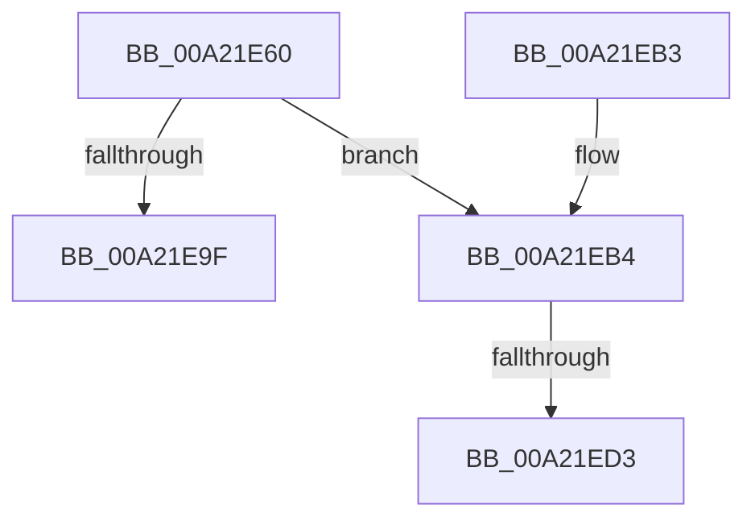

# NtCloseObjectAuditAlarm

- RVA: `0x00A21E60`–`0x00A21EDD` (길이 `125` bytes)
- VA: `0x0000000140A21E60`
- 실행 섹션: `PAGE`
- PDB 이름 있음: `예`; PDB Function 태그: `예`
- unwind 정보 RVA: `0x000AB29C`
- 디코드: `33`개 명령, `125/125` bytes 표시
- 미해석 바이트: `0` (있으면 어셈블리에 `.byte`로 보존)

> 이 문서는 커널 이미지의 기계어와 PDB 기호를 분석해 생성했습니다. 4번과 5번은 함수 원형과 자료형을 바이너리 사용 방식에서 추정한 C 해석이며 원본 소스 복구 결과는 아닙니다.

## 1. Dependencies

- 직접 호출 지점: **2**; 고유 호출 대상: **2**
- 직접 호출자로 확인된 함수: **0**
- RIP 상대 이미지 참조: **0**

### Outgoing calls
- `0x00A21EB9` → [SeCaptureSubjectContext](../86/SeCaptureSubjectContext_function_0086B820.md) (function, `0x0086B820`)
- `0x00A21EC6` → [SeCheckAuditPrivilege](../97/SeCheckAuditPrivilege_function_00974E48.md) (function, `0x00974E48`)

### Direct callers
- 이 함수 시작 RVA로 연결되는 직접 call은 확인되지 않았습니다. 간접 호출은 완전히 역산할 수 없습니다.

### Static image references
- 디코드된 RIP-relative 메모리 참조가 없습니다.

## 2. Other-region calls and transfers

- 다른 실행 섹션으로 향하는 call: **0**
- call이 아닌 외부 분기/꼬리 이동: **2**
  - `0x00A21ECD` → [sub_00B379EA](../B3/Unknown_function_00B379EA.md) (`tail-transfer`)
  - `0x00A21ED8` → [sub_00B379EA + 0x44](../B3/Unknown_function_00B379EA.md) (`tail-transfer`)

## 3. Assembly (complete function range)

```asm
00A21E60  48 8B C4                        mov rax, rsp
00A21E63  48 89 58 08                     mov qword ptr [rax + 8], rbx
00A21E67  48 89 70 18                     mov qword ptr [rax + 0x18], rsi
00A21E6B  48 89 50 10                     mov qword ptr [rax + 0x10], rdx
00A21E6F  57                              push rdi
00A21E70  48 83 EC 60                     sub rsp, 0x60
00A21E74  48 8B FA                        mov rdi, rdx
00A21E77  48 8B D9                        mov rbx, rcx
00A21E7A  0F 57 C0                        xorps xmm0, xmm0
00A21E7D  0F 11 40 D0                     movups xmmword ptr [rax - 0x30], xmm0
00A21E81  0F 11 40 E0                     movups xmmword ptr [rax - 0x20], xmm0
00A21E85  48 83 60 20 00                  and qword ptr [rax + 0x20], 0
00A21E8A  65 48 8B 04 25 88 01 00 00      mov rax, qword ptr gs:[0x188]
00A21E93  40 8A B0 32 02 00 00            mov sil, byte ptr [rax + 0x232]
00A21E9A  45 84 C0                        test r8b, r8b
00A21E9D  75 15                           jne 0x140a21eb4
00A21E9F  33 C0                           xor eax, eax
00A21EA1  4C 8D 5C 24 60                  lea r11, [rsp + 0x60]
00A21EA6  49 8B 5B 10                     mov rbx, qword ptr [r11 + 0x10]
00A21EAA  49 8B 73 20                     mov rsi, qword ptr [r11 + 0x20]
00A21EAE  49 8B E3                        mov rsp, r11
00A21EB1  5F                              pop rdi
00A21EB2  C3                              ret
00A21EB3  CC                              int3
00A21EB4  48 8D 4C 24 38                  lea rcx, [rsp + 0x38]
00A21EB9  E8 62 99 E4 FF                  call 0x14086b820
00A21EBE  40 8A D6                        mov dl, sil
00A21EC1  48 8D 4C 24 38                  lea rcx, [rsp + 0x38]
00A21EC6  E8 7D 2F F5 FF                  call 0x140974e48
00A21ECB  84 C0                           test al, al
00A21ECD  0F 85 17 5B 11 00               jne 0x140b379ea
00A21ED3  BB 61 00 00 C0                  mov ebx, 0xc0000061
00A21ED8  E9 51 5B 11 00                  jmp 0x140b37a2e
```

## 4. C-style interpretation (structured pseudocode)

```c
__int64 __fastcall NtCloseObjectAuditAlarm(__int64 a1, __int64 a2, unsigned __int8 a3)
{
    __int64 result;
    __int64 v_rsp;
    unsigned __int64 v_stack_m28;
    unsigned __int64 v_stack_m8;

    *(unsigned __int64 *)(v_rsp + 8) = v_rbx;
    *(unsigned __int64 *)(v_rsp + 24) = v_rsi;
    *(unsigned __int64 *)(v_rsp + 16) = a2;
    v_rsp = (v_rsp) - (96);
    *(unsigned __int64 *)(v_rsp - 48) = v_xmm0;
    *(unsigned __int64 *)(v_rsp - 32) = v_xmm0;
    if (a3 != 0) goto loc_00A21EB4;
    result = 0;
    return result;
loc_00A21EB4:
    result = SeCaptureSubjectContext(v_stack_m28, a2, a3, a4);
    result = SeCheckAuditPrivilege(v_stack_m28, (unsigned __int8)(*(unsigned __int64 *)(v_stack_m8 + 32)), a3, a4);
}
```

## 5. (Beta) C Style

```c
int64_t NtCloseObjectAuditAlarm(int64_t Arg1, int64_t Arg2, uint8_t Arg3)
{
    int64_t result;
    int64_t local_rsp;
    uint64_t v_stack_m28;
    uint64_t v_stack_m8;

    *(uint64_t *)(local_rsp + 0x8) = local_rbx;
    *(uint64_t *)(local_rsp + 0x18) = local_rsi;
    *(uint64_t *)(local_rsp + 0x10) = Arg2;
    local_rsp = (local_rsp) - (96);
    *(uint64_t *)(local_rsp - 0x30) = v_xmm0;
    *(uint64_t *)(local_rsp - 0x20) = v_xmm0;
    if (Arg3 != 0) goto loc_00A21EB4;
    result = 0;
    return result;
loc_00A21EB4:
    result = SeCaptureSubjectContext(v_stack_m28, Arg2, Arg3, a4);
    result = SeCheckAuditPrivilege(v_stack_m28, (uint8_t)(*(uint64_t *)(v_stack_m8 + 0x20)), Arg3, a4);
}
```

## 6. Execution-region graph

[열기: 2D/3D 그래프와 함수 탐색 컨트롤 패널](../../../control-panel.html?section=page&rva=0x00A21E60&view=graph)

- 2D 그래프는 위에서 아래로 흐르고, 3D 그래프는 빈 공간을 드래그해 회전합니다. Shift+드래그는 이동, 휠은 확대·축소, 함수 노드 선택은 대상 보고서 이동입니다.

### Static fallback


