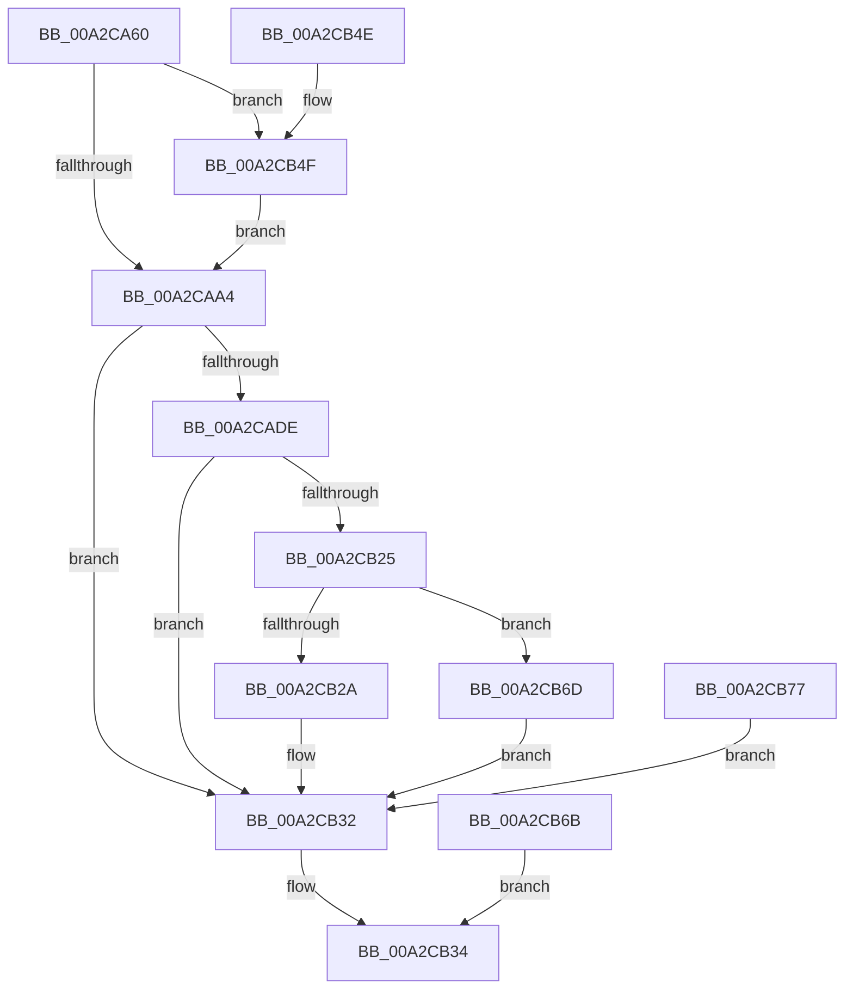

# NtCreateIoCompletion

- RVA: `0x00A2CA60`–`0x00A2CB7D` (길이 `285` bytes)
- VA: `0x0000000140A2CA60`
- 실행 섹션: `PAGE`
- PDB 이름 있음: `예`; PDB Function 태그: `아니요`
- unwind 정보 RVA: `0x000AC61C`
- 디코드: `72`개 명령, `285/285` bytes 표시
- 미해석 바이트: `0` (있으면 어셈블리에 `.byte`로 보존)

> 이 문서는 커널 이미지의 기계어와 PDB 기호를 분석해 생성했습니다. 4번과 5번은 함수 원형과 자료형을 바이너리 사용 방식에서 추정한 C 해석이며 원본 소스 복구 결과는 아닙니다.

## 1. Dependencies

- 직접 호출 지점: **3**; 고유 호출 대상: **3**
- 직접 호출자로 확인된 함수: **0**
- RIP 상대 이미지 참조: **1**

### Outgoing calls
- `0x00A2CAD3` → [ObCreateObjectEx](../89/ObCreateObjectEx_function_0089B1E0.md) (function, `0x0089B1E0`)
- `0x00A2CAE8` → [KeInitializeQueue](../../text/48/KeInitializeQueue_function_00480C90.md) (function, `0x00480C90`)
- `0x00A2CB16` → [ObInsertObjectEx](../8B/ObInsertObjectEx_function_008B97A0.md) (function, `0x008B97A0`)

### Direct callers
- 이 함수 시작 RVA로 연결되는 직접 call은 확인되지 않았습니다. 간접 호출은 완전히 역산할 수 없습니다.

### Static image references
- `0x00A2CAA4` → RVA `0x00FC6CC0` (`ALMOSTRO`; read)

## 2. Other-region calls and transfers

- 다른 실행 섹션으로 향하는 call: **1**
  - `0x00A2CAE8` → [KeInitializeQueue](../../text/48/KeInitializeQueue_function_00480C90.md) (`PAGE` → `.text`)
- 별도 외부 분기/꼬리 이동을 확인하지 못했습니다.

## 3. Assembly (complete function range)

```asm
00A2CA60  48 8B C4                        mov rax, rsp
00A2CA63  48 89 58 08                     mov qword ptr [rax + 8], rbx
00A2CA67  48 89 70 10                     mov qword ptr [rax + 0x10], rsi
00A2CA6B  48 89 78 18                     mov qword ptr [rax + 0x18], rdi
00A2CA6F  41 56                           push r14
00A2CA71  48 81 EC 80 00 00 00            sub rsp, 0x80
00A2CA78  41 8B D9                        mov ebx, r9d
00A2CA7B  44 8B F2                        mov r14d, edx
00A2CA7E  48 8B F9                        mov rdi, rcx
00A2CA81  48 83 60 D0 00                  and qword ptr [rax - 0x30], 0
00A2CA86  48 83 60 D8 00                  and qword ptr [rax - 0x28], 0
00A2CA8B  65 48 8B 04 25 88 01 00 00      mov rax, qword ptr gs:[0x188]
00A2CA94  40 8A B0 32 02 00 00            mov sil, byte ptr [rax + 0x232]
00A2CA9B  40 84 F6                        test sil, sil
00A2CA9E  0F 85 AB 00 00 00               jne 0x140a2cb4f
00A2CAA4  48 8B 15 15 A2 59 00            mov rdx, qword ptr [rip + 0x59a215]
00A2CAAB  48 83 64 24 48 00               and qword ptr [rsp + 0x48], 0
00A2CAB1  48 8D 44 24 60                  lea rax, [rsp + 0x60]
00A2CAB6  48 89 44 24 40                  mov qword ptr [rsp + 0x40], rax
00A2CABB  83 64 24 38 00                  and dword ptr [rsp + 0x38], 0
00A2CAC0  83 64 24 30 00                  and dword ptr [rsp + 0x30], 0
00A2CAC5  C7 44 24 28 50 00 00 00         mov dword ptr [rsp + 0x28], 0x50
00A2CACD  44 8A CE                        mov r9b, sil
00A2CAD0  40 8A CE                        mov cl, sil
00A2CAD3  E8 08 E7 E6 FF                  call 0x14089b1e0
00A2CAD8  8B C8                           mov ecx, eax
00A2CADA  85 C0                           test eax, eax
00A2CADC  78 54                           js 0x140a2cb32
00A2CADE  8B D3                           mov edx, ebx
00A2CAE0  48 8B 5C 24 60                  mov rbx, qword ptr [rsp + 0x60]
00A2CAE5  48 8B CB                        mov rcx, rbx
00A2CAE8  E8 A3 41 A5 FF                  call 0x140480c90
00A2CAED  48 83 63 40 00                  and qword ptr [rbx + 0x40], 0
00A2CAF2  C6 43 48 00                     mov byte ptr [rbx + 0x48], 0
00A2CAF6  48 8D 44 24 58                  lea rax, [rsp + 0x58]
00A2CAFB  48 89 44 24 30                  mov qword ptr [rsp + 0x30], rax
00A2CB00  48 83 64 24 28 00               and qword ptr [rsp + 0x28], 0
00A2CB06  83 64 24 20 00                  and dword ptr [rsp + 0x20], 0
00A2CB0B  45 33 C9                        xor r9d, r9d
00A2CB0E  45 8B C6                        mov r8d, r14d
00A2CB11  33 D2                           xor edx, edx
00A2CB13  48 8B CB                        mov rcx, rbx
00A2CB16  E8 85 CC E8 FF                  call 0x1408b97a0
00A2CB1B  8B C8                           mov ecx, eax
00A2CB1D  89 44 24 54                     mov dword ptr [rsp + 0x54], eax
00A2CB21  85 C0                           test eax, eax
00A2CB23  78 0D                           js 0x140a2cb32
00A2CB25  40 84 F6                        test sil, sil
00A2CB28  75 43                           jne 0x140a2cb6d
00A2CB2A  48 8B 44 24 58                  mov rax, qword ptr [rsp + 0x58]
00A2CB2F  48 89 07                        mov qword ptr [rdi], rax
00A2CB32  8B C1                           mov eax, ecx
00A2CB34  4C 8D 9C 24 80 00 00 00         lea r11, [rsp + 0x80]
00A2CB3C  49 8B 5B 10                     mov rbx, qword ptr [r11 + 0x10]
00A2CB40  49 8B 73 18                     mov rsi, qword ptr [r11 + 0x18]
00A2CB44  49 8B 7B 20                     mov rdi, qword ptr [r11 + 0x20]
00A2CB48  49 8B E3                        mov rsp, r11
00A2CB4B  41 5E                           pop r14
00A2CB4D  C3                              ret
00A2CB4E  CC                              int3
00A2CB4F  48 B9 00 00 FF FF FF 7F 00 00   movabs rcx, 0x7fffffff0000
00A2CB59  48 3B F9                        cmp rdi, rcx
00A2CB5C  48 0F 42 CF                     cmovb rcx, rdi
00A2CB60  48 8B 01                        mov rax, qword ptr [rcx]
00A2CB63  48 89 01                        mov qword ptr [rcx], rax
00A2CB66  E9 39 FF FF FF                  jmp 0x140a2caa4
00A2CB6B  EB C7                           jmp 0x140a2cb34
00A2CB6D  48 8B 44 24 58                  mov rax, qword ptr [rsp + 0x58]
00A2CB72  48 89 07                        mov qword ptr [rdi], rax
00A2CB75  EB BB                           jmp 0x140a2cb32
00A2CB77  8B 4C 24 54                     mov ecx, dword ptr [rsp + 0x54]
00A2CB7B  EB B5                           jmp 0x140a2cb32
```

## 4. C-style interpretation (structured pseudocode)

```c
__int64 __fastcall NtCreateIoCompletion(__int64 a1, int a2, __int64 a3, int a4)
{
    __int64 result;
    __int64 v_rsp;
    unsigned __int64 v_stack_m28;
    unsigned int v_stack_m2C;
    unsigned __int64 v_stack_m30;
    unsigned int v_stack_m34;
    unsigned __int64 v_stack_m40;
    unsigned __int64 v_stack_m48;
    unsigned int v_stack_m50;
    unsigned int v_stack_m58;
    unsigned int v_stack_m60;
    unsigned int v_stack_m68;
    unsigned __int64 v_stack_m8;

    *(unsigned __int64 *)(v_rsp + 8) = v_rbx;
    *(unsigned __int64 *)(v_rsp + 16) = v_rsi;
    *(unsigned __int64 *)(v_rsp + 24) = v_rdi;
    v_rsp = (v_rsp) - (128);
    if ((unsigned __int8)(*(unsigned __int8 *)(*(unsigned __int64 *)(gs_base + (0 + 392)) + 562)) != 0) goto loc_00A2CB4F;
loc_00A2CAA4:
    v_stack_m48 = v_stack_m28;
    v_stack_m60 = 80;
    result = ObCreateObjectEx((unsigned __int8)(*(unsigned __int8 *)(*(unsigned __int64 *)(gs_base + (0 + 392)) + 562)), *(unsigned __int64 *)(v_rip + 5874197), a3, (unsigned __int8)(*(unsigned __int8 *)(*(unsigned __int64 *)(gs_base + (0 + 392)) + 562)));
    if (sign_flag) goto loc_00A2CB32;
    result = KeInitializeQueue(v_stack_m28, (unsigned int)((unsigned int)((unsigned int)(a4))), a3, (unsigned __int8)(*(unsigned __int8 *)(*(unsigned __int64 *)(gs_base + (0 + 392)) + 562)));
    *(unsigned __int8 *)(v_stack_m28 + 72) = 0;
    v_stack_m58 = v_stack_m30;
    a4 = 0;
    a2 = 0;
    result = ObInsertObjectEx(v_stack_m28, a2, (unsigned int)((unsigned int)((unsigned int)(a2))), a4);
    v_stack_m34 = (unsigned int)(result);
    if (sign_flag) goto loc_00A2CB32;
    if ((unsigned __int8)(*(unsigned __int8 *)(*(unsigned __int64 *)(gs_base + (0 + 392)) + 562)) != 0) goto loc_00A2CB6D;
    *(unsigned __int64 *)(a1) = v_stack_m30;
loc_00A2CB32:
loc_00A2CB34:
    return (unsigned int)((unsigned int)((unsigned int)((unsigned int)(result))));
loc_00A2CB4F:
    a1 = (unsigned int)((unsigned int)(result));
    if ((*(unsigned __int64 *)(v_stack_m8 + 32)) < ((unsigned int)((unsigned int)(result)))) { a1 = *(unsigned __int64 *)(v_stack_m8 + 32); }
    *(unsigned __int64 *)(a1) = *(unsigned __int64 *)(a1);
    goto loc_00A2CAA4;
loc_00A2CB6D:
    *(unsigned __int64 *)(*(unsigned __int64 *)(v_stack_m8 + 32)) = v_stack_m28;
    goto loc_00A2CB32;
}
```

## 5. (Beta) C Style

```c
int64_t NtCreateIoCompletion(int64_t Arg1, int32_t Arg2, int64_t Arg3, int32_t Arg4)
{
    int64_t result;
    int64_t local_rsp;
    uint64_t v_stack_m28;
    uint32_t v_stack_m2C;
    uint64_t v_stack_m30;
    uint32_t v_stack_m34;
    uint64_t v_stack_m40;
    uint64_t v_stack_m48;
    uint32_t v_stack_m50;
    uint32_t v_stack_m58;
    uint32_t v_stack_m60;
    uint32_t v_stack_m68;
    uint64_t v_stack_m8;

    *(uint64_t *)(local_rsp + 0x8) = local_rbx;
    *(uint64_t *)(local_rsp + 0x10) = local_rsi;
    *(uint64_t *)(local_rsp + 0x18) = local_rdi;
    local_rsp = (local_rsp) - (128);
    if ((uint8_t)(*(uint8_t *)(*(uint64_t *)(gs_base + (0 + 0x188)) + 0x232)) != 0) goto loc_00A2CB4F;
loc_00A2CAA4:
    v_stack_m48 = v_stack_m28;
    v_stack_m60 = 80;
    result = ObCreateObjectEx((uint8_t)(*(uint8_t *)(*(uint64_t *)(gs_base + (0 + 0x188)) + 0x232)), *(uint64_t *)(v_rip + 0x59A215), Arg3, (uint8_t)(*(uint8_t *)(*(uint64_t *)(gs_base + (0 + 0x188)) + 0x232)));
    if (sign_flag) goto loc_00A2CB32;
    result = KeInitializeQueue(v_stack_m28, (uint32_t)((uint32_t)((uint32_t)(Arg4))), Arg3, (uint8_t)(*(uint8_t *)(*(uint64_t *)(gs_base + (0 + 0x188)) + 0x232)));
    *(uint8_t *)(v_stack_m28 + 0x48) = 0;
    v_stack_m58 = v_stack_m30;
    Arg4 = 0;
    Arg2 = 0;
    result = ObInsertObjectEx(v_stack_m28, Arg2, (uint32_t)((uint32_t)((uint32_t)(Arg2))), Arg4);
    v_stack_m34 = (uint32_t)(result);
    if (sign_flag) goto loc_00A2CB32;
    if ((uint8_t)(*(uint8_t *)(*(uint64_t *)(gs_base + (0 + 0x188)) + 0x232)) != 0) goto loc_00A2CB6D;
    *(uint64_t *)(Arg1) = v_stack_m30;
loc_00A2CB32:
loc_00A2CB34:
    return (uint32_t)((uint32_t)((uint32_t)((uint32_t)(result))));
loc_00A2CB4F:
    Arg1 = (uint32_t)((uint32_t)(result));
    if ((*(uint64_t *)(v_stack_m8 + 0x20)) < ((uint32_t)((uint32_t)(result)))) { Arg1 = *(uint64_t *)(v_stack_m8 + 0x20); }
    *(uint64_t *)(Arg1) = *(uint64_t *)(Arg1);
    goto loc_00A2CAA4;
loc_00A2CB6D:
    *(uint64_t *)(*(uint64_t *)(v_stack_m8 + 0x20)) = v_stack_m28;
    goto loc_00A2CB32;
}
```

## 6. Execution-region graph

[열기: 2D/3D 그래프와 함수 탐색 컨트롤 패널](../../../control-panel.html?section=page&rva=0x00A2CA60&view=graph)

- 2D 그래프는 위에서 아래로 흐르고, 3D 그래프는 빈 공간을 드래그해 회전합니다. Shift+드래그는 이동, 휠은 확대·축소, 함수 노드 선택은 대상 보고서 이동입니다.

### Static fallback


