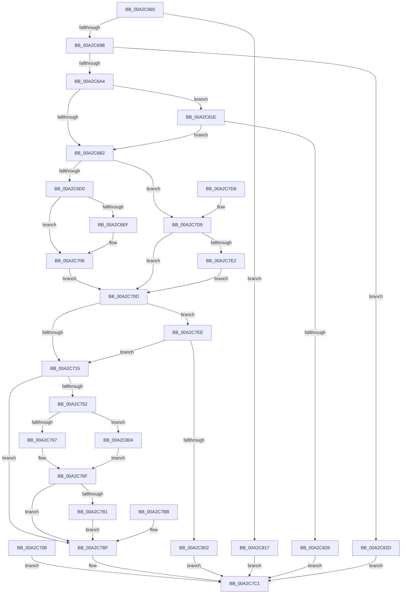

# NtCreateTimer2

- RVA: `0x00A2C660`–`0x00A2C834` (길이 `468` bytes)
- VA: `0x0000000140A2C660`
- 실행 섹션: `PAGE`
- PDB 이름 있음: `예`; PDB Function 태그: `아니요`
- unwind 정보 RVA: `0x000AC4A4`
- 디코드: `117`개 명령, `468/468` bytes 표시
- 미해석 바이트: `0` (있으면 어셈블리에 `.byte`로 보존)

> 이 문서는 커널 이미지의 기계어와 PDB 기호를 분석해 생성했습니다. 4번과 5번은 함수 원형과 자료형을 바이너리 사용 방식에서 추정한 C 해석이며 원본 소스 복구 결과는 아닙니다.

## 1. Dependencies

- 직접 호출 지점: **7**; 고유 호출 대상: **7**
- 직접 호출자로 확인된 함수: **1**
- RIP 상대 이미지 참조: **1**

### Outgoing calls
- `0x00A2C68E` → [ExpExTimerAttributesAreValid](../../text/3A/ExpExTimerAttributesAreValid_function_003A324C.md) (function, `0x003A324C`)
- `0x00A2C701` → [RtlCopyVolatileMemory](../../text/6B/RtlCopyVolatileMemory_function_006BC9D0.md) (function, `0x006BC9D0`)
- `0x00A2C747` → [ObCreateObjectEx](../89/ObCreateObjectEx_function_0089B1E0.md) (function, `0x0089B1E0`)
- `0x00A2C76A` → [KeInitializeTimer2](../../text/3A/KeInitializeTimer2_function_003A30B0.md) (function, `0x003A30B0`)
- `0x00A2C7A2` → [ObInsertObjectEx](../8B/ObInsertObjectEx_function_008B97A0.md) (function, `0x008B97A0`)
- `0x00A2C7F5` → [ExpCheckIRTimerAccess](ExpCheckIRTimerAccess_function_00A2C83C.md) (function, `0x00A2C83C`)
- `0x00A2C80D` → [KeInitializeIRTimer](../../text/3A/KeInitializeIRTimer_function_003A4204.md) (function, `0x003A4204`)

### Direct callers
- [NtCreateIRTimer](../7C/NtCreateIRTimer_function_007CAD90.md) at `0x007CADA2`

### Static image references
- `0x00A2C715` → RVA `0x00FC6F20` (`ALMOSTRO`; read)

## 2. Other-region calls and transfers

- 다른 실행 섹션으로 향하는 call: **4**
  - `0x00A2C68E` → [ExpExTimerAttributesAreValid](../../text/3A/ExpExTimerAttributesAreValid_function_003A324C.md) (`PAGE` → `.text`)
  - `0x00A2C701` → [RtlCopyVolatileMemory](../../text/6B/RtlCopyVolatileMemory_function_006BC9D0.md) (`PAGE` → `.text`)
  - `0x00A2C76A` → [KeInitializeTimer2](../../text/3A/KeInitializeTimer2_function_003A30B0.md) (`PAGE` → `.text`)
  - `0x00A2C80D` → [KeInitializeIRTimer](../../text/3A/KeInitializeIRTimer_function_003A4204.md) (`PAGE` → `.text`)
- 별도 외부 분기/꼬리 이동을 확인하지 못했습니다.

## 3. Assembly (complete function range)

```asm
00A2C660  48 8B C4                        mov rax, rsp
00A2C663  48 89 58 08                     mov qword ptr [rax + 8], rbx
00A2C667  48 89 70 10                     mov qword ptr [rax + 0x10], rsi
00A2C66B  48 89 78 18                     mov qword ptr [rax + 0x18], rdi
00A2C66F  41 56                           push r14
00A2C671  48 83 EC 70                     sub rsp, 0x70
00A2C675  41 8B F9                        mov edi, r9d
00A2C678  4D 8B D8                        mov r11, r8
00A2C67B  4C 8B D2                        mov r10, rdx
00A2C67E  4C 8B F1                        mov r14, rcx
00A2C681  48 83 60 E8 00                  and qword ptr [rax - 0x18], 0
00A2C686  48 83 60 E0 00                  and qword ptr [rax - 0x20], 0
00A2C68B  41 8B C9                        mov ecx, r9d
00A2C68E  E8 B9 6B 97 FF                  call 0x1403a324c
00A2C693  84 C0                           test al, al
00A2C695  0F 84 7C 01 00 00               je 0x140a2c817
00A2C69B  4D 85 DB                        test r11, r11
00A2C69E  0F 85 89 01 00 00               jne 0x140a2c82d
00A2C6A4  8B DF                           mov ebx, edi
00A2C6A6  83 E3 02                        and ebx, 2
00A2C6A9  4D 85 D2                        test r10, r10
00A2C6AC  0F 85 6C 01 00 00               jne 0x140a2c81e
00A2C6B2  83 64 24 50 00                  and dword ptr [rsp + 0x50], 0
00A2C6B7  65 48 8B 04 25 88 01 00 00      mov rax, qword ptr gs:[0x188]
00A2C6C0  40 8A B0 32 02 00 00            mov sil, byte ptr [rax + 0x232]
00A2C6C7  40 84 F6                        test sil, sil
00A2C6CA  0F 84 09 01 00 00               je 0x140a2c7d9
00A2C6D0  48 BA 00 00 FF FF FF 7F 00 00   movabs rdx, 0x7fffffff0000
00A2C6DA  48 8B CA                        mov rcx, rdx
00A2C6DD  4C 3B F2                        cmp r14, rdx
00A2C6E0  49 0F 42 CE                     cmovb rcx, r14
00A2C6E4  48 8B 01                        mov rax, qword ptr [rcx]
00A2C6E7  48 89 01                        mov qword ptr [rcx], rax
00A2C6EA  4D 85 D2                        test r10, r10
00A2C6ED  74 17                           je 0x140a2c706
00A2C6EF  4C 3B D2                        cmp r10, rdx
00A2C6F2  49 0F 42 D2                     cmovb rdx, r10
00A2C6F6  41 B8 04 00 00 00               mov r8d, 4
00A2C6FC  48 8D 4C 24 50                  lea rcx, [rsp + 0x50]
00A2C701  E8 CA 02 C9 FF                  call 0x1406bc9d0
00A2C706  EB 05                           jmp 0x140a2c70d
00A2C708  E9 B4 00 00 00                  jmp 0x140a2c7c1
00A2C70D  85 DB                           test ebx, ebx
00A2C70F  0F 85 D9 00 00 00               jne 0x140a2c7ee
00A2C715  48 8B 15 04 A8 59 00            mov rdx, qword ptr [rip + 0x59a804]
00A2C71C  48 83 64 24 48 00               and qword ptr [rsp + 0x48], 0
00A2C722  48 8D 44 24 58                  lea rax, [rsp + 0x58]
00A2C727  48 89 44 24 40                  mov qword ptr [rsp + 0x40], rax
00A2C72C  83 64 24 38 00                  and dword ptr [rsp + 0x38], 0
00A2C731  83 64 24 30 00                  and dword ptr [rsp + 0x30], 0
00A2C736  C7 44 24 28 A8 00 00 00         mov dword ptr [rsp + 0x28], 0xa8
00A2C73E  44 8A CE                        mov r9b, sil
00A2C741  45 33 C0                        xor r8d, r8d
00A2C744  40 8A CE                        mov cl, sil
00A2C747  E8 94 EA E6 FF                  call 0x14089b1e0
00A2C74C  8B C8                           mov ecx, eax
00A2C74E  85 C0                           test eax, eax
00A2C750  78 6D                           js 0x140a2c7bf
00A2C752  45 33 C0                        xor r8d, r8d
00A2C755  33 D2                           xor edx, edx
00A2C757  85 DB                           test ebx, ebx
00A2C759  48 8B 5C 24 58                  mov rbx, qword ptr [rsp + 0x58]
00A2C75E  48 8B CB                        mov rcx, rbx
00A2C761  0F 85 9D 00 00 00               jne 0x140a2c804
00A2C767  44 8B CF                        mov r9d, edi
00A2C76A  E8 41 69 97 FF                  call 0x1403a30b0
00A2C76F  48 83 A3 88 00 00 00 00         and qword ptr [rbx + 0x88], 0
00A2C777  89 BB A0 00 00 00               mov dword ptr [rbx + 0xa0], edi
00A2C77D  48 8D 44 24 60                  lea rax, [rsp + 0x60]
00A2C782  48 89 44 24 30                  mov qword ptr [rsp + 0x30], rax
00A2C787  48 83 64 24 28 00               and qword ptr [rsp + 0x28], 0
00A2C78D  83 64 24 20 00                  and dword ptr [rsp + 0x20], 0
00A2C792  45 33 C9                        xor r9d, r9d
00A2C795  44 8B 84 24 A0 00 00 00         mov r8d, dword ptr [rsp + 0xa0]
00A2C79D  33 D2                           xor edx, edx
00A2C79F  48 8B CB                        mov rcx, rbx
00A2C7A2  E8 F9 CF E8 FF                  call 0x1408b97a0
00A2C7A7  8B C8                           mov ecx, eax
00A2C7A9  89 44 24 58                     mov dword ptr [rsp + 0x58], eax
00A2C7AD  85 C0                           test eax, eax
00A2C7AF  78 0E                           js 0x140a2c7bf
00A2C7B1  48 8B 44 24 60                  mov rax, qword ptr [rsp + 0x60]
00A2C7B6  49 89 06                        mov qword ptr [r14], rax
00A2C7B9  EB 04                           jmp 0x140a2c7bf
00A2C7BB  8B 4C 24 58                     mov ecx, dword ptr [rsp + 0x58]
00A2C7BF  8B C1                           mov eax, ecx
00A2C7C1  4C 8D 5C 24 70                  lea r11, [rsp + 0x70]
00A2C7C6  49 8B 5B 10                     mov rbx, qword ptr [r11 + 0x10]
00A2C7CA  49 8B 73 18                     mov rsi, qword ptr [r11 + 0x18]
00A2C7CE  49 8B 7B 20                     mov rdi, qword ptr [r11 + 0x20]
00A2C7D2  49 8B E3                        mov rsp, r11
00A2C7D5  41 5E                           pop r14
00A2C7D7  C3                              ret
00A2C7D8  CC                              int3
00A2C7D9  4D 85 D2                        test r10, r10
00A2C7DC  0F 84 2B FF FF FF               je 0x140a2c70d
00A2C7E2  41 8B 02                        mov eax, dword ptr [r10]
00A2C7E5  89 44 24 50                     mov dword ptr [rsp + 0x50], eax
00A2C7E9  E9 1F FF FF FF                  jmp 0x140a2c70d
00A2C7EE  40 8A D6                        mov dl, sil
00A2C7F1  8B 4C 24 50                     mov ecx, dword ptr [rsp + 0x50]
00A2C7F5  E8 42 00 00 00                  call 0x140a2c83c
00A2C7FA  85 C0                           test eax, eax
00A2C7FC  0F 89 13 FF FF FF               jns 0x140a2c715
00A2C802  EB BD                           jmp 0x140a2c7c1
00A2C804  89 7C 24 20                     mov dword ptr [rsp + 0x20], edi
00A2C808  4C 8D 4C 24 50                  lea r9, [rsp + 0x50]
00A2C80D  E8 F2 79 97 FF                  call 0x1403a4204
00A2C812  E9 58 FF FF FF                  jmp 0x140a2c76f
00A2C817  B8 F2 00 00 C0                  mov eax, 0xc00000f2
00A2C81C  EB A3                           jmp 0x140a2c7c1
00A2C81E  85 DB                           test ebx, ebx
00A2C820  0F 85 8C FE FF FF               jne 0x140a2c6b2
00A2C826  B8 F0 00 00 C0                  mov eax, 0xc00000f0
00A2C82B  EB 94                           jmp 0x140a2c7c1
00A2C82D  B8 F1 00 00 C0                  mov eax, 0xc00000f1
00A2C832  EB 8D                           jmp 0x140a2c7c1
```

## 4. C-style interpretation (structured pseudocode)

```c
__int64 __fastcall NtCreateTimer2(__int64 a1, __int64 a2, __int64 a3, int a4, unsigned int a5)
{
    __int64 result;
    __int64 v_rbx;
    __int64 v_rsp;
    unsigned __int64 v_stack_m18;
    unsigned __int64 v_stack_m20;
    unsigned int v_stack_m28;
    unsigned __int64 v_stack_m30;
    unsigned __int64 v_stack_m38;
    unsigned int v_stack_m40;
    unsigned int v_stack_m48;
    unsigned int v_stack_m50;
    unsigned int v_stack_m58;
    unsigned __int64 v_stack_m8;

    *(unsigned __int64 *)(v_rsp + 8) = v_rbx;
    *(unsigned __int64 *)(v_rsp + 16) = v_rsi;
    *(unsigned __int64 *)(v_rsp + 24) = v_rdi;
    v_rsp = (v_rsp) - (112);
    result = ExpExTimerAttributesAreValid((unsigned int)(a4), a2, a3, a4);
    if ((unsigned __int8)(result) == 0) goto loc_00A2C817;
    if (a3 != 0) goto loc_00A2C82D;
    v_rbx = (unsigned int)(((unsigned int)((unsigned int)((unsigned int)(a4)))) & (2));
    if (a2 != 0) goto loc_00A2C81E;
loc_00A2C6B2:
    if ((unsigned __int8)(*(unsigned __int8 *)(*(unsigned __int64 *)(gs_base + (0 + 392)) + 562)) == 0) goto loc_00A2C7D9;
    if (a1 < a2) { a2 = a1; }
    *(unsigned __int64 *)(a2) = *(unsigned __int64 *)(a2);
    result = *(unsigned __int64 *)(a2);
    if (a2 != 0) {
        if (a2 < a2) { a2 = a2; }
        a3 = 4;
        a1 = v_stack_m28;
        result = RtlCopyVolatileMemory(a1, a2, a3, a4);
    }
    goto loc_00A2C70D;
loc_00A2C70D:
    if ((unsigned int)(v_rbx) != 0) goto loc_00A2C7EE;
loc_00A2C715:
    v_stack_m38 = v_stack_m20;
    v_stack_m50 = 168;
    a3 = 0;
    result = ObCreateObjectEx((unsigned __int8)(*(unsigned __int8 *)(*(unsigned __int64 *)(gs_base + (0 + 392)) + 562)), *(unsigned __int64 *)(v_rip + 5875716), a3, (unsigned __int8)(*(unsigned __int8 *)(*(unsigned __int64 *)(gs_base + (0 + 392)) + 562)));
    if (sign_flag) goto loc_00A2C7BF;
    a3 = 0;
    a2 = 0;
    if ((unsigned int)(v_rbx) != 0) goto loc_00A2C804;
    result = KeInitializeTimer2(v_stack_m20, a2, a3, (unsigned int)((unsigned int)((unsigned int)(a4))));
loc_00A2C76F:
    *(unsigned int *)(v_stack_m20 + 160) = (unsigned int)((unsigned int)(a4));
    v_stack_m48 = v_stack_m18;
    a4 = 0;
    a2 = 0;
    result = ObInsertObjectEx(v_stack_m20, a2, (unsigned int)(a5), a4);
    v_stack_m20 = (unsigned int)(result);
    if (sign_flag) goto loc_00A2C7BF;
    *(unsigned __int64 *)(a1) = v_stack_m18;
    goto loc_00A2C7BF;
loc_00A2C7BF:
loc_00A2C7C1:
    return (unsigned int)((unsigned int)((unsigned int)((unsigned int)(result))));
loc_00A2C7D9:
    if (0 == 0) goto loc_00A2C70D;
    v_stack_m20 = (unsigned int)((unsigned int)(*(unsigned int *)(a2)));
    goto loc_00A2C70D;
loc_00A2C7EE:
    result = ExpCheckIRTimerAccess((unsigned int)(v_stack_m20), (unsigned __int8)(*(unsigned __int64 *)(v_stack_m8 + 24)), (unsigned int)(a5), a4);
    if (!sign_flag) goto loc_00A2C715;
    goto loc_00A2C7C1;
loc_00A2C804:
    v_stack_m50 = (unsigned int)(*(unsigned __int64 *)(v_stack_m8 + 32));
    result = KeInitializeIRTimer((unsigned int)(v_stack_m20), (unsigned __int8)(*(unsigned __int64 *)(v_stack_m8 + 24)), (unsigned int)(a5), v_stack_m20);
    goto loc_00A2C76F;
loc_00A2C817:
    goto loc_00A2C7C1;
loc_00A2C81E:
    if ((unsigned int)(*(unsigned __int64 *)(v_stack_m8 + 16)) != 0) goto loc_00A2C6B2;
    goto loc_00A2C7C1;
loc_00A2C82D:
    goto loc_00A2C7C1;
}
```

## 5. (Beta) C Style

```c
int64_t NtCreateTimer2(int64_t Arg1, int64_t Arg2, int64_t Arg3, int32_t Arg4, uint32_t Arg5)
{
    int64_t result;
    int64_t local_rbx;
    int64_t local_rsp;
    uint64_t v_stack_m18;
    uint64_t v_stack_m20;
    uint32_t v_stack_m28;
    uint64_t v_stack_m30;
    uint64_t v_stack_m38;
    uint32_t v_stack_m40;
    uint32_t v_stack_m48;
    uint32_t v_stack_m50;
    uint32_t v_stack_m58;
    uint64_t v_stack_m8;

    *(uint64_t *)(local_rsp + 0x8) = local_rbx;
    *(uint64_t *)(local_rsp + 0x10) = local_rsi;
    *(uint64_t *)(local_rsp + 0x18) = local_rdi;
    local_rsp = (local_rsp) - (112);
    result = ExpExTimerAttributesAreValid((uint32_t)(Arg4), Arg2, Arg3, Arg4);
    if ((uint8_t)(result) == 0) goto loc_00A2C817;
    if (Arg3 != 0) goto loc_00A2C82D;
    local_rbx = (uint32_t)(((uint32_t)((uint32_t)((uint32_t)(Arg4)))) & (2));
    if (Arg2 != 0) goto loc_00A2C81E;
loc_00A2C6B2:
    if ((uint8_t)(*(uint8_t *)(*(uint64_t *)(gs_base + (0 + 0x188)) + 0x232)) == 0) goto loc_00A2C7D9;
    if (Arg1 < Arg2) { Arg2 = Arg1; }
    *(uint64_t *)(Arg2) = *(uint64_t *)(Arg2);
    result = *(uint64_t *)(Arg2);
    if (Arg2 != 0) {
        if (Arg2 < Arg2) { Arg2 = Arg2; }
        Arg3 = 4;
        Arg1 = v_stack_m28;
        result = RtlCopyVolatileMemory(Arg1, Arg2, Arg3, Arg4);
    }
    goto loc_00A2C70D;
loc_00A2C70D:
    if ((uint32_t)(local_rbx) != 0) goto loc_00A2C7EE;
loc_00A2C715:
    v_stack_m38 = v_stack_m20;
    v_stack_m50 = 168;
    Arg3 = 0;
    result = ObCreateObjectEx((uint8_t)(*(uint8_t *)(*(uint64_t *)(gs_base + (0 + 0x188)) + 0x232)), *(uint64_t *)(v_rip + 0x59A804), Arg3, (uint8_t)(*(uint8_t *)(*(uint64_t *)(gs_base + (0 + 0x188)) + 0x232)));
    if (sign_flag) goto loc_00A2C7BF;
    Arg3 = 0;
    Arg2 = 0;
    if ((uint32_t)(local_rbx) != 0) goto loc_00A2C804;
    result = KeInitializeTimer2(v_stack_m20, Arg2, Arg3, (uint32_t)((uint32_t)((uint32_t)(Arg4))));
loc_00A2C76F:
    *(uint32_t *)(v_stack_m20 + 0xA0) = (uint32_t)((uint32_t)(Arg4));
    v_stack_m48 = v_stack_m18;
    Arg4 = 0;
    Arg2 = 0;
    result = ObInsertObjectEx(v_stack_m20, Arg2, (uint32_t)(Arg5), Arg4);
    v_stack_m20 = (uint32_t)(result);
    if (sign_flag) goto loc_00A2C7BF;
    *(uint64_t *)(Arg1) = v_stack_m18;
    goto loc_00A2C7BF;
loc_00A2C7BF:
loc_00A2C7C1:
    return (uint32_t)((uint32_t)((uint32_t)((uint32_t)(result))));
loc_00A2C7D9:
    if (0 == 0) goto loc_00A2C70D;
    v_stack_m20 = (uint32_t)((uint32_t)(*(uint32_t *)(Arg2)));
    goto loc_00A2C70D;
loc_00A2C7EE:
    result = ExpCheckIRTimerAccess((uint32_t)(v_stack_m20), (uint8_t)(*(uint64_t *)(v_stack_m8 + 0x18)), (uint32_t)(Arg5), Arg4);
    if (!sign_flag) goto loc_00A2C715;
    goto loc_00A2C7C1;
loc_00A2C804:
    v_stack_m50 = (uint32_t)(*(uint64_t *)(v_stack_m8 + 0x20));
    result = KeInitializeIRTimer((uint32_t)(v_stack_m20), (uint8_t)(*(uint64_t *)(v_stack_m8 + 0x18)), (uint32_t)(Arg5), v_stack_m20);
    goto loc_00A2C76F;
loc_00A2C817:
    goto loc_00A2C7C1;
loc_00A2C81E:
    if ((uint32_t)(*(uint64_t *)(v_stack_m8 + 0x10)) != 0) goto loc_00A2C6B2;
    goto loc_00A2C7C1;
loc_00A2C82D:
    goto loc_00A2C7C1;
}
```

## 6. Execution-region graph

[열기: 2D/3D 그래프와 함수 탐색 컨트롤 패널](../../../control-panel.html?section=page&rva=0x00A2C660&view=graph)

- 2D 그래프는 위에서 아래로 흐르고, 3D 그래프는 빈 공간을 드래그해 회전합니다. Shift+드래그는 이동, 휠은 확대·축소, 함수 노드 선택은 대상 보고서 이동입니다.

### Static fallback


